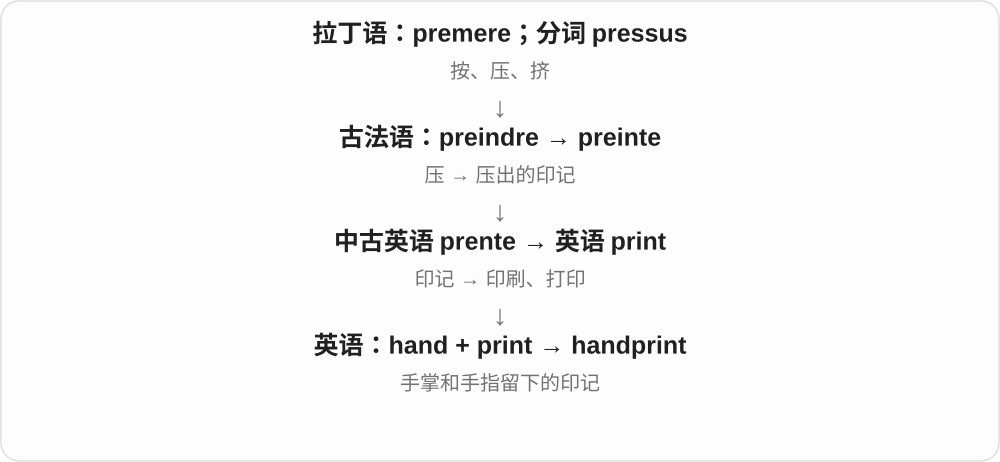

# 0279 · hand — 手；操作、递交；人手、书写方式

[逐词精讲目录](../00_逐词精讲目录.md) · [总目录](../00_总目录_按常用程度.md)

## 核心词根与来源

hand 接古英语 hand。handle、handy、handsome 各有早期形式，尤其 handsome 从易操用、合适等义发展出欣赏外观，不能编成手漂亮。handed 的过去形式与左右手等修饰组合在基础词里理解，冷门 hander 不单列。

**HAND：手拿、手做、手递，再借指做事的人和痕迹**

把手供手握，笔迹由手留下，farmhand 是农场里出力的人；每个组合先问 hand 在指哪一层。

- **基础词与技能评价**：hand · handle · handy · handsome · handful
- **制作与选择**：handcraft · handcrafted · handmade · handwork · handiwork · handpainted · handloom · handpicked
- **书写与痕迹**：handwriting · handwritten · shorthand · longhand · handprint
- **携物、交接和约束**：handbag · handset · handkerchief · handshake · handgun · handcuff · handcuffs
- **运动、制动与扶持**：handball · forehand · backhand · underhand · overhand · handstand · handbrake · handrail
- **来源、方式与时机**：firsthand · secondhand · freehand · beforehand · offhand · backhanded
- **人物和照料**：handmaid · farmhand · deckhand · handwashing
- **hand → hands：双手、指针与递交**：hand · hands
- **handle → handled：从用手处理到应对事务**：hand · handle · handled
- **handcuff → handcuffed：手腕铐具到受束缚**：hand · handcuff · handcuffed
- **handkerchief → handkerchiefs：手用小巾**：hand · kerchief · handkerchief · handkerchiefs
- **hand + saw → handsaw → handsaws：手锯**：hand · handsaw · handsaws
- **hand 的手持性质与电话部件组合**：hand · handheld · handhelds · handset · handsets
- **handbook：手边可查的说明手册**：hand · handbook · handbooks
- **hand 的工作人员义进入 stagehand**：stagehand · stagehands
- **hand 手 → handing：递交、移交**：handing

## 词形与演化规律

先 hand、handle、handy、handsome；制作 handcraft → handcrafted 与 handmade、handwork、handpainted、handloom、handpicked 相邻；书写 handwriting → handwritten、shorthand、longhand 一组。其他按携物、交接、运动、制动扶持、信息来源、时间方式、工作者和清洗展开。

hands 可为名词复数，也可是把东西递过去的动词形式，分别从句法与对象判断。

名词、动词古英语已有相关形式，现代过去式加 ed。

hand 加 cuff 的组合转为戴铐动作；现代加 -ed，尾读 t。

hand 加原有 kerchief 头巾，后者包含覆盖头部的法语旧材料；现代读音已连读缩变。

hand 说明手动用途，复数加在整个组合末尾。

held 是 hold 的分词；set 是设备组合名。两种后半分别看，不是相同词尾。

古英语 handboc 曾译拉丁 manualis；后来被 manual 等取代，近代又受德语 Handbuch 影响复兴。现代不是从拉丁 manus 直接借来 hand。

hand 在这里指提供实际劳动的人，不只是舞台上的一只手。

hand 承古英语手、控制等意思，更远来源不定；后来名词转动词有接管、递交义。现代加 -ing 原词不改，常与 over、out、in 连用。

## 单词速览（按词族由简到繁）

同一基础词的相关扩展放在一起，先读基础形式，再读扩展；各组之间优先读常用的。具体词源关系见各词讲解。

| 单词 | 音标 | 核心意思 |
|---|---|---|
| [hand](#w-1) | /hænd/ | 手；递给；帮助；人手；指针；笔迹 |
| [hands](#w-46) | /hændz/ | 手〔复数〕；指针；人手；递给、交出〔hand 的第三人称单数〕 |
| [handle](#w-2) | /ˈhændəl/ | 把手；操作、处理；应付；用户名〔非正式〕 |
| [handled](#w-47) | /ˈhændəld/ | 处理、应付了；拿过、触碰过〔过去式、过去分词〕 |
| [handsome](#w-4) | /ˈhænsəm/ | 英俊的；美观气派的；可观、丰厚的 |
| [handful](#w-5) | /ˈhændfʊl/ | 一把；少量；难以应付的人或事 |
| [handy](#w-6) | /ˈhændi/ | 方便实用的；手边的；手巧的 |
| [handing](#w-60) | 英、美 /ˈhændɪŋ/ | 递给；交出；移交〔分词、动名词〕 |
| [handmade](#w-7) | /ˈhændmeɪd/ | 手工制作的 |
| [handwriting](#w-9) | /ˈhændraɪtɪŋ/ | 手写；字迹、笔迹 |
| [handbag](#w-10) | /ˈhændbæɡ/ | 手提包；日常随身包 |
| [handshake](#w-11) | /ˈhændʃeɪk/ | 握手；通信握手过程 |
| [handgun](#w-12) | /ˈhændɡʌn/ | 手枪；手持短枪 |
| [handwritten](#w-13) | /ˈhændrɪtən/ | 手写的 |
| [handball](#w-18) | 英 /ˈhændbɔːl/；美 /ˈhændbɔːl/ | 手球；用手球类活动；足球手球犯规 |
| [handset](#w-19) | /ˈhændset/ | 电话听筒；手机；手持控制器 |
| [handsets](#w-54) | /ˈhændsets/ | 电话听筒、手持电话装置〔复数〕 |
| [handpicked](#w-24) | /ˈhændpɪkt/ | 手工采摘的；精挑细选的 |
| [handiwork](#w-25) | 英 /ˈhændiwɜːk/；美 /ˈhændiwɜːrk/ | 手工制品；某人的所作所为 |
| [handcuff](#w-28) | /ˈhændkʌf/ | 给……戴手铐；限制、束缚；单个铐环 |
| [handcuffs](#w-15) | /ˈhændkʌfs/ | 手铐〔通常复数〕 |
| [handcuffed](#w-48) | /ˈhændkʌft/ | 戴上手铐了、被铐住的；受束缚的 |
| [handbrake](#w-30) | /ˈhændbreɪk/ | 手刹；驻车制动操纵装置 |
| [handstand](#w-31) | /ˈhændstænd/ | 手倒立 |
| [handrail](#w-35) | /ˈhændreɪl/ | 扶手；楼梯、通道的扶手栏杆 |
| [handloom](#w-36) | /ˈhændluːm/ | 手织机 |
| [handmaid](#w-37) | /ˈhændmeɪd/ | 女仆〔历史用语〕；为某事服务的工具〔比喻〕 |
| [handwork](#w-41) | 英 /ˈhændwɜːk/；美 /ˈhændwɜːrk/ | 手工劳动；手工制作的部分 |
| [handprint](#w-39) | 英 /ˈhændprɪnt/；美 /ˈhændprɪnt/ | 手印；掌印 |
| [handwashing](#w-40) | /ˈhændwɒʃɪŋ/（英）；/ˈhændwɑːʃɪŋ/（美） | 洗手；手洗〔按搭配〕 |
| [handpainted](#w-42) | /ˈhændpeɪntɪd/ | 手绘的；手工上色的 |
| [handcraft](#w-44) | 英 /ˈhændkrɑːft/；美 /ˈhændkræft/ | 手工艺；手工制作 |
| [handcrafted](#w-21) | 英 /ˈhændkrɑːftɪd/；美 /ˈhændkræftɪd/ | 精心手工制作的 |
| [handsaw](#w-51) | 英 /ˈhændsɔː/；美 /ˈhændsɔː/，也读 /ˈhændsɑː/ | 手锯 |
| [handsaws](#w-52) | 英 /ˈhændsɔːz/；美 /ˈhændsɔːz/，也读 /ˈhændsɑːz/ | 手锯〔复数〕 |
| [beforehand](#w-8) | 英 /bɪˈfɔːhænd/；美 /bɪˈfɔːrhænd/ | 提前；事先 |
| [firsthand](#w-14) | 英 /ˌfɜːstˈhænd/；美 /ˌfɜːrstˈhænd/ | 亲身的；直接地 |
| [shorthand](#w-17) | 英 /ˈʃɔːthænd/；美 /ˈʃɔːrthænd/ | 速记；简略说法、代称 |
| [secondhand](#w-20) | 英 /ˌsekəndˈhænd/；美 /ˌsekəndˈhænd/，也有前重音 | 二手的；间接得来的；转述地 |
| [backhand](#w-23) | /ˈbækhænd/ | 反手击球；反手的 |
| [backhanded](#w-33) | /ˌbækˈhændɪd/ | 反手的；挖苦式的；表面夸赞而暗含贬意的 |
| [forehand](#w-26) | 英 /ˈfɔːhænd/；美 /ˈfɔːrhænd/ | 正手击球；正手的 |
| [offhand](#w-27) | 英 /ˌɒfˈhænd/；美 /ˌɔːfˈhænd/，也有前重音 | 未经准备地；随口的；敷衍冷淡的 |
| [freehand](#w-29) | /ˈfriːhænd/ | 徒手的；不用尺规或模板地 |
| [underhand](#w-32) | 英 /ˈʌndəhænd/；美 /ˈʌndərhænd/ | 下手式的；暗中、不光明正大的 |
| [overhand](#w-34) | 英 /ˈəʊvəhænd/；美 /ˈoʊvərhænd/ | 上手式的；从肩上方向前下方带出的 |
| [farmhand](#w-38) | 英 /ˈfɑːmhænd/；美 /ˈfɑːrmhænd/ | 农场工人 |
| [deckhand](#w-43) | /ˈdekhænd/ | 甲板水手；船上杂务工 |
| [longhand](#w-45) | 英 /ˈlɒŋhænd/；美 /ˈlɔːŋhænd/ | 普通手写；用完整字形书写 |
| [stagehand](#w-58) | /ˈsteɪdʒhænd/ | 舞台工作人员 |
| [stagehands](#w-59) | /ˈsteɪdʒhændz/ | 舞台工作人员〔复数〕 |
| [handbook](#w-56) | /ˈhændbʊk/ | 手册、便览 |
| [handbooks](#w-57) | /ˈhændbʊks/ | 手册、便览〔复数〕 |
| [handheld](#w-53) | /ˈhændheld/ | 手持的；手持设备 |
| [handhelds](#w-55) | /ˈhændheldz/ | 手持设备〔复数〕 |
| [kerchief](#w-50) | 英 /ˈkɜːtʃɪf/；美 /ˈkɜːrtʃɪf/ | 头巾；方巾 |
| [handkerchief](#w-16) | 英 /ˈhæŋkətʃɪf/；美 /ˈhæŋkərtʃɪf/；词尾也可读 /tʃiːf/ | 手帕 |
| [handkerchiefs](#w-49) | 英 /ˈhæŋkətʃɪfs/；美 /ˈhæŋkərtʃɪfs/，词尾也有长 /iː/ 读法 | 手帕〔复数〕 |

## 逐词讲解

### 1. hand — 手；递给；帮助；人手；指针；笔迹

**音标**：/hænd/

**先抓住这个画面**

手能拿、做、递，于是它也能代指帮忙、做事的人，甚至留下的笔迹。

**怎么拆**

名词接古英语 hand，经中古英语延续；动词 hand 有由名词发展及相关早期动词的历史。更远来源不完全确定，不硬拆成几个现代字母。

**怎么变成今天的意思**

**古英语 hand → 中古英语 hand / hond**  
手；与操作、工作者相关的用法

↓

**英语 hand**  
手；递交；帮助；人手；笔迹、指针等

hand me the bag 是把包递给我，give me a hand 是帮我一下，an extra hand 是多一名帮手；clock hands 是钟表指针，a neat hand 可说工整笔迹。动词过去式 handed /ˈhændɪd/；left-handed 等组合里的 -handed 则说明惯用哪只手。

**常见搭配与例句**

by hand；give a hand；hand something to；at hand；on the other hand。

> Could you give me a hand with this box?

你能帮我搬一下这个箱子吗？

> She handed me a handwritten note.

她递给我一张手写便条。

> The minute hand moved past twelve.

分针越过了十二点刻度。

**别混淆**

by hand 手工，in hand 已在手、掌握中，at hand 在近处或即将到来；介词改变关系，不能都翻成手里。

### 2. hands — 手〔复数〕；指针；人手；递给、交出〔hand 的第三人称单数〕

**音标**：/hændz/

**先抓住这个画面**

双手可以握住、递出东西；钟表伸出指向时间的部分也叫 hands；需要帮忙做事时，还会按手说人手。

**怎么拆**

hand + -s，/d/ 后读 /z/。hand 接古英语身体部位名，名词扩展为指针、劳动力，动词发展为用手递交；现代两种词性同写 hands。

**怎么变成今天的意思**

**古英语 hand → hand**  
手；后来也指指针、人手

↓

**hand 名词、动词 + -s → hands**  
多只手、指针；单数主语递交

wash your hands 洗手；the hands of a clock 时钟指针；extra hands 额外人手；hands me a cup 递给我一只杯子；in good hands 交给可靠的人照管。

**常见搭配与例句**

hands on the table；hands over the keys。

> She hands me a cup of tea every morning.

她每天早上递给我一杯茶。

> The hands of the clock pointed to twelve.

钟表的指针指向十二点。

**别混淆**

all hands 常按人手说全体人员；She hands me the keys 中 hands 是动词，表示递交。用主语、后面的宾语区分。

### 3. handle — 把手；操作、处理；应付；用户名〔非正式〕

**音标**：/ˈhændəl/

**先抓住这个画面**

手握住可使劲的那一处是把手；把事情接到自己手里去办，就是处理。

**怎么拆**

名词接古英语 handle，动词接 handlian“用手接触、处理”等；现代可对照 hand + -le，但不是今天才把手和小尾巴临时拼起来。

**怎么变成今天的意思**

**古英语 handle；handlian → 中古英语相应形式**  
握持部分；用手接触、处理

↓

**英语 handle**  
把手；处理事务；另有标识名等用法

a door handle 是门把手，handle a problem 是处理问题，handle pressure 是应付压力；an online handle 是网络昵称、标识名。

**常见搭配与例句**

a door handle；handle a request；handle pressure；an online handle。

> Turn the handle gently.

轻轻转动把手。

> She handles customer questions with patience.

她耐心处理顾客提问。

**别混淆**

handle 重接手处理，solve 重解决结果；处理过一个问题不保证已经解决。have a handle on 常说已掌握基本情况。

### 4. handled — 处理、应付了；拿过、触碰过〔过去式、过去分词〕

**音标**：/ˈhændəld/

**先抓住这个画面**

先是手拿着、摆弄一个东西，后来扩大成把一件事情接到自己手里去处理。handled 说这件事已经接过、做过了。

**怎么拆**

handle + -d，/l/ 后结尾读 /d/。handle 的把手名词、用手处理动词在古英语已有相应形式；不是现代才拼手和一个小尾巴。

**怎么变成今天的意思**

**古英语 handle、handlian 等 → handle**  
手可握的部位；用手接触、处理

↓

**handle 去 e + -ed → handled**  
物品被拿过；事务被处理、应对

handled with care 小心轻放；handled the situation 处理了局面；handled by the office 由办公室处理。

**常见搭配与例句**

well handled 处理得好；handled a difficult question 应对了一个难题。

> The complaint was handled quickly.

投诉很快得到了处理。

> The old book must be handled with care.

这本旧书必须小心翻拿。

**别混淆**

handled a problem 通常说应对过，不一定彻底解决。handled a fragile object 则可能真的在谈手如何拿物。

### 5. handsome — 英俊的；美观气派的；可观、丰厚的

**音标**：/ˈhænsəm/

**先抓住这个画面**

先是合手、好用，逐渐变成合适、出色，再发展为外观值得欣赏。

**怎么拆**

接中古英语 handsum、hondsom，可析 hand + -some。早期易于操作、合适等义后来发展为好看等赞许义；不是因为两只手漂亮才表示英俊。

**怎么变成今天的意思**

**中古英语 handsum / hondsom**  
易于操用、合适

↓

**后来的 handsome**  
出色、外观悦目；数额丰厚

a handsome man 是英俊男子，a handsome building 是气派建筑，a handsome profit 是可观利润。常见读音里 d 不单独清晰发出。

**常见搭配与例句**

a handsome man；a handsome building；a handsome profit。

> They restored a handsome stone house.

他们修复了一座气派的石屋。

> The sale brought a handsome profit.

这次出售带来了可观利润。

**别混淆**

handsome 不只形容男性脸，也可评价建筑和数额；handy 才强调好用、手巧，两词历史有关而现代侧重点已不同。

### 6. handful — 一把；少量；难以应付的人或事

**音标**：/ˈhændfʊl/

**先抓住这个画面**

手一握装不了多少；如果一个孩子把你两只手都忙满了，又会觉得够你应付。

**怎么拆**

hand + -ful，上接古英语 handfull；-ful 在此形成一手容量名词，后延伸少量与足够让人忙的对象。只有一个 l，不拼成 handfull。

**怎么变成今天的意思**

**古英语 handfull → 中古英语 handful → handful**  
手能拿住的量

↓

**handful 的延伸用法**  
少量；让人难应付的对象

a handful of rice 是一把米，a handful of people 是寥寥几人，The twins are a handful 是双胞胎很难带。量并不固定为五个。

**常见搭配与例句**

a handful of；only a handful；be a handful。

> Add a handful of fresh herbs.

加一把新鲜香草。

> Only a handful of visitors stayed until the end.

只有少数访客留到最后。

> The energetic puppy is a real handful.

那只精力旺盛的小狗真够人忙的。

**别混淆**

handful 一把或少数，full hand 分开只说手满了；a handful of people 不是说把人真抓在手里。

### 7. handy — 方便实用的；手边的；手巧的

**音标**：/ˈhændi/

**先抓住这个画面**

工具一伸手就拿得到、拿起来好用，人动手也很熟练。

**怎么拆**

现代可看 hand + -y；历史还有中古英语 hendi、handy 及更早熟练的相关词形影响，不把它当只表示手多。

**怎么变成今天的意思**

**古英语 hand → 中古英语 hand / hond**  
手；与操作、工作者相关的用法

↓

**早期 hendi / handy 等相关形式 → handy**  
熟练、便利、随手可用

come in handy 是派上用场，keep a pen handy 是把笔放在手边，be handy with tools 是善用工具。

**常见搭配与例句**

come in handy；keep handy；a handy guide；handy with tools。

> Keep a notebook handy during the interview.

采访时把笔记本放在手边。

> The extra bag came in handy on the journey home.

返程时，多带的袋子派上了用场。

**别混淆**

handy 方便、手巧，handmade 手工制成；机器做的工具也能非常 handy。

### 8. handing — 递给；交出；移交〔分词、动名词〕

**音标**：英、美 /ˈhændɪŋ/

**先抓住这个画面**

东西从自己的手里到别人手里，是 handing；权力、责任虽然拿不在手里，也可以用这个动作来形容移交。

**怎么拆**

hand + -ing → handing，原词不改。hand 承古英语 hond、hand 手，也有控制、持有的意思，更远来源不确定；英语后来把名词用作动词。

**怎么变成今天的意思**

**古英语 hand 手、持有 → 英语 hand 名词**  
以手的抓握表达持有、控制

↓

**hand 转动词接管、递交 → handing**  
现代递交义常与介词、副词组成短语

handing out leaflets 是分发传单；handing in work 是交作业；handing over responsibility 是移交责任。

**常见搭配与例句**

handing out；handing in；handing over。

> They were handing out maps at the entrance.

他们正在入口处分发地图。

> She is handing over the project to a colleague.

她正在把项目移交给一位同事。

**别混淆**

handing 后的小词会改变动作方向：out 是向大家分发，in 常是向负责接收的一方上交，over 常强调交给别人接手。

### 9. handmade — 手工制作的

**音标**：/ˈhændmeɪd/

**先抓住这个画面**

主要制作过程有人亲手做，不只是按一次启动键让流水线完成。

**怎么拆**

hand + made，made 是 make 的过去分词；以手工制造方式修饰物品。名称不要求全程连简单工具都不能使用。

**怎么变成今天的意思**

**英语 hand；made〔make 的过去分词〕**  
并列组合的两部分

↓

**hand + made〔make 的过去分词〕 → handmade**  
用手工方式制作的

handmade pottery 是手工陶器，handmade cards 是手制卡片。具体做了多少手工工序仍看商品、作品介绍。

**常见搭配与例句**

handmade pottery；handmade jewellery；a handmade card。

> She gave me a handmade birthday card.

她送我一张手工生日卡。

> The market sells handmade bowls and cups.

市集出售手工碗杯。

**别混淆**

handmade 说生产方式，homemade 说自家制作这一场景；家用机器做的面包可以 homemade。

### 10. handwriting — 手写；字迹、笔迹

**音标**：/ˈhændraɪtɪŋ/

**先抓住这个画面**

同样的字，每个人下笔速度、线条和形状不同，留下自己的字迹。

**怎么拆**

hand + writing，也与 handwrite + -ing 对应；writing 是 write 去 e 后加 -ing，w 在 write 的常见读音中不发。

**怎么变成今天的意思**

**英语 hand；writing〔write + -ing〕**  
并列组合的两部分

↓

**hand + writing〔write + -ing〕 → handwriting**  
手写活动；手写出的字迹

neat handwriting 是工整字迹，recognize someone’s handwriting 是认出笔迹；通常不可数，不用 handwritings 数几行字。

**常见搭配与例句**

neat handwriting；recognize handwriting；handwriting practice。

> I recognized her handwriting on the envelope.

我认出了信封上她的笔迹。

> His handwriting became clearer with practice.

练习后，他的字写得更清楚了。

**别混淆**

handwriting 是手写字迹或活动，handwritten 是手写的；a handwritten letter 包含可以辨认的 handwriting。

### 11. handbag — 手提包；日常随身包

**音标**：/ˈhændbæɡ/

**先抓住这个画面**

放钥匙、钱包等随身物件的小包，可以手提，也常有肩带。

**怎么拆**

hand + bag，按携带用途命名。日常并不要求一直用手握住，也不等于所有大型行李袋。

**怎么变成今天的意思**

**英语 hand；bag**  
并列组合的两部分

↓

**hand + bag → handbag**  
随身携带小物品的包

a leather handbag 是皮手提包，handbag strap 是包带。英式常用 handbag，美国也常说 purse，地区命名习惯不同。

**常见搭配与例句**

a leather handbag；a handbag strap；look in one’s handbag。

> She looked in her handbag for the keys.

她在手提包里找钥匙。

> The handbag has a removable shoulder strap.

手提包配有可拆肩带。

**别混淆**

handbag 随身小包，hand baggage 是手提行李这个更宽概念；登机箱也可算 hand baggage，不通常叫 handbag。

### 12. handshake — 握手；通信握手过程

**音标**：/ˈhændʃeɪk/

**先抓住这个画面**

两个人先握手确认接触；设备通信也先交换信号，确认能接上。

**怎么拆**

hand + shake，普通人际动作名；通信义借用互相确认的意象，不是设备有一只真的手。

**怎么变成今天的意思**

**英语 hand；shake**  
并列组合的两部分

↓

**hand + shake → handshake**  
握手 → 通信开始时的确认交换

a firm handshake 是有力握手，a handshake agreement 是非正式握手约定；a protocol handshake 是建立通信时的相应协商。

**常见搭配与例句**

a firm handshake；a handshake agreement；complete a handshake。

> They greeted each other with a handshake.

他们握手问候。

> The devices completed a handshake before exchanging data.

设备先完成握手，再交换数据。

**别混淆**

handshake 是互相确认的过程，handout 是发给人的材料；共同有 hand，不表示同一种传递。

### 13. handgun — 手枪；手持短枪

**音标**：/ˈhændɡʌn/

**先抓住这个画面**

比长枪小，设计上属于可手持操作的一类枪械。

**怎么拆**

hand + gun，按尺寸和手持使用方式形成类别名。不是所有拿在手上的枪都自动属于 handgun。

**怎么变成今天的意思**

**英语 hand；gun**  
并列组合的两部分

↓

**hand + gun → handgun**  
手持短枪一类武器

新闻、历史、物品分类里可见。pistol、revolver 都可属于 handgun，具体结构不是由 hand 这个前半决定。

**常见搭配与例句**

a handgun case；a handgun in a report；types of handguns。

> The museum displays several historical handguns.

博物馆展出几种历史手枪。

> The report distinguishes handguns from rifles.

报告区分了手枪与步枪。

**别混淆**

handgun 是上位类别，rifle 通常是步枪类长枪；不能只凭是否有人用双手握持来给实物分类。

### 14. handwritten — 手写的

**音标**：/ˈhændrɪtən/

**先抓住这个画面**

内容由人一笔笔写出来，而不是键盘排印的文字。

**怎么拆**

hand + written，written 是 write 的过去分词；注意 writing /ˈraɪtɪŋ/ 与 written /ˈrɪtən/ 元音不同。

**怎么变成今天的意思**

**英语 hand；written〔write 的过去分词〕**  
并列组合的两部分

↓

**hand + written〔write 的过去分词〕 → handwritten**  
由手写成的

a handwritten note 是手写便条，handwritten instructions 是手写说明；用数位笔书写也可能用此词，不限墨水纸张。

**常见搭配与例句**

a handwritten note；a handwritten letter；a handwritten label。

> She found a handwritten note inside the book.

她在书里发现了一张手写便条。

> The jar had a handwritten label.

罐子上贴着手写标签。

**别混淆**

handwritten 说明文字写法，handmade 可形容卡片制作；机器印刷卡片上可以再加 handwritten message。

### 15. handball — 手球；用手球类活动；足球手球犯规

**音标**：英 /ˈhændbɔːl/；美 /ˈhændbɔːl/

**先抓住这个画面**

一种运动以手传接球；足球里提到 handball，却往往是在说违反相关用手规则。

**怎么拆**

hand + ball，多种运动各自采用这一名称。不能把比赛名称与足球犯规合成同一套玩法。

**怎么变成今天的意思**

**英语 hand；ball**  
并列组合的两部分

↓

**hand + ball → handball**  
手参与的球类名称；足球中的手球判罚用语

play handball 是打手球，a handball court 是手球场；足球报道 an appeal for handball 是要求判手球。是否构成犯规仍按具体运动规则与情形。

**常见搭配与例句**

play handball；a handball team；an appeal for handball。

> She plays handball for the university team.

她在大学手球队打球。

> The referee rejected the appeal for handball.

裁判没有接受手球犯规的申诉。

**别混淆**

handball 不是所有球碰到手的中性叙述；比赛项目、地区玩法和足球判罚语境要分清。

### 16. handset — 电话听筒；手机；手持控制器

**音标**：/ˈhændset/

**先抓住这个画面**

通话设备里，有一部分拿到手中、靠近耳口使用。

**怎么拆**

hand（手）+ set（设备），电话用法常指包含听筒、话筒的手持部件；后来也用于手机等完整手持装置。

**怎么变成今天的意思**

**英语 hand；set〔设备〕**  
并列组合的两部分

↓

**hand + set〔设备〕 → handset**  
手持电话部件、手持设备

lift the handset 是拿起电话听筒，a mobile handset 是手机。具体是座机的一部分还是整部手机，看前后文。

**常见搭配与例句**

lift the handset；replace the handset；a mobile handset。

> She lifted the handset and dialled the number.

她拿起听筒，拨了号码。

> The shop sells handsets from several manufacturers.

商店出售几家厂商的手机。

**别混淆**

handset 手持，headset 头戴；电话会议里一个可能拿在手里，另一个可能戴在头上。

### 17. handsets — 电话听筒、手持电话装置〔复数〕

**音标**：/ˈhændsets/

**先抓住这个画面**

传统电话上拿起后能听、能说的那一部分，是 handset；后来也可指手机等手持通信装置。

**怎么拆**

hand + set 成套装置 → handset，整词加 -s，/t/ 后读 /s/。set 在这里是设备组合名。

**怎么变成今天的意思**

**hand + set → handset**  
拿在手中的电话部件、装置

↓

**用途扩展；handset + -s → handsets**  
多个听筒或手持通信装置

telephone handsets 电话听筒；mobile handsets 手机装置。

**常见搭配与例句**

replace the handsets 更换听筒、手机装置；cordless handsets 无绳电话听筒。

> The office replaced the damaged telephone handsets.

办公室换掉了损坏的电话听筒。

> The display included several early mobile handsets.

展台上有几部早期手机。

**别混淆**

handset 在旧电话场景可只是整台电话的一部分；在移动通信场景可说完整终端，按对象判断。

### 18. handpicked — 手工采摘的；精挑细选的

**音标**：/ˈhændpɪkt/

**先抓住这个画面**

果子一颗颗摘，人选也像一位位仔细挑，不是随便抓一批。

**怎么拆**

hand + picked，picked 是 pick + -ed，末尾读 /t/。采摘义偏字面，人员挑选义借用认真、亲自选择的意象。

**怎么变成今天的意思**

**英语 hand；picked〔pick + -ed〕**  
并列组合的两部分

↓

**hand + picked〔pick + -ed〕 → handpicked**  
用手采摘；亲自精挑细选

handpicked fruit 是手摘水果，a handpicked team 是精选团队；后者有时还强调某负责人亲自挑选。

**常见搭配与例句**

handpicked fruit；a handpicked team；handpicked experts。

> The tea is made from handpicked leaves.

这种茶用手采的茶叶制成。

> A handpicked team worked on the difficult project.

一支精挑细选的团队负责这个困难项目。

**别混淆**

handpicked 不保证人选客观最好，也可能暗示由内部关系、特定个人决定；读到新闻时看语气。

### 19. handiwork — 手工制品；某人的所作所为

**音标**：英 /ˈhændiwɜːk/；美 /ˈhændiwɜːrk/

**先抓住这个画面**

看见一件做出来的东西，就能认出是谁那双手留下的痕迹。

**怎么拆**

接古英语 handġeweorc“手做的工作”、中古英语 hondywerk 等形式；是 hand 与 work 的历史组合，不能只按现代 handy“方便的”来编来源。

**怎么变成今天的意思**

**古英语 hand + ġeweorc → handġeweorc**  
手做出的劳动、作品

↓

**中古英语 handiwerk → 英语 handiwork**  
手工成果；某人做的事

admire her handiwork 可说欣赏她的手工作品；This mess is your handiwork 可说这一团乱是你弄的，常带调侃或责备。

**常见搭配与例句**

admire someone’s handiwork；recognise someone’s handiwork；skilled handiwork。

> She stepped back to admire her handiwork.

她退后一步欣赏自己的作品。

> The broken lock was clearly the thieves’ handiwork.

门锁显然是窃贼弄坏的。

**别混淆**

handiwork 是做出的成果或痕迹；handwork 强调手工劳动，handy 则说便利或手巧，不能都换成同一个词。

### 20. handcuff — 给……戴手铐；限制、束缚；单个铐环

**音标**：/ˈhændkʌf/

**先抓住这个画面**

把手腕铐住，动作受限制；规章、资源也可比喻把行动能力绑住。

**怎么拆**

hand + cuff（环绕手腕的圈、袖口相关词），也有更早 handcops 等英语词形，但缺乏连续证据，不把现代词直接说成古词无缝变来。

**怎么变成今天的意思**

**英语 hand；cuff**  
并列组合的两部分

↓

**hand + cuff → handcuff**  
手腕铐具；戴上铐具 → 束缚

handcuff someone 是给人戴手铐，be handcuffed by rules 是受规则束缚。器物本身通常用复数 handcuffs。

**常见搭配与例句**

handcuff someone；be handcuffed by；a handcuff key。

> The report said the suspect had been handcuffed.

报道称嫌疑人已被戴上手铐。

> The team felt handcuffed by the outdated rules.

团队觉得被过时规则束缚住了。

**别混淆**

handcuff 常作动作，handcuffs 常作一副器具的名称；restrict 是限制更宽，不一定带人被铐住的强烈意象。

### 21. handcuffs — 手铐〔通常复数〕

**音标**：/ˈhændkʌfs/

**先抓住这个画面**

两个手腕各有铐环，通常把相连的一副作为复数名称使用。

**怎么拆**

hand + cuffs，与 handcuff 是同一器具和动作词的常见形式关系；不是两只手每只都要戴许多只铐。

**怎么变成今天的意思**

**英语 hand；cuffs**  
并列组合的两部分

↓

**hand + cuffs → handcuffs**  
用于约束双手腕的一副铐具

a pair of handcuffs 是一副手铐，in handcuffs 是戴着手铐。也可比喻限制条件，如 golden handcuffs 指令人不愿离开的利益约束。

**常见搭配与例句**

a pair of handcuffs；in handcuffs；golden handcuffs。

> A pair of old handcuffs was displayed in the case.

展柜里陈列着一副旧手铐。

> The character enters the courtroom in handcuffs.

角色戴着手铐走进法庭。

**别混淆**

handcuffs 腕部铐具，cufflinks 是袖扣；都与 cuff 的腕部衣物圈意象有关，现代物件完全不同。

### 22. handcuffed — 戴上手铐了、被铐住的；受束缚的

**音标**：/ˈhændkʌft/

**先抓住这个画面**

双手被铐具限制住，是 handcuffed。工作、决定被某种条件卡住，也可以借这个动作说受束缚。

**怎么拆**

hand + cuff 组成 handcuff 手铐，再转为给人戴铐；现代整词加 -ed，/f/ 后读 /t/。现代词与早期 handcops 等形式的联系不能当作无缺口的连续演化。

**怎么变成今天的意思**

**hand + cuff → handcuff**  
手 + 手腕圈具 → 手铐、戴铐动作

↓

**handcuff + -ed → handcuffed**  
已戴上铐；比喻受到限制

handcuffed together 被铐在一起；handcuffed by restrictions 被限制束缚。

**常见搭配与例句**

was handcuffed 被戴上手铐；feel handcuffed 觉得施展不开。

> In the novel, the prisoner was handcuffed to a guard.

小说里，囚犯和一名看守被手铐铐在一起。

> The team felt handcuffed by the outdated system.

团队觉得被那套过时系统束住了手脚。

**别混淆**

handcuffed 的引申义强调行动余地被限制，不一定是在说真实拘捕。

### 23. handbrake — 手刹；驻车制动操纵装置

**音标**：/ˈhændbreɪk/

**先抓住这个画面**

传统上用手拉起制动装置，让停住的车辆保持不动。

**怎么拆**

hand + brake（制动器），按手动操纵方式命名；现代名称也会随车辆用法沿用，不保证都有同一种机械拉杆。

**怎么变成今天的意思**

**英语 hand；brake**  
并列组合的两部分

↓

**hand + brake → handbrake**  
手动操纵的驻车制动装置

英式汽车语境常见，美国常说 parking brake。还可比喻阻碍推进，如 act as a handbrake on progress。

**常见搭配与例句**

the handbrake lever；a handbrake warning light；a handbrake on progress。

> The mechanic inspected the handbrake.

技师检查了手刹。

> The old system acted as a handbrake on progress.

旧系统成了进展的阻力。

**别混淆**

handbrake 是制动，handbreak 不是这个词的标准拼法；break 打破与 brake 刹车常同音，不能混字。

### 24. handstand — 手倒立

**音标**：/ˈhændstænd/

**先抓住这个画面**

正常用脚支撑身体，这次反过来，由双手撑地让身体倒立。

**怎么拆**

hand（手）+ stand（站立、支撑姿势），按支撑部位命名，不是手放在站台上。

**怎么变成今天的意思**

**英语 hand；stand**  
并列组合的两部分

↓

**hand + stand → handstand**  
用手支撑身体的倒立姿势

do a handstand 是做手倒立，hold a handstand 是保持姿势。体操比赛、舞蹈、动作照片的叙述里都可见；也能作动词说做手倒立。

**常见搭配与例句**

do a handstand；hold a handstand；a handstand position。

> The gymnast held a handstand for several seconds.

体操运动员保持手倒立几秒钟。

> The photograph captures her in a handstand.

照片拍下了她手倒立的瞬间。

**别混淆**

handstand 靠手支撑，headstand 常称头倒立；两者不能因为身体都倒过来就当同一个姿势。

### 25. handrail — 扶手；楼梯、通道的扶手栏杆

**音标**：/ˈhændreɪl/

**先抓住这个画面**

旁边有条可扶住的轨形结构，手放上去可以帮助支撑。

**怎么拆**

hand + rail（栏杆），按手的抓扶用途命名；rail 不是只指火车轨道。

**怎么变成今天的意思**

**英语 hand；rail**  
并列组合的两部分

↓

**hand + rail → handrail**  
供手抓扶的栏杆

a stair handrail 是楼梯扶手，an escalator handrail 是扶梯扶手带。保护栏杆整体与供握持的部分可能不完全是同一个构件。

**常见搭配与例句**

a stair handrail；hold the handrail；a wooden handrail。

> A wooden handrail runs beside the stairs.

楼梯旁有一道木扶手。

> She rested her hand on the handrail.

她把手搭在扶手上。

**别混淆**

handrail 供扶持，handbrake 供制动，handle 是握持操作点更泛；都用手但功能不一样。

### 26. handloom — 手织机

**音标**：/ˈhændluːm/

**先抓住这个画面**

机器有框架和织造结构，但驱动、操作主要由人手完成。

**怎么拆**

hand + loom（织机），按手工操作方式命名。loom 不是“模糊逼近”的动词义。

**怎么变成今天的意思**

**英语 hand；loom〔织机〕**  
并列组合的两部分

↓

**hand + loom〔织机〕 → handloom**  
由人手操作的织机

woven on a handloom 是手织机织成，handloom weaving 是手工织造。常见于传统纺织、工艺展示。

**常见搭配与例句**

a wooden handloom；handloom weaving；woven on a handloom。

> The museum demonstrates weaving on a handloom.

博物馆演示用手织机织布。

> She learned handloom weaving from her grandmother.

她跟祖母学会了手织技艺。

**别混淆**

handloom 是工具，handwoven 是手工织成的性质；使用手织机不代表完全没有任何机械部件。

### 27. handmaid — 女仆〔历史用语〕；为某事服务的工具〔比喻〕

**音标**：/ˈhændmeɪd/

**先抓住这个画面**

旧时在主人身边随时听使唤的人，后来也比喻从属于另一件事的角色。

**怎么拆**

接中古英语 handemayde 等，可析 hand + maid，hand 在手边、随时可用的旧表达中理解；不是用手做出的女孩。

**怎么变成今天的意思**

**古英语 hand → 中古英语 hand / hond**  
手；与操作、工作者相关的用法

↓

**中古英语 handemayde 等 → handmaid**  
随侍的女仆

↓

**handmaid 的比喻用法**  
服务、从属于另一目标的东西

历史小说、宗教文献和相关作品标题可见，也有 handmaiden 形式。the handmaid of ... 比喻为……服务的工具、附属。

**常见搭配与例句**

a household handmaid；the handmaid of；a handmaid in a historical tale。

> The story is told by a young handmaid in the household.

故事由宅中的年轻女仆讲述。

> The essay argues that technique should be the handmaid of imagination.

文章认为技巧应当为想象力服务。

**别混淆**

handmaid 与 handmade /ˈhændmeɪd/ 常同音：前者女仆，后者手工制成；看 maid 人物与 made 制作结果。

### 28. handwork — 手工劳动；手工制作的部分

**音标**：英 /ˈhændwɜːk/；美 /ˈhændwɜːrk/

**先抓住这个画面**

衣服、物件有的部分需要人亲手慢慢做，把这份工作称为 handwork。

**怎么拆**

hand + work，上接古英语 handweorc、中古英语 hondwerk；与 handiwork 的历史相关，现代使用场景各有习惯。

**怎么变成今天的意思**

**古英语 hand → 中古英语 hand / hond**  
手；与操作、工作者相关的用法

↓

**古英语 handweorc → 中古英语 hondwerk → handwork**  
用手完成的工作

fine handwork 是精细手工，the handwork on a dress 是裙子上的手工部分。纺织、工艺制作叙述常见。

**常见搭配与例句**

fine handwork；delicate handwork；hours of handwork。

> The dress contains hours of delicate handwork.

裙子上有耗时许久的精细手工。

> She admired the handwork on the embroidered cushion.

她赞赏绣花靠垫上的手工。

**别混淆**

handwork 侧重手工劳动、工序，handiwork 常说某人做出的成品、成果；不是所有情况下都需严格分开。

### 29. handprint — 手印；掌印

**音标**：英 /ˈhændprɪnt/；美 /ˈhændprɪnt/

**先抓住这个画面**

整只手按在一个表面上，留下手掌和手指的大致形状。

**怎么拆**

hand 手 + print 印痕。

**怎么变成今天的意思**

常见于儿童画、湿水泥或泥土中的手形印记；不一定清楚到能够辨识细微指纹。

**常见搭配与例句**

a muddy handprint；leave a handprint。

> The children left painted handprints on the paper.

孩子们在纸上留下了彩色手印。

> There was a muddy handprint beside the door.

门旁有一个带泥的手印。

**别混淆**

handprint 强调整只手的印记；fingerprint 强调手指的纹路。

### 30. handwashing — 洗手；手洗〔按搭配〕

**音标**：/ˈhændwɒʃɪŋ/（英）；/ˈhændwɑːʃɪŋ/（美）

**先抓住这个画面**

可以是在洗自己的双手，也可以在衣物说明里说不用洗衣机的手洗。

**怎么拆**

hand + washing，washing 是 wash + -ing；名词复合中，前半可能是被洗对象，也可能说明洗的方式，要看上下文。

**怎么变成今天的意思**

**英语 hand；washing**  
并列组合的两部分

↓

**hand + washing → handwashing**  
洗手；也用于手洗方式

handwashing facilities 常是洗手设施，handwashing a delicate item 可说手洗精细衣物。分写 hand washing 也常见。

**常见搭配与例句**

handwashing facilities；a handwashing station；handwashing instructions。

> The campsite has basic handwashing facilities.

营地设有基本洗手设施。

> The label gives instructions for handwashing the scarf.

标签上有手洗围巾的说明。

**别混淆**

handwashing facilities 的 hand 通常是对象，不是设施由手工做成；handmade 则说制造方式。

### 31. handpainted — 手绘的；手工上色的

**音标**：/ˈhændpeɪntɪd/

**先抓住这个画面**

颜色、图案是人拿笔画上去，不是整片机器印出的同一图样。

**怎么拆**

hand + painted，painted 是 paint + -ed；-ed 在 /t/ 后读 /ɪd/。也常有带连字符写法，本页保留连写形式。

**怎么变成今天的意思**

**英语 hand；painted〔paint + -ed〕**  
并列组合的两部分

↓

**hand + painted〔paint + -ed〕 → handpainted**  
人手描绘、上色的

handpainted tiles 是手绘瓷砖，handpainted signs 是手绘招牌；不要求物件本体所有制作工序也全手工。

**常见搭配与例句**

handpainted tiles；a handpainted sign；handpainted decorations。

> The café has a handpainted sign above the door.

咖啡馆门上方有块手绘招牌。

> Each cup is decorated with a handpainted flower.

每个杯子都饰有一朵手绘花。

**别混淆**

handpainted 说绘画、上色方式，handmade 说制作方式；机器做的杯子可以再加手绘图案。

### 32. handcraft — 手工艺；手工制作

**音标**：英 /ˈhændkrɑːft/；美 /ˈhændkræft/

**先抓住这个画面**

用双手和技巧把材料变成有用或好看的东西。

**怎么拆**

hand + craft，接古英语 handcræft、中古英语 handcrafte 等；craft 是技艺，不是飞机、船等另一义。

**怎么变成今天的意思**

**古英语 hand → 中古英语 hand / hond**  
手；与操作、工作者相关的用法

↓

**古英语 handcræft → 中古英语 handcrafte → handcraft**  
手工技艺；手工制作

traditional handcraft 是传统手工艺，也可作动词 handcraft a table。handicraft 是相近的常见形式，按具体词条理解。

**常见搭配与例句**

traditional handcraft；a handcraft workshop；handcraft furniture。

> The workshop teaches traditional handcraft.

工作坊教授传统手工艺。

> Local artists handcraft the wooden toys.

当地艺人手工制作这些木玩具。

**别混淆**

handcraft 是技艺或动作，handcrafted 是手工制成的；craftsperson 是从事技艺的人，不是同一词性。

### 33. handcrafted — 精心手工制作的

**音标**：英 /ˈhændkrɑːftɪd/；美 /ˈhændkræftɪd/

**先抓住这个画面**

制作时能看见手艺人的加工、修整与细节，而不是只强调出厂数量。

**怎么拆**

hand + crafted，也可对应 handcraft 的过去分词；crafted 是 craft + -ed，末尾 /t/ 后 -ed 读 /ɪd/。

**怎么变成今天的意思**

**英语 hand；crafted〔craft + -ed〕**  
并列组合的两部分

↓

**hand + crafted〔craft + -ed〕 → handcrafted**  
由手工技艺制作的

handcrafted furniture 是手工家具，handcrafted leather goods 是手工皮具。常有强调技艺的语气，但价格、品质仍看实物。

**常见搭配与例句**

handcrafted furniture；handcrafted jewellery；a handcrafted gift。

> The shop displays handcrafted wooden furniture.

店里陈列着手工木家具。

> She chose a handcrafted leather wallet as a gift.

她选了一个手工皮钱包作礼物。

**别混淆**

handmade 更直接说明手工制作，handcrafted 常突出工艺、手艺；两者重叠很大，不是正式质量等级。

### 34. handsaw — 手锯

**音标**：英 /ˈhændsɔː/；美 /ˈhændsɔː/，也读 /ˈhændsɑː/

**先抓住这个画面**

手拿着锯柄，来回移动带齿刀片切木料，就是 handsaw。hand 把手动使用方式说清。

**怎么拆**

hand + saw 的英语组合；hand 继承手部旧词，工具 saw 继承古英语 sagu。整个词按使用方式命名。

**怎么变成今天的意思**

**hand + saw → handsaw**  
手动使用的锯

↓

**固定工具名称**  
用手操控、来回锯切的器具

a sharp handsaw 锋利手锯；cut with a handsaw 用手锯切。

**常见搭配与例句**

a handsaw with a wooden handle 木柄手锯；hang up the handsaw 挂好手锯。

> He cut the branch with a handsaw.

他用手锯切树枝。

> The handsaw hung beside the hammer.

手锯挂在锤子旁。

**别混淆**

手锯的 saw 取锯子名。它告诉你大致的手动器具类型，具体齿形、尺寸还要看实物。

### 35. handsaws — 手锯〔复数〕

**音标**：英 /ˈhændsɔːz/；美 /ˈhændsɔːz/，也读 /ˈhændsɑːz/

**先抓住这个画面**

多把手拿着来回锯切的工具，是 handsaws。手动用途保持不变，复数只数整把器具。

**怎么拆**

hand + saw → handsaw，现代整词加 -s；元音后复数读 /z/，w 不另发辅音。

**怎么变成今天的意思**

**hand + saw → handsaw**  
手动锯的组合名

↓

**handsaw + -s → handsaws**  
多把手锯

sharp handsaws 锋利手锯；old handsaws 旧手锯。

**常见搭配与例句**

handsaws on the wall 墙上的手锯；a collection of handsaws 一组收藏手锯。

> Old handsaws hung on the workshop wall.

车间墙上挂着旧手锯。

> The collection includes handsaws of different sizes.

藏品包括不同大小的手锯。

**别混淆**

前面的 hand 说明用途、操控方式，通常保持单数。复数落在最后 saw 上。

### 36. beforehand — 提前；事先

**音标**：英 /bɪˈfɔːhænd/；美 /bɪˈfɔːrhænd/

**先抓住这个画面**

事情还没开始，需要的准备、通知已经先做完。

**怎么拆**

接中古英语 biforhand 等，可析 before + hand，并受到古法语 avant main 等相应表达影响。现代整词固定为提前，不是位置在手掌前方。

**怎么变成今天的意思**

**古英语 hand → 中古英语 hand / hond**  
手；与操作、工作者相关的用法

↓

**中古英语 biforhand 等 → beforehand**  
在事情之前；预先

book beforehand 是提前预订，let me know beforehand 是事先通知我。常作副词单用，不直接像 before 那样接事件名词。

**常见搭配与例句**

plan beforehand；book beforehand；know beforehand。

> Please let us know beforehand if you cannot attend.

如果不能出席，请提前告知。

> We checked the route beforehand.

我们事先核查了路线。

**别混淆**

before the meeting 接具体参照事件，beforehand 本身通常不再直接接 the meeting；时间参照由上下文给出。

### 37. firsthand — 亲身的；直接地

**音标**：英 /ˌfɜːstˈhænd/；美 /ˌfɜːrstˈhænd/

**先抓住这个画面**

消息没有经过一层层转述，是自己亲眼看、亲手做、亲自经历的。

**怎么拆**

first + hand，hand 借来表示接触、经手。连写形式可作形容词或副词；还常见带连字符的拼写。

**怎么变成今天的意思**

**英语 first；hand**  
组合使用的两个材料

↓

**first + hand → firsthand**  
直接接触、亲身经历的

firsthand experience 是亲身经验，see firsthand 是亲眼见到。直接经历可减少转述环节，但不保证观察者绝无偏差。

**常见搭配与例句**

firsthand experience；firsthand knowledge；see firsthand。

> She has firsthand experience of running a small business.

她有亲自经营小企业的经验。

> We saw firsthand how the new system worked.

我们亲眼看到了新系统如何运作。

**别混淆**

firsthand 与 secondhand 亲历、转述相对；不是说第一只手与第二只手。

### 38. shorthand — 速记；简略说法、代称

**音标**：英 /ˈʃɔːthænd/；美 /ˈʃɔːrthænd/

**先抓住这个画面**

用较少符号追上讲话速度；也可以拿一个短说法代表一大串意思。

**怎么拆**

short + hand，hand 选笔迹、书写方式义，不是手短。由压缩书写方式延伸为简要代称。

**怎么变成今天的意思**

**英语 short；hand〔书写方式〕**  
并列组合的两部分

↓

**short + hand〔书写方式〕 → shorthand**  
简缩书写 → 简略代称

take notes in shorthand 是用速记记录，shorthand for ... 是……的简略代称。某个标签只是 shorthand，不一定包办全部细节。

**常见搭配与例句**

in shorthand；take shorthand；shorthand for。

> She took the interview notes in shorthand.

她用速记记录采访。

> The phrase became shorthand for a much larger debate.

这个说法成了一场更广泛争论的简略代称。

**别混淆**

shorthand 速记，short-handed 人手不足，是不同组合；longhand 是普通完整手写，不是手比较长。

### 39. secondhand — 二手的；间接得来的；转述地

**音标**：英 /ˌsekəndˈhænd/；美 /ˌsekəndˈhænd/，也有前重音

**先抓住这个画面**

物件先经别人使用再到你这里；消息也可以先经别人转述再到你耳里。

**怎么拆**

second + hand，hand 借指持有、来源环节。不是 second hand“两词”中钟表秒针这一用法。

**怎么变成今天的意思**

**英语 second；hand〔持有或来源〕**  
并列组合的两部分

↓

**second + hand〔持有或来源〕 → secondhand**  
经前一使用者、信息来源转手而来

secondhand books 是二手书，secondhand information 是间接消息，hear secondhand 是听别人转述。也有 second-hand 拼写形式。

**常见搭配与例句**

secondhand books；a secondhand shop；secondhand information。

> She bought a secondhand bicycle.

她买了一辆二手自行车。

> I heard about the decision secondhand.

我从别人转述中听说了这个决定。

**别混淆**

secondhand 二手、间接，firsthand 亲历、直接；second hand 分开在钟表里又可能是秒针，需按结构区分。

### 40. backhand — 反手击球；反手的

**音标**：/ˈbækhænd/

**先抓住这个画面**

相较正手，用另一侧姿势挥拍，让手背方向成为辨认动作的线索。

**怎么拆**

back（背面）+ hand（手），用于球拍运动等的反手动作；并非左撇子的所有动作都叫 backhand。

**怎么变成今天的意思**

**英语 back；hand**  
组合时并列的两个材料

↓

**back + hand → backhand**  
特定反手击打动作

a powerful backhand 是有力的反手球；hit a backhand 是完成一次反手击球。具体技术随网球、羽毛球等运动不同。

**常见搭配与例句**

a backhand shot；a two-handed backhand；hit a backhand。

> Her backhand is stronger than her forehand.

她的反手比正手强。

> He returned the ball with a backhand.

他用反手把球击回。

**别混淆**

backhand 与 forehand 区分击球方式，不直接等于左手与右手。双手反手也仍是 backhand。

### 41. backhanded — 反手的；挖苦式的；表面夸赞而暗含贬意的

**音标**：/ˌbækˈhændɪd/

**先抓住这个画面**

话从正面听像夸人，翻到背面却藏着一下刺。

**怎么拆**

back + hand + -ed，先关联反手动作或方式，再有间接、不真诚的表达用法。不是所有 backhand 都必然意味着讽刺。

**怎么变成今天的意思**

**英语 backhand；-ed**  
组合时并列的两个材料

↓

**backhand + -ed → backhanded**  
反手的；话语中间接、暗含贬抑的

a backhanded compliment 是明褒暗贬，比如“你今天居然挺聪明”。常用来指出所谓夸奖里藏着负面预设。

**常见搭配与例句**

a backhanded compliment；a backhanded apology；a backhanded remark。

> Calling the result “good for a beginner” sounded like a backhanded compliment.

把结果说成“对新手来说不错”，听着像明褒暗贬。

> She was annoyed by his backhanded apology.

他那不真诚、夹枪带棒的道歉让她恼火。

**别混淆**

backhanded compliment 与 genuine praise 不同，前者表面赞美可能让听者不舒服；forthright 则是明确直说。

### 42. forehand — 正手击球；正手的

**音标**：英 /ˈfɔːhænd/；美 /ˈfɔːrhænd/

**先抓住这个画面**

持拍手这一侧用相应的正手动作击球，与反手方向相对。

**怎么拆**

fore-（前侧）+ hand，在网球、乒乓球等形成固定动作名。它不是把 before“提前”缩掉几字母就成了正手。

**怎么变成今天的意思**

**英语 fore-；hand**  
并列组合的两部分

↓

**fore- + hand → forehand**  
持拍运动中的正手击球

a forehand shot 是正手球，a powerful forehand 是强力正手；具体姿态随运动、握拍方式而异，词名先与 backhand 对照。

**常见搭配与例句**

a forehand shot；a forehand winner；a powerful forehand。

> Her forehand is her strongest shot.

正手是她最强的击球。

> He won the point with a forehand down the line.

他用一记正手直线球赢下这一分。

**别混淆**

forehand 正手，backhand 反手；beforehand 提前，是另一个整词，不能用作球技名称。

### 43. offhand — 未经准备地；随口的；敷衍冷淡的

**音标**：英 /ˌɒfˈhænd/；美 /ˌɔːfˈhænd/，也有前重音

**先抓住这个画面**

问题突然抛来，没查资料就随口答；态度太随便，又可能让人觉得不被重视。

**怎么拆**

现代可析 off + hand，17世纪末已有立即、径直等用法，后有未经思量的意思。更早连接手部动作的解释有推测成分，不把某个射击故事写成定论。

**怎么变成今天的意思**

**英语 off + hand；早期 offhand 用法**  
立即、径直；字面起因有不同解释

↓

**后来的 offhand**  
未经准备、随口；随便到显得冷淡

I can’t remember offhand 是我一时想不起来，an offhand remark 是随口评论；an offhand manner 可是漫不经心、不够礼貌。

**常见搭配与例句**

remember offhand；say offhand；an offhand remark；an offhand manner。

> I can’t remember the exact date offhand.

我一时想不起确切日期。

> Her offhand reply made him feel unwelcome.

她敷衍的回答让他觉得不受欢迎。

**别混淆**

offhand 未预备、随口，beforehand 提前；offhand response 不一定错，但也不代表核查过。

### 44. freehand — 徒手的；不用尺规或模板地

**音标**：/ˈfriːhænd/

**先抓住这个画面**

手直接带着笔画线，不沿着尺子、描图板或固定模板走。

**怎么拆**

free（不受工具导引）+ hand（手），侧重手的自由绘制，并非一定连笔和画纸都不用。

**怎么变成今天的意思**

**英语 free；hand**  
并列组合的两部分

↓

**free + hand → freehand**  
不用尺规、模板辅助的手绘方式

draw freehand 是徒手画，a freehand sketch 是徒手草图。用数位笔也能 freehand，关键不在纸质还是屏幕。

**常见搭配与例句**

draw freehand；a freehand sketch；freehand lettering。

> She drew the circle freehand.

她不用圆规，徒手画了这个圆。

> The notebook contains several freehand sketches.

笔记本里有几幅徒手草图。

**别混淆**

freehand 说明画法，handmade 说明手工制作；手工做出的物件也可能用了尺子和模板。

### 45. underhand — 下手式的；暗中、不光明正大的

**音标**：英 /ˈʌndəhænd/；美 /ˈʌndərhænd/

**先抓住这个画面**

动作里手从较低处带出去；处事里又可能藏在台面下，让人觉得不坦荡。

**怎么拆**

under + hand，字面用于手臂动作方式，另有秘密、狡猾的整词用法。比喻可帮助理解，不据此编造每种义的唯一历史因果。

**怎么变成今天的意思**

**英语 under；hand**  
并列组合的两部分

↓

**under + hand → underhand**  
下手动作；暗中、欺瞒的方式

an underhand throw 是下手投掷，underhand tactics 是不光明正大手段。体育动作本身不等于不诚实。

**常见搭配与例句**

an underhand throw；underhand tactics；an underhand deal。

> She tossed the ball underhand.

她以下手动作把球抛出去。

> They objected to the company’s underhand tactics.

他们反对公司的不光明手段。

**别混淆**

underhand 动作低手，不必有贬意；形容交易手段时才常说偷偷摸摸。与 overhand 比较动作，与 honest 比较道德评价。

### 46. overhand — 上手式的；从肩上方向前下方带出的

**音标**：英 /ˈəʊvəhænd/；美 /ˈoʊvərhænd/

**先抓住这个画面**

手臂从较高位置、肩上方带出动作，与从下面抛相对。

**怎么拆**

over- + hand，形成运动、缝纫等领域的动作修饰语；这里不等于 overheard“无意听到”。

**怎么变成今天的意思**

**英语 over-；hand**  
并列组合的两部分

↓

**over- + hand → overhand**  
手从上方向前带出的动作方式

an overhand throw 是上手投掷，泳姿、缝纫也有各自术语用法。先记普通运动方向，不扩成每项技术的具体教程。

**常见搭配与例句**

an overhand throw；an overhand motion；throw overhand。

> The player used an overhand throw.

球员采用上手投掷动作。

> The diagram compares overhand and underhand motions.

图中比较了上手与下手动作。

**别混淆**

overhand 上手、underhand 下手；overhead 在头顶上方，侧重位置，两者不是所有动作里都可交换。

### 47. farmhand — 农场工人

**音标**：英 /ˈfɑːmhænd/；美 /ˈfɑːrmhænd/

**先抓住这个画面**

农场有活要做，雇来一双手；这里用身体部位代指劳动者。

**怎么拆**

farm + hand，hand 选工人、人手义，不是农场自己长着一只手。

**怎么变成今天的意思**

**英语 farm；hand〔工人〕**  
并列组合的两部分

↓

**farm + hand〔工人〕 → farmhand**  
农场雇工、劳动者

work as a farmhand 是做农场工，a seasonal farmhand 是季节性农场工。是否负责牲畜、作物或机械需另说明。

**常见搭配与例句**

a seasonal farmhand；work as a farmhand；hire farmhands。

> He worked as a farmhand during the summer.

他夏天在农场做工。

> The farm hired two extra farmhands for the harvest.

农场为收获季额外雇了两名工人。

**别混淆**

farmhand 是农场工人，farmer 可指经营农场者或农民更宽；受雇劳动与拥有经营不一定同一角色。

### 48. deckhand — 甲板水手；船上杂务工

**音标**：/ˈdekhænd/

**先抓住这个画面**

在船上做甲板相关体力杂务的人，不是所有人都负责指挥航向。

**怎么拆**

deck（甲板）+ hand（工人、船员），以工作位置加人手义命名。

**怎么变成今天的意思**

**英语 deck；hand〔船员〕**  
并列组合的两部分

↓

**deck + hand〔船员〕 → deckhand**  
承担甲板杂务的船员

work as a deckhand 是做甲板水手，an experienced deckhand 是熟练甲板工。具体职责随船只与雇用安排变化。

**常见搭配与例句**

a fishing-boat deckhand；work as a deckhand；an experienced deckhand。

> She spent a season working as a deckhand.

她做了一季甲板水手。

> The deckhands helped prepare the boat for departure.

甲板水手们协助做好开船准备。

**别混淆**

deckhand 偏甲板劳动，helmsman 掌舵，captain 船长；可能有职责交叠，但名称本身不表示同一职位。

### 49. longhand — 普通手写；用完整字形书写

**音标**：英 /ˈlɒŋhænd/；美 /ˈlɔːŋhænd/

**先抓住这个画面**

一个词一个词按通常字形写出来，不用速记符号压缩。

**怎么拆**

long + hand（书写方式），仿 shorthand（速记）而成的相对名称。hand 在这里是笔迹、书写，不是手臂长度。

**怎么变成今天的意思**

**英语 long；hand〔书写〕**  
并列组合的两部分

↓

**long + hand〔书写〕 → longhand**  
普通完整字形的手写

write in longhand 通常指手写完整文字，和速记或打字相比。字可以写得很小，也不要求每个字母都拖得很长。

**常见搭配与例句**

write in longhand；a longhand draft；longhand notes。

> She wrote the first draft in longhand.

她用普通手写完成了初稿。

> The old notebook contains both shorthand and longhand notes.

旧笔记本里既有速记，也有普通手写记录。

**别混淆**

longhand 是书写方式，handwriting 是笔迹或手写这件事本身；shorthand 是速记，不等于字体小。

### 50. stagehand — 舞台工作人员

**音标**：/ˈsteɪdʒhænd/

**先抓住这个画面**

演员在灯光下，旁边有人搬布景、安排道具、协助换场。这些实际做舞台工作的人可以叫 stagehand。

**怎么拆**

stage 舞台 + hand 人手、工作人员；hand 用人的劳动能力代指人，不是只叫一只手。

**怎么变成今天的意思**

**stage 舞台；hand 的工作人员义**  
在舞台相关工作中出力的人

↓

**stage + hand → stagehand**  
舞台工作人员

a stagehand 常负责舞台技术、布景道具等实际工作；具体分工随剧场、演出而异。

**常见搭配与例句**

work as a stagehand 当舞台工作人员；a theatre stagehand 剧场舞台工作人员。

> A stagehand moved the chair into position.

一位舞台工作人员把椅子搬到位。

> She worked as a stagehand before becoming a designer.

她成为设计师前当过舞台工作人员。

**别混淆**

performer 通常指呈现表演的人，stagehand 关注支撑舞台运转的工作；是同一演出中的不同角色。

### 51. stagehands — 舞台工作人员〔复数〕

**音标**：/ˈsteɪdʒhændz/

**先抓住这个画面**

几位工作人员在幕布后配合换景，就是 stagehands。数的是工作人员，不是演员的手部动作。

**怎么拆**

stagehand + -s，/d/ 后读 /z/；先把 stage 与 hand 人手组成职业名，再在全词末变复数。

**怎么变成今天的意思**

**stage + hand → stagehand**  
舞台工作人员

↓

**stagehand + -s → stagehands**  
多位舞台工作人员

the stagehands changed the set 是工作人员更换布景；他们可在表演继续时于后台协作。

**常见搭配与例句**

a team of stagehands 舞台工作团队；experienced stagehands 有经验的舞台工作人员。

> The stagehands changed the set during the interval.

舞台工作人员在幕间休息时更换了布景。

> Two stagehands carried the large table backstage.

两位舞台工作人员把大桌子抬到后台。

**别混淆**

stagehands 是人，stage props 是舞台道具；hand 的工作人员义把词的指向从东西变成人。

### 52. handbook — 手册、便览

**音标**：/ˈhændbʊk/

**先抓住这个画面**

把常用规则、做法整理成一册，放在手边随时查，叫 handbook。抓住便于拿来参考的书这个画面。

**怎么拆**

hand + book。古英语已有 handboc，曾用来译拉丁 manualis；中古英语被 manual 等取代，近代又模仿德语 Handbuch 重新使用。不是一条从古到今完全不断的简单延续线。

**怎么变成今天的意思**

**古英语 handboc**  
手册，翻译拉丁手边、手册材料

↓

**中古英语更多使用 manual 等**  
旧词被其他名称取代

↓

**近代受德语 Handbuch 影响重用 handbook**  
今天的实用参考手册

an employee handbook 员工手册；a handbook of grammar 语法手册。

**常见搭配与例句**

consult the handbook 查手册；a practical handbook 实用手册。

> The employee handbook explains the office procedures.

员工手册说明了办公室流程。

> She kept a grammar handbook beside her desk.

她在书桌旁放了一本语法手册。

**别混淆**

handbook 与 manual 意义常交叠，前者常是便于查阅的一册，后者也常给具体操作说明；历史上二者确实有过替代关系。

### 53. handbooks — 手册、便览〔复数〕

**音标**：/ˈhændbʊks/

**先抓住这个画面**

几本把常用知识整理在手边、便于随查的资料册，是 handbooks。

**怎么拆**

hand + book → handbook，加 -s，/k/ 后读 /s/。基础词有古英语旧形式被替代、近代受德语影响复兴的历史。

**怎么变成今天的意思**

**handboc 旧英语；近代借鉴 Handbuch 重用 handbook**  
手册名称的旧词与复兴

↓

**handbook + -s → handbooks**  
多本参考手册

reference handbooks 参考手册；employee handbooks 员工手册。

**常见搭配与例句**

consult handbooks 查阅手册；technical handbooks 技术手册。

> The library keeps reference handbooks near the desk.

图书馆把参考手册放在服务台附近。

> The team updated the employee handbooks.

团队更新了员工手册。

**别混淆**

handbooks 的 hand 保留手边可用的命名背景，今天手册也可以数字形式提供。

### 54. handheld — 手持的；手持设备

**音标**：/ˈhændheld/

**先抓住这个画面**

拿在手里就能用的设备，是 handheld。hand 给手，held 给被拿住的状态，组合很直观。

**怎么拆**

hand + held，held 是 hold 的不规则过去分词；性质词可转为手持设备的名词。hold 动作支继承古英语 healdan。

**怎么变成今天的意思**

**hold → held；hand + held → handheld**  
拿住；在手中持有的

↓

**handheld 的名词用途**  
可拿在手里操作的设备

a handheld camera 手持相机；a handheld device 手持设备。

**常见搭配与例句**

a handheld scanner 手持扫描器；a gaming handheld 手持游戏设备。

> She used a handheld scanner to read the labels.

她用手持扫描器读取标签。

> The new handheld fits in a small bag.

这款新手持设备能装进小包。

**别混淆**

handheld 强调手持使用，portable 强调便于携带；能带走的东西未必适合一直拿在手里操作。

### 55. handhelds — 手持设备〔复数〕

**音标**：/ˈhændheldz/

**先抓住这个画面**

几台拿在手里操作的设备，是 handhelds。这里把手持这种性质当成设备类别来数。

**怎么拆**

hand + held → handheld，转为可数设备名后加 -s，/d/ 后读 /z/。held 本身不是规则加 ed 得到的。

**怎么变成今天的意思**

**hand + held → handheld**  
手持的；手持设备

↓

**handheld + -s → handhelds**  
多个手持装置

gaming handhelds 手持游戏设备；small handhelds 小型手持设备。

**常见搭配与例句**

carry handhelds 携带手持设备；test the handhelds 测试手持设备。

> The exhibition compared old and new gaming handhelds.

展览比较了新旧手持游戏设备。

> The staff carried handhelds to check the stock.

员工拿着手持设备检查库存。

**别混淆**

handhelds 是复数名词；handheld devices 中 handheld 作前置性质修饰，不因 devices 复数而加 s。

### 56. kerchief — 头巾；方巾

**音标**：英 /ˈkɜːtʃɪf/；美 /ˈkɜːrtʃɪf/

**先抓住这个画面**

最早的画面就是一块遮住头的布；后来也可以折起来系在颈部等地方。

**怎么拆**

古法语 couvrechief 是 couvrir“遮盖”+ chief“头”，经过中古英语 coverchef 等形式缩短；chief 在这里保留了身体部位的旧义。

**怎么变成今天的意思**

**拉丁 cooperire；caput（capitis）**  
两个材料分别表示遮盖、头，沿不同支线进入法语

↓

**古法语：couvrir + chief → couvrechief**  
遮盖 + 头 → 头巾

↓

**中古英语 coverchef / keverchef → 英语 kerchief**  
头巾、方巾

常指较小的方形布巾，带一点传统或文学色彩。复数 kerchiefs，也可见 kerchieves。

**常见搭配与例句**

tie a kerchief；a silk kerchief；a kerchief over one’s hair。

> She tied a red kerchief over her hair.

她在头发外系了一条红头巾。

> A silk kerchief added colour to the plain jacket.

一条丝巾给素色夹克添了色彩。

**别混淆**

scarf 是更宽泛的围巾、披巾；kerchief 常让人想到可折叠、打结的小方巾。

### 57. handkerchief — 手帕

**音标**：英 /ˈhæŋkətʃɪf/；美 /ˈhæŋkərtʃɪf/；词尾也可读 /tʃiːf/

**先抓住这个画面**

原来的 kerchief 是遮头的布；加上 hand，就把用途转到了手上：随身拿来擦拭、拭泪的小布。

**怎么拆**

hand + kerchief，英语复合词。读音连在一起后，hand 里的 d 通常不单独读，前面的 n 受 k 影响读成 /ŋ/。

**怎么变成今天的意思**

**拉丁 cooperire；caput（capitis）**  
两个材料分别表示遮盖、头，沿不同支线进入法语

↓

**古法语：couvrir + chief → couvrechief**  
遮盖 + 头 → 头巾

↓

**中古英语 coverchef / keverchef → 英语 kerchief**  
头巾、方巾

↓

**英语：hand + kerchief → handkerchief**  
头巾、方巾 → 手里使用的小方巾

常指可随身携带的手帕，非正式缩略为 hanky 或 hankie；复数通常 handkerchiefs，也见 handkerchieves。

**常见搭配与例句**

a clean handkerchief；take out a handkerchief；wave a handkerchief。

> He took a clean handkerchief from his pocket.

他从口袋里拿出一块干净手帕。

> She waved her handkerchief as the train pulled away.

火车开走时，她挥动手帕告别。

**别混淆**

tissue 通常是一次性纸巾；handkerchief 常让人想到可反复使用的布手帕。

### 58. handkerchiefs — 手帕〔复数〕

**音标**：英 /ˈhæŋkətʃɪfs/；美 /ˈhæŋkərtʃɪfs/，词尾也有长 /iː/ 读法

**先抓住这个画面**

随身拿来擦手、擦脸或擤鼻子的小巾，是 handkerchiefs。hand 指手用，kerchief 是更早的巾布名称。

**怎么拆**

hand + kerchief；kerchief 接古法语 couvrechief，覆盖 + 头的旧组合，后来整词用途扩大。现代加 -s，/f/ 后读 /s/；hand 的 d 常不单独读，n 受后面 k 影响读 /ŋ/。

**怎么变成今天的意思**

**法语覆盖 + 头 → kerchief；hand + kerchief → handkerchief**  
头巾旧名称进入手用小巾组合

↓

**handkerchief + -s → handkerchiefs**  
多块手帕；读音连读缩变

cotton handkerchiefs 棉手帕；clean handkerchiefs 干净手帕。

**常见搭配与例句**

fold the handkerchiefs 叠手帕；embroidered handkerchiefs 刺绣手帕。

> He packed two clean handkerchiefs.

他装好了两块干净手帕。

> The box held embroidered handkerchiefs.

盒子里放着刺绣手帕。

**别混淆**

历史中的头义解释 kerchief 的来源，现代手帕并不要求戴头上。常用复数直接加 s，不凭 f 结尾就自动改成 ves。

## 这一组要分清什么

handmade／handmaid 同音但制作与人物不同。shorthand 的 hand 是笔迹，farmhand 的 hand 是工人。handy 实用，handsome 英俊、气派或可观。secondhand 二手与 second hand 秒针要看结构。

## 串起来练习

The handy farmhand handed me a handwritten note before repairing the handle.

那位手巧的农场工修理把手前，递给我一张手写便条。
