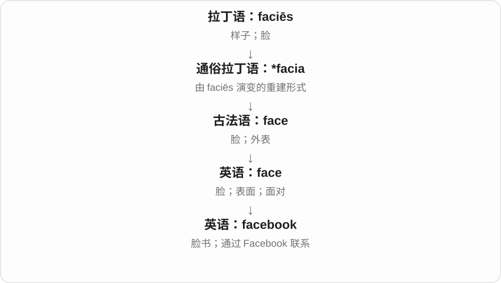
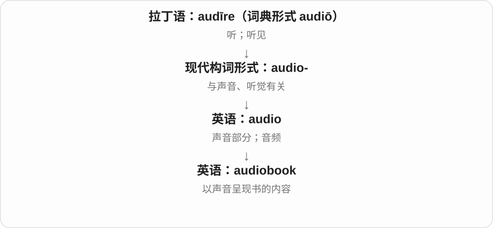
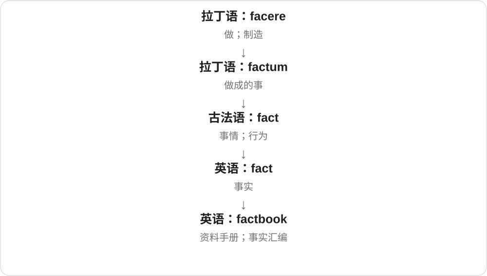

# 0281 · book — 书、记录册；登记、预约

[逐词精讲目录](../00_逐词精讲目录.md) · [总目录](../00_总目录_按常用程度.md)

## 核心词根与来源

book 接古英语 bōc，经中古英语延续。动词预订、记名从记录用法理解；bookmaker 现代常见博彩义不等于所有制作书籍的职业。

**BOOK：把文字、信息、交易或约定记成可查的记录**

阅读是一本书，记账是账簿，预订是把名字放进记录；先认出每个词用了哪一种 book。

- **基本书与读者形象**：book · booklet · bookish · bookworm
- **销售、装订与记账**：bookstore · bookshop · bookseller · bookselling · bookbinder · bookbinding · bookkeeper · bookkeeping
- **存放、标记和目录**：bookcase · bookshelf · bookmark · booklist · bookend
- **书的内容、用途与媒介**：cookbook · storybook · sketchbook · scrapbook · rulebook · sourcebook · casebook · songbook · artbook · phonebook · textbook · notebook · yearbook · playbook · audiobook · workbook · photobook · factbook · lookbook
- **便携物与记录名称**：pocketbook · passbook · matchbook · facebook
- **博彩与预订的动词分支**：bookmaker · bookmaking · bookable · rebook
- **book → books：书、账簿与预订**：book · books
- **book → booked：把名字、安排记进本子**：book · booked
- **book → booking：写入记录到预订**：book · booking
- **book 的储放用品：书架、书柜、书立及复数**：book · bookshelf · bookshelves · bookcase · bookcases · bookend · bookends
- **notebook → notebooks：记事用册子与便携电脑名**：book · notebook · notebooks
- **bookmark 从书签到收藏入口与动作变化**：bookmark · bookmarks · bookmarked · bookmarking
- **book 的阅读形式、书店、职业与用途组合**：book · ebook · ebooks · audiobook · audiobooks · bookshop · bookshops · bookstore · bookstores · bookworm · bookworms · bookkeeper · bookkeepers · bookseller · booksellers · bookbinder · bookbinders · textbook · textbooks · workbook · workbooks · guidebook · guidebooks · handbook · handbooks · pocketbook · pocketbooks · storybook · storybooks
- **booking → bookings：登记预订的多项记录**：booking · bookings
- **bookmakers：制书旧义与经营投注的常见义**：bookmaker · bookmakers

## 词形与演化规律

book → booklet、bookish、bookworm；售书 bookseller → bookselling，装订 bookbinder → bookbinding，记账 bookkeeper → bookkeeping 各自相邻。书店、家具、书签清单、内容分类、便携记录物及预订另分组。

books 既可作书的复数，也可作预订的动词形式；账簿义保留书面记录的历史联系。

本族书名衍生登记、预订动词，过去形式 k 后读 t。

古英语书、记录材料转动词，现代直接加完整 ing。

shelf、case、end 分别说明架板、容器家具、两端支物。

前半 note 说明记录用途，电脑名称为后来的用途、形态比喻。

阅读位置标记的用途进入数字内容；收藏链接不自动等于下载全文。

bookkeeper 的 book 是账簿，其他多取阅读物、书册；handbook 有旧英语用词中断后受德语影响复兴的历史。

book 的书面登记义发展到预订，-ing 形成具体事项名词后再加复数。

book + maker；制作书籍义较早，投注业务义较晚，联系记录赌注的 book。现代 bookmakers 常指经营接收投注的一方，不是普通下注者的总称。

## 单词速览（按词族由简到繁）

同一基础词的相关扩展放在一起，先读基础形式，再读扩展；各组之间优先读常用的。具体词源关系见各词讲解。

| 单词 | 音标 | 核心意思 |
|---|---|---|
| [book](#w-1) | /bʊk/ | 书；册；账簿；预订；登记 |
| [books](#w-49) | /bʊks/ | 书籍；账簿、账目；预订〔book 的第三人称单数〕 |
| [booked](#w-50) | /bʊkt/ | 预订、登记了；预订满的〔过去式、过去分词〕 |
| [booking](#w-51) | /ˈbʊkɪŋ/ | 预订、预约、预订事项；登记〔动名词、现在分词、名词〕 |
| [bookings](#w-76) | /ˈbʊkɪŋz/ | 预订、预约；演出邀约〔复数〕 |
| [booklet](#w-6) | /ˈbʊklət/ | 小册子 |
| [bookstore](#w-8) | 英 /ˈbʊkstɔː/；美 /ˈbʊkstɔːr/ | 书店 |
| [bookstores](#w-63) | 英 /ˈbʊkstɔːz/；美 /ˈbʊkstɔːrz/ | 书店〔复数〕 |
| [bookshop](#w-11) | 英 /ˈbʊkʃɒp/；美 /ˈbʊkʃɑːp/ | 书店〔尤英式〕 |
| [bookshops](#w-68) | 英 /ˈbʊkʃɒps/；美 /ˈbʊkʃɑːps/ | 书店〔复数〕 |
| [bookmark](#w-13) | 英 /ˈbʊkmɑːk/；美 /ˈbʊkmɑːrk/ | 书签；收藏链接；加书签 |
| [bookmarks](#w-56) | 英 /ˈbʊkmɑːks/；美 /ˈbʊkmɑːrks/ | 书签、收藏入口〔复数〕；加书签、收藏〔第三人称单数〕 |
| [bookmarked](#w-57) | 英 /ˈbʊkmɑːkt/；美 /ˈbʊkmɑːrkt/ | 加了书签、作了收藏标记的；收藏了 |
| [bookmarking](#w-58) | 英 /ˈbʊkmɑːkɪŋ/；美 /ˈbʊkmɑːrkɪŋ/ | 添加书签、收藏入口的过程 |
| [bookshelf](#w-15) | /ˈbʊkʃelf/ | 书架；放书层板 |
| [bookshelves](#w-52) | /ˈbʊkʃelvz/ | 书架、放书的架板〔复数〕 |
| [bookseller](#w-16) | 英 /ˈbʊkselə/；美 /ˈbʊkselər/ | 书商；售书店、售书者 |
| [booksellers](#w-66) | 英 /ˈbʊkseləz/；美 /ˈbʊkselərz/ | 书商、售书者或企业〔复数〕 |
| [bookkeeper](#w-17) | 英 /ˈbʊkkiːpə/；美 /ˈbʊkkiːpər/ | 簿记员；记账人员 |
| [bookkeepers](#w-74) | 英 /ˈbʊkkiːpəz/；美 /ˈbʊkkiːpərz/ | 簿记员、记账人员〔复数〕 |
| [bookcase](#w-20) | /ˈbʊkkeɪs/ | 书柜；书架式柜体 |
| [bookcases](#w-53) | /ˈbʊkkeɪsɪz/ | 书柜、书架家具〔复数〕 |
| [bookmaker](#w-24) | 英 /ˈbʊkmeɪkə/；美 /ˈbʊkmeɪkər/ | 博彩经营者；制书者〔历史或特定语境〕 |
| [bookmakers](#w-77) | 英 /ˈbʊkˌmeɪkəz/；美 /ˈbʊkˌmeɪkɚz/ | 经营接收投注的人或机构；制书者〔较早义〕 |
| [bookworm](#w-25) | 英 /ˈbʊkwɜːm/；美 /ˈbʊkwɜːrm/ | 书虫；嗜书者 |
| [bookworms](#w-72) | 英 /ˈbʊkwɜːmz/；美 /ˈbʊkwɜːrmz/ | 书虫、爱读书的人；蛀书虫〔复数〕 |
| [bookish](#w-26) | /ˈbʊkɪʃ/ | 爱读书的；书卷气的；书本式的 |
| [booklist](#w-29) | /ˈbʊklɪst/ | 书单；图书目录清单 |
| [bookmaking](#w-31) | /ˈbʊkmeɪkɪŋ/ | 经营赌注业务；制作书籍〔另一用法〕 |
| [bookbinding](#w-33) | /ˈbʊkbaɪndɪŋ/ | 书籍装订；装帧工艺 |
| [bookable](#w-36) | /ˈbʊkəbəl/ | 可预订的 |
| [bookend](#w-39) | /ˈbʊkend/ | 书挡；在两端呼应；首尾夹住 |
| [bookends](#w-54) | /ˈbʊkendz/ | 书立、挡书夹〔复数〕；放在前后两端、首尾呼应〔第三人称单数〕 |
| [bookbinder](#w-44) | 英 /ˈbʊkbaɪndə/；美 /ˈbʊkbaɪndər/ | 装订工；装帧者 |
| [bookbinders](#w-75) | 英 /ˈbʊkbaɪndəz/；美 /ˈbʊkbaɪndərz/ | 装订工、装帧者〔复数〕 |
| [bookselling](#w-45) | /ˈbʊkselɪŋ/ | 图书销售；售书业 |
| [facebook](#w-2) | /ˈfeɪsˌbʊk/ | 脸书；通过 Facebook 联系 |
| [textbook](#w-3) | /ˈtekstbʊk/ | 教科书；典型的；规范示范式的 |
| [textbooks](#w-61) | /ˈtekstbʊks/ | 教材、教科书〔复数〕 |
| [notebook](#w-4) | 英 /ˈnəʊtbʊk/；美 /ˈnoʊtbʊk/ | 笔记本；笔记本电脑；交互式计算笔记 |
| [notebooks](#w-55) | 英 /ˈnəʊtbʊks/；美 /ˈnoʊtbʊks/ | 笔记本、记事本；笔记本电脑〔复数〕 |
| [ebook](#w-60) | /ˈiːbʊk/ | 电子书 |
| [ebooks](#w-62) | /ˈiːbʊks/ | 电子书〔复数〕 |
| [yearbook](#w-7) | 英 /ˈjɪəbʊk/；美 /ˈjɪrbʊk/ | 年鉴；学校年度纪念册 |
| [cookbook](#w-9) | /ˈkʊkbʊk/ | 烹饪书；食谱集；操作诀窍集〔引申〕 |
| [playbook](#w-10) | /ˈpleɪbʊk/ | 战术手册；行动套路、策略 |
| [audiobook](#w-12) | 英 /ˈɔːdiəʊbʊk/；美 /ˈɑːdioʊbʊk/ | 有声书 |
| [audiobooks](#w-65) | 英 /ˈɔːdiəʊbʊks/；美 /ˈɔːdioʊbʊks/ | 有声书〔复数〕 |
| [scrapbook](#w-14) | /ˈskræpbʊk/ | 剪贴簿；纪念资料册 |
| [workbook](#w-18) | 英 /ˈwɜːkbʊk/；美 /ˈwɜːrkbʊk/ | 练习册；电子表格工作簿 |
| [workbooks](#w-70) | /ˈwɜːkbʊks/〔英〕；/ˈwɜːrkbʊks/〔美〕 | 练习册；工作簿〔复数〕 |
| [storybook](#w-19) | /ˈstɔːribʊk/ | 故事书；童话般的 |
| [storybooks](#w-73) | 英 /ˈstɔːribʊks/；美 /ˈstɔːribʊks/ | 故事书〔复数〕 |
| [sketchbook](#w-21) | /ˈsketʃbʊk/ | 速写本；素描簿 |
| [rulebook](#w-22) | /ˈruːlbʊk/ | 规则手册；一套既定做法〔比喻〕 |
| [pocketbook](#w-23) | 英 /ˈpɒkɪtbʊk/；美 /ˈpɑːkɪtbʊk/ | 钱包；手提包〔美〕；财力；袖珍书〔另义〕 |
| [pocketbooks](#w-71) | 英 /ˈpɒkɪtbʊks/；美 /ˈpɑːkɪtbʊks/ | 钱包、手袋；财力；袖珍书〔复数用途〕 |
| [songbook](#w-27) | /ˈsɒŋbʊk/（英）；/ˈsɔːŋbʊk/（美） | 歌集；歌曲曲目总汇 |
| [sourcebook](#w-28) | 英 /ˈsɔːsbʊk/；美 /ˈsɔːrsbʊk/ | 资料集；史料汇编；参考资料书 |
| [casebook](#w-30) | /ˈkeɪsbʊk/ | 案例集；个案记录册 |
| [photobook](#w-32) | 构词参考读法：英 /ˈfəʊtəʊbʊk/；美 /ˈfoʊtoʊbʊk/ | 摄影集；照片书 |
| [factbook](#w-34) | /ˈfæktbʊk/ | 资料手册；事实汇编 |
| [lookbook](#w-37) | /ˈlʊkbʊk/ | 造型册；视觉风格展示册 |
| [phonebook](#w-40) | 英 /ˈfəʊnbʊk/；美 /ˈfoʊnbʊk/ | 电话号码簿 |
| [passbook](#w-42) | 英 /ˈpɑːsbʊk/；美 /ˈpæsbʊk/ | 存折；往来账册 |
| [artbook](#w-43) | 英 /ˈɑːtbʊk/；美 /ˈɑːrtbʊk/ | 画集；艺术设定集；艺术图书 |
| [rebook](#w-47) | /ˌriːˈbʊk/ | 重新预订；改订 |
| [matchbook](#w-46) | 英 /ˈmætʃbʊk/；美 /ˈmætʃbʊk/ | 纸板火柴夹；册状火柴 |
| [handbook](#w-59) | /ˈhændbʊk/ | 手册、便览 |
| [handbooks](#w-67) | /ˈhændbʊks/ | 手册、便览〔复数〕 |
| [bookkeeping](#w-48) | /ˈbʊkkiːpɪŋ/ | 簿记；记账；维护记录的琐务〔引申〕 |
| [guidebook](#w-64) | /ˈɡaɪdbʊk/ | 指南书、旅行指南 |
| [guidebooks](#w-69) | /ˈɡaɪdbʊks/ | 指南书、旅行指南〔复数〕 |

## 逐词讲解

### 1. book — 书；册；账簿；预订；登记

**音标**：/bʊk/

**先抓住这个画面**

把文字集中到一个能查阅的地方；座位、客房的预订也曾靠把名字记进册子确认。

**怎么拆**

接古英语 bōc，经中古英语 bok、book 延续。动词登记、预订从书面记录的用法发展，不是现代英语 boo 加 k。

**怎么变成今天的意思**

**古英语 bōc → 中古英语 bok / book**  
书、书面记录

↓

**英语 book**  
书；账簿；预订、登记等动词用法

read a book 是读书，book a room 是预订房间，the books 常指账簿。警方或体育报道中的 book someone 可能是登记、记名处理，具体制度另看语境。

**常见搭配与例句**

read a book；book a room；book in advance；keep the books；by the book。

> I borrowed a book from the library.

我从图书馆借了一本书。

> We booked a room near the station.

我们预订了车站附近的房间。

> She keeps the books for the family business.

她为家族生意记账。

**别混淆**

book 预订，不保证一定已付款；buy 是购买。by the book 是按规定，不是物理位置在一本书旁。

### 2. books — 书籍；账簿、账目；预订〔book 的第三人称单数〕

**音标**：/bʊks/

**先抓住这个画面**

一本本装着文字的书是 books；账目原来常记在簿子里，books 又能说账簿。把名字登记进去，book 作动词便能说预订。

**怎么拆**

book + -s，/k/ 后读 /s/。book 接古英语 boc 书、文书，动词登记、预订与书面记录的发展相连。

**怎么变成今天的意思**

**古英语 boc → book**  
书、文书；书面记录

↓

**book 名词、动词 + -s → books**  
多本书、账簿；单数主语预订

read books 读书；keep the books 记账；balance the books 使收支账目平衡；on the books 在册、列入记录；books a room 预订房间。

**常见搭配与例句**

a stack of books；books a table。

> The books on the top shelf belong to my sister.

最上层架子上的书是我姐姐的。

> He books the same room whenever he visits the city.

每次来这座城市，他都预订同一个房间。

**别混淆**

The books are here 中 books 是复数名词；She books the tickets 中是动词。book 作预订时可以接房间、票、座位等对象，并不限于书。

### 3. booked — 预订、登记了；预订满的〔过去式、过去分词〕

**音标**：/bʊkt/

**先抓住这个画面**

把名字和安排记进记录本，给你留一个位置，就是 booked。今天可以在手机里完成，画面里的登记关系仍然在。

**怎么拆**

book + -ed，/k/ 后读 /t/，只有一个音节。book 继承古英语 boc 的书、书面记录名词，登记、预订动词从记录行为发展。

**怎么变成今天的意思**

**古英语 boc → book → 对应动词**  
书面记录 → 把人、安排登记下来

↓

**book + -ed → booked**  
已预订、登记；被占用的

booked a room 订了房间；fully booked 全部订满；booked in advance 提前预订。

**常见搭配与例句**

booked a table 订了餐桌；already booked 已经有安排、被预订。

> We booked a table for six.

我们订了一张六人桌。

> The hotel is fully booked this weekend.

酒店这个周末已经订满了。

**别混淆**

I booked a room 是我订房；the hotel is fully booked 是酒店没空房。booked 不等于买了一本书，书名词变成动词后有专门用法。

### 4. booking — 预订、预约、预订事项；登记〔动名词、现在分词、名词〕

**音标**：/ˈbʊkɪŋ/

**先抓住这个画面**

先把你的名字和时间写进安排里，让位置留给你，就是 booking。现代不用纸本账簿，也保留这套登记画面。

**怎么拆**

book 继承古英语 boc 书、书面记录，登记动词由记录用法发展为预订。现代直接加完整 -ing，动词过程又能成为一项预订的可数名词。

**怎么变成今天的意思**

**古英语书、记录材料 → book 动词**  
写入记录 → 登记、预订

↓

**book + -ing → booking**  
预订过程；一项已经作出的预订

make a booking 预订；a hotel booking 酒店预订；booking tickets 订票。

**常见搭配与例句**

confirm the booking 确认预订；booking in advance 提前预订。

> She checked the dates before booking the room.

订房前她核对了日期。

> We received a message confirming the booking.

我们收到了一条确认预订的消息。

**别混淆**

booking 不等于 reading a book。book 作动词有登记、预订义；a booking 又能数一项具体预约。

### 5. bookings — 预订、预约；演出邀约〔复数〕

**音标**：/ˈbʊkɪŋz/

**先抓住这个画面**

把某个日期、座位或房间记到名下，是一项 booking；本子里已经登记的几项安排就是 bookings。

**怎么拆**

book + -ing → booking，成为可数名词后再加 -s；book 的登记、预订义由书面记录用途发展。

**怎么变成今天的意思**

**book 的书、记录义 → 登记、预订动词**  
先记下来，给人保留位置或时间

↓

**book + -ing → booking → bookings**  
一项预订；多项预订、工作邀约

hotel bookings 是酒店预订，advance bookings 是提前预订；艺人的 bookings 也可说已经约好的演出工作。

**常见搭配与例句**

take bookings 接受预订；cancel bookings 取消预订。

> We are not taking any more bookings for Friday.

我们不再接受周五的预订了。

> The band has several bookings next month.

乐队下个月有几场已经约好的演出。

**别混淆**

bookings 是登记的预订事项，books 是书；从记录到预订的动词发展，解释了多出来的 -ing。

### 6. booklet — 小册子

**音标**：/ˈbʊklət/

**先抓住这个画面**

信息比一张传单多，又不需要装成一本很厚的大书。

**怎么拆**

book + -let，-let 表较小的东西；不是 book + let“让书做某事”。

**怎么变成今天的意思**

**古英语 bōc → 中古英语 bok / book**  
书、书面记录

↓

**英语 book**  
书；账簿；预订、登记等动词用法

↓

**book + -let → booklet**  
较小、较薄的书册

an information booklet 是资料小册，an instruction booklet 是说明小册。页数没有由词尾规定统一界线。

**常见搭配与例句**

an information booklet；an instruction booklet；a small booklet。

> The museum provides a free information booklet.

博物馆提供免费资料小册。

> The booklet explains the history of the building.

小册子介绍了建筑历史。

**别混淆**

booklet 小册，leaflet 传单或折页常更薄；实际形式有重叠，不要只按一页、两页死分。

### 7. bookstore — 书店

**音标**：英 /ˈbʊkstɔː/；美 /ˈbʊkstɔːr/

**先抓住这个画面**

书作为商品陈列在这里，人们挑选、购买。

**怎么拆**

book + store（商店），美式常用；store 不是在此只说仓库存储。

**怎么变成今天的意思**

**英语 book；store**  
并列组合的两部分

↓

**book + store → bookstore**  
出售图书的商店

an independent bookstore 是独立书店，a used bookstore 是二手书店；线上售书店也可用。

**常见搭配与例句**

an independent bookstore；a local bookstore；an online bookstore。

> The bookstore hosts readings by local writers.

书店举办当地作者朗读活动。

> She found the novel in a secondhand bookstore.

她在二手书店找到了这部小说。

**别混淆**

bookstore 卖书，library 图书馆主要组织借阅、保存等服务；同样有书，功能不同。

### 8. bookstores — 书店〔复数〕

**音标**：英 /ˈbʊkstɔːz/；美 /ˈbʊkstɔːrz/

**先抓住这个画面**

store 在这里是一家店，book 指主要售卖书，所以 bookstores 就是几家书店。

**怎么拆**

book + store → bookstore，加 -s，读 /z/。store 选商店义，不把组合译成存储书的数据动作。

**怎么变成今天的意思**

**book + store → bookstore**  
售书商店

↓

**bookstore + -s → bookstores**  
多家书店

local bookstores 当地书店；online bookstores 网上书店。

**常见搭配与例句**

browse in bookstores 逛书店；bookstores near the station 车站附近书店。

> The guide lists bookstores near the station.

指南列出了车站附近的书店。

> Local bookstores organised a reading event.

当地书店组织了读书活动。

**别混淆**

书店可以有实体场所，也可以在线售卖；online 这个限定语选出后者。

### 9. bookshop — 书店〔尤英式〕

**音标**：英 /ˈbʊkʃɒp/；美 /ˈbʊkʃɑːp/

**先抓住这个画面**

走进去看书架、选书、结账，与 bookstore 说的是同一类店。

**怎么拆**

book + shop；shop 是店铺。英式很常见，不是必须比 bookstore 小一个等级。

**怎么变成今天的意思**

**英语 book；shop**  
并列组合的两部分

↓

**book + shop → bookshop**  
售书店铺

a local bookshop 是当地书店，a specialist bookshop 是专门售某类书的店。地区偏好不是严格尺寸标准。

**常见搭配与例句**

a local bookshop；a specialist bookshop；browse in a bookshop。

> We spent an hour browsing in the bookshop.

我们在书店逛着看了一小时。

> The village still has a small bookshop.

村里仍有一家小书店。

**别混淆**

bookshop 与 bookstore 主要是用词习惯差别；不能机械背成小书店对大书城。

### 10. bookshops — 书店〔复数〕

**音标**：英 /ˈbʊkʃɒps/；美 /ˈbʊkʃɑːps/

**先抓住这个画面**

卖书的商店，就是 bookshops。book 给售卖对象，shop 给经营场所。

**怎么拆**

book + shop → bookshop，整词加 -s，/p/ 后读 /s/。两种英语材料组合成商店类别名。

**怎么变成今天的意思**

**book + shop → bookshop**  
以书为主要售卖对象的店

↓

**bookshop + -s → bookshops**  
多家书店

independent bookshops 独立书店；local bookshops 当地书店。

**常见搭配与例句**

visit bookshops 逛书店；secondhand bookshops 二手书店。

> We visited three independent bookshops.

我们逛了三家独立书店。

> The street is known for its secondhand bookshops.

这条街以二手书店出名。

**别混淆**

bookshop、bookstore 常指同一种店；library 是收藏、出借图书等资料的机构。

### 11. bookmark — 书签；收藏链接；加书签

**音标**：英 /ˈbʊkmɑːk/；美 /ˈbʊkmɑːrk/

**先抓住这个画面**

读到这里先放一个标记，下次不用从头找；网页也能保存一个回去的入口。

**怎么拆**

book + mark，早有相应书页标记用法，数字时代扩展为链接收藏和动词。不是标记所有书中文字才叫 bookmark。

**怎么变成今天的意思**

**英语 book；mark**  
并列组合的两部分

↓

**book + mark → bookmark**  
标记阅读位置 → 保存访问入口

use a bookmark 是用书签，bookmark a page 是给网页或文档页作收藏标记。保存链接通常不等于把整份网页内容下载到本地。

**常见搭配与例句**

a paper bookmark；bookmark a page；a browser bookmark。

> She used an old postcard as a bookmark.

她用一张旧明信片当书签。

> I bookmarked the article to read later.

我收藏了文章链接，准备稍后阅读。

**别混淆**

bookmark 标位置、入口，booklist 列一批书；一个链接可当书签，不必已经读完。

### 12. bookmarks — 书签、收藏入口〔复数〕；加书签、收藏〔第三人称单数〕

**音标**：英 /ˈbʊkmɑːks/；美 /ˈbʊkmɑːrks/

**先抓住这个画面**

留个位置，下次直接回去：纸书里是书签，浏览器里是收藏入口，都叫 bookmarks。

**怎么拆**

book + mark → bookmark，现代整词加 -s，/k/ 后读 /s/；名词也转成加标记、收藏的动词。

**怎么变成今天的意思**

**book + mark → bookmark**  
标出读到哪里的书签

↓

**数字访问入口、动词用途；+ -s → bookmarks**  
多个书签、收藏入口；它收藏

paper bookmarks 纸书签；browser bookmarks 浏览器书签。

**常见搭配与例句**

save bookmarks 保存书签；organise bookmarks 整理收藏入口。

> She makes bookmarks from old postcards.

她用旧明信片做书签。

> I organised my bookmarks into folders.

我把书签整理到文件夹里。

**别混淆**

数字 bookmarks 通常保存访问入口，不等于把每个网页的全部内容都存到设备。

### 13. bookmarked — 加了书签、作了收藏标记的；收藏了

**音标**：英 /ˈbʊkmɑːkt/；美 /ˈbʊkmɑːrkt/

**先抓住这个画面**

给内容留了一个下次能找到的入口，是 bookmarked；重点在标位置、方便回来。

**怎么拆**

bookmark + -ed，/k/ 后词尾读 /t/。组合 book、mark 先形成书签名称，再有相应动词与数字用途。

**怎么变成今天的意思**

**book + mark → bookmark；名词转动词**  
书签；给内容作回访标记

↓

**bookmark + -ed → bookmarked**  
过去收藏；已经标记的状态

bookmarked the article 收藏了文章；a bookmarked page 作了书签的页面。

**常见搭配与例句**

already bookmarked 已经收藏；bookmarked for later 留待以后再看。

> I bookmarked the article for the weekend.

我收藏了那篇文章，准备周末看。

> The bookmarked page contained the example we needed.

作了书签的那页有我们需要的例子。

**别混淆**

bookmarked 不保证内容已经阅读，也不保证链接以后一直有效；它只表达作了标记这一层意思。

### 14. bookmarking — 添加书签、收藏入口的过程

**音标**：英 /ˈbʊkmɑːkɪŋ/；美 /ˈbʊkmɑːrkɪŋ/

**先抓住这个画面**

正在给有用内容留回来的入口，就是 bookmarking。相当于先插好一个位置标记。

**怎么拆**

bookmark + -ing，整词不改拼写；book、mark 提供书本位置标记的旧画面。

**怎么变成今天的意思**

**book + mark → bookmark；转为动词**  
书签；为内容标位置、入口

↓

**bookmark + -ing → bookmarking**  
正在收藏、加标记；相应过程

bookmarking useful pages 收藏有用页面；a bookmarking tool 书签工具。

**常见搭配与例句**

bookmarking articles 收藏文章；bookmarking for later 为以后阅读作标记。

> She was bookmarking useful pages for her project.

她正为项目收藏有用页面。

> Bookmarking the article made it easier to find later.

收藏这篇文章后，以后更容易找到。

**别混淆**

bookmarking 是作入口标记，downloading 是接收文件；两种动作可一起做，但不是同一词义。

### 15. bookshelf — 书架；放书层板

**音标**：/ˈbʊkʃelf/

**先抓住这个画面**

书沿着一块层板排好，伸手就能看见、取用。

**怎么拆**

book + shelf，复数 bookshelves /ˈbʊkʃelvz/，沿用 shelf → shelves 的变化。

**怎么变成今天的意思**

**英语 book；shelf**  
并列组合的两部分

↓

**book + shelf → bookshelf**  
摆放书籍的架、层板

on the bookshelf 是在书架上，a wall-mounted bookshelf 是壁挂书架；复数也可泛指一组书架。

**常见搭配与例句**

on a bookshelf；a wooden bookshelf；put up bookshelves。

> The dictionary is on the bookshelf beside the desk.

词典在书桌旁的书架上。

> They put up new bookshelves in the study.

他们在书房装了新书架。

**别混淆**

bookshelf 可以是一层，bookcase 常是整件柜体；图书馆整排架体也常用 shelves，按实际说法理解。

### 16. bookshelves — 书架、放书的架板〔复数〕

**音标**：/ˈbʊkʃelvz/

**先抓住这个画面**

一层层承住书的架板，是 bookshelves。book 说明所放对象，shelf 是水平托住东西的架板。

**怎么拆**

book + shelf → bookshelf；复数沿用 shelf → shelves，将 f 改 v，加 -es，结尾实际读 /vz/。

**怎么变成今天的意思**

**book + shelf → bookshelf**  
放书的架板、架子

↓

**bookshelf 的 f 改 v + -es → bookshelves**  
多层或多个书架

wooden bookshelves 木书架；bookshelves full of novels 摆满小说的书架。

**常见搭配与例句**

put up bookshelves 装书架；bookshelves along the wall 沿墙的书架。

> Bookshelves covered one wall of the room.

房间一面墙上装满了书架。

> She arranged the novels on the bookshelves.

她把小说摆在书架上。

**别混淆**

bookshelf 可指一层架板，也可泛指架子；bookcase 常更突出完整存书家具。两者日常叫法有重叠。

### 17. bookseller — 书商；售书店、售书者

**音标**：英 /ˈbʊkselə/；美 /ˈbʊkselər/

**先抓住这个画面**

把书卖给读者的那一方，可以是店里的人，也可以是企业。

**怎么拆**

book + seller，seller 是 sell + -er，中古英语已有 boksellere 等形式。

**怎么变成今天的意思**

**英语 book；seller〔sell + -er〕**  
并列组合的两部分

↓

**book + seller〔sell + -er〕 → bookseller**  
从事售书的人或企业

an independent bookseller 是独立书商，a bookseller’s recommendation 是书商推荐；不只称门口收银的人。

**常见搭配与例句**

an independent bookseller；an online bookseller；a local bookseller。

> The bookseller recommended a new biography.

书商推荐了一本新传记。

> Several independent booksellers joined the fair.

几家独立书商参加了书展。

**别混淆**

bookseller 卖书，bookkeeper 记账；keeper 保管的 books 在后者里是账簿，职业完全不同。

### 18. booksellers — 书商、售书者或企业〔复数〕

**音标**：英 /ˈbʊkseləz/；美 /ˈbʊkselərz/

**先抓住这个画面**

把书卖给读者的人、商店或企业，按售卖角色叫 booksellers。

**怎么拆**

book + seller〔sell + -er〕→ bookseller，加 -s，读 /z/；中古英语已有相应职业组合。

**怎么变成今天的意思**

**book + seller → bookseller**  
从事售书的角色

↓

**bookseller + -s → booksellers**  
多个售书者、企业

independent booksellers 独立书商；online booksellers 网上售书商。

**常见搭配与例句**

local booksellers 当地书商；recommendations from booksellers 书商推荐。

> Independent booksellers joined the book fair.

独立书商参加了书展。

> The booksellers recommended several biographies.

书商推荐了几本传记。

**别混淆**

bookseller 按销售角色命名，可以是企业而不只指柜台后一个人。

### 19. bookkeeper — 簿记员；记账人员

**音标**：英 /ˈbʊkkiːpə/；美 /ˈbʊkkiːpər/

**先抓住这个画面**

负责把进出款项、交易记录整齐的人，保管的是账，不是图书馆借书。

**怎么拆**

book（账簿）+ keeper（记录、管理者）；中间相邻的 oo、kk、ee 各有构词来源，不漏写一组。

**怎么变成今天的意思**

**英语 book〔账簿〕；keeper**  
并列组合的两部分

↓

**book〔账簿〕 + keeper → bookkeeper**  
管理、记录财务账簿的人

a part-time bookkeeper 是兼职簿记员。职责可以因机构而不同，先记日常财务记录角色，不直接等同所有会计资格。

**常见搭配与例句**

a company bookkeeper；a part-time bookkeeper；work as a bookkeeper。

> The bookkeeper recorded the day’s payments.

簿记员记录了当天款项。

> The small company hired a part-time bookkeeper.

小公司聘了一名兼职簿记员。

**别混淆**

bookkeeper 记账，bookseller 卖书，librarian 图书馆员；book 在不同词里选账簿或阅读物的义。

### 20. bookkeepers — 簿记员、记账人员〔复数〕

**音标**：英 /ˈbʊkkiːpəz/；美 /ˈbʊkkiːpərz/

**先抓住这个画面**

这里 book 是账簿，keeper 是记录、管理者；多位做日常记账工作的人，就是 bookkeepers。

**怎么拆**

book 账簿 + keeper〔keep + -er〕→ bookkeeper，加 -s，读 /z/。book 与 keeper 交界保留相邻 kk。

**怎么变成今天的意思**

**book + keeper → bookkeeper**  
管理、记录账簿的人

↓

**bookkeeper + -s → bookkeepers**  
多位簿记人员

company bookkeepers 公司记账人员；experienced bookkeepers 有经验的簿记员。

**常见搭配与例句**

hire bookkeepers 雇簿记员；bookkeepers’ records 簿记员的记录。

> The bookkeepers checked the payment records.

簿记员核对了付款记录。

> The company hired two experienced bookkeepers.

公司雇了两位有经验的记账人员。

**别混淆**

bookkeepers 记账，booksellers 卖书，bookbinders 装订；相同 book 在职业组合里选取不同用途。

### 21. bookcase — 书柜；书架式柜体

**音标**：/ˈbʊkkeɪs/

**先抓住这个画面**

不是只给一本书套壳，而是用带层板的家具存放一排排书。

**怎么拆**

book + case（柜、容器），不是法律案件 case。通常指完整存书家具。

**怎么变成今天的意思**

**英语 book；case〔柜体〕**  
并列组合的两部分

↓

**book + case〔柜体〕 → bookcase**  
存放书籍的家具

a wooden bookcase 是木书柜，a built-in bookcase 是嵌入式书柜。可有门也可开放，不能靠柜门有无绝对区分。

**常见搭配与例句**

a wooden bookcase；a tall bookcase；a built-in bookcase。

> A tall bookcase stood beside the window.

窗边立着一个高书柜。

> They filled the bookcase with novels and travel books.

他们在书柜里放满小说和旅行书。

**别混淆**

bookcase 多指整件家具，bookshelf 是放书层板、架；一个 bookcase 可以包含 several bookshelves。

### 22. bookcases — 书柜、书架家具〔复数〕

**音标**：/ˈbʊkkeɪsɪz/

**先抓住这个画面**

作为完整家具收纳书的一只只柜、架，是 bookcases。book 是所装的书，case 是容纳它们的家具。

**怎么拆**

book + case 容器、柜体 → bookcase；现代加 -s，原词尾 /s/ 后增加 /ɪz/。case 接拉丁 capsa 盒的一支，不接案件来源。

**怎么变成今天的意思**

**book + 容器义 case → bookcase**  
容书的柜、架

↓

**bookcase + -s → bookcases**  
多个书柜

wooden bookcases 木书柜；tall bookcases 高书柜。

**常见搭配与例句**

bookcases in the study 书房里的书柜；move the bookcases 搬书柜。

> Tall bookcases lined the study.

书房里排着高书柜。

> They moved the bookcases away from the window.

他们把书柜从窗边移开了。

**别混淆**

bookcases 常突出完整的书柜家具，bookshelves 可数一层层架板。末尾因 case 的 s 音，多出复数音节。

### 23. bookmaker — 博彩经营者；制书者〔历史或特定语境〕

**音标**：英 /ˈbʊkmeɪkə/；美 /ˈbʊkmeɪkər/

**先抓住这个画面**

现代常见义不是替你写小说，而是接受、记录赌注并经营相关业务的人。

**怎么拆**

book + maker，历史有制作、编书者义；博彩义接 make a book 等记赌注的旧表达，book 选记录册义。

**怎么变成今天的意思**

**英语 book〔记录册等义〕；maker**  
并列组合的两部分

↓

**book〔记录册等义〕 + maker → bookmaker**  
制书者；后来常指经营赌注业务者

a bookmaker’s shop 是博彩营业场所，a licensed bookmaker 是获许可经营者这一描述；具体许可制度随地区，不由词名保证。

**常见搭配与例句**

a bookmaker’s shop；a licensed bookmaker；local bookmakers。

> The article examines the history of bookmakers in Britain.

文章考察英国博彩经营者的历史。

> The character works in a bookmaker’s shop.

这个角色在一家博彩店工作。

**别混淆**

bookmaker 现代常是博彩经营者，bookbinder 装订，publisher 出版；看到 book 不要把三类职业混成书店。

### 24. bookmakers — 经营接收投注的人或机构；制书者〔较早义〕

**音标**：英 /ˈbʊkˌmeɪkəz/；美 /ˈbʊkˌmeɪkɚz/

**先抓住这个画面**

现代体育新闻里的 bookmakers 多半在接收投注、定赔率；不是在写书、装订书。后者却是这个组合更早真实存在的用途。

**怎么拆**

bookmaker + -s，读 /z/；内层 book + maker。较早制书者义，后来博彩义联系记录投注的 book、make a book 等表达，不是从作家职业直接变赌客。

**怎么变成今天的意思**

**book + maker → bookmaker**  
较早可说制作书籍的人

↓

**记录投注的 book、make a book 等 → 博彩经营者；bookie 短称**  
bookmakers、bookies 是各自人物名词的复数

↓

**bookmaker + -s → bookmakers**  
多个经营接收投注者，也可按较早义指制书者

bookmakers and bettors 博彩经营者与下注者；online bookmakers 网上接注机构。

**常见搭配与例句**

odds offered by bookmakers；records kept by bookmakers。

> The documentary explained how bookmakers recorded bets.

纪录片解释了博彩经营者如何记录投注。

> The article compared the odds offered by different bookmakers.

文章比较了不同接注机构给出的赔率。

**别混淆**

bookmakers 通常经营接注业务，gamblers、bettors 是下注者；不是每个下注的人都在当 bookmaker。

### 25. bookworm — 书虫；嗜书者

**音标**：英 /ˈbʊkwɜːm/；美 /ˈbʊkwɜːrm/

**先抓住这个画面**

虫子钻进书，爱读书的人也像整天钻在书堆里。

**怎么拆**

book + worm，字面指蛀书虫类，人物义借作沉迷读书的称呼。不是正式昆虫学上只有一种名为 bookworm 的物种。

**怎么变成今天的意思**

**英语 book；worm**  
并列组合的两部分

↓

**book + worm → bookworm**  
蛀书虫 → 爱读书的人

a real bookworm 是十足书迷，可亲昵、幽默，也可带书呆子意味，依语气。

**常见搭配与例句**

a real bookworm；a lifelong bookworm；a young bookworm。

> My sister is a bookworm who always carries a novel.

我姐姐是书迷，身上总带着一本小说。

> The library club welcomes young bookworms.

图书馆社团欢迎小书迷们。

**别混淆**

bookworm 侧重嗜读，scholar 常说学者或特定学术身份；读得多不自动等于职业研究者。

### 26. bookworms — 书虫、爱读书的人；蛀书虫〔复数〕

**音标**：英 /ˈbʊkwɜːmz/；美 /ˈbʊkwɜːrmz/

**先抓住这个画面**

像整天钻在书里一样爱读书的人，叫 bookworms；字面上也能指破坏书页的小虫。

**怎么拆**

book + worm → bookworm，加 -s，/m/ 后读 /z/。虫的实物用途与沉浸阅读的人物比喻分开看。

**怎么变成今天的意思**

**book + worm → bookworm**  
书中的小虫；借给沉浸书本的人

↓

**bookworm + -s → bookworms**  
多个蛀书虫、爱书人

young bookworms 爱读书的孩子；a club for bookworms 书友俱乐部。

**常见搭配与例句**

lifelong bookworms 一辈子爱读书的人；damage by bookworms 蛀书虫造成的损伤。

> The reading club welcomes bookworms of all ages.

读书俱乐部欢迎各年龄的爱书人。

> The old pages showed damage caused by bookworms.

旧书页上有蛀书虫造成的损伤。

**别混淆**

叫人 bookworm 常带爱读书、埋头阅读的感觉；librarian 则是图书馆工作角色。

### 27. bookish — 爱读书的；书卷气的；书本式的

**音标**：/ˈbʊkɪʃ/

**先抓住这个画面**

兴趣、谈吐都带着常与书相处的气息，有时是赞赏，有时嫌脱离实际。

**怎么拆**

book + -ish，-ish 在此表示带有某种特点。不是所有 -ish 都表示差不多、不精确。

**怎么变成今天的意思**

**古英语 bōc → 中古英语 bok / book**  
书、书面记录

↓

**英语 book**  
书；账簿；预订、登记等动词用法

↓

**book + -ish → bookish**  
有读书、书本特征的

a bookish child 是爱读书的孩子，bookish language 是书面味很重的语言。是否带贬意要看上下文。

**常见搭配与例句**

a bookish child；a bookish manner；bookish language。

> He was a quiet, bookish child.

他是个安静、爱读书的孩子。

> The dialogue sounded too bookish for everyday speech.

对话听着太书面，不像日常说话。

**别混淆**

bookish 描述特征，bookworm 是人或书虫的名词；书卷气不自动等于社交能力差。

### 28. booklist — 书单；图书目录清单

**音标**：/ˈbʊklɪst/

**先抓住这个画面**

把要读、推荐、出版或采购的书列到一起，不先收进每本书的正文。

**怎么拆**

book + list，重点是名称清单；也可写 book list。

**怎么变成今天的意思**

**英语 book；list**  
并列组合的两部分

↓

**book + list → booklist**  
按某种用途整理的书籍清单

a summer booklist 是暑期书单，a course booklist 是课程用书单。是否必须购买、阅读须看清单用途。

**常见搭配与例句**

a course booklist；a recommended booklist；prepare a booklist。

> The teacher sent a booklist before the course began.

课程开始前，老师发来了书单。

> The library prepared a booklist for young readers.

图书馆为小读者准备了书单。

**别混淆**

booklist 列书，book review 评书；书单可以附介绍，但不因列出名称就成完整书评。

### 29. bookmaking — 经营赌注业务；制作书籍〔另一用法〕

**音标**：/ˈbʊkmeɪkɪŋ/

**先抓住这个画面**

同样做 book，现代博彩语境是在经营记录、接收赌注的业务；工艺语境则可能真在做书。

**怎么拆**

book + making，与 bookmaker 两种主要背景相连；两种活动不能只靠“制作”一个中文词混过去。

**怎么变成今天的意思**

**英语 book；making〔make + -ing〕**  
并列组合的两部分

↓

**book + making〔make + -ing〕 → bookmaking**  
赌注经营；特定语境的制书活动

the bookmaking industry 常说博彩业相关业务；traditional bookmaking 在艺术工艺课程中也可能是制作书册。先看行业背景。

**常见搭配与例句**

the bookmaking industry；traditional bookmaking；a bookmaking workshop。

> The documentary follows changes in the bookmaking industry.

纪录片跟踪赌注经营行业的变化。

> The art class includes a workshop on traditional bookmaking.

艺术课包含传统制书工作坊。

**别混淆**

bookmaking 可能博彩，也可能制书；bookkeeping 是记账，不是所有记账人都在经营赌注。

### 30. bookbinding — 书籍装订；装帧工艺

**音标**：/ˈbʊkbaɪndɪŋ/

**先抓住这个画面**

把散页变成翻阅得了、保存得住的一册，这项工艺就是 bookbinding。

**怎么拆**

book + binding，binding 是 bind + -ing；binding 在此是装订活动、构造，不是合同有约束力的形容词义。

**怎么变成今天的意思**

**英语 book；binding〔bind + -ing〕**  
并列组合的两部分

↓

**book + binding〔bind + -ing〕 → bookbinding**  
书页装订、装帧的工艺

learn bookbinding 是学习装订，traditional bookbinding 是传统装订技艺。也能讨论书的装订结构、质量。

**常见搭配与例句**

traditional bookbinding；a bookbinding course；bookbinding techniques。

> She took a course in traditional bookbinding.

她上了传统书籍装订课。

> The display explains the stages of bookbinding.

展览介绍了装订成书的各个阶段。

**别混淆**

bookbinding 是工艺，bookbinder 是人；binding agreement 里的 binding 又是有约束力，不等于把协议装成一本书。

### 31. bookable — 可预订的

**音标**：/ˈbʊkəbəl/

**先抓住这个画面**

房间、时段已经开放，可以把预约登记上去。

**怎么拆**

book 动词 + -able，表示能够预订。不是书的内容值得相信这个意思。

**怎么变成今天的意思**

**古英语 bōc → 中古英语 bok / book**  
书、书面记录

↓

**英语 book**  
书；账簿；预订、登记等动词用法

↓

**book + -able → bookable**  
可以预约、预订的

bookable online 是可网上预订，bookable time slots 是可预约时段。实际是否还有空位、需付款等看具体服务。

**常见搭配与例句**

bookable online；a bookable room；bookable time slots。

> The meeting rooms are bookable online.

会议室可在网上预订。

> The calendar shows the bookable time slots.

日历显示可预约时段。

**别混淆**

bookable 可预订，booked 已被预订；available 可用更宽，不一定需要预约。

### 32. bookend — 书挡；在两端呼应；首尾夹住

**音标**：/ˈbʊkend/

**先抓住这个画面**

一排书两头各放一个支撑物，防止书倒开；故事也能用相似场景在首尾托住。

**怎么拆**

book（书）+ end（端部），先是书两端的支撑物，再转作动词表示夹在前后、形成呼应。

**怎么变成今天的意思**

**英语 book；end**  
并列组合的材料

↓

**book + end → bookend**  
书列两端的支撑物；首尾呼应

a pair of bookends 是一对书挡；two scenes bookend the film 是两场戏分立影片首尾。动词不表示把书的结尾剪掉。

**常见搭配与例句**

a pair of bookends；bookend a story；matching bookends。

> A pair of stone bookends held the books in place.

一对石书挡把书固定住。

> Similar scenes bookend the novel.

相似场景在小说首尾形成呼应。

**别混淆**

bookend 的 end 说两端位置，ending 是结尾内容。买 bookends 不是买一本书最后几页。

### 33. bookends — 书立、挡书夹〔复数〕；放在前后两端、首尾呼应〔第三人称单数〕

**音标**：/ˈbʊkendz/

**先抓住这个画面**

一列书两头各放支撑物，把书挡住，这对物件是 bookends。让一段故事前后都出现同样内容，也像两端放上相应支物。

**怎么拆**

book + end → bookend，器物名转为放在两端、形成首尾呼应的动词；现代加 -s，/d/ 后读 /z/。

**怎么变成今天的意思**

**book + end → bookend**  
书列两端的支物

↓

**器物名转动词；bookend + -s → bookends**  
多只书立；某内容放在前后两端

a pair of bookends 一对书立；bookends the film 在影片开头和结尾出现。

**常见搭配与例句**

metal bookends 金属书立；matching bookends 成对书立。

> Metal bookends supported the row of novels.

金属书立撑着那一排小说。

> The same song bookends the film.

同一首歌在电影开头和结尾呼应出现。

**别混淆**

动词 bookend 不要求真的有书；用在电影、文章时，突出前后两端的安排或呼应。

### 34. bookbinder — 装订工；装帧者

**音标**：英 /ˈbʊkbaɪndə/；美 /ˈbʊkbaɪndər/

**先抓住这个画面**

散页排好后，还得有人把它们固定成册、装上合适封面。

**怎么拆**

book + binder，binder 是 bind + -er，中古英语有 bokebynder 等形式；bind 是装订，不是只用绳随便绑一下。

**怎么变成今天的意思**

**英语 book；binder〔bind + -er〕**  
并列组合的两部分

↓

**book + binder〔bind + -er〕 → bookbinder**  
将书页装订成册的从业者

a skilled bookbinder 是熟练装订工，a traditional bookbinder 是传统装订手艺人；现代工作也可结合设备。

**常见搭配与例句**

a skilled bookbinder；a bookbinder’s workshop；a traditional bookbinder。

> The bookbinder repaired the damaged spine.

装订师修复了破损书脊。

> The museum recreated a bookbinder’s workshop.

博物馆复原了一间装订工坊。

**别混淆**

bookbinder 负责装订，bookseller 负责销售，writer 负责写作；同一个人可兼任，名称按职责区分。

### 35. bookbinders — 装订工、装帧者〔复数〕

**音标**：英 /ˈbʊkbaɪndəz/；美 /ˈbʊkbaɪndərz/

**先抓住这个画面**

把一叠书页固定成册、配好外封装的人，是 bookbinders。书从散页变成能翻读的一册。

**怎么拆**

book + binder〔bind + -er〕→ bookbinder，加 -s，读 /z/；中古英语已有相应职业词。

**怎么变成今天的意思**

**book + binder → bookbinder**  
装订、修复书籍的从业者

↓

**bookbinder + -s → bookbinders**  
多位装订、装帧人员

traditional bookbinders 传统装订师；skilled bookbinders 熟练装订工。

**常见搭配与例句**

bookbinders’ tools 装订工具；a workshop for bookbinders 装订工坊。

> The bookbinders repaired the damaged volumes.

装订师修复了受损书册。

> The museum displayed tools used by bookbinders.

博物馆展示了装订工使用的工具。

**别混淆**

binder 的 bind 在组合里取装订用途；bookbinder 与 bookseller 按制作、销售不同职责命名。

### 36. bookselling — 图书销售；售书业

**音标**：/ˈbʊkselɪŋ/

**先抓住这个画面**

从谁卖书转到整个卖书的工作、渠道与行业。

**怎么拆**

book + selling，selling 是 sell + -ing；与 bookseller 并排看，活动与从业者区别清楚。

**怎么变成今天的意思**

**英语 book；selling〔sell + -ing〕**  
并列组合的两部分

↓

**book + selling〔sell + -ing〕 → bookselling**  
销售图书的活动、行业

the bookselling trade 是售书业，online bookselling 是网络售书。不是写书、编辑、印刷全部工作的统一名称。

**常见搭配与例句**

the bookselling trade；online bookselling；a career in bookselling。

> She began her career in bookselling.

她从售书业开始职业生涯。

> Online bookselling changed how readers discover titles.

网络售书改变了读者发现图书的方式。

**别混淆**

bookselling 销售，publishing 出版；出版社与书店在产业中可能关联，但任务不同。

### 37. facebook — 脸书；通过 Facebook 联系

**音标**：/ˈfeɪsˌbʊk/

**先抓住这个画面**

这个名字最直观的画面，是一本照片配姓名的学生名册。社交网站的名字沿用了这种让人认脸、认人的册子。

**怎么拆**

face + book，属于英语合成。平台专名写 Facebook；小写 facebook 也可作与平台活动有关的动词。

**怎么变成今天的意思**

face 的“面孔”加 book 的“册子”，原本是字面组合，后来成为社交平台的名字；这不是拉丁语直接造出的网络词。

**常见搭配与例句**

a Facebook group；on Facebook；Facebook someone（口语，通过平台联系某人）。

> Our class has a private Facebook group.

我们班有一个私密的 Facebook 群组。

> The old student facebook helped us put names to faces.

那本旧学生人像名册帮我们把姓名和面孔对上了。

**别混淆**

book 在这里最初是名册，不是“预订”；正式写作保持商标的大写。

### 38. textbook — 教科书；典型的；规范示范式的

**音标**：/ˈtekstbʊk/

**先抓住这个画面**

用来系统讲授一门知识的书；再引申为“标准到可以写进教材的例子”。

**怎么拆**

text + book 的英语复合词；形容词义来自名词的典型示范作用。

**怎么变成今天的意思**

**拉丁 texere，分词 textus**  
编织；织成的

↓

**后期及中世纪拉丁 textus → 古法语 texte**  
从织成的结构，比喻为写成的文字

↓

**中古英语 text → 英语 text**  
文本、正文；后来也指短信

↓

**英语 text + book → textbook**  
教学用书；引申为典型或规范的

a textbook example 是非常典型的例子，可以是好事也可以是坏事。a textbook failure 不是值得模仿，而是失败得很有代表性。

**常见搭配与例句**

a biology textbook；a textbook example；a textbook landing。

> The textbook introduces each topic with a simple experiment.

这本教科书用一个简单实验引出每个主题。

> The company’s collapse became a textbook example of poor financial control.

这家公司的倒闭成了财务管理不善的典型案例。

**别混淆**

manual 多指导某项操作；textbook 通常按学科组织知识。形容词 textbook 并不保证所说的事是好事。

### 39. textbooks — 教材、教科书〔复数〕

**音标**：/ˈtekstbʊks/

**先抓住这个画面**

把某门课、某个领域按学习顺序组织成书，这类书叫 textbooks。是供系统学习的书。

**怎么拆**

text 文本、正文 + book → textbook，加 -s，/k/ 后读 /s/。固定用途已超出凡是有文字的书这个字面范围。

**怎么变成今天的意思**

**text + book → textbook**  
按教学内容组织的书

↓

**textbook + -s → textbooks**  
多本教材

school textbooks 学校教材；science textbooks 科学教材。

**常见搭配与例句**

borrow textbooks 借教材；textbooks for the course 课程教材。

> The school provided science textbooks.

学校提供了科学教材。

> The students borrowed the textbooks from the library.

学生从图书馆借了教材。

**别混淆**

textbook 通常负责讲知识结构；workbook 常配练习任务，两者可以配套。

### 40. notebook — 笔记本；笔记本电脑；交互式计算笔记

**音标**：英 /ˈnəʊtbʊk/；美 /ˈnoʊtbʊk/

**先抓住这个画面**

把一页页记录收在一起的本子；后来也用来命名便携电脑和计算记录界面。

**怎么拆**

note + book，英语复合词；book 不要求里面已经印好了完整文章，也可以是留给你写的本子。

**怎么变成今天的意思**

**拉丁 nota；古法语 note**  
标记、符号、记录

↓

**中古英语 note → 现代 note**  
记录；音符；留意等用法

↓

**英语 note + book → notebook**  
供记事的本子

↓

**现代扩展：电脑与交互式计算 notebook**  
借用可携带、逐页记录的形象

纸本 notebook 用来记笔记；电脑广告中可能指笔记本电脑；编程中则可能指把代码、输出和文字放在同一文档的环境。要靠上下文判断。

**常见搭配与例句**

a pocket notebook；a notebook computer；a computational notebook。

> She keeps a notebook beside her bed to record ideas.

她在床边放着一本笔记本，用来记录想法。

> The analyst shared a notebook containing code, charts and comments.

分析师分享了一份包含代码、图表与说明的计算笔记。

**别混淆**

notepad 常是薄薄一叠便笺纸；notebook 通常更像装订成册的本子。两者在软件命名里可有品牌专用义。

### 41. notebooks — 笔记本、记事本；笔记本电脑〔复数〕

**音标**：英 /ˈnəʊtbʊks/；美 /ˈnoʊtbʊks/

**先抓住这个画面**

把笔记收成一本册子，是 notebooks 的纸本画面。小型便携电脑后来也借这种便携记事本的名称。

**怎么拆**

note 记录、笔记 + book 册子 → notebook，现代加 -s，/k/ 后读 /s/。电脑用法是后来形成的专门场景。

**怎么变成今天的意思**

**note + book → notebook**  
收笔记、记录的册子

↓

**notebook + -s → notebooks；便携电脑用法**  
多个纸本或相应电脑

school notebooks 学校笔记本；notebook computers 笔记本电脑〔前部修饰用单数〕。

**常见搭配与例句**

fill notebooks 写满笔记本；lightweight notebooks 轻便笔记本电脑〔设备语境〕。

> She filled two notebooks with sketches.

她画满了两个笔记本。

> The students used notebooks to run the program.

学生用笔记本电脑运行程序。

**别混淆**

notes 数记录内容，notebooks 数承载内容的本子或设备。提到 battery、program 等常选出电脑用法。

### 42. ebook — 电子书

**音标**：/ˈiːbʊk/

**先抓住这个画面**

一本书的内容以电子文件、数字形式提供，能在设备上阅读，就是 ebook。book 保留作品，载体不再限于纸。

**怎么拆**

e- 缩自 electronic 电子的 + book 的现代英语组合，另常写 e-book。这里 e 直接按字母名 /iː/ 读。

**怎么变成今天的意思**

**electronic → e-；book 书、作品**  
电子形式与作品材料

↓

**e- + book → ebook**  
以数字形式阅读的书

an ebook reader 电子书阅读器；an ebook edition 电子书版。

**常见搭配与例句**

read an ebook 读电子书；download an ebook 下载电子书。

> She read the novel as an ebook.

她读的是这部小说的电子书。

> The library offers an ebook edition of the guide.

图书馆提供这本指南的电子书版。

**别混淆**

ebook 是数字阅读的书，audiobook 是声音呈现的书，主要接收方式不同。

### 43. ebooks — 电子书〔复数〕

**音标**：/ˈiːbʊks/

**先抓住这个画面**

设备上能读的一部部数字书，就是 ebooks。一个作品可以同时有电子书、纸书等版本。

**怎么拆**

e- electronic 的缩短 + book → ebook，加 -s，/k/ 后读 /s/。

**怎么变成今天的意思**

**e- + book → ebook**  
电子形式的书

↓

**ebook + -s → ebooks**  
多部电子书

borrow ebooks 借电子书；read ebooks 阅读电子书。

**常见搭配与例句**

a collection of ebooks 电子书收藏；ebooks on the device 设备中的电子书。

> The library lends ebooks as well as printed books.

图书馆既出借纸书，也出借电子书。

> She keeps several ebooks on her tablet.

她在平板上存了几本电子书。

**别混淆**

ebooks 数书、作品或数字版本；同一本书下载几份副本时，也可进一步说 copies。

### 44. yearbook — 年鉴；学校年度纪念册

**音标**：英 /ˈjɪəbʊk/；美 /ˈjɪrbʊk/

**先抓住这个画面**

把一年的事件、人物或数据装进一本书，让这一年可以回头翻看。

**怎么拆**

year 年 + book 书，早期可指年度法律案件记录，后来用于年度事件、资料汇编；学校纪念册义更晚形成。不是一本书放满一年就自动成为 yearbook。

**怎么变成今天的意思**

**英语 year 年；book 书**  
两个材料按记录范围组合

↓

**英语 yearbook：年度记录、年鉴 → 后来的校园纪念册**  
学校用法常收学生照片和年度活动

a school yearbook 常有同学照片、留言与活动记录；a statistical yearbook 则是统计年鉴。不是每种 yearbook 都是毕业册。

**常见搭配与例句**

a school yearbook；a statistical yearbook；sign a yearbook。

> She found a photograph of her father in an old school yearbook.

她在一本旧学校纪念册里找到了父亲的照片。

> The researcher compared figures from several statistical yearbooks.

研究者比较了几本统计年鉴中的数据。

**别混淆**

diary 通常按个人日常逐次记，yearbook 是汇编某年资料的成品；annual report 更偏机构年度工作或财务报告。

### 45. cookbook — 烹饪书；食谱集；操作诀窍集〔引申〕

**音标**：/ˈkʊkbʊk/

**先抓住这个画面**

把做菜步骤按配方写好；别的领域也借来称照步骤操作的技巧集。

**怎么拆**

cook（烹饪）+ book，与德语 Kochbuch 等相应组合也有关联。不是 book“预订”一个厨师。

**怎么变成今天的意思**

**英语 cook；book**  
并列组合的两部分

↓

**cook + book → cookbook**  
烹饪食谱书 → 步骤、诀窍汇编

a vegetarian cookbook 是素食烹饪书，a programming cookbook 是按问题给操作例子的技术手册。后一义强调实用配方式组织。

**常见搭配与例句**

a vegetarian cookbook；a family cookbook；a programming cookbook。

> She found the soup recipe in an old cookbook.

她在旧烹饪书里找到汤的做法。

> The guide is organized like a cookbook, with short practical examples.

指南像配方书一样组织，提供简短实用的例子。

**别混淆**

cookbook 是一部汇集食谱的书，recipe 是其中一道菜的做法；menu 是要供应的菜品单。

### 46. playbook — 战术手册；行动套路、策略

**音标**：/ˈpleɪbʊk/

**先抓住这个画面**

球队把某种局面该怎样跑位画进册子，后来也比喻组织反复采用的招数。

**怎么拆**

play（战术、剧目等具体材料）+ book（册），不同历史场景可有剧本文本、战术集等义，现代常用战术与策略比喻。

**怎么变成今天的意思**

**英语 play；book**  
并列的构词材料

↓

**play + book → playbook**  
战术或剧目册；成套行动策略

a coach’s playbook 是战术手册；follow the same playbook 是照同一套策略办。强调已组织、可复用的做法，不必真是纸书。

**常见搭配与例句**

a familiar playbook；follow the playbook；a page from someone’s playbook。

> The team added a new formation to its playbook.

球队把一种新阵型加进战术手册。

> The campaign followed a familiar playbook.

这场活动沿用了熟悉的策略套路。

**别混淆**

playbook 是策略集，rulebook 是规则集；一个说怎样争取成功，一个说哪些行为被允许。

### 47. audiobook — 有声书

**音标**：英 /ˈɔːdiəʊbʊk/；美 /ˈɑːdioʊbʊk/

**先抓住这个画面**

audiobook 就是把书的内容变成可以听的版本，眼睛不用盯着页面，也能跟着故事走。

**怎么拆**

audio-（声音）+ book（书），是现代英语组合词，不是古代拉丁语已经有了有声书。

**怎么变成今天的意思**

book 提供内容形式，audio 说明接收方式。朗读可以完整，也可以是删节版，是否完整还要看版本说明。

**常见搭配与例句**

listen to an audiobook；an audiobook narrator；an unabridged audiobook（完整版有声书）。

> I listened to an audiobook on the train.

我在火车上听了一本有声书。

> The author narrated the audiobook herself.

这本有声书由作者亲自朗读。

**别混淆**

audiobook 通常对应书籍；podcast 是按节目或系列发布的音频，内容不一定来自一本书。

### 48. audiobooks — 有声书〔复数〕

**音标**：英 /ˈɔːdiəʊbʊks/；美 /ˈɔːdioʊbʊks/

**先抓住这个画面**

把书的内容读出来，主要让人听，这些声音版本就是 audiobooks。作品仍是 book，audio 改了呈现方式。

**怎么拆**

audio 声音、听觉 + book → audiobook，加 -s，/k/ 后读 /s/。audio 的拉丁材料接听。

**怎么变成今天的意思**

**audio + book → audiobook**  
用声音呈现的书

↓

**audiobook + -s → audiobooks**  
多部有声书

listen to audiobooks 听有声书；unabridged audiobooks 未删节有声书。

**常见搭配与例句**

borrow audiobooks 借有声书；audiobooks for the journey 旅途听的有声书。

> She listens to audiobooks on long journeys.

长途旅行时她听有声书。

> The library added three new audiobooks.

图书馆新增了三部有声书。

**别混淆**

有声书可能删节，也可能全本，unabridged 才明确未删节；书名之外可留意这种修饰。

### 49. scrapbook — 剪贴簿；纪念资料册

**音标**：/ˈskræpbʊk/

**先抓住这个画面**

把票根、照片、剪报等零散记忆收进一本，慢慢拼成自己的记录。

**怎么拆**

scrap（碎片、零散材料）+ book；不是把书毁成纸屑的动作名。

**怎么变成今天的意思**

**英语 scrap；book**  
并列组合的两部分

↓

**scrap + book → scrapbook**  
收集、排列零散材料的册子

a family scrapbook 是家庭剪贴簿，a travel scrapbook 是旅行纪念册。也有数字形式，核心是汇集、排列材料。

**常见搭配与例句**

a family scrapbook；a travel scrapbook；keep a scrapbook。

> She kept the tickets in a travel scrapbook.

她把票根收在旅行剪贴簿里。

> The scrapbook contains photographs and newspaper cuttings.

剪贴簿里有照片和剪报。

**别混淆**

scrapbook 汇集照片、剪贴等，notebook 泛指记笔记本，sketchbook 画草图；一册可混用，但名称点出的主要用途不同。

### 50. workbook — 练习册；电子表格工作簿

**音标**：英 /ˈwɜːkbʊk/；美 /ˈwɜːrkbʊk/

**先抓住这个画面**

一本不是只让你读、还留着位置让你动手做的书。

**怎么拆**

work（练习、工作）+ book（书、本），后来计算机借用成整份电子表格文件的名称。

**怎么变成今天的意思**

**英语 work；book**  
并列的两个构词材料

↓

**work + book → workbook**  
练习册；包含工作表的电子文件

a grammar workbook 有语法练习；save the workbook 在表格软件中指保存整个工作簿。两种场景都包含若干页面或表页。

**常见搭配与例句**

a student workbook；open a workbook；save the workbook。

> Complete the first two pages of the workbook.

做完练习册的前两页。

> Save the workbook before closing the spreadsheet application.

关闭电子表格应用前先保存工作簿。

**别混淆**

textbook 是主要讲授内容的教材，workbook 主要让学习者练习；软件中的 worksheet 则是工作簿里的单张表。

### 51. workbooks — 练习册；工作簿〔复数〕

**音标**：/ˈwɜːkbʊks/〔英〕；/ˈwɜːrkbʊks/〔美〕

**先抓住这个画面**

留给学习者动手做练习的书册，是 workbooks；电子表格语境里也可指包含工作表的文件。

**怎么拆**

work 工作、练习 + book 书册 → workbook，加 -s，/k/ 后读 /s/。数字工作簿借组织多页工作的用途。

**怎么变成今天的意思**

**work + book → workbook**  
供工作、练习的书册

↓

**数字用途；workbook + -s → workbooks**  
多本练习册、多个工作簿文件

maths workbooks 数学练习册；spreadsheet workbooks 电子表格工作簿。

**常见搭配与例句**

complete the workbooks 做练习册；open the workbooks 打开工作簿。

> The children completed the exercises in their workbooks.

孩子们完成了练习册里的题目。

> She compared the totals in the two workbooks.

她比较了两份工作簿中的总数。

**别混淆**

workbook 可包含多张 worksheets；在电子表格语境里先分整份文件和其中一张表。

### 52. storybook — 故事书；童话般的

**音标**：/ˈstɔːribʊk/

**先抓住这个画面**

把故事收进书里；形容现实像故事书时，常带美好、理想化的感觉。

**怎么拆**

story + book，作名词是故事书，作修饰语可借童话故事的典型形象。

**怎么变成今天的意思**

**英语 story；book**  
并列组合的两部分

↓

**story + book → storybook**  
故事书 → 像童话故事般的

a children’s storybook 是儿童故事书，a storybook ending 是童话般圆满结局；并非所有故事书都只能写好结局。

**常见搭配与例句**

a children’s storybook；a storybook village；a storybook ending。

> She read the child a storybook before bed.

睡前，她给孩子读故事书。

> The village looked like a storybook setting.

村庄看起来像故事书中的场景。

**别混淆**

storybook 是内容类型，picture book 强调图画组织；有图故事书可能两者都是，纯图画知识书却未必是 storybook。

### 53. storybooks — 故事书〔复数〕

**音标**：英 /ˈstɔːribʊks/；美 /ˈstɔːribʊks/

**先抓住这个画面**

书里主要装着一个个故事，常给孩子读，这些书叫 storybooks。story 按内容体裁限定 book。

**怎么拆**

story + book → storybook，加 -s，/k/ 后读 /s/。story 的内容材料与 book 的书册材料在英语中组合。

**怎么变成今天的意思**

**story + book → storybook**  
收故事的书册

↓

**storybook + -s → storybooks**  
多本故事书

children’s storybooks 儿童故事书；illustrated storybooks 插图故事书。

**常见搭配与例句**

read storybooks 读故事书；a shelf of storybooks 一架故事书。

> The children chose storybooks from the shelf.

孩子们从书架上挑了故事书。

> She read storybooks to her younger brother.

她给弟弟读故事书。

**别混淆**

storybook 作前置修饰还可说故事般、美好如童话的；storybooks 加 s 时是数书本的名词。

### 54. sketchbook — 速写本；素描簿

**音标**：/ˈsketʃbʊk/

**先抓住这个画面**

看到一个轮廓、冒出一个构想，先画进随身的空白本子里。

**怎么拆**

sketch（草图、速写）+ book，按绘画用途命名；不要求每页都已经画满。

**怎么变成今天的意思**

**英语 sketch；book**  
并列组合的两部分

↓

**sketch + book → sketchbook**  
用于速写、草图的本子

carry a sketchbook 是随身带速写本，an artist’s sketchbook 是艺术家草图本；也可成为出版的素描集。

**常见搭配与例句**

an artist’s sketchbook；a blank sketchbook；draw in a sketchbook。

> He drew the bridge in his sketchbook.

他在速写本里画下桥的样子。

> The exhibition includes pages from her sketchbooks.

展览展出了她速写本中的一些页面。

**别混淆**

sketchbook 用来画草图，scrapbook 用来收集剪贴材料；两者都可有图片，但组织方式不同。

### 55. rulebook — 规则手册；一套既定做法〔比喻〕

**音标**：/ˈruːlbʊk/

**先抓住这个画面**

遇到争议先翻手册，看规则怎么写；比喻时也可指一整套旧惯例。

**怎么拆**

rule + book，由载体借指规则体系。throw out the rulebook 是打破惯例，不必真的扔书。

**怎么变成今天的意思**

**英语 rule；book**  
并列组合的两部分

↓

**rule + book → rulebook**  
记载规则的书 → 既定规则、惯例

the official rulebook 是官方规则手册，rewrite the rulebook 是大改玩法、惯例。具体规则内容仍来自该手册，不从词名判断。

**常见搭配与例句**

the official rulebook；follow the rulebook；rewrite the rulebook。

> The referee checked the rulebook.

裁判查阅了规则手册。

> The invention rewrote the rulebook for the industry.

这项发明改变了行业的既有玩法。

**别混淆**

rulebook 强调手册或惯例，ruleset 强调一套规则内容；规则可以保存在软件中，并无纸质 rulebook。

### 56. pocketbook — 钱包；手提包〔美〕；财力；袖珍书〔另义〕

**音标**：英 /ˈpɒkɪtbʊk/；美 /ˈpɑːkɪtbʊk/

**先抓住这个画面**

有些语境真说小型便携书，另一些尤其美式语境却是在说装钱物件、能花多少钱。

**怎么拆**

pocket + book，早有便携书册等用法；后有钱包、手提包及财力的固定用法。不要每次见 book 就一定找书页。

**怎么变成今天的意思**

**英语 pocket；book**  
并列组合的两部分

↓

**pocket + book → pocketbook**  
便携书册等旧用法；钱包、手袋与财力

check one’s pocketbook 可说看钱包、财力，hit consumers’ pocketbooks 是影响消费者花费能力；地区背景决定是否实际指手袋。

**常见搭配与例句**

one’s pocketbook；hit the pocketbook；a leather pocketbook。

> She took a coin from her pocketbook.

她从钱包里拿出一枚硬币。

> Higher fares will hit commuters’ pocketbooks.

票价上涨会加重通勤者的钱包负担。

**别混淆**

pocketbook 可能钱包、手袋，paperback 是平装书；不能因便携就把所有 paperback 换叫 pocketbook。

### 57. pocketbooks — 钱包、手袋；财力；袖珍书〔复数用途〕

**音标**：英 /ˈpɒkɪtbʊks/；美 /ˈpɑːkɪtbʊks/

**先抓住这个画面**

早期能随身带的小书册，后来另有钱包、手袋用法，尤见美式；比喻花钱能力时也说 pocketbooks。

**怎么拆**

pocket + book → pocketbook，加 -s，/k/ 后读 /s/。便携书册、装钱物件、财力的固定用途按场景分辨。

**怎么变成今天的意思**

**pocket + book → pocketbook**  
便携书册等用途；后有钱包、手袋义

↓

**pocketbook + -s → pocketbooks**  
多个钱包、手袋、袖珍书；人们的财力

leather pocketbooks 皮钱包、手袋；consumers’ pocketbooks 消费者的钱包、花费能力。

**常见搭配与例句**

carry pocketbooks 带钱包、手袋；hit pocketbooks 增加钱包负担。

> The shop displayed leather pocketbooks.

店里陈列了皮钱包、手袋。

> Higher fares affected commuters’ pocketbooks.

票价上涨加重了通勤者的钱包负担。

**别混淆**

paperbacks 是平装书；pocketbooks 尤其在美式会选出钱物语境，不宜只因 book 就一律译成书。

### 58. songbook — 歌集；歌曲曲目总汇

**音标**：/ˈsɒŋbʊk/（英）；/ˈsɔːŋbʊk/（美）

**先抓住这个画面**

把歌词、乐谱或某创作者的一批歌收拢，方便唱、查、表演。

**怎么拆**

song + book，接古英语 sangbōc 等；后来也可指某时期、作者的歌曲整体，不一定有一本实体书。

**怎么变成今天的意思**

**古英语 bōc → 中古英语 bok / book**  
书、书面记录

↓

**古英语 sangbōc → 中古英语 song boke → songbook**  
收集歌曲的书；延伸为歌曲曲目总汇

a children’s songbook 是儿童歌集，a songwriter’s songbook 可说作者的作品曲目。实际有没有乐谱要看书内容。

**常见搭配与例句**

a children’s songbook；a folk songbook；the songs in a songbook。

> They sang from an old folk songbook.

他们照着旧民歌集唱歌。

> The concert celebrates the composer’s songbook.

音乐会以这位作曲家的歌曲作品为主题。

**别混淆**

songbook 歌曲汇集，setlist 是某次演出安排；从一部歌集中挑选几首，就可组成 setlist。

### 59. sourcebook — 资料集；史料汇编；参考资料书

**音标**：英 /ˈsɔːsbʊk/；美 /ˈsɔːrsbʊk/

**先抓住这个画面**

研究一个话题，不只听概述，还需要集中查阅相关原文、材料和例子。

**怎么拆**

source（来源、资料）+ book，按收集资料的用途命名；游戏等领域也有扩展材料书的专门用法。

**怎么变成今天的意思**

**英语 source；book**  
并列组合的两部分

↓

**source + book → sourcebook**  
某主题的资料、文本汇编

a historical sourcebook 是历史资料集，a sourcebook of design ideas 是设计创意参考资料书。是否全为第一手材料要看编选说明。

**常见搭配与例句**

a historical sourcebook；a sourcebook of；a useful sourcebook。

> The course uses a sourcebook of medieval documents.

课程使用一部中世纪文献资料集。

> The volume is a useful sourcebook for local history.

这本书是研究当地历史的实用资料集。

**别混淆**

sourcebook 重材料汇集，textbook 重教学组织；同一本书可兼具功能，但别把所有参考书都当入门教材。

### 60. casebook — 案例集；个案记录册

**音标**：/ˈkeɪsbʊk/

**先抓住这个画面**

把一件件案例摆在一起，让人比较事实、处理和结论，而不只有抽象概论。

**怎么拆**

case（个案、案例）+ book，不是给书做的外壳；法律、医学、研究和故事叙述都有不同用法。

**怎么变成今天的意思**

**英语 case；book**  
并列组合的两部分

↓

**case + book → casebook**  
收集案例及相关分析的书

a legal casebook 是法律案例书，a detective’s casebook 是侦探个案记录或相关故事集。内容标准依领域，词名不提供法律、医疗结论。

**常见搭配与例句**

a legal casebook；a detective’s casebook；a casebook on。

> The students discussed a case from the casebook.

学生讨论了案例书中的一个案例。

> The novel is presented as a detective’s casebook.

小说以侦探个案记录册的形式呈现。

**别混淆**

casebook 案例书，bookcase 书柜；顺序互换，后半决定主要是一部书还是一件柜体。

### 61. photobook — 摄影集；照片书

**音标**：构词参考读法：英 /ˈfəʊtəʊbʊk/；美 /ˈfoʊtoʊbʊk/

**先抓住这个画面**

把一组照片按顺序编成一本书，让它们一起讲一个主题或故事。

**怎么拆**

photo + book；现代英语组合，亦常分写 photo book。

**怎么变成今天的意思**

**希腊语 phōs，属格 phōtos**  
光；phot- 来自它的变化词干

↓

**19世纪 photo- + -graph → 英语 photograph**  
光 + 记录、图像 → 照片；也作拍照动词

↓

**英语 photograph 缩略为 photo**  
照片的常用短称

↓

**英语 photo + book → photobook**  
照片 + 书 → 以照片为主要内容的书

可以是艺术家的摄影作品集，也可以是把家庭照片印成的书。照片的选择、排列和页面设计共同影响阅读效果，不只是随意堆放图片。

**常见搭配与例句**

publish a photobook；a travel photobook；design a photobook。

> She made a photobook of the family’s coastal trip.

她把一家人的海边旅行做成了一本照片书。

> The photographer’s new photobook follows life in a fishing village.

摄影师的新摄影集记录了一个渔村的生活。

**别混淆**

photo album 也可指装入照片的相册；photobook 更突出编排、印制成书的成品。

### 62. factbook — 资料手册；事实汇编

**音标**：/ˈfæktbʊk/

**先抓住这个画面**

把一个国家、机构或主题的基本数据集中放进一本册子，它就像随手查底数的 factbook。

**怎么拆**

fact + book，英语合成，强调书中汇总事实性信息。

**怎么变成今天的意思**

fact 为内容，book 为载体。名字表示编写目的，并不保证数据永不过时，阅读时仍要看版本与统计口径。

**常见搭配与例句**

a national factbook；a university factbook；an annual factbook。

> The university publishes an annual factbook.

大学每年出版一本基本资料汇编。

> I checked the population figures in the factbook.

我在资料手册里查了人口数字。

**别混淆**

textbook 用于系统教学；factbook 更偏向快速查阅事实和数据。

### 63. lookbook — 造型册；视觉风格展示册

**音标**：/ˈlʊkbʊk/

**先抓住这个画面**

把一组完整造型排在一起，让人先看到整体风格。

**怎么拆**

look 的造型、外观义＋book，英语合成词；book 可以是实体册子，也可以是电子展示。

**怎么变成今天的意思**

**英语 look；book**  
造型、视觉外观；册子

↓

**英语 lookbook**  
通过成组图片展示服装或作品的风格

服装品牌的 lookbook 常把衣服穿在人身上，展示颜色、搭配和氛围，不只是列出价格。影视创作中也可以用它展示希望做出的画面风格。

**常见搭配与例句**

a fashion lookbook；a digital lookbook；create a lookbook；a seasonal lookbook。

> The brand released a digital lookbook for its autumn collection.

这个品牌为秋季系列发布了一本电子造型册。

> The director used a lookbook to explain the film’s visual style.

导演用一本视觉展示册说明影片想要的画面风格。

**别混淆**

catalogue 可以侧重商品编号、规格和价格；lookbook 通常更突出整套造型与视觉感觉。

### 64. phonebook — 电话号码簿

**音标**：英 /ˈfəʊnbʊk/；美 /ˈfoʊnbʊk/

**先抓住这个画面**

按姓名、机构等查号码，把联系信息集中成一本或一份目录。

**怎么拆**

phone + book，也常写 phone book。phone 是 telephone 的短形式，不是书里一定内置一部电话。

**怎么变成今天的意思**

**英语 phone；book**  
并列组合的两部分

↓

**phone + book → phonebook**  
电话号码目录

look someone up in the phonebook 是查电话簿找某人；电子联系人目录也可沿用。纸质大电话簿更多见于旧时生活背景。

**常见搭配与例句**

a local phonebook；in the phonebook；look up a number。

> He looked up the number in an old phonebook.

他在旧电话簿里查到号码。

> The phonebook lists local businesses.

电话簿列有当地商家的号码。

**别混淆**

phonebook 查号码，address book 查联系地址、方式更泛；联系人应用可能同时提供这些功能。

### 65. passbook — 存折；往来账册

**音标**：英 /ˈpɑːsbʊk/；美 /ˈpæsbʊk/

**先抓住这个画面**

把存取、账户往来记在一本客户能拿着查看的小册里。

**怎么拆**

pass + book，历史有在客户、商家或银行间往来记录的账册用法；不是通过考试的教材。

**怎么变成今天的意思**

**英语 pass；book**  
并列组合的两部分

↓

**pass + book → passbook**  
往来交易、存取款的记录册

a savings passbook 是储蓄存折，a passbook entry 是存折记录。数字账户不一定有实体存折，词仍用于相关历史、具体产品。

**常见搭配与例句**

a savings passbook；a passbook entry；update a passbook。

> The old passbook records decades of small deposits.

旧存折记着几十年的小额存款。

> She kept her savings passbook in a drawer.

她把储蓄存折放在抽屉里。

**别混淆**

passbook 账户记录，passport 是护照，passcode 是通行码；共同开头不能替代后半的具体对象。

### 66. artbook — 画集；艺术设定集；艺术图书

**音标**：英 /ˈɑːtbʊk/；美 /ˈɑːrtbʊk/

**先抓住这个画面**

把绘画、角色草案、场景概念图等作为视觉内容集中展示。

**怎么拆**

art + book，按内容领域命名。也常写 art book 两词，不是 artist 作家名的缩写。

**怎么变成今天的意思**

**英语 art；book**  
并列组合的两部分

↓

**art + book → artbook**  
收集艺术作品、概念设计等的书

a film artbook 是电影艺术设定集，a game artbook 是游戏美术集。也可泛说艺术作品集，具体含义看内容。

**常见搭配与例句**

a game artbook；a film artbook；a concept artbook。

> The artbook includes early designs for the characters.

设定集收录了角色早期设计。

> She bought the film’s artbook after seeing the exhibition.

看过展览后，她买了电影的艺术设定集。

**别混淆**

artbook 多是整理展示的出版物，sketchbook 常是直接画草图的本子；出版艺术家的速写本时两类可以重叠。

### 67. rebook — 重新预订；改订

**音标**：/ˌriːˈbʊk/

**先抓住这个画面**

原来的日期、行程不合适，再把预订登记一次。

**怎么拆**

re-（再次）+ book 动词；不等于 reread 重读书。过去式 rebooked，末尾 -ed 读 /t/。

**怎么变成今天的意思**

**古英语 bōc → 中古英语 bok / book**  
书、书面记录

↓

**英语 book**  
书；账簿；预订、登记等动词用法

↓

**re- + book → rebook**  
重新安排预订

rebook a flight 是改订航班，rebook for next week 是重新订到下周。具体是否更改、取消、另收费依服务安排。

**常见搭配与例句**

rebook a flight；rebook for；rebook an appointment。

> We had to rebook our flight for the following day.

我们不得不把航班改订到次日。

> She rebooked the appointment for next week.

她把预约重新安排到下周。

**别混淆**

rebook 重新预订，rewrite 重写，reread 重读；book 的动词在这里已选预约登记义。

### 68. matchbook — 纸板火柴夹；册状火柴

**音标**：英 /ˈmætʃbʊk/；美 /ˈmætʃbʊk/

**先抓住这个画面**

纸板火柴排成小片，再用像小封皮一样的纸壳折起来，外形像小册。

**怎么拆**

match（火柴）+ book，按折叠装夹结构命名。match 在这里不是比赛，book 也不代表记录比赛比分的册子。

**怎么变成今天的意思**

**英语 match〔火柴〕；book**  
并列组合的两部分

↓

**match〔火柴〕 + book → matchbook**  
册状装夹的纸板火柴

a matchbook cover 是火柴夹封皮，旧旅馆、餐厅宣传品收藏里常见。与一盒木梗火柴的外形不同。

**常见搭配与例句**

a matchbook cover；a vintage matchbook；a collection of matchbooks。

> The museum has a collection of vintage matchbooks.

博物馆收藏着一批旧式火柴夹。

> The matchbook cover carried the hotel’s name.

火柴夹封皮上印着旅馆名称。

**别混淆**

matchbook 纸板夹装火柴，matchbox 火柴盒；不能只看 match 的比赛义猜成赛程书。

### 69. handbook — 手册、便览

**音标**：/ˈhændbʊk/

**先抓住这个画面**

把常用规则、做法整理成一册，放在手边随时查，叫 handbook。抓住便于拿来参考的书这个画面。

**怎么拆**

hand + book。古英语已有 handboc，曾用来译拉丁 manualis；中古英语被 manual 等取代，近代又模仿德语 Handbuch 重新使用。不是一条从古到今完全不断的简单延续线。

**怎么变成今天的意思**

**古英语 handboc**  
手册，翻译拉丁手边、手册材料

↓

**中古英语更多使用 manual 等**  
旧词被其他名称取代

↓

**近代受德语 Handbuch 影响重用 handbook**  
今天的实用参考手册

an employee handbook 员工手册；a handbook of grammar 语法手册。

**常见搭配与例句**

consult the handbook 查手册；a practical handbook 实用手册。

> The employee handbook explains the office procedures.

员工手册说明了办公室流程。

> She kept a grammar handbook beside her desk.

她在书桌旁放了一本语法手册。

**别混淆**

handbook 与 manual 意义常交叠，前者常是便于查阅的一册，后者也常给具体操作说明；历史上二者确实有过替代关系。

### 70. handbooks — 手册、便览〔复数〕

**音标**：/ˈhændbʊks/

**先抓住这个画面**

几本把常用知识整理在手边、便于随查的资料册，是 handbooks。

**怎么拆**

hand + book → handbook，加 -s，/k/ 后读 /s/。基础词有古英语旧形式被替代、近代受德语影响复兴的历史。

**怎么变成今天的意思**

**handboc 旧英语；近代借鉴 Handbuch 重用 handbook**  
手册名称的旧词与复兴

↓

**handbook + -s → handbooks**  
多本参考手册

reference handbooks 参考手册；employee handbooks 员工手册。

**常见搭配与例句**

consult handbooks 查阅手册；technical handbooks 技术手册。

> The library keeps reference handbooks near the desk.

图书馆把参考手册放在服务台附近。

> The team updated the employee handbooks.

团队更新了员工手册。

**别混淆**

handbooks 的 hand 保留手边可用的命名背景，今天手册也可以数字形式提供。

### 71. bookkeeping — 簿记；记账；维护记录的琐务〔引申〕

**音标**：/ˈbʊkkiːpɪŋ/

**先抓住这个画面**

每笔收入、支出都记清楚，让账户不是靠记忆大概猜。

**怎么拆**

book（账簿）+ keeping（持续记录、管理），与 keep the books 对应；与 bookkeeper 并排看，活动和从业者便能分清。

**怎么变成今天的意思**

**英语 book〔账簿〕；keeping〔keep + -ing〕**  
并列组合的两部分

↓

**book〔账簿〕 + keeping〔keep + -ing〕 → bookkeeping**  
持续记账；维护系统记录的引申用法

do the bookkeeping 是记账，bookkeeping records 是簿记记录。计算、系统描述里也可能指维持状态、记录的额外工作。

**常见搭配与例句**

do the bookkeeping；basic bookkeeping；bookkeeping records。

> She does the bookkeeping for the shop.

她为商店记账。

> The team simplified the process to reduce bookkeeping work.

团队简化流程，减少维护记录的琐务。

**别混淆**

bookkeeping 偏交易记录，accounting 范围更广，还可有归纳、分析等；不能把两词当任何场景都绝对分工的职位规则。

### 72. guidebook — 指南书、旅行指南

**音标**：/ˈɡaɪdbʊk/

**先抓住这个画面**

不熟一个地方、主题时，一本书替你说明去哪儿、怎么看、怎么做，这就是 guidebook。guide 像纸上的向导。

**怎么拆**

guide 指引、指南 + book 的英语组合。guide 经法语 guider、guier 等，通常再接日耳曼指路材料。

**怎么变成今天的意思**

**guide 的指路、说明用途 + book**  
把指引内容放进书中

↓

**guide + book → guidebook**  
指南书，常用于旅行等领域

a travel guidebook 旅行指南；a guidebook to the city 城市指南。

**常见搭配与例句**

consult a guidebook 查指南；a local guidebook 当地指南。

> The guidebook showed several walking routes.

指南列出了几条步行路线。

> She carried a guidebook to the old city.

她带着一本古城指南。

**别混淆**

guidebook 提供帮助行动、理解的指引；textbook 更常按课程或学科系统教学，书的用途焦点不同。

### 73. guidebooks — 指南书、旅行指南〔复数〕

**音标**：/ˈɡaɪdbʊks/

**先抓住这个画面**

几本给陌生地方、主题带路的书，是 guidebooks。它们把建议、说明组织成便于查阅的资料。

**怎么拆**

guide + book → guidebook，加 -s，/k/ 后读 /s/。

**怎么变成今天的意思**

**guide + book → guidebook**  
以书提供指引

↓

**guidebook + -s → guidebooks**  
多本指南

travel guidebooks 旅行指南；local guidebooks 当地指南。

**常见搭配与例句**

compare guidebooks 比较指南书；guidebooks in the library 图书馆的指南。

> The library has guidebooks for several cities.

图书馆有几座城市的指南。

> We compared the maps in two guidebooks.

我们比较了两本指南里的地图。

**别混淆**

guidebook 的 book 指具体书册，guide 单独用可以是人、文件、短说明等，范围更广。

## 这一组要分清什么

bookcase 书柜、casebook 案例书；bookkeeper 记账、bookseller 售书、bookmaker 常指博彩经营者。bookable 可订，booked 已订；book 不是每次都指阅读物。

## 串起来练习

The bookseller put a booklet on the bookshelf while the bookkeeper finished the bookkeeping.

书商把小册子放上书架，簿记员则完成了记账。
