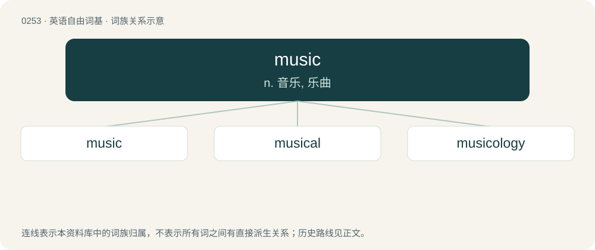

# 0281 · music — n. 音乐, 乐曲

[总目录](../00_总目录_按常用程度.md)

**类型**：英语自由词基　｜　**来源语言**：见词源记录

## 核心含义与来源

- 核心含义：n. 音乐, 乐曲
- 英文含义：A series of sounds organized in time, usually employing some combination of harmony, melody, rhythm, tempo, timbre, sound design, lyrics, etc., often to convey a mood.
- 词形：music

**来源记录 1**（名词；A series of sounds organized in time, usually employing some combination of harmony, melody, rhythm, tempo, timbre, sound design, lyrics, etc., often to convey a mood.）

From Middle English musik, musike, borrowed from Anglo-Norman musik, musike, Old French musique, and their source Latin mūsica, from Ancient Greek μουσική (mousikḗ), from Ancient Greek Μοῦσα (Moûsa, “Muse”), an Ancient Greek deity of the arts. By surface analysis, muse + -ic (“pertaining to”). In this sense, displaced native Old English drēam (“music”), whence Modern English dream. Fully displaced Old English sweġl.

## 词族图

## 单词速览（常用到不常用）

| 单词 | 音标 | 释义 |
|---|---|---|
| [music](#w-1) | 英 /ˈmjuːzɪk/；美 /ˈmju.zɪk/ | n. 音乐, 乐曲 |
| [musical](#w-2) | /ˈmju.zɪ.kəl/ | n. 音乐片, 音乐舞台剧；a. 音乐的, 声音美妙的, 喜爱音乐的 |
| [musicology](#w-3) | 英 /mjuːzɪˈkɒlədʒi/ | n. 音乐学 |

## 逐词详解

### 1. music

**词性**：名词　｜　**音标**：英 /ˈmjuːzɪk/；美 /ˈmju.zɪk/

**中文释义**：n. 音乐, 乐曲

**英文义项**：A series of sounds organized in time, usually employing some combination of harmony, melody, rhythm, tempo, timbre, sound design, lyrics, etc., often to convey a mood. / Any interesting or pleasing sounds.

**词源与演化**：

From Middle English musik, musike, borrowed from Anglo-Norman musik, musike, Old French musique, and their source Latin mūsica, from Ancient Greek μουσική (mousikḗ), from Ancient Greek Μοῦσα (Moûsa, “Muse”), an Ancient Greek deity of the arts. By surface analysis, muse + -ic (“pertaining to”). In this sense, displaced native Old English drēam (“music”), whence Modern English dream. Fully displaced Old English sweġl.

**例句**：

> I keep listening to this music because it’s a masterpiece.

该用例对应义项：A series of sounds organized in time, usually employing some combination of harmony, melody, rhythm, tempo, timbre, sound design, lyrics, etc., often to convey a mood.

### 2. musical

**词性**：形容词　｜　**音标**：/ˈmju.zɪ.kəl/

**中文释义**：n. 音乐片, 音乐舞台剧；a. 音乐的, 声音美妙的, 喜爱音乐的

**英文义项**：Of, belonging or relating to music, or to its performance or notation. / Pleasing to the ear; sounding agreeably; having the qualities of music; melodious; harmonious.

**构词拆分**：music + -al

**词源与演化**：

From Middle English musical, from Old French \[Term?\], from Medieval Latin mūsicālis, from Latin mūsica (“music”) + -ālis (suffix forming adjectives); equivalent to music + -al.

**例句**：

> She had a musical voice.

该用例对应义项：Pleasing to the ear; sounding agreeably; having the qualities of music; melodious; harmonious.

### 3. musicology

**词性**：名词　｜　**音标**：英 /mjuːzɪˈkɒlədʒi/

**中文释义**：n. 音乐学

**英文义项**：The scholarly or scientific study of music, as in historical research, music theory, or the physical nature of sound.

**构词拆分**：music + -logy

**词源与演化**：

From music + -logy.
