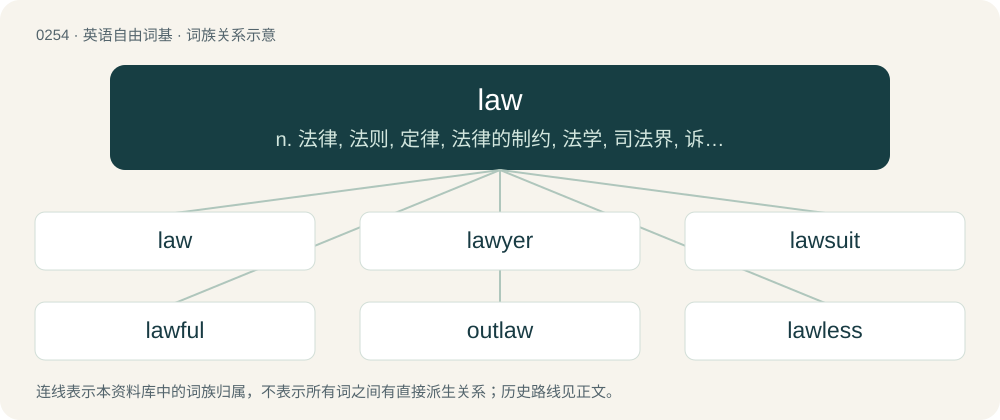

# 0283 · law — n. 法律, 法则, 定律, 法律的制约, 法学, 司法界, 诉讼；v. 起诉

[总目录](../00_总目录_按常用程度.md)

**类型**：英语自由词基　｜　**来源语言**：见词源记录

## 核心含义与来源

- 核心含义：n. 法律, 法则, 定律, 法律的制约, 法学, 司法界, 诉讼；v. 起诉
- 英文含义：The body of binding rules and regulations, customs, and standards established in a community by its legislative and judicial authorities.
- 词形：law

**多个词源／构词路径**：同一拼写可能有不同来源；以下按词性和含义分别列出。

**来源记录 1**（名词；The body of binding rules and regulations, customs, and standards established in a community by its legislative and judicial authorities.）

From Middle English lawe, laȝe, from Old English lagu (“law”), borrowed from Old Norse lǫg (“law”, literally “things laid down or firmly established”), originally the plural of lag (“layer, stratum, a laying in order, measure, stroke”), from Proto-Germanic \*lagą (“that which is laid down”), from Proto-Indo-European \*legʰ- (“to lie”). Cognate with Scots law (“law”), Icelandic lög (“things laid down, law”), Faroese lóg (“law”), Norwegian lov (“law”), Swedish lag (“law”), Danish lov (“law”), Finnish laki (“law”). Compare typologically distant cognate Russian уложе́ние (uložénije). Displaced native Old English ǣ and ġesetnes. More at lay. Not related to legal, nor to French loi, Spanish ley, all of which ultimately derive from Latin lēx, from Proto-Indo-European \*leǵ- (“to gather”).

**来源记录 2**（感叹词；An exclamation of mild surprise; lawks; in interjections, a minced oath for Lord.）

Compare la and Lawd.

## 词族图

## 单词速览（常用到不常用）

| 单词 | 音标 | 释义 |
|---|---|---|
| [law](#w-1) | 英 /lɔː/；美 /lɔ/ | n. 法律, 法则, 定律, 法律的制约, 法学, 司法界, 诉讼；v. 起诉 |
| [lawyer](#w-2) | 英 /ˈlɔːjə(ɹ)/；美 /ˈlɔɪ.ɚ/ | n. 律师；\[经\] 律师 |
| [lawsuit](#w-3) | 英 /ˈlɔːˌs(j)uːt/；美 /ˈlɔˌs(j)ut/ | n. 诉讼；\[法\] 诉讼, 诉讼案件 |
| [lawful](#w-4) | 英 /ˈlɔːfl̩/；美 /ˈlɔfl̩/ | a. 法律许可的, 守法的, 合法的；\[经\] 合法的, 法定的 |
| [outlaw](#w-5) | 英 /ˈaʊt.lɔː/；美 /ˈaʊt.lɔ/ | n. 被剥夺法律保护的人, 罪犯；vt. 使...失去法律保护, 将...逐出社会, 宣告非法, 取缔 |
| [lawless](#w-6) | /ˈlɔːləs/ | a. 非法的, 违法的 |
| [lawmaker](#w-7) | /lɒːˈmeikə/ | n. 立法者 |
| [lawman](#w-8) | 英 /ˈlɔːmæn/；美 /ˈlɔmæn/ | n. \[律\] 执法官, 警察, 警官 |
| [lawmaking](#w-9) | /lɒːˈmeikiŋ/ | n. 立法 |

## 逐词详解

### 1. law

**词性**：名词　｜　**音标**：英 /lɔː/；美 /lɔ/

**中文释义**：n. 法律, 法则, 定律, 法律的制约, 法学, 司法界, 诉讼；v. 起诉

**英文义项**：The body of binding rules and regulations, customs, and standards established in a community by its legislative and judicial authorities. / The body of such rules that pertain to a particular topic.

**词源与演化**：

From Middle English lawe, laȝe, from Old English lagu (“law”), borrowed from Old Norse lǫg (“law”, literally “things laid down or firmly established”), originally the plural of lag (“layer, stratum, a laying in order, measure, stroke”), from Proto-Germanic \*lagą (“that which is laid down”), from Proto-Indo-European \*legʰ- (“to lie”). Cognate with Scots law (“law”), Icelandic lög (“things laid down, law”), Faroese lóg (“law”), Norwegian lov (“law”), Swedish lag (“law”), Danish lov (“law”), Finnish laki (“law”). Compare typologically distant cognate Russian уложе́ние (uložénije). Displaced native Old English ǣ and ġesetnes. More at lay. Not related to legal, nor to French loi, Spanish ley, all of which ultimately derive from Latin lēx, from Proto-Indo-European \*leǵ- (“to gather”).

**例句**：

> Mathematical laws can be proved purely through mathematics, without scientific experimentation.

该用例对应义项：A statement (of relation) that is true under specified conditions; a mathematical or logical rule.

### 2. lawyer

**词性**：名词　｜　**音标**：英 /ˈlɔːjə(ɹ)/；美 /ˈlɔɪ.ɚ/

**中文释义**：n. 律师；\[经\] 律师

**英文义项**：A professional person with a graduate law degree that qualifies for legal work (such as Juris Doctor) / A professional person qualified (as by a law degree or bar exam) and authorized to practice law as an attorney-at-law, solicitor, advocate, barrister or equivalent, i.e. represent parties in lawsuits or trials and give legal advice.

**构词拆分**：law + -yer

**词源与演化**：

From Middle English lawiere, lawier, lawer, equivalent to law + -yer.

**用法示例／搭配（非完整句）**：

> A lawyer's time and advice are his stock in trade. \[one of various versions of an aphorism in law\]

该用例对应义项：A professional person qualified (as by a law degree or bar exam) and authorized to practice law as an attorney-at-law, solicitor, advocate, barrister or equivalent, i.e. represent parties in lawsuits or trials and give legal advice.

### 3. lawsuit

**词性**：名词　｜　**音标**：英 /ˈlɔːˌs(j)uːt/；美 /ˈlɔˌs(j)ut/

**中文释义**：n. 诉讼；\[法\] 诉讼, 诉讼案件

**英文义项**：In civil law, a case where two or more people disagree and one or more of the parties take the case to a court for resolution.

**构词拆分**：law + suit

**词源与演化**：

From law + suit.

**例句**：

> My ex-fiancé filed a lawsuit against me for a false restraining order and defamation.

该用例对应义项：In civil law, a case where two or more people disagree and one or more of the parties take the case to a court for resolution.

### 4. lawful

**词性**：形容词　｜　**音标**：英 /ˈlɔːfl̩/；美 /ˈlɔfl̩/

**中文释义**：a. 法律许可的, 守法的, 合法的；\[经\] 合法的, 法定的

**英文义项**：Conforming to, or recognised by the laws of society. / Operating according to some law or fundamental principle.

**构词拆分**：law + -ful

**词源与演化**：

From Middle English laweful, equivalent to law + -ful, conflated with Middle English leful, leeful, leveful (“according to law, lawful, pertaining to law”). See also leveful.

**例句**：

> Lawful money is always a land asset and can only be issued by an actual land jurisdiction government — not a corporation.

该用例对应义项：Conforming to, or recognised by the laws of society.

### 5. outlaw

**词性**：名词　｜　**音标**：英 /ˈaʊt.lɔː/；美 /ˈaʊt.lɔ/

**中文释义**：n. 被剥夺法律保护的人, 罪犯；vt. 使...失去法律保护, 将...逐出社会, 宣告非法, 取缔

**英文义项**：A fugitive from the law. / A criminal who is excluded from normal legal rights; one who can be killed at will without legal penalty.

**构词拆分**：out- + law

**词源与演化**：

From Middle English outlawe, outlagh, utlaȝe, from Old English ūtlaga (“outlaw”), borrowed from Old Norse útlagi (“outlaw, fugitive”), equivalent to out- + law. Cognate with Icelandic útlagi (“outlaw”).

**例句**：

> The main character in the play was a bit of an outlaw who refused to shake hands or say thank you.

该用例对应义项：A person who operates outside established norms.

### 6. lawless

**词性**：形容词　｜　**音标**：/ˈlɔːləs/

**中文释义**：a. 非法的, 违法的

**英文义项**：Not governed by any law. / Prohibited by law; unlawful, illegal.

**构词拆分**：law + -less

**词源与演化**：

From Middle English laweles; equivalent to law + -less. Cognate with Danish lovløs (“lawless”), Swedish laglös (“lawless”), Norwegian lovløs (“lawless”), Icelandic löglaus (“lawless”).

**用法示例／搭配（非完整句）**：

> On why leaving lawless places and leaving pseudovirtuous groups is loving such places and groups

该用例对应义项：Not restrained by the law or by discipline; disorderly, unruly.

### 7. lawmaker

**词性**：名词　｜　**音标**：/lɒːˈmeikə/

**中文释义**：n. 立法者

**英文义项**：One who makes or enacts laws.

**构词拆分**：law + maker

**词源与演化**：

From Middle English lawemaker, lawe maker, equivalent to law + maker.

**例句**：

> Ricks, 54, is now a lawmaker in the Colorado General Assembly, elected in November 2020.

### 8. lawman

**词性**：名词　｜　**音标**：英 /ˈlɔːmæn/；美 /ˈlɔmæn/

**中文释义**：n. \[律\] 执法官, 警察, 警官

**英文义项**：The presiding justice of the supreme court. / A man of the law: a lawyer.

**构词拆分**：law + -man

**词源与演化**：

From Middle English laweman, laȝaman (as a man's name, Laȝamon, Layamon), from Old English lahmann, borrowed from Old Norse lǫgmaðr. In present use as a law-enforcement officer, law + -man.

### 9. lawmaking

**词性**：名词　｜　**音标**：/lɒːˈmeikiŋ/

**中文释义**：n. 立法

**英文义项**：The process of passing or enacting laws; legislation.

**构词拆分**：law + making

**词源与演化**：

From law + making.

**例句**：

> The country adopted a unicameral legislature to simplify the lawmaking process.
