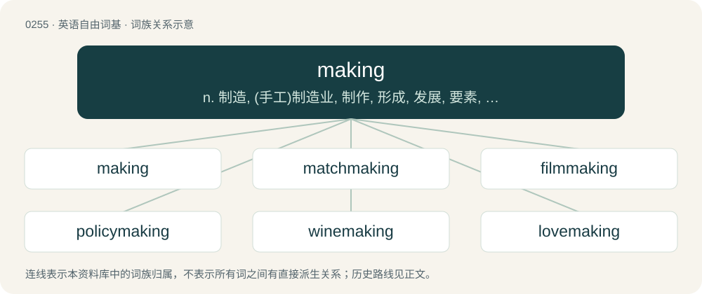

# 0284 · making — n. 制造, (手工)制造业, 制作, 形成, 发展, 要素, 内在因素, 赚头, 制造物

[总目录](../00_总目录_按常用程度.md)

**类型**：英语自由词基　｜　**来源语言**：见词源记录

## 核心含义与来源

- 核心含义：n. 制造, (手工)制造业, 制作, 形成, 发展, 要素, 内在因素, 赚头, 制造物
- 英文含义：The act of forming, causing, or constituting; workmanship; construction.
- 词形：making

**来源记录 1**（名词；The act of forming, causing, or constituting; workmanship; construction.）

From Middle English making, from Old English macung (“making”), equivalent to make + -ing. Cognate with dated Dutch making (“making”), Old High German machunga.

## 词族图

## 单词速览（常用到不常用）

| 单词 | 音标 | 释义 |
|---|---|---|
| [making](#w-1) | /ˈmeɪkɪŋ/ | n. 制造, (手工)制造业, 制作, 形成, 发展, 要素, 内在因素, 赚头, 制造物 |
| [matchmaking](#w-2) | /ˈmæt͡ʃˌmeɪkɪŋ/ | n. 火柴制造, 缔缘, 做媒 |
| [filmmaking](#w-3) | /ˈfilm.meikiŋ/ | n. 制片, 电影摄制 |
| [policymaking](#w-4) | /ˈpɔləsi,meikiŋ/ | \[法\] 政策制定者, 决策人 |
| [winemaking](#w-5) | /ˈwaɪnmeɪkɪŋ/ | n. 葡萄酒酿制；\[网络\] 葡萄酒酿造；酿酒；酿造方式 |
| [lovemaking](#w-6) | /ˈlʌvmeikiŋ/ | n. 调情, 寄情, 求婚 |
| [printmaking](#w-7) | /ˈprint,meikiŋ/ | n. 版画复制(术) |
| [rulemaking](#w-8) |  | 【英文】Having the power to make rules. |
| [playmaking](#w-9) | /ˈplei,meikiŋ/ | n. 控球后卫；发动机 |
| [peacemaking](#w-10) | /ˈpiːsˌmeɪ.kɪŋ/ | n. 调解, 调停；a. 调解的, 调停的 |
| [bookmaking](#w-11) | /ˈbjk,meikiŋ/ | n. 编书 |
| [steelmaking](#w-12) |  | n. 炼钢 |
| [watchmaking](#w-13) | /ˈwɒtʃ.meikiŋ/ | n. 钟表制造业 |
| [dressmaking](#w-14) | /ˈdresmeikiŋ/ | n. 服装缝制 |
| [papermaking](#w-15) | /ˈpeipə,meikiŋ/ | n. 造纸, 造纸业, 造纸学 |
| [homemaking](#w-16) | /ˈhəummeikiŋ/ | n. 家政 |

## 逐词详解

### 1. making

**词性**：名词　｜　**音标**：/ˈmeɪkɪŋ/

**中文释义**：n. 制造, (手工)制造业, 制作, 形成, 发展, 要素, 内在因素, 赚头, 制造物

**英文义项**：The act of forming, causing, or constituting; workmanship; construction. / Process of growth or development.

**构词拆分**：make + -ing

**词源与演化**：

From Middle English making, from Old English macung (“making”), equivalent to make + -ing. Cognate with dated Dutch making (“making”), Old High German machunga.

**例句**：

> As a child, he didn’t seem like a genius in the making.

该用例对应义项：Process of growth or development.

### 2. matchmaking

**词性**：名词　｜　**音标**：/ˈmæt͡ʃˌmeɪkɪŋ/

**中文释义**：n. 火柴制造, 缔缘, 做媒

**英文义项**：An attempt to make two people romantically interested in each other, especially an attempt to set up a date between people or to arrange a marriage. / A service aiming to bring together sellers and buyers or potential partners.

**构词拆分**：From match + making.

**词源与演化**：

From match + making.

**例句**：

> Tatoeba.org is not a site for friendly conversation, flirting, nor matchmaking.

### 3. filmmaking

**词性**：名词　｜　**音标**：/ˈfilm.meikiŋ/

**中文释义**：n. 制片, 电影摄制

**英文义项**：The activity of preparing edited video works, formerly principally films, whether for entertainment or other purposes. / The manufacture of physical film.

**构词拆分**：film + making

**词源与演化**：

From film + making.

### 4. policymaking

**词性**：名词　｜　**音标**：/ˈpɔləsi,meikiŋ/

**中文释义**：\[法\] 政策制定者, 决策人

**英文义项**：The formulation of policies.

**构词拆分**：From policy + making.

**词源与演化**：

From policy + making.

### 5. winemaking

**词性**：名词　｜　**音标**：/ˈwaɪnmeɪkɪŋ/

**中文释义**：n. 葡萄酒酿制；\[网络\] 葡萄酒酿造；酿酒；酿造方式

**英文义项**：The process of making wine.

**构词拆分**：wine + making

**词源与演化**：

From wine + making.

**例句**：

> Adriano appreciates the art of winemaking.

### 6. lovemaking

**词性**：名词　｜　**音标**：/ˈlʌvmeikiŋ/

**中文释义**：n. 调情, 寄情, 求婚

**英文义项**：Sexual intercourse. / Courtship; amorous advances.

**构词拆分**：love + making

**词源与演化**：

From love + making.

**例句**：

> His lovemaking disgusted her.

该用例对应义项：sexual activities (often including sexual intercourse) between two people

### 7. printmaking

**词性**：名词　｜　**音标**：/ˈprint,meikiŋ/

**中文释义**：n. 版画复制(术)

**英文义项**：The field of art concerned, roughly, with the transfer of ink or paint from a plate or block or through a screen mesh to paper.

**构词拆分**：print + making

**词源与演化**：

From print + making.

### 8. rulemaking

**词性**：形容词

**英文义项**：Having the power to make rules.

**构词拆分**：rule + making

**词源与演化**：

From rule + making.

### 9. playmaking

**词性**：名词　｜　**音标**：/ˈplei,meikiŋ/

**中文释义**：n. 控球后卫；发动机

**英文义项**：The initiation of offensive play with the intent of scoring a goal (or the equivalent)

**构词拆分**：play + making

**词源与演化**：

From play + making.

### 10. peacemaking

**词性**：名词　｜　**音标**：/ˈpiːsˌmeɪ.kɪŋ/

**中文释义**：n. 调解, 调停；a. 调解的, 调停的

**英文义项**：The act of reconciling two people or groups who disagree.

**构词拆分**：peace + making

**词源与演化**：

From peace + making.

### 11. bookmaking

**词性**：名词　｜　**音标**：/ˈbjk,meikiŋ/

**中文释义**：n. 编书

**英文义项**：The art or profession of determining odds and receiving and paying off bets, especially bets on the outcome of sporting events. / The art or practice of printing and binding books.

**构词拆分**：book + making

**词源与演化**：

From Middle English boke-making, equivalent to book + making.

### 12. steelmaking

**词性**：名词

**中文释义**：n. 炼钢

**英文义项**：The manufacture of steel.

**构词拆分**：steel + making

**词源与演化**：

From steel + making.

### 13. watchmaking

**词性**：名词　｜　**音标**：/ˈwɒtʃ.meikiŋ/

**中文释义**：n. 钟表制造业

**英文义项**：The making (and repairing) of watches.

**构词拆分**：watch + making

**词源与演化**：

From watch + making.

### 14. dressmaking

**词性**：名词　｜　**音标**：/ˈdresmeikiŋ/

**中文释义**：n. 服装缝制

**英文义项**：The craft of making custom clothing for women, such as dresses, blouses, and evening gowns.

**构词拆分**：dress + making

**词源与演化**：

From dress + making.

### 15. papermaking

**词性**：名词　｜　**音标**：/ˈpeipə,meikiŋ/

**中文释义**：n. 造纸, 造纸业, 造纸学

**英文义项**：The craft of making paper.

**构词拆分**：paper + making

**词源与演化**：

From paper + making.

**例句**：

> The port city of 20,000 has a reputation as one of Australia's premier papermaking centers.

### 16. homemaking

**词性**：名词　｜　**音标**：/ˈhəummeikiŋ/

**中文释义**：n. 家政

**英文义项**：The management of a household considered as an occupation.

**构词拆分**：home + making

**词源与演化**：

From home + making.
