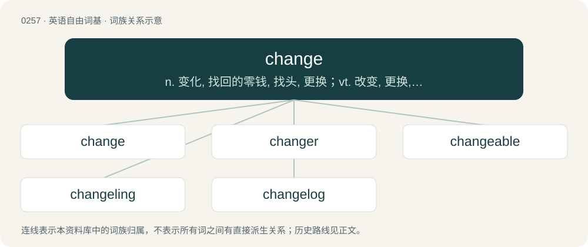

# 0286 · change — n. 变化, 找回的零钱, 找头, 更换；vt. 改变, 更换, 兑换

[总目录](../00_总目录_按常用程度.md)

**类型**：英语自由词基　｜　**来源语言**：见词源记录

## 核心含义与来源

- 核心含义：n. 变化, 找回的零钱, 找头, 更换；vt. 改变, 更换, 兑换
- 英文含义：To become something different.
- 词形：change

**来源记录 1**（动词；To become something different.）

From Middle English changen, chaungen, from Old French changier, from Late Latin cambiāre, from Latin cambīre (“to exchange, barter”), derived from the noun cambium (“change”) (whence was loaned the English doublet cambium), from Gaulish cambion, earlier \*kambyom (“change”), related to Proto-Celtic \*kambos (“twisted, crooked”), possibly from Proto-Indo-European \*(s)ḱh₂(e)mbos, \*(s)kh₂(e)mbos (“crooked”). More at skimp, scam; see also Proto-Indo-European \*kh₂em-. Cognate with Italian cambiare, Portuguese cambiar, Romanian schimba, Sicilian canciari, Spanish cambiar. Used in English since the 13th century. Displaced Middle English wenden, from wendan (“to turn, change”) (whence wend). The noun is from Middle English change, chaunge, from Old French change, from the verb changier. See also exchange. Possibly related from the same source is Old English gombe.

## 词族图

## 单词速览（常用到不常用）

| 单词 | 音标 | 释义 |
|---|---|---|
| [change](#w-1) | 英 /ˈt͡ʃeɪnd͡ʒ/；/t͡ʃeːnd͡ʒ/ | n. 变化, 找回的零钱, 找头, 更换；vt. 改变, 更换, 兑换 |
| [changer](#w-2) | 英 /ˈt͡ʃeɪnd͡ʒə/；美 /ˈt͡ʃeɪnd͡ʒɚ/ | \[计\] 变换器, 转换器, 转接开关；\[经\] 兑换店 |
| [changeable](#w-3) | /ˈt͡ʃeɪn.d͡ʒə.bəl/ | a. 可改变的 |
| [changeling](#w-4) | 英 /ˈtʃeɪn(d)ʒlɪŋ/；美 /ˈt͡ʃeɪnd͡ʒlɪŋ/ | n. 被偷换后留下的孩童, 矮小丑陋的小孩, 低能儿 |
| [changelog](#w-5) | 英 /ˈtʃeɪndʒˌlɒɡ/ | 【英文】A log that records changes between versions, as in source control. |

## 逐词详解

### 1. change

**词性**：动词　｜　**音标**：英 /ˈt͡ʃeɪnd͡ʒ/；/t͡ʃeːnd͡ʒ/

**中文释义**：n. 变化, 找回的零钱, 找头, 更换；vt. 改变, 更换, 兑换

**英文义项**：To become something different. / To make something into something else.

**词源与演化**：

From Middle English changen, chaungen, from Old French changier, from Late Latin cambiāre, from Latin cambīre (“to exchange, barter”), derived from the noun cambium (“change”) (whence was loaned the English doublet cambium), from Gaulish cambion, earlier \*kambyom (“change”), related to Proto-Celtic \*kambos (“twisted, crooked”), possibly from Proto-Indo-European \*(s)ḱh₂(e)mbos, \*(s)kh₂(e)mbos (“crooked”). More at skimp, scam; see also Proto-Indo-European \*kh₂em-. Cognate with Italian cambiare, Portuguese cambiar, Romanian schimba, Sicilian canciari, Spanish cambiar. Used in English since the 13th century. Displaced Middle English wenden, from wendan (“to turn, change”) (whence wend). The noun is from Middle English change, chaunge, from Old French change, from the verb changier. See also exchange. Possibly related from the same source is Old English gombe.

**例句**：

> I had to change the wording of the ad so it would fit.

该用例对应义项：To make something into something else.

### 2. changer

**词性**：名词　｜　**音标**：英 /ˈt͡ʃeɪnd͡ʒə/；美 /ˈt͡ʃeɪnd͡ʒɚ/

**中文释义**：\[计\] 变换器, 转换器, 转接开关；\[经\] 兑换店

**英文义项**：Someone or something who changes things. / Someone or something that changes or transforms itself.

**构词拆分**：change + -er

**词源与演化**：

Inherited from Middle English chaungere, chaungeour (“moneychanger”); equivalent to change + -er.

**例句**：

> She bought a coin changer for her pool bar.

该用例对应义项：Someone or something who changes things.

### 3. changeable

**词性**：形容词　｜　**音标**：/ˈt͡ʃeɪn.d͡ʒə.bəl/

**中文释义**：a. 可改变的

**英文义项**：Capable of being changed. / Subject to sudden or frequent changes.

**构词拆分**：change + -able

**词源与演化**：

From Middle English chaungeable, from Old Northern French chaungeable, from Late Latin cambiāre (“to change”), equivalent to change + -able.

**例句**：

> The weather is very changeable today: we've had bright sunshine, clouds, wind and rain in the same half-hour.

该用例对应义项：Subject to sudden or frequent changes.

### 4. changeling

**词性**：名词　｜　**音标**：英 /ˈtʃeɪn(d)ʒlɪŋ/；美 /ˈt͡ʃeɪnd͡ʒlɪŋ/

**中文释义**：n. 被偷换后留下的孩童, 矮小丑陋的小孩, 低能儿

**英文义项**：In pre-modern European folklore: an infant of a magical creature that was secretly exchanged for a human infant. In British, Irish and Scandinavian mythology the exchanged infants were thought to be those of fairies, sprites or trolls; in other places, they were ascribed to demons, devils, or witches. / A person or object (especially when regarded as inferior) secretly exchanged for something else.

**构词拆分**：change + -ling (suffix with the sense ‘immature; small’)

**词源与演化**：

The noun is derived from change + -ling (suffix with the sense ‘immature; small’). Sense 6 (“idiot, simpleton”) is from the idea that foolish children had been left by magical creatures (sense 1). The adjective is derived from the noun.

**例句**：

> In the Deep Space 9 space station, Odo is a Changeling security chief.

### 5. changelog

**词性**：名词　｜　**音标**：英 /ˈtʃeɪndʒˌlɒɡ/

**英文义项**：A log that records changes between versions, as in source control.

**构词拆分**：change + log

**词源与演化**：

From change + log.
