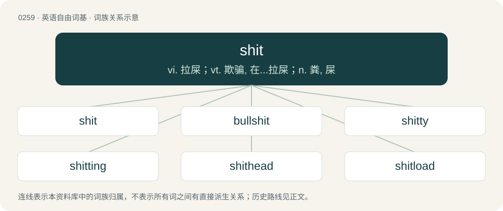

# 0288 · shit — vi. 拉屎；vt. 欺骗, 在...拉屎；n. 粪, 屎

[总目录](../00_总目录_按常用程度.md)

**类型**：英语自由词基　｜　**来源语言**：见词源记录

## 核心含义与来源

- 核心含义：vi. 拉屎；vt. 欺骗, 在...拉屎；n. 粪, 屎
- 英文含义：Usually solid excretory product evacuated from the bowels; feces.
- 词形：shit

**多个词源／构词路径**：同一拼写可能有不同来源；以下按词性和含义分别列出。

**来源记录 1**（名词；Usually solid excretory product evacuated from the bowels; feces.）

From Middle English schit, schyt, from Old English \*sċite (“dung”) and sċitte (“diarrhoea”), from Proto-West Germanic \*skiti and \*skittjā, from Proto-Germanic \*skitiz, from Proto-Indo-European \*skeyd- (“to split, divide, separate”). Related to Saterland Frisian Skiete, West Frisian skyte, skyt, Dutch schijt, German Low German Schiet, German Scheiße, Danish skidt, Swedish and Norwegian Nynorsk skit, Norwegian Bokmål skitt, Icelandic skítur. Compare shite. Doublet of scheisse.

**来源记录 2**（动词；To defecate.）

From Middle English schiten, shiten, from Old English sċītan, from Proto-West Germanic \*skītan, from Proto-Germanic \*skītaną, from Proto-Indo-European \*skéydt, from \*skeyd-, \*skeh₁i-d (“to cut”) (compare \*skey-). Cognate with West Frisian skite, Low German schieten, Dutch schijten, German scheißen, Danish skide. More at shed.

## 词族图

## 单词速览（常用到不常用）

| 单词 | 音标 | 释义 |
|---|---|---|
| [shit](#w-1) | /ʃɪt/ | vi. 拉屎；vt. 欺骗, 在...拉屎；n. 粪, 屎 |
| [bullshit](#w-2) | /ˈbʊɫʃɪt/ | n. 胡说 |
| [shitty](#w-3) | 英 /ˈʃɪti/；美 /ˈʃɪti/ | 劣等的, 较差的 |
| [shitting](#w-4) | /ˈʃɪtɪŋ/ | v. 大便, 拉屎( shit的现在分词 ); 拉屎弄脏（某物）; 取笑; 欺骗 |
| [shithead](#w-5) | /ˈʃɪt.hɛd/ | n. 笨蛋 |
| [shitload](#w-6) | 美 /ˈʃɪtˌloʊd/ | 【英文】A large amount. |
| [dipshit](#w-7) | /ˈdɪpʃɪt/ | 笨蛋 |
| [horseshit](#w-8) | /ˈhɔːsʃit,ˈhɔːʃ-/ | n. 胡说, 谎话 |
| [shitless](#w-9) | /ˈʃitlis/ | adv. &lt;俚&gt;&lt;粗&gt;极度,非常 |
| [shitter](#w-10) | 英 /ˈʃɪt.ə/；美 /ˈʃɪt.ɚ/ | n. 厕所；坐桶；\[美国英语\]马 |
| [shitstorm](#w-11) |  | 【英文】A chaotic and unpleasant or violent situation. |
| [shithouse](#w-12) | 美 /ˈʃɪtˌhaʊs/ | 厕所；卫生间 |
| [shitbag](#w-13) |  | 【英文】A colostomy bag. |
| [shitfaced](#w-14) | /ˈʃɪtfeɪst/ | 【英文】Very drunk. |
| [chickenshit](#w-15) | /ˈtʃikinʃit/ | n. 琐碎的细节, 不重要的工作；a. 渺小的 |
| [shitpost](#w-16) | 英 /ˈʃɪtpəʊst/；美 /ˈʃɪtpoʊst/ | 【英文】A worthless or superficially meaningless post on a message board, newsgroup, or other online discussion platform, often intended to derail or distract from relevant conversation. |
| [apeshit](#w-17) | /ˈeɪp.ʃɪt/ | 愤怒 |

## 逐词详解

### 1. shit

**词性**：名词　｜　**音标**：/ʃɪt/

**中文释义**：vi. 拉屎；vt. 欺骗, 在...拉屎；n. 粪, 屎

**英文义项**：Usually solid excretory product evacuated from the bowels; feces. / The act of shitting.

**词源与演化**：

From Middle English schit, schyt, from Old English \*sċite (“dung”) and sċitte (“diarrhoea”), from Proto-West Germanic \*skiti and \*skittjā, from Proto-Germanic \*skitiz, from Proto-Indo-European \*skeyd- (“to split, divide, separate”). Related to Saterland Frisian Skiete, West Frisian skyte, skyt, Dutch schijt, German Low German Schiet, German Scheiße, Danish skidt, Swedish and Norwegian Nynorsk skit, Norwegian Bokmål skitt, Icelandic skítur. Compare shite. Doublet of scheisse.

**例句**：

> I heard Bobby escaped from the police by jumping off a bridge into the river. Ain't that some shit?

该用例对应义项：Anything exceptional or remarkable.

### 2. bullshit

**词性**：名词　｜　**音标**：/ˈbʊɫʃɪt/

**中文释义**：n. 胡说

**英文义项**：Feces produced by a bull. / Statements that are false or exaggerated to impress or cheat the listener.

**构词拆分**：bull + shit

**词源与演化**：

From bull + shit. Figurative use as a noun referring to useless or untrue information is attested from the 1910s.

**例句**：

> That's total bullshit! I called your office and they said that you didn't come in!

该用例对应义项：Statements that are transparently or offensively false.

### 3. shitty

**词性**：形容词　｜　**音标**：英 /ˈʃɪti/；美 /ˈʃɪti/

**中文释义**：劣等的, 较差的

**英文义项**：Very bad; unpleasant; miserable; insignificant. / Under the influence of illicit drugs or alcohol; drunk; high.

**构词拆分**：shit + -y

**词源与演化**：

From shit + -y. Cognate with German Low German schittig (“dirty, shitty”), German scheißig (“shitty”).

**例句**：

> The television I bought there was so shitty that I will never shop there again.

该用例对应义项：Very bad; unpleasant; miserable; insignificant.

### 4. shitting

**词性**：名词　｜　**音标**：/ˈʃɪtɪŋ/

**中文释义**：v. 大便, 拉屎( shit的现在分词 ); 拉屎弄脏（某物）; 取笑; 欺骗

**英文义项**：The act of defecating.

**构词拆分**：shit + -ing

**词源与演化**：

From shit + -ing. Compare Middle English schitinge, schytynge (“defecation”), whence modern English shiting.

**例句**：

> Mennad was shitting in a place in full sight of the road.

### 5. shithead

**词性**：名词　｜　**音标**：/ˈʃɪt.hɛd/

**中文释义**：n. 笨蛋

**英文义项**：A stupid or contemptible person. / A card game, the aim of which is to lose one's cards.

**构词拆分**：shit + head

**词源与演化**：

From shit + head. Dysphemistically modelled after dickhead.

**例句**：

> Unfortunately Todd is a dummy, but what's worse is that Harvey is a shithead.

该用例对应义项：A stupid or contemptible person.

### 6. shitload

**词性**：名词　｜　**音标**：美 /ˈʃɪtˌloʊd/

**英文义项**：A large amount.

**构词拆分**：shit + load

**词源与演化**：

From shit + load.

**例句**：

> They say the best fertilizer is manure, so I bought a shitload of it.

### 7. dipshit

**词性**：名词　｜　**音标**：/ˈdɪpʃɪt/

**中文释义**：笨蛋

**英文义项**：A stupid, obnoxious, or undesirable person.

**构词拆分**：dip (“foolish person”) + shit

**词源与演化**：

Compound of dip (“foolish person”) + shit. First attested in c. 1960s.

**例句**：

> That guy at work is such a dipshit!

该用例对应义项：A stupid, obnoxious, or undesirable person.

### 8. horseshit

**词性**：名词　｜　**音标**：/ˈhɔːsʃit,ˈhɔːʃ-/

**中文释义**：n. 胡说, 谎话

**英文义项**：Serious harassment or abuse. / Blatant nonsense, more likely stemming from ignorance than any intent to deceive.

**构词拆分**：horse + shit

**词源与演化**：

From horse + shit.

**例句**：

> He claims that he wasn't at that meeting? Don't you realize that's horseshit?

该用例对应义项：Deliberate falsehoods (lies); manipulations or cons (fraud).

### 9. shitless

**词性**：形容词　｜　**音标**：/ˈʃitlis/

**中文释义**：adv. &lt;俚&gt;&lt;粗&gt;极度,非常

**英文义项**：Having an empty bowel; greatly frightened; see usage notes below.

**构词拆分**：shit + -less

**词源与演化**：

From shit + -less. Compare scare the shit out of.

**例句**：

> The movie The Ring scared me shitless as a child.

该用例对应义项：Having an empty bowel; greatly frightened; see usage notes below.

### 10. shitter

**词性**：名词　｜　**音标**：英 /ˈʃɪt.ə/；美 /ˈʃɪt.ɚ/

**中文释义**：n. 厕所；坐桶；\[美国英语\]马

**英文义项**：One who defecates. / A toilet or lavatory; an outhouse.

**构词拆分**：shit + -er；shit + -er (patient suffix)

**词源与演化**：

Agent noun formed from shit + -er. The sense referring to a toilet formed from shit + -er (patient suffix).

**例句**：

> Hold on, I gotta use the shitter.

该用例对应义项：A toilet or lavatory; an outhouse.

### 11. shitstorm

**词性**：名词

**英文义项**：A chaotic and unpleasant or violent situation. / Considerable backlash from the public.

**构词拆分**：shit + storm

**词源与演化**：

From shit + storm.

### 12. shithouse

**词性**：名词　｜　**音标**：美 /ˈʃɪtˌhaʊs/

**中文释义**：厕所；卫生间

**英文义项**：An outhouse, an outbuilding used as a lavatory. / A coward; one who is overly fearful or timid.

**构词拆分**：shit + house

**词源与演化**：

From shit + house. Compare Middle Low German schîthûs, German Scheißhaus, Swedish skithus, Icelandic skíthús.

### 13. shitbag

**词性**：名词

**英文义项**：A colostomy bag. / A worthless or despicable person.

**构词拆分**：shit + bag

**词源与演化**：

From shit + bag. Sense 2 was dysphemistically modelled after scumbag.

### 14. shitfaced

**词性**：形容词　｜　**音标**：/ˈʃɪtfeɪst/

**英文义项**：Very drunk. / Under the influence of mind-altering drugs.

**构词拆分**：shit + faced

**词源与演化**：

From shit + faced.

**例句**：

> When they brought in that keg, I knew I was going to get shitfaced.

该用例对应义项：Very drunk.

### 15. chickenshit

**词性**：形容词　｜　**音标**：/ˈtʃikinʃit/

**中文释义**：n. 琐碎的细节, 不重要的工作；a. 渺小的

**英文义项**：Petty; contemptibly unimportant. (Compare bullshit.) / Cowardly.

**构词拆分**：chicken + shit

**词源与演化**：

From chicken + shit.

**例句**：

> How chickenshit of that girl to just stand there and do nothing.

该用例对应义项：Cowardly.

### 16. shitpost

**词性**：名词　｜　**音标**：英 /ˈʃɪtpəʊst/；美 /ˈʃɪtpoʊst/

**英文义项**：A worthless or superficially meaningless post on a message board, newsgroup, or other online discussion platform, often intended to derail or distract from relevant conversation. / A seemingly worthless or superficially meaningless image, video or piece of text posted to a social media platform that is intended to be humorously or ironically enjoyed.

**构词拆分**：shit + -post

**词源与演化**：

From shit + -post.

**例句**：

> Tom loves to shitpost in his spare time.

### 17. apeshit

**词性**：形容词　｜　**音标**：/ˈeɪp.ʃɪt/

**中文释义**：愤怒

**英文义项**：Out of control due to anger or excitement. / awesome

**构词拆分**：ape + shit

**词源与演化**：

From ape + shit, possibly from the tendency of certain primate species to throw faeces when extremely annoyed.

**例句**：

> I told him the bad news, and he went apeshit.

该用例对应义项：Out of control due to anger or excitement.
