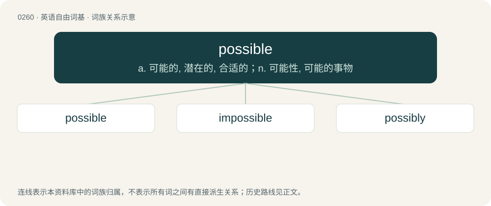

# 0289 · possible — a. 可能的, 潜在的, 合适的；n. 可能性, 可能的事物

[总目录](../00_总目录_按常用程度.md)

**类型**：英语自由词基　｜　**来源语言**：见词源记录

## 核心含义与来源

- 核心含义：a. 可能的, 潜在的, 合适的；n. 可能性, 可能的事物
- 英文含义：Able but not certain to happen; neither inevitable nor impossible.
- 词形：possible

**来源记录 1**（形容词；Able but not certain to happen; neither inevitable nor impossible.）

From Middle English possible, from Old French possible, from Latin possibilis (“possible”), from posse, possum (“to be able”); see power. Displaced Middle English acumendlic (“possible”), from Old English ācumendlīċ (“possible”). Compare also Old English mihtelīċ (“strong, capable, powerful, possible”), which was cognate with Old High German mahtlīh (“possible”) and Old Norse máttulígr (“mighty, possible”). Compare also Dutch mogelijk (“possible”) and German möglich (“possible”).

## 词族图

## 单词速览（常用到不常用）

| 单词 | 音标 | 释义 |
|---|---|---|
| [possible](#w-1) | 英 /ˈpɒs.ə.bəl/；美 /ˈpɑ.sə.bəl/ | a. 可能的, 潜在的, 合适的；n. 可能性, 可能的事物 |
| [impossible](#w-2) | 英 /ɪmˈpɒs.ɪ.bəl/；美 /ɪmˈpɑ.sə.bəl/ | a. 不可能的, 难以置信的, 令人无法忍受的 |
| [possibly](#w-3) | 英 /ˈpɒs.ə.bli/；美 /ˈpɑ.sɪ.bli/ | adv. 可能, 也许 |

## 逐词详解

### 1. possible

**词性**：形容词　｜　**音标**：英 /ˈpɒs.ə.bəl/；美 /ˈpɑ.sə.bəl/

**中文释义**：a. 可能的, 潜在的, 合适的；n. 可能性, 可能的事物

**英文义项**：Able but not certain to happen; neither inevitable nor impossible. / Capable of being done or achieved; feasible.

**词源与演化**：

From Middle English possible, from Old French possible, from Latin possibilis (“possible”), from posse, possum (“to be able”); see power. Displaced Middle English acumendlic (“possible”), from Old English ācumendlīċ (“possible”). Compare also Old English mihtelīċ (“strong, capable, powerful, possible”), which was cognate with Old High German mahtlīh (“possible”) and Old Norse máttulígr (“mighty, possible”). Compare also Dutch mogelijk (“possible”) and German möglich (“possible”).

**例句**：

> It's not just possible, it's probable that there will be rain tomorrow.

该用例对应义项：Able but not certain to happen; neither inevitable nor impossible.

### 2. impossible

**词性**：形容词　｜　**音标**：英 /ɪmˈpɒs.ɪ.bəl/；美 /ɪmˈpɑ.sə.bəl/

**中文释义**：a. 不可能的, 难以置信的, 令人无法忍受的

**英文义项**：Not possible; not able to be done or happen. / Very difficult to deal with.

**构词拆分**：im- + possible

**词源与演化**：

From Middle English impossible, equivalent to im- + possible.

**例句**：

> Sarah thinks that nothing is impossible because things can always somehow happen.

该用例对应义项：Not possible; not able to be done or happen.

### 3. possibly

**词性**：副词　｜　**音标**：英 /ˈpɒs.ə.bli/；美 /ˈpɑ.sɪ.bli/

**中文释义**：adv. 可能, 也许

**英文义项**：Perhaps; indicates that the proposition may be true (is not certainly false) regardless of any facts or circumstances known to, stated by or implied by the speaker. / In the realm of possibility; indicates that the action may successfully be performed (is not impossible) regardless of any facts or circumstances known to, stated by or implied by the speaker that might limit the performance.

**构词拆分**：possible + -ly

**词源与演化**：

From possible + -ly.

**例句**：

> It was possibly the costliest mistake in the organization's history.

该用例对应义项：Perhaps; indicates that the proposition may be true (is not certainly false) regardless of any facts or circumstances known to, stated by or implied by the speaker.
