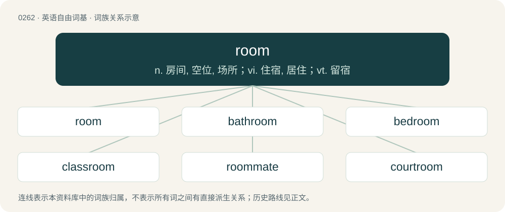

# 0291 · room — n. 房间, 空位, 场所；vi. 住宿, 居住；vt. 留宿

[总目录](../00_总目录_按常用程度.md)

**类型**：英语自由词基　｜　**来源语言**：见词源记录

## 核心含义与来源

- 核心含义：n. 房间, 空位, 场所；vi. 住宿, 居住；vt. 留宿
- 英文含义：Space for something, or to carry out an activity.
- 词形：room

**多个词源／构词路径**：同一拼写可能有不同来源；以下按词性和含义分别列出。

**来源记录 1**（名词；Space for something, or to carry out an activity.）

From Middle English roum (“room, space”), from Old English rūm (“room, space”), from Proto-West Germanic \*rūm (“room”), from Proto-Germanic \*rūmą (“room”), from Proto-Indo-European \*(H)rewH- (“to root; to rip, tear”), from \*Hrew- (“to tear out, open”). Cognates Cognate with North Frisian rüm (“room, space”), Saterland Frisian and Low German Ruum (“room, space”), Dutch ruim (“open space; cargo hold”), German and Luxembourgish Raum (“room, space”), Vilamovian raojm (“room”), Danish and Swedish rum (“room, space”), Faroese and Icelandic rúm (“space, room”), Norwegian Bokmål and Norwegian Nynorsk rom (“room, space”), Gothic 𐍂𐌿𐌼 (rum, “room, space”); also Irish rúsc (“bark”), Manx roost (“bark; peel, rind”), Scottish Gaelic rùsg (“rind; bark; fleece; shell”), Welsh rhisgl (“bark”), Latin rūs (“country, fields, lands; estate, farm; village”), Ancient Greek ὀρύσσω (orússō), ὀρύττω (orúttō, “to dig”), Latvian raut (“to pull with force”), Lithuanian rauti (“to grub, pull”), Belarusian рыць (rycʹ, “to dig”), Bulgarian ри́я (ríja, “to excavate”), Czech rýt (“to dig; to engrave”), Polish ryć (“to dig”), Russian рыть (rytʹ, “to dig; to burrow, mine”), Slovak ryť (“to dig; to engrave”), Slovene riti (“to dig”), Ukrainian ри́ти (rýty, “to dig, excavate”), Central Kurdish ڕێو (rêw, “public hair”), Tocharian A kärpi (“raw, rough; common”), Tocharian B kärpiye (“raw, rough; common”), Sanskrit लोमन् (loman), रोमन् (roman, “body hair; down, wool”). More at rural. Doublet of Raum, a surname from German. The word superficially appears to be an exception to the Great Vowel Shift, which might have produced the pronunciation /ɹaʊm/, but the retention of Middle English /uː/ before /m/ is regular. In fact, /aʊ/ does not occur before non-coronal consonants in Standard Modern English native vocabulary. Some dialects did undergo diphthongization in such a position and the pronunciation /ɹaʊm/ occurs, for example, in Lancashire.

**来源记录 2**（副词；Off from the wind.）

From Middle English rome, from Old English rūme (“widely, spaciously, roomily, far and wide, so as to extend over a wide space, liberally, extensively, amply, abundantly, in a high degree, without restriction or encumbrance, without the pressure of care, light-heartedly, without obstruction, plainly, clearly, in detail”). Cognate with Dutch ruim (“amply”, adverb).

## 词族图

## 单词速览（常用到不常用）

| 单词 | 音标 | 释义 |
|---|---|---|
| [room](#w-1) | 英 /ɹʊm/；美 /ɹum/ | n. 房间, 空位, 场所；vi. 住宿, 居住；vt. 留宿 |
| [bathroom](#w-2) | 英 /ˈbɑːθɹʊm/；美 /ˈbæθˌɹum/ | n. 浴室, 厕所 |
| [bedroom](#w-3) | 英 /ˈbɛdɹuːm/；美 /ˈbɛdˌɹum/ | n. 卧室 |
| [classroom](#w-4) | 英 /ˈklɑːsɹʊm/ | n. 教室 |
| [roommate](#w-5) | 美 /ˈɹu(m)ˌmeɪt/ | n. 住在同室的人 |
| [courtroom](#w-6) | /ˈkɒːtrum/ | n. 法庭, 审判室；\[法\] 法庭, 审判室 |
| [ballroom](#w-7) | /ˈbɔːlɹuːm/ | n. 舞厅, 跳舞场 |
| [restroom](#w-8) | 美 /ˈɹɛstˌɹum/ | n. 洗手间；休息室；更衣室；厕所 |
| [newsroom](#w-9) | /ˈnjuːzɹuːm/ | n. 新闻编辑部, 报刊阅览室, 售报处 |
| [showroom](#w-10) | 美 /ˈʃoʊˌɹum/ | n. 陈列室；\[经\] 样品间, 陈列室 |
| [boardroom](#w-11) | 英 /ˈbɔːdˌɹuːm/ | n. 会议室, 证券交换场所 |
| [washroom](#w-12) | Canada /ˈwɒʃrʊm/ | n. 盥洗室 |
| [backroom](#w-13) | 英 /ˈbækˌɹuːm/；美 /ˈbækˌɹum/ | n. 后房, 密室；a. 在密室中的 |
| [roomy](#w-14) | 英 /ˈɹuːmi/ | a. 广阔的, 宽敞的, 宽大的 |
| [darkroom](#w-15) | /ˈdɑːkrum/ | n. 暗房；\[医\] 暗室 |
| [lightroom](#w-16) |  | 【英文】A small room from which the magazine of a naval vessel is lighted, being separated from the magazine by heavy glass windows. |
| [headroom](#w-17) | /ˈhedruːm/ | n. 净空, 车身内部高度 |
| [storeroom](#w-18) | /ˈstɒːrum/ | n. 储藏室, 库房；\[经\] 仓库货栈, 储藏室 |
| [playroom](#w-19) | /ˈpleiruːm/ | n. 游戏室, 娱乐室 |
| [homeroom](#w-20) | 美 /ˈhoʊmˌɹum/ | n. 学生接受指导的教室 |
| [roomie](#w-21) | /ˈruːmi/ | n. 住在同室的人 |
| [cloakroom](#w-22) | /ˈkləʊkɹʊm/ | n. 寄物间 |
| [legroom](#w-23) | /ˈlɛɡɹuːm/ | n. 放脚空间, 踏脚处 |
| [stateroom](#w-24) | /ˈsteitruːm/ | n. 政府公寓, 特等舱 |
| [workroom](#w-25) | 美 /ˈwɝk.ɹum/ | n. 工作室 |
| [schoolroom](#w-26) | /ˈskuːlruːm/ | n. 教室, 讲堂 |
| [roomful](#w-27) | /ˈruːmful/ | n. 满房间, 满场的人 |
| [lunchroom](#w-28) | 美 /ˈlʌnt͡ʃˌɹum/ | n. 便餐厅 |
| [taproom](#w-29) | 美 /ˈtæpˌɹum/ | n. 酒吧间 |
| [barroom](#w-30) | /ˈbɑːruːm/ | n. 酒吧间 |
| [tearoom](#w-31) | 美 /ˈtiˌɹum/ | n. 茶室 |
| [mailroom](#w-32) | /ˈmeɪlruːm/ | 邮件收发室 |
| [stockroom](#w-33) | /ˈstɔkruːm. -rum/ | n. 商品储藏室；仓库 |
| [sunroom](#w-34) | 美 /ˈsʌnˌɹum/ | n. (=sun parlor)日光浴室 |

## 逐词详解

### 1. room

**词性**：名词　｜　**音标**：英 /ɹʊm/；美 /ɹum/

**中文释义**：n. 房间, 空位, 场所；vi. 住宿, 居住；vt. 留宿

**英文义项**：Space for something, or to carry out an activity. / Sufficient space for or to do something.

**词源与演化**：

From Middle English roum (“room, space”), from Old English rūm (“room, space”), from Proto-West Germanic \*rūm (“room”), from Proto-Germanic \*rūmą (“room”), from Proto-Indo-European \*(H)rewH- (“to root; to rip, tear”), from \*Hrew- (“to tear out, open”). Cognates Cognate with North Frisian rüm (“room, space”), Saterland Frisian and Low German Ruum (“room, space”), Dutch ruim (“open space; cargo hold”), German and Luxembourgish Raum (“room, space”), Vilamovian raojm (“room”), Danish and Swedish rum (“room, space”), Faroese and Icelandic rúm (“space, room”), Norwegian Bokmål and Norwegian Nynorsk rom (“room, space”), Gothic 𐍂𐌿𐌼 (rum, “room, space”); also Irish rúsc (“bark”), Manx roost (“bark; peel, rind”), Scottish Gaelic rùsg (“rind; bark; fleece; shell”), Welsh rhisgl (“bark”), Latin rūs (“country, fields, lands; estate, farm; village”), Ancient Greek ὀρύσσω (orússō), ὀρύττω (orúttō, “to dig”), Latvian raut (“to pull with force”), Lithuanian rauti (“to grub, pull”), Belarusian рыць (rycʹ, “to dig”), Bulgarian ри́я (ríja, “to excavate”), Czech rýt (“to dig; to engrave”), Polish ryć (“to dig”), Russian рыть (rytʹ, “to dig; to burrow, mine”), Slovak ryť (“to dig; to engrave”), Slovene riti (“to dig”), Ukrainian ри́ти (rýty, “to dig, excavate”), Central Kurdish ڕێو (rêw, “public hair”), Tocharian A kärpi (“raw, rough; common”), Tocharian B kärpiye (“raw, rough; common”), Sanskrit लोमन् (loman), रोमन् (roman, “body hair; down, wool”). More at rural. Doublet of Raum, a surname from German. The word superficially appears to be an exception to the Great Vowel Shift, which might have produced the pronunciation /ɹaʊm/, but the retention of Middle English /uː/ before /m/ is regular. In fact, /aʊ/ does not occur before non-coronal consonants in Standard Modern English native vocabulary. Some dialects did undergo diphthongization in such a position and the pronunciation /ɹaʊm/ occurs, for example, in Lancashire.

**例句**：

> Some users may not be able to access the AOL room.

该用例对应义项：An IRC or chat room.

### 2. bathroom

**词性**：名词　｜　**音标**：英 /ˈbɑːθɹʊm/；美 /ˈbæθˌɹum/

**中文释义**：n. 浴室, 厕所

**英文义项**：A room containing a shower or bathtub, and (typically but not necessarily) a toilet. / A lavatory: a room containing a toilet and (typically but not necessarily) a bathtub.

**构词拆分**：bath + room

**词源与演化**：

From bath + room. Compare Dutch badkamer (“bathroom”), German Badezimmer (“bathroom”), Swedish badrum (“bathroom”), Faroese baðrúm (“bathroom”).

**例句**：

> Most Americans don't know 'WC' and many Brits mock 'bathroom' but almost everyone understands 'toilet' or 'lavatory'.

该用例对应义项：A lavatory: a room containing a toilet and (typically but not necessarily) a bathtub.

### 3. bedroom

**词性**：名词　｜　**音标**：英 /ˈbɛdɹuːm/；美 /ˈbɛdˌɹum/

**中文释义**：n. 卧室

**英文义项**：A room in a house, apartment, hotel, or other dwelling where a bed is kept for sleeping. / The location of sexual activity.

**构词拆分**：bed + room

**词源与演化**：

From bed + room.

**例句**：

> "How are things in the bedroom?" asked the marriage therapist.

该用例对应义项：The location of sexual activity.

### 4. classroom

**词性**：名词　｜　**音标**：英 /ˈklɑːsɹʊm/

**中文释义**：n. 教室

**英文义项**：A room, often in a school, where classes take place.

**构词拆分**：class + room

**词源与演化**：

From class + room.

**例句**：

> I found that I had left my umbrella behind in the classroom.

### 5. roommate

**词性**：名词　｜　**音标**：美 /ˈɹu(m)ˌmeɪt/

**中文释义**：n. 住在同室的人

**英文义项**：A person with whom one shares a room, as in a dormitory, barracks, rooming house, or apartment. / A person sharing the same home albeit not the same room (but generally not a family member or spouse).

**构词拆分**：room + -mate

**词源与演化**：

From room + -mate.

**例句**：

> I have a problem with my roommate. He eats all my food.

### 6. courtroom

**词性**：名词　｜　**音标**：/ˈkɒːtrum/

**中文释义**：n. 法庭, 审判室；\[法\] 法庭, 审判室

**英文义项**：The room where a judge presides over hearings and trials, sometimes with a jury.

**构词拆分**：court + room

**词源与演化**：

From court + room.

**例句**：

> Television cameras were admitted in the courtroom.

该用例对应义项：a room in which a lawcourt sits

### 7. ballroom

**词性**：名词　｜　**音标**：/ˈbɔːlɹuːm/

**中文释义**：n. 舞厅, 跳舞场

**英文义项**：A large room used for dancing and banquets. / A type of elegant dance.

**构词拆分**：ball + room

**词源与演化**：

From ball + room.

**例句**：

> Benedito and Melissa went on a date to a fancy ballroom dance.

### 8. restroom

**词性**：名词　｜　**音标**：美 /ˈɹɛstˌɹum/

**中文释义**：n. 洗手间；休息室；更衣室；厕所

**英文义项**：A room containing a public toilet: a public lavatory.

**构词拆分**：rest + room

**词源与演化**：

From rest + room, from an earlier sense of "breakroom".

**例句**：

> Could you tell me where I can find the restroom?

该用例对应义项：A room containing a public toilet: a public lavatory.

### 9. newsroom

**词性**：名词　｜　**音标**：/ˈnjuːzɹuːm/

**中文释义**：n. 新闻编辑部, 报刊阅览室, 售报处

**英文义项**：The office of a news organisation, especially that part of it where the journalists work and news stories are processed. / A room where newspapers and magazines are available for reading.

**构词拆分**：news + room

**词源与演化**：

From news + room.

**例句**：

> Every newspaper editor is criticized by the newsroom.

该用例对应义项：the staff of a newspaper or the news department of a periodical

### 10. showroom

**词性**：动词　｜　**音标**：美 /ˈʃoʊˌɹum/

**中文释义**：n. 陈列室；\[经\] 样品间, 陈列室

**英文义项**：To inspect merchandise in a physical store, then purchase the identical product from an online merchant; to use a physical store as a showroom for an online merchant.

**构词拆分**：show + room

**词源与演化**：

From show + room. Verb sense circa 2011.

**例句**：

> This new phone looks good, but I want to go to the mall and showroom it before buying.

该用例对应义项：To inspect merchandise in a physical store, then purchase the identical product from an online merchant; to use a physical store as a showroom for an online merchant.

### 11. boardroom

**词性**：名词　｜　**音标**：英 /ˈbɔːdˌɹuːm/

**中文释义**：n. 会议室, 证券交换场所

**英文义项**：The room where a group of people (especially the board of a company or organization) conducts its meetings / Corporations or corporate management considered as a section of society

**构词拆分**：board + room

**词源与演化**：

From board + room.

**例句**：

> Though the new law is popular among the general public, it is hated in the boardroom.

该用例对应义项：Corporations or corporate management considered as a section of society

### 12. washroom

**词性**：名词　｜　**音标**：Canada /ˈwɒʃrʊm/

**中文释义**：n. 盥洗室

**英文义项**：A room intended to wash the face and hands. / A room with a toilet, particularly a public toilet.

**构词拆分**：wash + room

**词源与演化**：

From wash + room in reference to its sinks, but generally used euphemistically outside of Canada and the United States.

**例句**：

> I'm bursting for a wee and I can't find a washroom.

### 13. backroom

**词性**：名词　｜　**音标**：英 /ˈbækˌɹuːm/；美 /ˈbækˌɹum/

**中文释义**：n. 后房, 密室；a. 在密室中的

**英文义项**：Especially, one that is only accessible to a privileged few and can be used as an inconspicuous meeting place, where secrecy, anonymity, and even crooked dealings may occur. / A storeroom in the rear of the premises.

**构词拆分**：back + room

**词源与演化**：

Compound of back + room

**例句**：

> We had thought that they were out of the old model, but somebody checked in the backroom and found a case of them.

该用例对应义项：A storeroom in the rear of the premises.

### 14. roomy

**词性**：形容词　｜　**音标**：英 /ˈɹuːmi/

**中文释义**：a. 广阔的, 宽敞的, 宽大的

**英文义项**：Spacious, expansive, comfortable.

**构词拆分**：room + -y

**词源与演化**：

From room + -y.

**例句**：

> Our new apartment is roomy enough to accommodate all our furniture.

该用例对应义项：Spacious, expansive, comfortable.

### 15. darkroom

**词性**：名词　｜　**音标**：/ˈdɑːkrum/

**中文释义**：n. 暗房；\[医\] 暗室

**英文义项**：A dark room, where photographs are developed. / A darkened room where sexual activity can take place, especially one in a gay club.

**构词拆分**：dark + room

**词源与演化**：

From dark + room.

**例句**：

> What are you looking for in the darkroom?

### 16. lightroom

**词性**：名词

**英文义项**：A small room from which the magazine of a naval vessel is lighted, being separated from the magazine by heavy glass windows. / The room at the top of a lighthouse containing the lighting apparatus.

**构词拆分**：light (noun) + room (noun)

**词源与演化**：

From light (noun) + room (noun).

### 17. headroom

**词性**：名词　｜　**音标**：/ˈhedruːm/

**中文释义**：n. 净空, 车身内部高度

**英文义项**：The vertical clearance above someone's head, as in a tunnel, doorway etc; room (space) for one's head. / The vertical measurement, top to bottom, for example for clearance under a bridge.

**构词拆分**：head + room

**词源与演化**：

From head + room.

**例句**：

> This tent doesn't have a lot of headroom.

### 18. storeroom

**词性**：名词　｜　**音标**：/ˈstɒːrum/

**中文释义**：n. 储藏室, 库房；\[经\] 仓库货栈, 储藏室

**英文义项**：A room used for storage.

**构词拆分**：store + room

**词源与演化**：

From store + room.

**例句**：

> The box that you're looking for is in the storeroom.

### 19. playroom

**词性**：名词　｜　**音标**：/ˈpleiruːm/

**中文释义**：n. 游戏室, 娱乐室

**英文义项**：A room, allocated as a children's play area, in which noisy or boisterous activities are tolerated. / A room dedicated to sadomasochistic sexual activity.

**构词拆分**：play + room

**词源与演化**：

From play + room.

**例句**：

> There is a children's playroom. You can take your child there.

### 20. homeroom

**词性**：名词　｜　**音标**：美 /ˈhoʊmˌɹum/

**中文释义**：n. 学生接受指导的教室

**英文义项**：A classroom where school pupils of the same age gather for registration, or for other purposes that are unrelated to class content. / The collection of pupils who gather in such a room.

**构词拆分**：home + room

**词源与演化**：

From home + room.

**例句**：

> Homeroom teachers should make every effort to keep in touch with their students.

### 21. roomie

**词性**：名词　｜　**音标**：/ˈruːmi/

**中文释义**：n. 住在同室的人

**英文义项**：A roommate.

**构词拆分**：room + -ie

**词源与演化**：

From room + -ie.

### 22. cloakroom

**词性**：名词　｜　**音标**：/ˈkləʊkɹʊm/

**中文释义**：n. 寄物间

**英文义项**：A room intended for holding guests' cloaks and other heavy outerwear, as at a theater or night club. / A room intended for holding luggage, as at an airport.

**构词拆分**：cloak + room

**词源与演化**：

From cloak + room.

**例句**：

> Did you get a ticket for our jackets from the cloakroom attendant?

### 23. legroom

**词性**：名词　｜　**音标**：/ˈlɛɡɹuːm/

**中文释义**：n. 放脚空间, 踏脚处

**英文义项**：Space to stretch the legs while seated. / Freedom to move or grow.

**构词拆分**：leg + room

**词源与演化**：

From leg + room.

**例句**：

> The lack of legroom on international flights can be a health hazard as blood clots can form from not being able to move around.

该用例对应义项：Space to stretch the legs while seated.

### 24. stateroom

**词性**：名词　｜　**音标**：/ˈsteitruːm/

**中文释义**：n. 政府公寓, 特等舱

**英文义项**：An apartment in a palace or great house for use on ceremonial occasions. / A superior cabin for a ship's officer or captain.

**构词拆分**：state + room

**词源与演化**：

From state + room.

**例句**：

> I want to reserve a first-class stateroom.

### 25. workroom

**词性**：名词　｜　**音标**：美 /ˈwɝk.ɹum/

**中文释义**：n. 工作室

**英文义项**：A room, such as a workshop or studio, where work is done.

**构词拆分**：work + room

**词源与演化**：

From work + room.

**例句**：

> He is still at work in the workroom.

### 26. schoolroom

**词性**：名词　｜　**音标**：/ˈskuːlruːm/

**中文释义**：n. 教室, 讲堂

**英文义项**：A classroom, a room in a school used for instruction.

**构词拆分**：school + room

**词源与演化**：

From school + room.

**例句**：

> The girl was sobbing in the corner of the schoolroom.

### 27. roomful

**词性**：名词　｜　**音标**：/ˈruːmful/

**中文释义**：n. 满房间, 满场的人

**英文义项**：The amount that a room can hold, especially the number of people that can fit into a room. / The people in a room, considered as a group.

**构词拆分**：room + -ful

**词源与演化**：

From room + -ful.

### 28. lunchroom

**词性**：名词　｜　**音标**：美 /ˈlʌnt͡ʃˌɹum/

**中文释义**：n. 便餐厅

**英文义项**：A room designated as a place to eat lunch. / A diner or small restaurant that serves lunch.

**构词拆分**：lunch + room

**词源与演化**：

From lunch + room.

**例句**：

> I don't know how they stay in business serving only lunch, but the lunchroom on the corner is cheap and fast so I like it.

该用例对应义项：A diner or small restaurant that serves lunch.

### 29. taproom

**词性**：名词　｜　**音标**：美 /ˈtæpˌɹum/

**中文释义**：n. 酒吧间

**英文义项**：A room where alcoholic beverages are served on tap; a bar or barroom.

**构词拆分**：tap + room

**词源与演化**：

From tap + room.

**例句**：

> Dusty left the taproom of the tavern and wandered into the small arcade in back.

该用例对应义项：A room where alcoholic beverages are served on tap; a bar or barroom.

### 30. barroom

**词性**：名词　｜　**音标**：/ˈbɑːruːm/

**中文释义**：n. 酒吧间

**英文义项**：A room where alcoholic drinks are served over a counter.

**构词拆分**：bar + room

**词源与演化**：

From bar + room.

**例句**：

> Tom intervened in a barroom fight and ended up with a black eye.

### 31. tearoom

**词性**：名词　｜　**音标**：美 /ˈtiˌɹum/

**中文释义**：n. 茶室

**英文义项**：A café which serves tea, usually with light food. / A public lavatory.

**构词拆分**：tea + room

**词源与演化**：

From tea + room. In reference to a lavatory, probably as a variant of t-room (“toilet room”).

**例句**：

> Antoine and Chantal are eating rhubarb cake with mint tea in the tearoom.

### 32. mailroom

**词性**：名词　｜　**音标**：/ˈmeɪlruːm/

**中文释义**：邮件收发室

**英文义项**：A room used for receiving and (usually) sending mail.

**构词拆分**：mail + room

**词源与演化**：

From mail + room.

**例句**：

> Tom started as a mailroom clerk.

### 33. stockroom

**词性**：名词　｜　**音标**：/ˈstɔkruːm. -rum/

**中文释义**：n. 商品储藏室；仓库

**英文义项**：A room where a store keeps its stock of merchandise.

**构词拆分**：stock + room

**词源与演化**：

From stock + room.

**例句**：

> Could you get some more paper from the stockroom? We ran out.

### 34. sunroom

**词性**：名词　｜　**音标**：美 /ˈsʌnˌɹum/

**中文释义**：n. (=sun parlor)日光浴室

**英文义项**：A room used for its abundant sunlight, especially one in a residence with numerous large glass windows.

**构词拆分**：sun + room

**词源与演化**：

From sun + room.

**例句**：

> He found them tanning in the sunroom, their unclothed bodies evenly browned from invisible light.
