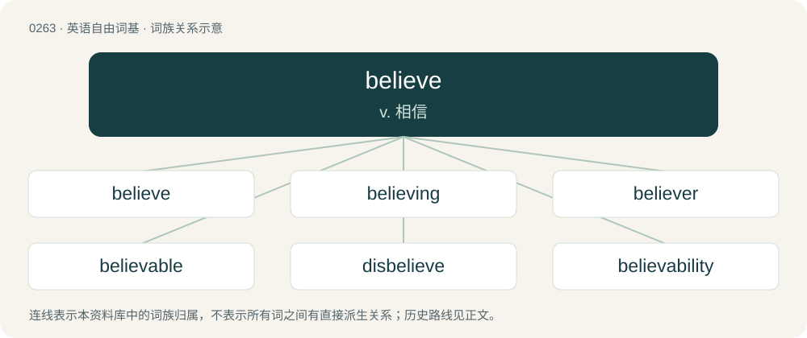

# 0292 · believe — v. 相信

[总目录](../00_总目录_按常用程度.md)

**类型**：英语自由词基　｜　**来源语言**：见词源记录

## 核心含义与来源

- 核心含义：v. 相信
- 英文含义：To accept as true, particularly without absolute certainty (i.e., as opposed to knowing).
- 词形：believe

**来源记录 1**（动词；To accept as true, particularly without absolute certainty (i.e., as opposed to knowing).）

From Middle English beleven, bileven, from Old English belīefan (“to believe”), from Proto-West Germanic \*bilaubijan (“to believe”), equivalent to be- + leave (“to give leave or permission to, permit, allow, grant”). Cognate with Scots beleve (“to believe”), Old Frisian bilēva (“to permit”), Middle Dutch beloven (“to believe, entrust”), Middle Low German belö̂ven (“to believe”), Middle High German belouben (“to believe”). A related term in Old English was ġelīefan (“to be dear to; believe, trust”), from Proto-West Germanic \*galaubijan (“to have faith, believe”), from Proto-Germanic \*galaubijaną. Compare also Old English ġelēafa (“belief, faith, confidence, trust”), Old English lēof ("dear, valued, beloved, pleasant, agreeable" &gt; English lief). Related also to North Frisian leauwjen (“to believe”), Saterland Frisian leeuwe (“to believe”), West Frisian leauwe (“to believe”), Dutch geloven (“to believe”), German Low German glöven (“to believe”), German glauben (“to believe”), Gothic 𐌲𐌰𐌻𐌰𐌿𐌱𐌾𐌰𐌽 (galaubjan, “to hold dear, valuable, or satisfactory, approve of, believe”). The prepositionally transitive senses with in are a semantic loan from Latin crēdō in aliquem / aliquid.

## 词族图

## 单词速览（常用到不常用）

| 单词 | 音标 | 释义 |
|---|---|---|
| [believe](#w-1) | 英 /bɪˈliːv/；美 /bɪˈliv/ | v. 相信 |
| [believing](#w-2) | 英 /bɪˈliː.vɪŋ/；美 /bɪˈli.vɪŋ/ | a. 信任他人的, 有信仰的 |
| [believer](#w-3) | 英 /bɪˈliːvə/；美 /bɪˈlivɚ/ | n. 信徒 |
| [believable](#w-4) | /bɪˈliːvəbl̩/ | a. 可信的 |
| [disbelieve](#w-5) | 英 /dɪsbɪˈliːv/ | v. 不信, 怀疑 |
| [believability](#w-6) | /bi.liːvəˈbiləti/ | n. 可信度 |

## 逐词详解

### 1. believe

**词性**：动词　｜　**音标**：英 /bɪˈliːv/；美 /bɪˈliv/

**中文释义**：v. 相信

**英文义项**：To accept as true, particularly without absolute certainty (i.e., as opposed to knowing). / To accept that someone is telling the truth.

**构词拆分**：be- + leave (“to give leave or permission to, permit, allow, grant”)

**词源与演化**：

From Middle English beleven, bileven, from Old English belīefan (“to believe”), from Proto-West Germanic \*bilaubijan (“to believe”), equivalent to be- + leave (“to give leave or permission to, permit, allow, grant”). Cognate with Scots beleve (“to believe”), Old Frisian bilēva (“to permit”), Middle Dutch beloven (“to believe, entrust”), Middle Low German belö̂ven (“to believe”), Middle High German belouben (“to believe”). A related term in Old English was ġelīefan (“to be dear to; believe, trust”), from Proto-West Germanic \*galaubijan (“to have faith, believe”), from Proto-Germanic \*galaubijaną. Compare also Old English ġelēafa (“belief, faith, confidence, trust”), Old English lēof ("dear, valued, beloved, pleasant, agreeable" &gt; English lief). Related also to North Frisian leauwjen (“to believe”), Saterland Frisian leeuwe (“to believe”), West Frisian leauwe (“to believe”), Dutch geloven (“to believe”), German Low German glöven (“to believe”), German glauben (“to believe”), Gothic 𐌲𐌰𐌻𐌰𐌿𐌱𐌾𐌰𐌽 (galaubjan, “to hold dear, valuable, or satisfactory, approve of, believe”). The prepositionally transitive senses with in are a semantic loan from Latin crēdō in aliquem / aliquid.

**例句**：

> Since I don't believe in reincarnation, I believe that the only way to eliminate suffering is to die.

该用例对应义项：To ascribe existence to.

### 2. believing

**词性**：名词　｜　**音标**：英 /bɪˈliː.vɪŋ/；美 /bɪˈli.vɪŋ/

**中文释义**：a. 信任他人的, 有信仰的

**英文义项**：The act or process of having faith, trust, or confidence in. / Belief.

**构词拆分**：believe + -ing

**词源与演化**：

From Middle English bilevinge, belewynge, equivalent to believe + -ing.

**例句**：

> If you keep saying it you'll eventually kid yourself into believing it.

### 3. believer

**词性**：名词　｜　**音标**：英 /bɪˈliːvə/；美 /bɪˈlivɚ/

**中文释义**：n. 信徒

**英文义项**：A person who believes; especially regarding religion.

**构词拆分**：believe + -er

**词源与演化**：

From Middle English bilevar, bileever, belever, equivalent to believe + -er.

**例句**：

> She's a believer in life after death.

该用例对应义项：A person who believes; especially regarding religion.

### 4. believable

**词性**：形容词　｜　**音标**：/bɪˈliːvəbl̩/

**中文释义**：a. 可信的

**英文义项**：Capable of being believed; credible.

**构词拆分**：believe + -able

**词源与演化**：

From Middle English bilevable, beleevable, equivalent to believe + -able.

**用法示例／搭配（非完整句）**：

> believable account

该用例对应义项：Capable of being believed; credible.

### 5. disbelieve

**词性**：动词　｜　**音标**：英 /dɪsbɪˈliːv/

**中文释义**：v. 不信, 怀疑

**英文义项**：To not believe; to exercise disbelief. / To actively deny (a statement, opinion or perception).

**构词拆分**：dis- + believe

**词源与演化**：

Coined circa 1640, from dis- + believe. Compare misbelieve.

**例句**：

> If you disbelieve such people, then keep disbelieving them for as long as you live or want.

该用例对应义项：To not believe; to exercise disbelief.

### 6. believability

**词性**：名词　｜　**音标**：/bi.liːvəˈbiləti/

**中文释义**：n. 可信度

**英文义项**：The state or quality of being believable.

**构词拆分**：believe + -ability

**词源与演化**：

From believe + -ability.
