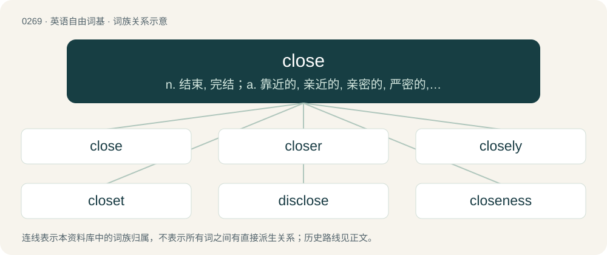

# 0300 · close — n. 结束, 完结；a. 靠近的, 亲近的, 亲密的, 严密的, 关闭的, 狭窄的, 秘密的；vt. 关, 结束, 使靠近, 封闭, 使接近

[总目录](../00_总目录_按常用程度.md)

**类型**：英语自由词基　｜　**来源语言**：见词源记录

## 核心含义与来源

- 核心含义：n. 结束, 完结；a. 靠近的, 亲近的, 亲密的, 严密的, 关闭的, 狭窄的, 秘密的；vt. 关, 结束, 使靠近, 封闭, 使接近
- 英文含义：To move a thing, or part of a thing, nearer to another so that the gap or opening between the two is removed.
- 词形：close

**多个词源／构词路径**：同一拼写可能有不同来源；以下按词性和含义分别列出。

**来源记录 1**（动词；To move a thing, or part of a thing, nearer to another so that the gap or opening between the two is removed.）

From Middle English closen (“to close, enclose”), partly continuing (in altered form) earlier Middle English clusen (“to close”) from Old English clȳsan (“to close, shut”); compare beclose, foreclose, etc.), and partly derived from Middle English clos (“close, shut up, confined, secret”, adjective), from Old French clos (“close, confined”, adjective), from Latin clausus (“shut up”, past participle), from claudō (“to bar, block, close, enclose, bring an end to, confine”), from Proto-Indo-European \*kleh₂w- (“key, hook, nail”), related to Latin clāvis (“key, deadbolt, bar”), clāvus (“nail, peg”), claustrum (“bar, bolt, barrier”), claustra (“dam, wall, barricade, stronghold”). Cognate with Ancient Greek κλείω (kleíō), κλείς (kleís, “bar, bolt, key”), Russian заключи́ть (zaključítʹ) (via ключ (ključ)), German schließen (“to close, conclude, lock”), Dutch sluiten (“to close, conclude, lock”). Partially replaced Old English lūcan (“to close, lock, enclose”), (whence English lock). Doublet of clause.

**来源记录 2**（形容词；At little distance; near in space or time.）

Borrowed from French clos, from Latin clausum, participle of claudō.

## 词族图

## 单词速览（常用到不常用）

| 单词 | 音标 | 释义 |
|---|---|---|
| [close](#w-1) | 英 /ˈkləʊz/；美 /ˈkloʊ̯z/ | n. 结束, 完结；a. 靠近的, 亲近的, 亲密的, 严密的, 关闭的, 狭窄的, 秘密的；vt. 关, 结束, 使靠近, 封闭, 使接近 |
| [closer](#w-2) | 英 /ˈkləʊ.zə/；美 /ˈkloʊ.zɚ/ | n. 关闭者, 闭合器, 关闭器 |
| [closely](#w-3) | 英 /ˈkləʊsliː/；美 /ˈkloʊsli/ | adv. 接近地 |
| [closet](#w-4) | 英 /ˈklɒzɪt/；美 /ˈklɑzɪt/ | n. 壁橱, 小室；a. 秘密的, 空谈的；vt. 把...关入小室 |
| [disclose](#w-5) | /dɪsˈkləʊz/ | vt. 揭露, 透露；\[法\] 揭发, 揭露, 公开 |
| [closeness](#w-6) | 英 /ˈkləʊs.nəs/；美 /ˈkloʊs.nəs/ | \[建\] 密闭, 紧密 |
| [enclose](#w-7) | 英 /ɪnˈkləʊz/；美 /ɪnˈkloʊz/ | vt. 围绕, 圈起, 放入封套, 附上 |
| [foreclose](#w-8) | 英 /fɔːˈkləʊz/；美 /fɔɹˈkloʊz/ | vt. 阻止, 排除, 预先处理, 取消抵押品赎回权；vi. 取消抵押品赎回权 |

## 逐词详解

### 1. close

**词性**：动词　｜　**音标**：英 /ˈkləʊz/；美 /ˈkloʊ̯z/

**中文释义**：n. 结束, 完结；a. 靠近的, 亲近的, 亲密的, 严密的, 关闭的, 狭窄的, 秘密的；vt. 关, 结束, 使靠近, 封闭, 使接近

**英文义项**：To move a thing, or part of a thing, nearer to another so that the gap or opening between the two is removed. / To obstruct or block.

**词源与演化**：

From Middle English closen (“to close, enclose”), partly continuing (in altered form) earlier Middle English clusen (“to close”) from Old English clȳsan (“to close, shut”); compare beclose, foreclose, etc.), and partly derived from Middle English clos (“close, shut up, confined, secret”, adjective), from Old French clos (“close, confined”, adjective), from Latin clausus (“shut up”, past participle), from claudō (“to bar, block, close, enclose, bring an end to, confine”), from Proto-Indo-European \*kleh₂w- (“key, hook, nail”), related to Latin clāvis (“key, deadbolt, bar”), clāvus (“nail, peg”), claustrum (“bar, bolt, barrier”), claustra (“dam, wall, barricade, stronghold”). Cognate with Ancient Greek κλείω (kleíō), κλείς (kleís, “bar, bolt, key”), Russian заключи́ть (zaključítʹ) (via ключ (ključ)), German schließen (“to close, conclude, lock”), Dutch sluiten (“to close, conclude, lock”). Partially replaced Old English lūcan (“to close, lock, enclose”), (whence English lock). Doublet of clause.

**例句**：

> This app has a bug: when you try to sort a large spreadsheet, it closes.

该用例对应义项：To terminate an application, window, file or database connection, etc.

### 2. closer

**词性**：名词　｜　**音标**：英 /ˈkləʊ.zə/；美 /ˈkloʊ.zɚ/

**中文释义**：n. 关闭者, 闭合器, 关闭器

**英文义项**：Someone or something that closes. / Someone or something that concludes.

**构词拆分**：close (verb) + -er

**词源与演化**：

From Middle English closere, equivalent to close (verb) + -er.

**例句**：

> The DJ chose a fantastic track as his closer at the end of the night.

该用例对应义项：Someone or something that concludes.

### 3. closely

**词性**：副词　｜　**音标**：英 /ˈkləʊsliː/；美 /ˈkloʊsli/

**中文释义**：adv. 接近地

**英文义项**：In a close manner.

**构词拆分**：close + -ly

**词源与演化**：

From close + -ly.

**例句**：

> The borderline between East and West Berlin was very closely guarded.

该用例对应义项：In a close manner.

### 4. closet

**词性**：名词　｜　**音标**：英 /ˈklɒzɪt/；美 /ˈklɑzɪt/

**中文释义**：n. 壁橱, 小室；a. 秘密的, 空谈的；vt. 把...关入小室

**英文义项**：A small room within a house used to store clothing, food, or other household supplies. / A secret or hiding place, (particularly) the hiding place in English idioms such as in the closet and skeleton in the closet.

**构词拆分**：close + -et

**词源与演化**：

From Middle English closet, from Old French closet, from clos (“private space”) + -et (diminutive suffix), from Latin clausum. Equivalent to close + -et, but generally applied in French solely to small open-air enclosures.

**例句**：

> The closet can be a scary place for a gay teenager.

该用例对应义项：A secret or hiding place, (particularly) the hiding place in English idioms such as in the closet and skeleton in the closet.

### 5. disclose

**词性**：动词　｜　**音标**：/dɪsˈkləʊz/

**中文释义**：vt. 揭露, 透露；\[法\] 揭发, 揭露, 公开

**英文义项**：To uncover; physically expose to view. / To expose to the knowledge of others; to make known; state openly; reveal (something).

**构词拆分**：By surface analysis, dis- + close

**词源与演化**：

From Middle English disclosen, from Middle French desclos, from Old French desclore, itself from Vulgar Latin disclaudere, from Latin dis- + claudere (“to close, shut”) or as a variant of discludo, discludere (cf. disclude). By surface analysis, dis- + close.

**例句**：

> The auction house would not disclose the price at which the van Gogh had sold.

该用例对应义项：make known to the public information that was previously known only to a few people or that was meant to be kept a secret

### 6. closeness

**词性**：名词　｜　**音标**：英 /ˈkləʊs.nəs/；美 /ˈkloʊs.nəs/

**中文释义**：\[建\] 密闭, 紧密

**英文义项**：The state of being close (all senses). / The state of being friends.

**构词拆分**：close + -ness

**词源与演化**：

From close + -ness.

**例句**：

> Their closeness grew as the night wore on.

该用例对应义项：a feeling of being intimate and belonging together

### 7. enclose

**词性**：动词　｜　**音标**：英 /ɪnˈkləʊz/；美 /ɪnˈkloʊz/

**中文释义**：vt. 围绕, 圈起, 放入封套, 附上

**英文义项**：To surround with a wall, fence, etc. / To insert into a container, usually an envelope or package.

**构词拆分**：en- + close

**词源与演化**：

From Middle English enclosen, inclosen, from Middle English enclos, from Old French enclose, feminine plural past participle of enclore, from Vulgar Latin \*inclaudō, \*inclaudere, from Latin inclūdō (doublet of include), from in- (“in”) + claudō (“to shut”), ultimately from Proto-Indo-European \*kleh₂u- (“key, hook, nail”). Equivalent to en- + close.

**例句**：

> Please enclose a stamped self-addressed envelope if you require a reply.

该用例对应义项：To insert into a container, usually an envelope or package.

### 8. foreclose

**词性**：动词　｜　**音标**：英 /fɔːˈkləʊz/；美 /fɔɹˈkloʊz/

**中文释义**：vt. 阻止, 排除, 预先处理, 取消抵押品赎回权；vi. 取消抵押品赎回权

**英文义项**：To repossess a mortgaged property whose owner has failed to make the necessary payments; used with on. / To cut off (a mortgager) by a judgment of court from the power of redeeming the mortgaged premises.

**构词拆分**：fore- + close

**词源与演化**：

Partially from Middle English foreclosen, forclosen, from Old French forclos, past participle of forclore (“to exclude”), from for- (“(prefix used to express error, exclusion, or inadequacy)”) + clore (“to shut”), and partially from Middle English forclusen (“to close up”), from Old English forclȳsan (“to close up”), equivalent to fore- + close.

**例句**：

> Just when the bank was about to foreclose on her home, she came into a lot of money.
