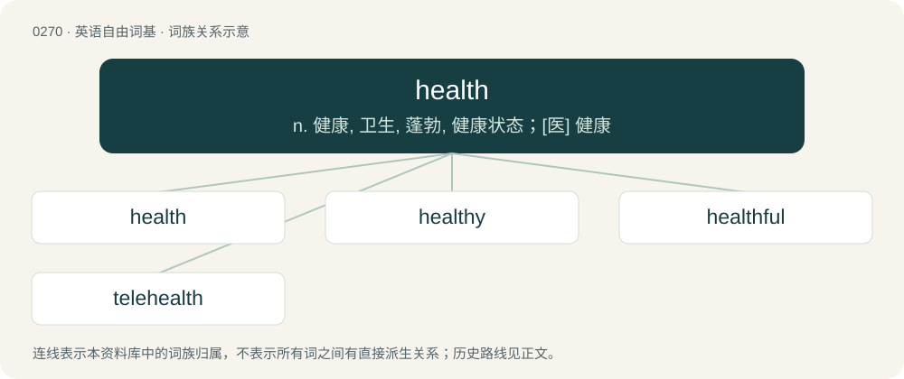

# 0301 · health — n. 健康, 卫生, 蓬勃, 健康状态；\[医\] 健康

[总目录](../00_总目录_按常用程度.md)

**类型**：英语自由词基　｜　**来源语言**：见词源记录

## 核心含义与来源

- 核心含义：n. 健康, 卫生, 蓬勃, 健康状态；\[医\] 健康
- 英文含义：The state of being free from physical or psychological disease, illness, or malfunction; wellness.
- 词形：health

**来源记录 1**（名词；The state of being free from physical or psychological disease, illness, or malfunction; wellness.）

Inherited from Middle English helthe, from Old English hǣlþ, from Proto-West Germanic \*hailiþu, from Proto-Germanic \*hailiþō, from \*hailaz + \*-iþō. Cognate with Old High German heilida. Analyzable as whole, hale, or heal + -th (abstract nominal suffix). More at heal. Doublet of wholth.

## 词族图

## 单词速览（常用到不常用）

| 单词 | 音标 | 释义 |
|---|---|---|
| [health](#w-1) | 英 /ˈhɛlθ/ | n. 健康, 卫生, 蓬勃, 健康状态；\[医\] 健康 |
| [healthy](#w-2) | 英 /ˈhɛl.θi/ | a. 健康的, 有益健康的, 卫生的；\[医\] 健康的 |
| [healthful](#w-3) | /ˈhelθful/ | a. 有益健康的, 使人健康的, 卫生的；\[法\] 有益健康的, 健康的, 卫生的 |
| [telehealth](#w-4) |  | 【英文】Healthcare facilitated by telecommunication technology, typically allowing a doctor or other healthcare professional to interact with a patient visually and audibly. |

## 逐词详解

### 1. health

**词性**：名词　｜　**音标**：英 /ˈhɛlθ/

**中文释义**：n. 健康, 卫生, 蓬勃, 健康状态；\[医\] 健康

**英文义项**：The state of being free from physical or psychological disease, illness, or malfunction; wellness. / A state of well-being or balance, often physical but sometimes also mental and social; the overall level of function of an organism from the cellular (micro) level to the social (macro) level.

**构词拆分**：heal + -th (abstract nominal suffix)

**词源与演化**：

Inherited from Middle English helthe, from Old English hǣlþ, from Proto-West Germanic \*hailiþu, from Proto-Germanic \*hailiþō, from \*hailaz + \*-iþō. Cognate with Old High German heilida. Analyzable as whole, hale, or heal + -th (abstract nominal suffix). More at heal. Doublet of wholth.

**例句**：

> The directors are concerned about the financial health of the project.

该用例对应义项：A state of well-being or balance, often physical but sometimes also mental and social; the overall level of function of an organism from the cellular (micro) level to the social (macro) level.

### 2. healthy

**词性**：形容词　｜　**音标**：英 /ˈhɛl.θi/

**中文释义**：a. 健康的, 有益健康的, 卫生的；\[医\] 健康的

**英文义项**：Enjoying good health; free from disease or disorder. / Conducive to health.

**构词拆分**：health + -y

**词源与演化**：

From health + -y.

**例句**：

> Sam unwrapped the sandwich and took a healthy bite out of the middle.

该用例对应义项：Significant, hefty; beneficial.

### 3. healthful

**词性**：形容词　｜　**音标**：/ˈhelθful/

**中文释义**：a. 有益健康的, 使人健康的, 卫生的；\[法\] 有益健康的, 健康的, 卫生的

**英文义项**：Beneficial to bodily health. / Conducive to moral or spiritual prosperity; salutary.

**构词拆分**：health + -ful

**词源与演化**：

From Middle English helthful, helþful, helþeful, equivalent to health + -ful.

**例句**：

> Dickens's relatively healthful exuberance.

该用例对应义项：conducive to good health of body or mind

### 4. telehealth

**词性**：名词

**英文义项**：Healthcare facilitated by telecommunication technology, typically allowing a doctor or other healthcare professional to interact with a patient visually and audibly.

**构词拆分**：tele- + health

**词源与演化**：

From tele- + health.
