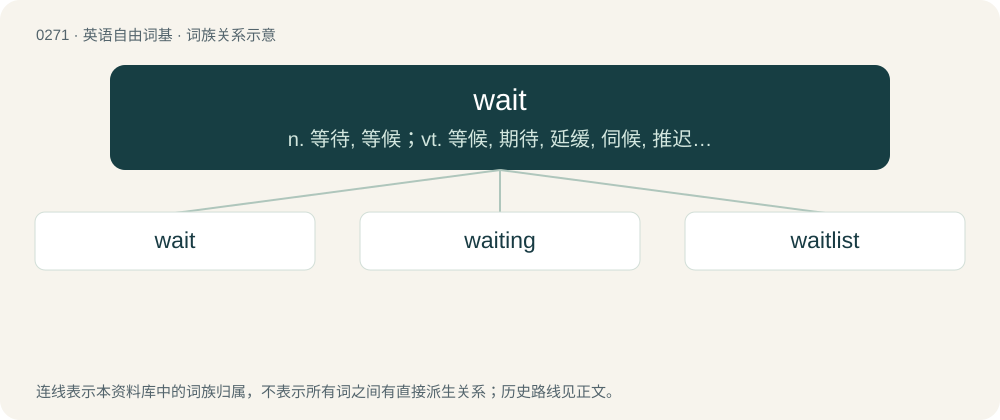

# 0302 · wait — n. 等待, 等候；vt. 等候, 期待, 延缓, 伺候, 推迟；vi. 等, 等候, 耽搁, 伺候用餐

[总目录](../00_总目录_按常用程度.md)

**类型**：英语自由词基　｜　**来源语言**：见词源记录

## 核心含义与来源

- 核心含义：n. 等待, 等候；vt. 等候, 期待, 延缓, 伺候, 推迟；vi. 等, 等候, 耽搁, 伺候用餐
- 英文含义：To delay movement or action until some event or time; to remain neglected or in readiness.
- 词形：wait

**来源记录 1**（动词；To delay movement or action until some event or time; to remain neglected or in readiness.）

From Middle English waiten, from Anglo-Norman waiter, waitier (compare French guetter from Old French gaitier, guaitier), from Frankish \*wahtwēn (“to watch, guard”), derivative of Frankish \*wahtu (“guard, watch”), from Proto-Germanic \*wahtwō (“guard, watch”), from Proto-Indo-European \*weǵ- (“to be fresh, cheerful, awake”). Cognate with Old High German wahtēn (“to watch, guard”), German Low German wachten (“to wait”), Dutch wachten (“to wait, expect”), French guetter (“to watch out for”), Saterland Frisian wachtje (“to wait”), West Frisian wachtsje (“to wait”), North Frisian wachtjen (“to stand, stay put”). More at watch. In some senses, merged or influenced by Middle English waiten, weiten (“to do good to, lie in wait for, to contrive good or harm on, catch, snare”), from Old Norse veita (“to give help to, assist, grant, cause to happen”), from Proto-Germanic \*waitijaną (“to show, guide, advise, direct”), from Proto-Indo-European \*weyd- (“to see, know”). Largely overtook native Middle English biden, from Old English bīdan, source of bide.

## 词族图

## 单词速览（常用到不常用）

| 单词 | 音标 | 释义 |
|---|---|---|
| [wait](#w-1) | 美 /weɪt/；/weɪt/ | n. 等待, 等候；vt. 等候, 期待, 延缓, 伺候, 推迟；vi. 等, 等候, 耽搁, 伺候用餐 |
| [waiting](#w-2) | /ˈweɪtɪŋ/ | n. 等候；a. 等候的, 服侍的 |
| [waitlist](#w-3) | /ˈweɪtˌlɪst/ | vt. 把...登入申请人名单 |

## 逐词详解

### 1. wait

**词性**：动词　｜　**音标**：美 /weɪt/；/weɪt/

**中文释义**：n. 等待, 等候；vt. 等候, 期待, 延缓, 伺候, 推迟；vi. 等, 等候, 耽搁, 伺候用餐

**英文义项**：To delay movement or action until some event or time; to remain neglected or in readiness. / To wait tables; to serve customers in a restaurant or other eating establishment.

**词源与演化**：

From Middle English waiten, from Anglo-Norman waiter, waitier (compare French guetter from Old French gaitier, guaitier), from Frankish \*wahtwēn (“to watch, guard”), derivative of Frankish \*wahtu (“guard, watch”), from Proto-Germanic \*wahtwō (“guard, watch”), from Proto-Indo-European \*weǵ- (“to be fresh, cheerful, awake”). Cognate with Old High German wahtēn (“to watch, guard”), German Low German wachten (“to wait”), Dutch wachten (“to wait, expect”), French guetter (“to watch out for”), Saterland Frisian wachtje (“to wait”), West Frisian wachtsje (“to wait”), North Frisian wachtjen (“to stand, stay put”). More at watch. In some senses, merged or influenced by Middle English waiten, weiten (“to do good to, lie in wait for, to contrive good or harm on, catch, snare”), from Old Norse veita (“to give help to, assist, grant, cause to happen”), from Proto-Germanic \*waitijaną (“to show, guide, advise, direct”), from Proto-Indo-European \*weyd- (“to see, know”). Largely overtook native Middle English biden, from Old English bīdan, source of bide.

**例句**：

> I’m still waiting for you to pay me back the money I lent you..

该用例对应义项：To delay movement or action until some event or time; to remain neglected or in readiness.

### 2. waiting

**词性**：名词　｜　**音标**：/ˈweɪtɪŋ/

**中文释义**：n. 等候；a. 等候的, 服侍的

**英文义项**：The act of staying or remaining in expectation. / Attendance, service.

**构词拆分**：wait + -ing

**词源与演化**：

From Middle English waitynge, waytynge, equivalent to wait + -ing.

**用法示例／搭配（非完整句）**：

> Waiting for any news in a waiting room. (gerund)

该用例对应义项：The act of staying or remaining in expectation.

### 3. waitlist

**词性**：名词　｜　**音标**：/ˈweɪtˌlɪst/

**中文释义**：vt. 把...登入申请人名单

**英文义项**：A waiting list.

**构词拆分**：wait + list

**词源与演化**：

From wait + list.
