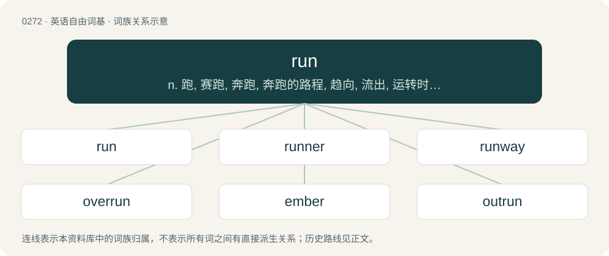

# 0303 · run — n. 跑, 赛跑, 奔跑, 奔跑的路程, 趋向, 流出, 运转时间, 连续；vi. 跑, 奔跑, 跑步, 赛跑, 竞赛, 行驶, 运转, 进行, 蔓延；vt. 使跑, 参赛, 追究, 驾驶, 开动, 管理, 经营, 使流出, 运行

[总目录](../00_总目录_按常用程度.md)

**类型**：英语自由词基　｜　**来源语言**：见词源记录

## 核心含义与来源

- 核心含义：n. 跑, 赛跑, 奔跑, 奔跑的路程, 趋向, 流出, 运转时间, 连续；vi. 跑, 奔跑, 跑步, 赛跑, 竞赛, 行驶, 运转, 进行, 蔓延；vt. 使跑, 参赛, 追究, 驾驶, 开动, 管理, 经营, 使流出, 运行
- 英文含义：To move forward quickly upon two feet by alternately making a short jump off either foot.
- 词形：run

**来源记录 1**（动词；To move forward quickly upon two feet by alternately making a short jump off either foot.）

From Middle English runnen, rennen (“to run”), alteration (due to the past participle runne, runnen, yronne) of Middle English rinnen (“to run”), from Old English rinnan, iernan (“to run”) and Old Norse rinna (“to run”), both from Proto-Germanic \*rinnaną (“to run”), from Proto-Indo-European \*h₃reyH- (“to boil, churn”). Cognate with Scots rin (“to run”), West Frisian rinne (“to walk, march”), archaic Dutch rinnen (“to flow”, still in geronnen), German rinnen (“to flow”), Swedish rinna (“to flow”), and Icelandic renna (“to flow”). From the causative Proto-Germanic \*rannijaną (“to make run”) are Dutch rennen, German rennen, Danish rende, Swedish ränna (all “to run”). Non-Germanic cognates include Albanian rend (“to run, run after”), Persian راندن (rândan, “to move, set in motion”). See also random.

## 词族图

## 单词速览（常用到不常用）

| 单词 | 音标 | 释义 |
|---|---|---|
| [run](#w-1) | 英 /ɹʌn/ | n. 跑, 赛跑, 奔跑, 奔跑的路程, 趋向, 流出, 运转时间, 连续；vi. 跑, 奔跑, 跑步, 赛跑, 竞赛, 行驶, 运转, 进行, 蔓延；vt. 使跑, 参赛, 追究, 驾驶, 开动, 管理, 经营, 使流出, 运行 |
| [runner](#w-2) | 英 /ˈɹʌnə/；美 /ˈɹʌnɚ/ | n. 跑步者, 赛跑者, 送信人, 走私船, 操作者, 滑槽；\[化\] 碾碎机; 压碎机 |
| [runway](#w-3) | /ˈɹʌnweɪ/ | n. 跑道, 河床, 过道；\[化\] 单轨架空道; 吊车道 |
| [overrun](#w-4) | 英 /ˌəʊ.vəˈɹʌn/；美 /ˌoʊ.vɚˈɹʌn/ | n. 蔓延, 风行一时, 超过限度；vt. 蔓延, 蹂躏, 超过, 泛滥；vi. 泛滥, 超载限度 |
| [ember](#w-5) | 英 /ˈɛm.bə/；美 /ˈɛm.bɚ/ | 【英文】Making a circuit of the year or the seasons; recurring in each quarter of the year, as certain religious days set apart for fasting and prayer. |
| [outrun](#w-6) | /ˈaʊtɹʌn/ | vt. 超过, 逃脱 |
| [runny](#w-7) | 英 /ˈɹʌni/ | a. 松软的, 水分过多的, 流鼻涕的 |
| [rerun](#w-8) | 英 /ˈɹiːɹʌn/；美 /ˈɹiɹʌn/ | n. 重新开动, 再度上演；vt. 重新开动, 再度上演；\[计\] 再运行; 重新运行 |
| [speedrun](#w-9) | /ˈspiːd.ɹʌn/ | 【英文】A playthrough of a computer or video game in which the whole game or a select part of it, such as a single level, is played with the intent of completing it as quickly as possible, optionally with certain prerequisit |

## 逐词详解

### 1. run

**词性**：动词　｜　**音标**：英 /ɹʌn/

**中文释义**：n. 跑, 赛跑, 奔跑, 奔跑的路程, 趋向, 流出, 运转时间, 连续；vi. 跑, 奔跑, 跑步, 赛跑, 竞赛, 行驶, 运转, 进行, 蔓延；vt. 使跑, 参赛, 追究, 驾驶, 开动, 管理, 经营, 使流出, 运行

**英文义项**：To move forward quickly upon two feet by alternately making a short jump off either foot. / To go at a fast pace; to move quickly.

**词源与演化**：

From Middle English runnen, rennen (“to run”), alteration (due to the past participle runne, runnen, yronne) of Middle English rinnen (“to run”), from Old English rinnan, iernan (“to run”) and Old Norse rinna (“to run”), both from Proto-Germanic \*rinnaną (“to run”), from Proto-Indo-European \*h₃reyH- (“to boil, churn”). Cognate with Scots rin (“to run”), West Frisian rinne (“to walk, march”), archaic Dutch rinnen (“to flow”, still in geronnen), German rinnen (“to flow”), Swedish rinna (“to flow”), and Icelandic renna (“to flow”). From the causative Proto-Germanic \*rannijaną (“to make run”) are Dutch rennen, German rennen, Danish rende, Swedish ränna (all “to run”). Non-Germanic cognates include Albanian rend (“to run, run after”), Persian راندن (rândan, “to move, set in motion”). See also random.

**例句**：

> Jackson got himself run in the top of the sixth for arguing a borderline strike three call.

该用例对应义项：To eject from a game or match.

### 2. runner

**词性**：名词　｜　**音标**：英 /ˈɹʌnə/；美 /ˈɹʌnɚ/

**中文释义**：n. 跑步者, 赛跑者, 送信人, 走私船, 操作者, 滑槽；\[化\] 碾碎机; 压碎机

**英文义项**：A person who moves, on foot, at a fast pace, especially an athlete. / Any entrant, person or animal (especially a horse), for a race or any competition; a candidate for an election.

**构词拆分**：run + -er

**词源与演化**：

From Middle English rennere, rynner, urnare, equivalent to run + -er. Cognate with Old Norse rennari (“runner; messenger”). Displaced earlier Middle English runel (“runner”), from Old English rynel (“runner”; also “messenger, courier”). ((botany) a long stolon sent by a plant): Compare typologically Russian побе́г (pobég) (akin to бежа́ть (bežátʹ)).

**例句**：

> After the cycle completes, the runner travels back quickly to be in place for the next cycle.

该用例对应义项：A part of an apparatus that moves quickly.

### 3. runway

**词性**：名词　｜　**音标**：/ˈɹʌnweɪ/

**中文释义**：n. 跑道, 河床, 过道；\[化\] 单轨架空道; 吊车道

**英文义项**：A defined, narrow section of land or an artificial structure used for access. / The usual path taken by deer or other wild animals, such as from a forest to a water source.

**构词拆分**：run + way

**词源与演化**：

From run + way.

**例句**：

> There is a long line of planes waiting to use the runway.

### 4. overrun

**词性**：动词　｜　**音标**：英 /ˌəʊ.vəˈɹʌn/；美 /ˌoʊ.vɚˈɹʌn/

**中文释义**：n. 蔓延, 风行一时, 超过限度；vt. 蔓延, 蹂躏, 超过, 泛滥；vi. 泛滥, 超载限度

**英文义项**：To defeat an enemy and invade in great numbers, seizing the enemy positions conclusively. / To infest, swarm over, flow over.

**构词拆分**：over- + run

**词源与演化**：

From over- + run.

**例句**：

> In machinery, a sliding piece is said to overrun its bearing when its forward end goes beyond it.

该用例对应义项：To go beyond; to extend in part beyond.

### 5. ember

**词性**：形容词　｜　**音标**：英 /ˈɛm.bə/；美 /ˈɛm.bɚ/

**英文义项**：Making a circuit of the year or the seasons; recurring in each quarter of the year, as certain religious days set apart for fasting and prayer.

**构词拆分**：By surface analysis, umb- + run

**词源与演化**：

From Middle English embryne (“running around, circuit”), from Old English ymbryne (“course; circuit”). Spelling changed through folk etymology. By surface analysis, umb- + run.

**用法示例／搭配（非完整句）**：

> ember fasts

该用例对应义项：Making a circuit of the year or the seasons; recurring in each quarter of the year, as certain religious days set apart for fasting and prayer.

### 6. outrun

**词性**：动词　｜　**音标**：/ˈaʊtɹʌn/

**中文释义**：vt. 超过, 逃脱

**英文义项**：To run faster than. / To exceed or overextend.

**构词拆分**：out- + run

**词源与演化**：

From out- + run.

**例句**：

> I don't need to outrun the bear; I just need to outrun you.

该用例对应义项：To run faster than.

### 7. runny

**词性**：形容词　｜　**音标**：英 /ˈɹʌni/

**中文释义**：a. 松软的, 水分过多的, 流鼻涕的

**英文义项**：Fluid; readily flowing. / Liable to run or drip.

**构词拆分**：From run + -y.

**词源与演化**：

From run + -y.

**用法示例／搭配（非完整句）**：

> a runny nose

该用例对应义项：Liable to run or drip.

### 8. rerun

**词性**：名词　｜　**音标**：英 /ˈɹiːɹʌn/；美 /ˈɹiɹʌn/

**中文释义**：n. 重新开动, 再度上演；vt. 重新开动, 再度上演；\[计\] 再运行; 重新运行

**英文义项**：An act or instance of rerunning; a repetition. / A television program shown after its initial presentation, particularly many weeks after its initial presentation; a repeat.

**构词拆分**：re- + run

**词源与演化**：

From re- + run.

**例句**：

> I'm not a fan of the new Simpsons episodes, but the old reruns have me in stitches, although I've seen them countless times.

该用例对应义项：A television program shown after its initial presentation, particularly many weeks after its initial presentation; a repeat.

### 9. speedrun

**词性**：名词　｜　**音标**：/ˈspiːd.ɹʌn/

**英文义项**：A playthrough of a computer or video game in which the whole game or a select part of it, such as a single level, is played with the intent of completing it as quickly as possible, optionally with certain prerequisites.

**构词拆分**：speed + run

**词源与演化**：

From speed + run. There are isolated attestations of the term as far back as the 19th century, mostly hyphenated as speed-run and in an engineering context; it is unlikely that these cases influenced the modern form.

**例句**：

> In the speedrun of Super Mario Bros. 3, Anonymous Jones finishes the whole game in just 11 minutes.

该用例对应义项：A playthrough of a computer or video game in which the whole game or a select part of it, such as a single level, is played with the intent of completing it as quickly as possible, optionally with certain prerequisites.
