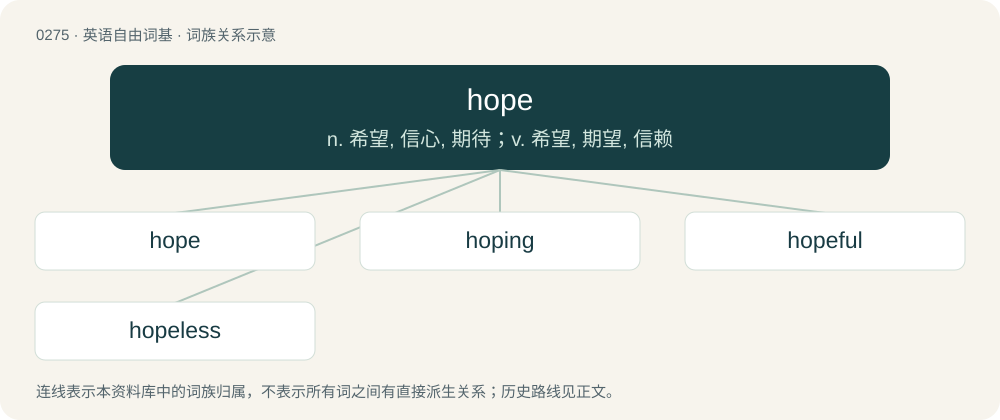

# 0309 · hope — n. 希望, 信心, 期待；v. 希望, 期望, 信赖

[总目录](../00_总目录_按常用程度.md)

**类型**：英语自由词基　｜　**来源语言**：见词源记录

## 核心含义与来源

- 核心含义：n. 希望, 信心, 期待；v. 希望, 期望, 信赖
- 英文含义：To want (something) to happen, with a sense of expectation that it might \[with that (+ clause); or (informal) with clause; or with so or (negative) not\].
- 词形：hope

**多个词源／构词路径**：同一拼写可能有不同来源；以下按词性和含义分别列出。

**来源记录 1**（动词；To want (something) to happen, with a sense of expectation that it might \[with that (+ clause); or (informal) with clause; or with so or (negative) not\].）

From Middle English hopen, from Old English hopian (“hope”), from Proto-West Germanic \*hopōn; further etymology unclear. Cognates Cognate with Saterland Frisian, West Frisian hoopje (“to hope”), Cimbrian hòffan (“to hope”), Dutch hopen (“to hope”), German, Luxembourgish hoffen (“to hope”), Vilamovian höfnan (“hope”), Yiddish האָפֿן (hofn, “to hope”), Danish håbe (“to hope”), Norwegian Bokmål håpe (“to hope”), Norwegian Nynorsk håpa, håpe (“to hope”), Swedish hoppas (“to hope”).

**来源记录 2**（名词；The feeling of trust, confidence, belief or expectation that something wished for can or will happen.）

From Middle English hope, from Old English hopa (“hope, expectation”), from the same source as the verb hope. Eclipsed non-native early modern English esperance, borrowed from Middle French esperance.

**来源记录 3**（名词；A hollow; a valley, especially the upper end of a narrow mountain valley when it is nearly encircled by smooth, green slopes; a combe.）

From Middle English hope (“a valley”), from Old English hōp (found only in placenames). More at hoop.

**来源记录 4**（名词；A sloping plain between mountain ridges.）

From Icelandic hóp (“a small bay or inlet”). Cognate with English hoop.

## 词族图

## 单词速览（常用到不常用）

| 单词 | 音标 | 释义 |
|---|---|---|
| [hope](#w-1) | 英 /ˈhəʊp/；美 /ˈhoʊp/ | n. 希望, 信心, 期待；v. 希望, 期望, 信赖 |
| [hoping](#w-2) | 英 /ˈhəʊpɪŋ/；美 /ˈhoʊpɪŋ/ | v. 希望（hope的ing形式） |
| [hopeful](#w-3) | 英 /ˈhəʊpfl̩/；美 /ˈhoʊpfl̩/ | n. 有希望之人, 有前途之人；a. 有希望的, 怀抱希望的, 保持乐观的 |
| [hopeless](#w-4) | 英 /ˈhəʊplɪs/；美 /ˈhoʊplɪs/ | a. 无希望的, 绝望的, 不可救药的 |

## 逐词详解

### 1. hope

**词性**：动词　｜　**音标**：英 /ˈhəʊp/；美 /ˈhoʊp/

**中文释义**：n. 希望, 信心, 期待；v. 希望, 期望, 信赖

**英文义项**：To want (something) to happen, with a sense of expectation that it might \[with that (+ clause); or (informal) with clause; or with so or (negative) not\]. / To intend to do something and look forward to the prospect of having done it \[with to (+ infinitive)\].

**词源与演化**：

From Middle English hopen, from Old English hopian (“hope”), from Proto-West Germanic \*hopōn; further etymology unclear. Cognates Cognate with Saterland Frisian, West Frisian hoopje (“to hope”), Cimbrian hòffan (“to hope”), Dutch hopen (“to hope”), German, Luxembourgish hoffen (“to hope”), Vilamovian höfnan (“hope”), Yiddish האָפֿן (hofn, “to hope”), Danish håbe (“to hope”), Norwegian Bokmål håpe (“to hope”), Norwegian Nynorsk håpa, håpe (“to hope”), Swedish hoppas (“to hope”).

**例句**：

> I'm going to get a new car. I hope it will be better than the last one.

该用例对应义项：To want (something) to happen, with a sense of expectation that it might \[with that (+ clause); or (informal) with clause; or with so or (negative) not\].

### 2. hoping

**词性**：形容词　｜　**音标**：英 /ˈhəʊpɪŋ/；美 /ˈhoʊpɪŋ/

**中文释义**：v. 希望（hope的ing形式）

**英文义项**：Filled with or inspiring hope.

**构词拆分**：hope + -ing

**词源与演化**：

From hope + -ing. Cognate with German Hoffnung (“hope”).

**例句**：

> A hoping situation is not yet desolate.

该用例对应义项：Filled with or inspiring hope.

### 3. hopeful

**词性**：形容词　｜　**音标**：英 /ˈhəʊpfl̩/；美 /ˈhoʊpfl̩/

**中文释义**：n. 有希望之人, 有前途之人；a. 有希望的, 怀抱希望的, 保持乐观的

**英文义项**：feeling hope / inspiring hope

**构词拆分**：hope + -ful

**词源与演化**：

From hope + -ful.

**例句**：

> It looks hopeful that my father will be able to walk again.

该用例对应义项：inspiring hope

### 4. hopeless

**词性**：形容词　｜　**音标**：英 /ˈhəʊplɪs/；美 /ˈhoʊplɪs/

**中文释义**：a. 无希望的, 绝望的, 不可救药的

**英文义项**：Without hope; despairing; not expecting anything positive. / Giving no ground of hope; promising nothing desirable; desperate.

**构词拆分**：hope + -less

**词源与演化**：

From hope + -less. Compare Swedish hopplös.

**例句**：

> He's a hopeless writer, but can draw very well.

该用例对应义项：Without talent, not skilled.
