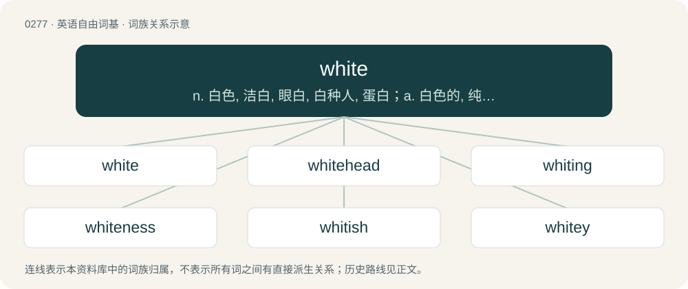

# 0311 · white — n. 白色, 洁白, 眼白, 白种人, 蛋白；a. 白色的, 纯洁的, 白种的, 苍白的, 空白的, 幸运的

[总目录](../00_总目录_按常用程度.md)

**类型**：英语自由词基　｜　**来源语言**：见词源记录

## 核心含义与来源

- 核心含义：n. 白色, 洁白, 眼白, 白种人, 蛋白；a. 白色的, 纯洁的, 白种的, 苍白的, 空白的, 幸运的
- 英文含义：Bright and colourless; reflecting equal quantities of all frequencies of visible light.
- 词形：white

**来源记录 1**（形容词；Bright and colourless; reflecting equal quantities of all frequencies of visible light.）

Inherited from Middle English whit, hwit, from Old English hwīt, from Proto-West Germanic \*hwīt, from Proto-Germanic \*hwītaz, from Proto-Indo-European \*ḱweydós, a byform of \*ḱweytós (“bright; shine”). Cognates \* West Frisian wyt \* Dutch wit \* German weiß \* German weiss \* Norwegian Bokmål hvit \* Norwegian Nynorsk kvit \* Swedish vit \* Danish hvid \* Lithuanian šviẽsti (“to gleam”), šviesa (“light”) \* Old Church Slavonic свѣтъ (světŭ, “light”), свѣтьлъ (světĭlŭ, “clear, bright”) \* Persian سفید (sefid, “white”), Persian سپید (sepid, “white”) \* Avestan 𐬯𐬞𐬀𐬉𐬙𐬀 (spaēta, “white”) \* Sanskrit श्वेत (śvetá, “white, bright”)

## 词族图

## 单词速览（常用到不常用）

| 单词 | 音标 | 释义 |
|---|---|---|
| [white](#w-1) | /ˈwaɪt/ | n. 白色, 洁白, 眼白, 白种人, 蛋白；a. 白色的, 纯洁的, 白种的, 苍白的, 空白的, 幸运的 |
| [whitehead](#w-2) |  | 【英文】A type of comedo, manifesting as a small whitish bump of the skin due to retention of sebum and dead skin cells in a skin pore blocked by a thin layer of epithelium. |
| [whiting](#w-3) | /ˈwaɪtɪŋ/ | n. 白粉, 白垩；\[医\] 白粉, 精制碳酸钙 |
| [whiteness](#w-4) | /ˈwaɪtnəs/ | n. 白, 苍白, 洁白；\[化\] 白度 |
| [whitish](#w-5) | /ˈwaɪtɪʃ/ | a. 发白的, 带白色的 |
| [whitey](#w-6) | /ˈwaɪti/ | n. 白人社会 |
| [whiteboard](#w-7) | 英 /ˈwaɪtbɔːd/；美 /ˈwaɪtbɔɹd/ | n. 白色书写板 |
| [whitewash](#w-8) | 美 /ˈʍaɪtˌwɑʃ/；/ˈwaɪtwɒʃ/ | n. 白色涂料, 粉饰, 得零分的惨败 |
| [whitefish](#w-9) | /ˈhwaitfiʃ/ | n. 白鲑, 白鲸 |
| [whiten](#w-10) | /ˈ(h)waɪ̯.tən/ | vt. 使白, 漂白；vi. 变白 |
| [whitelist](#w-11) |  | 【英文】To place on a whitelist; to mark or note a person or entity as trustworthy or acceptable. |
| [nonwhite](#w-12) | /nɒnˈhwait/ | a. 非白人的；n. 非白人 |
| [paperwhite](#w-13) | /ˈpeipəhwait/ | n. \[植\]多花水仙 |
| [whitetail](#w-14) | /ˈwaitteil/ | n. 白尾鹿 |
| [whitestone](#w-15) |  | 玻璃假宝石 |
| [whitebeard](#w-16) | /ˈhwait,biəd/ | n. 白胡子老人,老翁 |

## 逐词详解

### 1. white

**词性**：形容词　｜　**音标**：/ˈwaɪt/

**中文释义**：n. 白色, 洁白, 眼白, 白种人, 蛋白；a. 白色的, 纯洁的, 白种的, 苍白的, 空白的, 幸运的

**英文义项**：Bright and colourless; reflecting equal quantities of all frequencies of visible light. / Of or relating to Europeans or those of European descent, regardless if their skin has cool or warm undertones.

**词源与演化**：

Inherited from Middle English whit, hwit, from Old English hwīt, from Proto-West Germanic \*hwīt, from Proto-Germanic \*hwītaz, from Proto-Indo-European \*ḱweydós, a byform of \*ḱweytós (“bright; shine”). Cognates \* West Frisian wyt \* Dutch wit \* German weiß \* German weiss \* Norwegian Bokmål hvit \* Norwegian Nynorsk kvit \* Swedish vit \* Danish hvid \* Lithuanian šviẽsti (“to gleam”), šviesa (“light”) \* Old Church Slavonic свѣтъ (světŭ, “light”), свѣтьлъ (světĭlŭ, “clear, bright”) \* Persian سفید (sefid, “white”), Persian سپید (sepid, “white”) \* Avestan 𐬯𐬞𐬀𐬉𐬙𐬀 (spaēta, “white”) \* Sanskrit श्वेत (śvetá, “white, bright”)

**例句**：

> The white pieces in this set are in fact made of light green glass.

该用例对应义项：The standard denomination of the playing pieces of a board game deemed to belong to the white set, no matter what the actual colour.

### 2. whitehead

**词性**：名词

**英文义项**：A type of comedo, manifesting as a small whitish bump of the skin due to retention of sebum and dead skin cells in a skin pore blocked by a thin layer of epithelium. / A species of passerine bird, endemic to New Zealand (Mohoua albicilla).

**构词拆分**：white + head

**词源与演化**：

From white + head.

**例句**：

> Ruth knew that the whiteheads of her teenage acne were a temporary state of affairs, but that did nothing to quell her distress when an eruption hit just before prom.

该用例对应义项：A type of comedo, manifesting as a small whitish bump of the skin due to retention of sebum and dead skin cells in a skin pore blocked by a thin layer of epithelium.

### 3. whiting

**词性**：名词　｜　**音标**：/ˈwaɪtɪŋ/

**中文释义**：n. 白粉, 白垩；\[医\] 白粉, 精制碳酸钙

**英文义项**：A fine white chalk used in paints, putty, whitewash etc.

**构词拆分**：white + -ing

**词源与演化**：

From white + -ing.

### 4. whiteness

**词性**：名词　｜　**音标**：/ˈwaɪtnəs/

**中文释义**：n. 白, 苍白, 洁白；\[化\] 白度

**英文义项**：The state or quality of being white (all senses). / The quality of being white (in the racial sense).

**构词拆分**：white + -ness

**词源与演化**：

Inherited from Middle English whitenesse, whitnesse, whytnesse, hwitnesse, from Old English hwītnes (“whiteness”), equivalent to white + -ness.

**例句**：

> The whiteness of the lily is a symbol of purity.

### 5. whitish

**词性**：形容词　｜　**音标**：/ˈwaɪtɪʃ/

**中文释义**：a. 发白的, 带白色的

**英文义项**：Somewhat white, pale or almost white.

**构词拆分**：white + -ish

**词源与演化**：

From Middle English whitisch, whytyssh, equivalent to white + -ish.

**例句**：

> The flowers of dwarf goat's beards have a whitish color.

### 6. whitey

**词性**：名词　｜　**音标**：/ˈwaɪti/

**中文释义**：n. 白人社会

**英文义项**：A white person, a person of Western European descent. / A state or bout of sickness, especially induced by cannabis use.

**构词拆分**：white + -y

**词源与演化**：

From white (“bright and colorless; a white-skinned person”) + -y (“forming diminutives”).

### 7. whiteboard

**词性**：名词　｜　**音标**：英 /ˈwaɪtbɔːd/；美 /ˈwaɪtbɔɹd/

**中文释义**：n. 白色书写板

**英文义项**：A writing board finished with a hard white material, which can be written upon using special non-permanent markers and subsequently wiped clean. / A collaborative tool allowing several users to write and draw on the same shared display.

**构词拆分**：white + board

**词源与演化**：

From white + board, modelled on blackboard.

**例句**：

> The teacher wrote a good number of sentences on the whiteboard.

### 8. whitewash

**词性**：动词　｜　**音标**：美 /ˈʍaɪtˌwɑʃ/；/ˈwaɪtwɒʃ/

**中文释义**：n. 白色涂料, 粉饰, 得零分的惨败

**英文义项**：To paint (a building, a wall, etc.) a bright white with whitewash. / To distort or give a misleading account of (history, a narrative, etc.) by discounting the participation of people of colour and focusing on white people.

**构词拆分**：white (adjective) + wash (noun)；white (adjective) + wash (verb)

**词源与演化**：

The noun is derived from white (adjective) + wash (noun). Noun sense 5.1 (“medicinal preparation for treating skin diseases”) is a calque of New Latin lōtiō alba (literally “white wash”). The verb is derived partly from white (adjective) + wash (verb), and partly from the noun.

**例句**：

> The houses looked very bright after they had whitewashed the whole neighbourhood.

该用例对应义项：To paint (a building, a wall, etc.) a bright white with whitewash.

### 9. whitefish

**词性**：名词　｜　**音标**：/ˈhwaitfiʃ/

**中文释义**：n. 白鲑, 白鲸

**英文义项**：Any of several North American freshwater fish, of the genus Coregonus, used as food. / Any of several other fish, such as whiting (Merlangius merlangus) or menhaden (Brevoortia spp. and Ethmidium spp.).

**构词拆分**：white + fish

**词源与演化**：

From white + fish.

### 10. whiten

**词性**：动词　｜　**音标**：/ˈ(h)waɪ̯.tən/

**中文释义**：vt. 使白, 漂白；vi. 变白

**英文义项**：(To cause) to become white or whiter; to bleach or blanch. / To increase the security of an iterated block cipher by steps that combine the data with portions of the key.

**构词拆分**：white + -en

**词源与演化**：

From Middle English whitenen, whitnen, from Old Norse hvítna (“to whiten”), from Proto-Germanic \*hwītnōną (“to whiten, become white”), from Proto-Indo-European \*kwind-, \*kwint- (“bright”), equivalent to white + -en. Cognate with Icelandic hvítna (“to whiten”), Swedish vitna, hvitna (“to whiten”), Danish hvidne (“to whiten”). Compare Old English hwītian (“to whiten, become white, be white, make white”).

**例句**：

> The trees in spring whiten with blossoms.

该用例对应义项：(To cause) to become white or whiter; to bleach or blanch.

### 11. whitelist

**词性**：动词

**英文义项**：To place on a whitelist; to mark or note a person or entity as trustworthy or acceptable.

**构词拆分**：white + list

**词源与演化**：

From white + list.

**例句**：

> The email program allows you to whitelist email from known sources.

该用例对应义项：To place on a whitelist; to mark or note a person or entity as trustworthy or acceptable.

### 12. nonwhite

**词性**：形容词　｜　**音标**：/nɒnˈhwait/

**中文释义**：a. 非白人的；n. 非白人

**英文义项**：Not white in color. / Not belonging to the white race.

**构词拆分**：non- + white

**词源与演化**：

From non- + white.

**例句**：

> Gen Z is the most racially and ethnically diverse generation in history, with 48% in 2018 being nonwhite.

### 13. paperwhite

**词性**：名词　｜　**音标**：/ˈpeipəhwait/

**中文释义**：n. \[植\]多花水仙

**英文义项**：A bulbous perennial, of species Narcissus papyraceus, native to the Mediterranean region, with fragrant bunches of white flowers. / A perennial ornamental plant (Narcissus tazetta).

**构词拆分**：paper + white

**词源与演化**：

From paper + white.

### 14. whitetail

**词性**：名词　｜　**音标**：/ˈwaitteil/

**中文释义**：n. 白尾鹿

**英文义项**：A deer, Odocoileus virginianus, family Cervidae, perhaps the most popular game animal in North America. / Any of the white-tailed spiders of genus Lampona (Lampona cylindrata and Lampona murina) native to eastern and southern Australia.

**构词拆分**：white + tail

**词源与演化**：

From white + tail.

### 15. whitestone

**词性**：名词

**中文释义**：玻璃假宝石

**英文义项**：A light-coloured stone formerly used for scrubbing. / Granulite.

**构词拆分**：white + stone

**词源与演化**：

From white + stone.

### 16. whitebeard

**词性**：名词　｜　**音标**：/ˈhwait,biəd/

**中文释义**：n. 白胡子老人,老翁

**英文义项**：An old man; a greybeard.

**构词拆分**：white + beard

**词源与演化**：

From white + beard.
