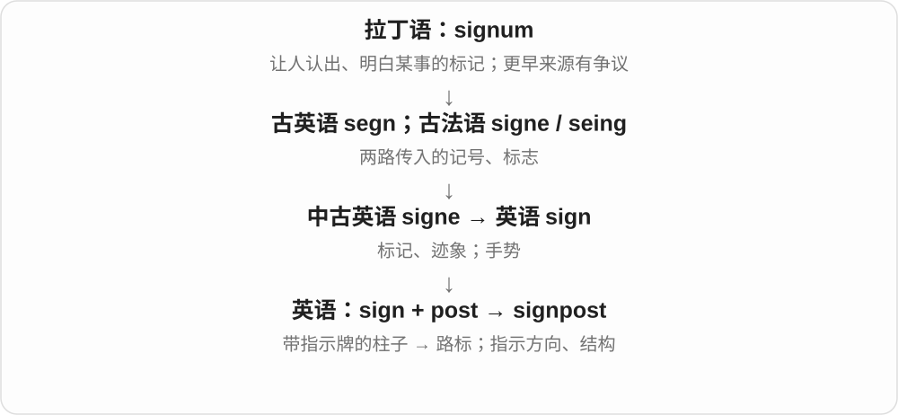

# 0312 · post — 柱与张贴；邮递；驻点、岗位

[逐词精讲目录](../00_逐词精讲目录.md) · [总目录](../00_总目录_按常用程度.md)

## 核心词根与来源

柱义上接拉丁 postis，经古英语、古法语；邮递、驻点岗位接法语 poste、意大利 posta 等。post- 表在后的前缀另看，不能把 postman 解释成后面的人。

**POST：同形几条来路，先问它在说柱、信、帖子还是岗位**

柱上贴告示成为公开发布；驿站联系邮递；安置的位置联系驻点岗位。不要用一个在后来包所有意思。

- **柱、发布、派驻的基本词**：post · poster · posting · repost
- **邮政与费用、载体、印记、编码**：postal · postage · postcard · postmark · postcode
- **邮政人员和数字内容**：postman · postmaster · blogpost
- **驻点和柱形物**：outpost · goalpost · signpost · lamppost · milepost
- **post → posted：发布、寄出与派驻**：post · posted
- **post → posts：柱、岗位与发布内容**：post · posts
- **poster → posters：张贴出来的内容与发帖的人**：post · poster · posters

## 词形与演化规律

post → poster、posting、repost 讲发布；postal → postage、postcard、postmark、postcode、postman、postmaster 讲邮务；blogpost 讲内容；outpost、goalpost 与已有 signpost 等分清位置和柱。

post 的柱、邮递、岗位等材料有不同历史路线；posted 不一律按前缀 post- 在后解释。

柱与驿站、岗位等分支分别追溯，张贴内容后有网络发布义。

张贴义 post 加完整 er，人物和物品两种词义都常见。

## 单词速览（按词族由简到繁）

同一基础词的相关扩展放在一起，先读基础形式，再读扩展；各组之间优先读常用的。具体词源关系见各词讲解。

| 单词 | 音标 | 核心意思 |
|---|---|---|
| [post](#w-1) | 英 /pəʊst/；美 /poʊst/ | 柱；张贴、帖子；邮递；岗位、驻点 |
| [posted](#w-18) | 英 /ˈpəʊstɪd/；美 /ˈpoʊstɪd/ | 张贴、发布了；寄出了；派驻了；post 的过去式和过去分词 |
| [posts](#w-19) | 英 /pəʊsts/；美 /poʊsts/ | 柱、桩；岗位；帖文〔复数〕；张贴、发布、邮寄等〔第三人称单数〕 |
| [posting](#w-17) | 英 /ˈpəʊstɪŋ/；美 /ˈpoʊstɪŋ/ | 发布、帖子；派驻、工作安排；入账等〔依语境〕 |
| [poster](#w-2) | 英 /ˈpəʊstə/；美 /ˈpoʊstər/ | 海报；招贴；发帖者〔另义〕 |
| [posters](#w-20) | 英 /ˈpəʊstəz/；美 /ˈpoʊstərz/ | 海报、招贴；发帖者〔复数〕 |
| [postal](#w-3) | 英 /ˈpəʊstəl/；美 /ˈpoʊstəl/ | 邮政的；邮递的 |
| [postage](#w-5) | 英 /ˈpəʊstɪdʒ/；美 /ˈpoʊstɪdʒ/ | 邮资；邮费 |
| [postcard](#w-6) | 英 /ˈpəʊstkɑːd/；美 /ˈpoʊstkɑːrd/ | 明信片 |
| [postmaster](#w-8) | 英 /ˈpəʊstmɑːstə/；美 /ˈpoʊstmæstər/ | 邮局负责人；邮件系统管理员〔技术语境〕 |
| [postman](#w-9) | 英 /ˈpəʊstmən/；美 /ˈpoʊstmən/ | 邮递员〔传统男性称谓，也可泛用〕 |
| [postcode](#w-10) | 英 /ˈpəʊstkəʊd/；美 /ˈpoʊstkoʊd/ | 邮政编码〔尤英式〕 |
| [postmark](#w-14) | 英 /ˈpəʊstmɑːk/；美 /ˈpoʊstmɑːrk/ | 邮戳；盖邮戳 |
| [repost](#w-4) | 动词英 /ˌriːˈpəʊst/、美 /ˌriːˈpoʊst/；名词英 /ˈriːpəʊst/、美 /ˈriːpoʊst/ | 重新发布；转发；重发内容 |
| [outpost](#w-7) | 英 /ˈaʊtpəʊst/；美 /ˈaʊtpoʊst/ | 前哨；偏远站点；外围分支 |
| [blogpost](#w-11) | 英 /ˈblɒɡpəʊst/；美 /ˈblɑːɡpoʊst/ | 博客文章；博文 |
| [signpost](#w-12) | 英 /ˈsaɪnpəʊst/；美 /ˈsaɪnpoʊst/ | 路标；指示牌；标出方向；提示文章结构 |
| [lamppost](#w-13) | 英 /ˈlæmpˌpəʊst/；美 /ˈlæmpˌpoʊst/ | 路灯柱 |
| [goalpost](#w-15) | 英 /ˈɡəʊlpəʊst/；美 /ˈɡoʊlpoʊst/ | 球门柱；球门架相关立柱 |
| [milepost](#w-16) | 英 /ˈmaɪlpəʊst/；美 /ˈmaɪlpoʊst/ | 英里标柱；里程标 |

## 逐词讲解

### 1. post — 柱；张贴、帖子；邮递；岗位、驻点

**音标**：英 /pəʊst/；美 /poʊst/

**先抓住这个画面**

路边一根柱，墙上一张告示，邮局里一封信，工作中的一个岗位——拼写相同，要分来源、分场景。

**怎么拆**

柱义经古英语、古法语接拉丁 postis；邮递义经法语 poste 接意大利 posta 驿站，岗位、驻点义也与法语 poste 相关。张贴与在显眼柱面等公布告示的用法相连。不要统统解释成 post- 在后。

**怎么变成今天的意思**

**拉丁 postis → 古英语、古法语 post；另一路意大利 posta → 法语 poste**  
柱子；另有驿站、安置位置等词源

↓

**英语 post**  
柱、张贴；邮递；岗位、驻点等同形用法

a fence post 篱笆柱，post a notice 张贴告示，post a letter 邮寄信件，a job post 工作岗位；a social media post 社交平台帖子从公开发布用法扩展。

**常见搭配与例句**

a fence post；post a notice；post a letter；a teaching post；a social media post。

> She posted a notice on the door.

她在门上贴了张告示。

> I need to post this letter today.

我今天要把信寄出去。

> He accepted a teaching post at the local school.

他接受了当地学校的一个教学岗位。

> A wooden post supports the fence.

一根木柱撑着篱笆。

**别混淆**

post 名词、动词的多义要看宾语和场景；post- 在 postwar 等词里表示战后，是另一个前缀用法，不能套到 postman 说成后面的人。

### 2. posted — 张贴、发布了；寄出了；派驻了；post 的过去式和过去分词

**音标**：英 /ˈpəʊstɪd/；美 /ˈpoʊstɪd/

**先抓住这个画面**

信息贴出去、信寄出去、人派到岗位上，都能说 posted。共同的现代感觉是把内容或人员安排到某个位置，但几个 post 的历史路线要分别看。

**怎么拆**

post + -ed，/t/ 后读 /ɪd/。柱义接拉丁 postis；邮递义经法语 poste、意大利 posta 驿站；岗位、派驻也与法语 poste 相关，不都归在英语 post- 在后。

**怎么变成今天的意思**

**不同借入路线的 post：柱、驿站与岗位等**  
张贴告示；递送邮件；派到岗位

↓

**post + -ed → posted**  
过去发布、寄出、派驻

posted a notice 张贴告示；posted a photo online 网上发照片；posted a letter 寄信〔常见英式〕；was posted abroad 被派驻国外；keep someone posted 随时告知进展。

**常见搭配与例句**

posted on the website；keep me posted。

> The timetable was posted beside the entrance.

时间表贴在入口旁。

> Please keep me posted if the delivery time changes.

如果送达时间有变，请及时告诉我。

**别混淆**

posted online 说明放到网上了，posted a letter 是寄了信。keep me posted 是让我随时知道进展，不是让我一直去发帖。

### 3. posts — 柱、桩；岗位；帖文〔复数〕；张贴、发布、邮寄等〔第三人称单数〕

**音标**：英 /pəʊsts/；美 /poʊsts/

**先抓住这个画面**

立着支撑的柱、人在组织中的岗位、网上发布的一条条内容，都能写 posts；先把柱与驻点两条历史分开，再看发布、邮递用途。

**怎么拆**

post + -s，/t/ 后读 /s/。柱名经古英语、法语接拉丁 postis；岗位、驿站支经法语 poste 接意大利语 posto 等放置词。张贴义接在柱面公布，邮递义接沿途驿站。

**怎么变成今天的意思**

**拉丁 postis → 柱 post → 张贴、公开发布**  
实物柱 → 在显眼处公布内容

↓

**意大利驻点词、法语 poste → 岗位、邮递 post；加 -s**  
驻留位置、驿站 → 岗位、邮件；现代形式 posts

wooden posts 木柱；teaching posts 教职岗位；blog posts 博客文章；posts a message 发布消息。

**常见搭配与例句**

posts along the fence；posts appearing on the website。

> The fence is supported by wooden posts.

围栏由木柱支撑。

> Several teaching posts are advertised on the website.

网站上刊登着几个教职岗位。

> She posts a short update every Friday.

她每周五发布一则简短进展。

**别混淆**

posts a letter 在英式常是寄信；posts a message 常是发布消息。所有这些 post 都不能只按 post- 在后这个前缀解释。

### 4. posting — 发布、帖子；派驻、工作安排；入账等〔依语境〕

**音标**：英 /ˈpəʊstɪŋ/；美 /ˈpoʊstɪŋ/

**先抓住这个画面**

一条内容被放上平台，或一个人被安排到某岗位；都要先看用了哪个 post。

**怎么拆**

post + -ing；发布、派驻、记入记录等源自 post 的不同动词用法，并非一条网络帖子演变成一个工作岗位。

**怎么变成今天的意思**

**拉丁 postis → 古英语、古法语 post；另一路意大利 posta → 法语 poste**  
柱子；另有驿站、安置位置等词源

↓

**英语 post**  
柱、张贴；邮递；岗位、驻点等同形用法

↓

**post + -ing → posting**  
发布的内容、活动；岗位派驻；记入记录等

a job posting 招聘启事，an overseas posting 海外派驻，an online posting 网帖；财务材料也可指记入账簿。

**常见搭配与例句**

a job posting；an overseas posting；an online posting。

> The job posting lists the skills required.

招聘启事列出了所需技能。

> She accepted a two-year overseas posting.

她接受了两年的海外派驻。

**别混淆**

job posting 是发布出来的职位消息，job post 可以是职位本身；an overseas posting 则更常是一段外派安排。

### 5. poster — 海报；招贴；发帖者〔另义〕

**音标**：英 /ˈpəʊstə/；美 /ˈpoʊstər/

**先抓住这个画面**

把一幅大图、一张告示贴出来给人看；网络里也可说是谁发了那条帖子。

**怎么拆**

post（张贴、发布）+ -er；名词可指供张贴的东西，也可指执行发帖的人。不是所有 -er 都只指人。

**怎么变成今天的意思**

**拉丁 postis → 古英语、古法语 post；另一路意大利 posta → 法语 poste**  
柱子；另有驿站、安置位置等词源

↓

**英语 post**  
柱、张贴；邮递；岗位、驻点等同形用法

↓

**post + -er → poster**  
招贴、海报；发帖的人

a movie poster 电影海报，put up a poster 贴海报，the original poster 原发帖者。按指物还是指人分义。

**常见搭配与例句**

a movie poster；put up a poster；the original poster。

> A concert poster hung beside the entrance.

入口旁挂着一张音乐会海报。

> The original poster later added more details.

原发帖者后来补充了更多细节。

**别混淆**

poster 海报或发帖者，postcard 邮寄卡片；同样纸片或图像，用途不同。

### 6. posters — 海报、招贴；发帖者〔复数〕

**音标**：英 /ˈpəʊstəz/；美 /ˈpoʊstərz/

**先抓住这个画面**

把消息贴出来让大家看，贴出的那张东西是 poster；网上负责发出内容的人也可以是 poster。

**怎么拆**

post + 完整 -er → poster，再加 -s。张贴义 post 的背景联系柱子、张贴位置，不把邮递、岗位等所有同形来源混成一路。

**怎么变成今天的意思**

**张贴义 post + -er → poster**  
供张贴的东西；执行发帖的人

↓

**poster + -s → posters**  
多张海报、招贴；多位发帖者

film posters 电影海报；posters on the wall 墙上海报；regular posters 经常发帖的人。

**常见搭配与例句**

put up posters 张贴海报；colourful posters 色彩鲜艳的海报。

> They put up posters around the school.

他们在学校各处贴上海报。

> The forum welcomes new posters.

论坛欢迎新的发帖者。

**别混淆**

posters 的 er 既可指人，也可指物，不能只凭尾部就译成张贴的人。论坛里 posters 常是发帖者，墙面、广告语境里多是海报。

### 7. postal — 邮政的；邮递的

**音标**：英 /ˈpəʊstəl/；美 /ˈpoʊstəl/

**先抓住这个画面**

把信件、包裹从收取到分拣再送达的服务体系，用 postal 来修饰。

**怎么拆**

post（邮递）+ -al，构词受法语 postal 等对应形式影响。al 形成相关形容词，不是表示所有字母。

**怎么变成今天的意思**

**拉丁 postis → 古英语、古法语 post；另一路意大利 posta → 法语 poste**  
柱子；另有驿站、安置位置等词源

↓

**英语 post**  
柱、张贴；邮递；岗位、驻点等同形用法

↓

**post + -al → postal**  
与邮政、邮递相关的

the postal service 邮政服务，a postal address 邮寄地址，postal workers 邮政工作人员。并非一切在线消息都算邮政。

**常见搭配与例句**

the postal service；a postal address；postal workers；postal delivery。

> Please include your full postal address.

请填写完整邮寄地址。

> The postal service delivers to the village twice a week.

邮政服务每周向村里投递两次。

**别混淆**

postal address 是邮寄地址，email address 电子邮箱地址；发信方式不同，不凭 address 相同就混写。

### 8. postage — 邮资；邮费

**音标**：英 /ˈpəʊstɪdʒ/；美 /ˈpoʊstɪdʒ/

**先抓住这个画面**

把东西寄出去要支付的费用，不是信里写了多少字。

**怎么拆**

post + -age，-age 在这里形成与服务、费用等有关的名词；不是 post“岗位”的年龄。

**怎么变成今天的意思**

**拉丁 postis → 古英语、古法语 post；另一路意大利 posta → 法语 poste**  
柱子；另有驿站、安置位置等词源

↓

**英语 post**  
柱、张贴；邮递；岗位、驻点等同形用法

↓

**post + -age → postage**  
邮递服务费用

pay the postage 支付邮资，postage included 含邮费，a postage stamp 邮票。具体费用随服务而变，词里不带固定金额。

**常见搭配与例句**

pay the postage；postage included；a postage stamp；postage costs。

> The price includes postage.

价格包含邮费。

> I forgot to check the postage before sending the parcel.

寄包裹前，我忘了查邮费。

**别混淆**

postage 是邮寄费用，stamp 邮票是传统支付、标示邮资的形式之一；有 postage 不一定手贴一张纸邮票。

### 9. postcard — 明信片

**音标**：英 /ˈpəʊstkɑːd/；美 /ˈpoʊstkɑːrd/

**先抓住这个画面**

一张可以写地址、写短消息直接寄走的卡片，常一面有风景图。

**怎么拆**

post（邮递）+ card；按邮寄形式命名，不是贴在柱上的海报。

**怎么变成今天的意思**

**post〔邮递〕；card**  
并列构词部分

↓

**postcard**  
通常不用信封寄送短消息的卡片

send a postcard 寄明信片，a picture postcard 风景明信片。图案常见但不由 card 一词保证一定有摄影作品。

**常见搭配与例句**

send a postcard；a picture postcard；write a postcard。

> She sent us a postcard from the mountains.

她从山区给我们寄来一张明信片。

> I wrote a short message on the back of the postcard.

我在明信片背面写了一条短消息。

**别混淆**

postcard 可直接写地址寄送，poster 招贴用于张贴展示；都可有大图，但通常尺寸、用途不同。

### 10. postmaster — 邮局负责人；邮件系统管理员〔技术语境〕

**音标**：英 /ˈpəʊstmɑːstə/；美 /ˈpoʊstmæstər/

**先抓住这个画面**

有人负责整个邮局、邮务安排；电子邮件系统也借这个名字称管理角色。

**怎么拆**

post + master（负责人、管理者），不是邮递员一定比别人更有学历。

**怎么变成今天的意思**

**post〔邮务〕；master〔负责人〕**  
并列构词部分

↓

**postmaster**  
邮局负责人；电子邮件系统管理角色

the village postmaster 村邮局负责人，contact the postmaster 联系邮件系统管理者；技术语境里的 postmaster 还可能是管理联系地址、账号名称。

**常见搭配与例句**

the village postmaster；contact the postmaster；the local postmaster。

> The postmaster explained the new collection times.

邮局负责人解释了新的收件时间。

> The error message suggested contacting the postmaster.

错误消息建议联系邮件系统管理员。

**别混淆**

postmaster 管理邮务，postman 常负责投递；互联网 postmaster 也不等于普通新闻发帖者 poster。

### 11. postman — 邮递员〔传统男性称谓，也可泛用〕

**音标**：英 /ˈpəʊstmən/；美 /ˈpoʊstmən/

**先抓住这个画面**

不是只坐在邮局里的人，而是把邮件送到住户、单位的人。

**怎么拆**

post（邮件投递）+ man；现代不指定性别可说 postal worker、mail carrier，具体岗位仍按职责。

**怎么变成今天的意思**

**post〔邮件、投递〕；man**  
并列构词部分

↓

**postman**  
从事邮件收取、投递的人

the local postman 当地邮递员，the postman delivers letters 邮递员送信；英式很常见。

**常见搭配与例句**

the local postman；the postman’s bag；wait for the postman。

> The postman delivered a parcel this morning.

邮递员今早送来一个包裹。

> Our postman knows every lane in the village.

我们的邮递员熟悉村里每条小路。

**别混淆**

postman 投递员，postmaster 邮局负责人；不是每一位邮递员都管理整个邮局。

### 12. postcode — 邮政编码〔尤英式〕

**音标**：英 /ˈpəʊstkəʊd/；美 /ˈpoʊstkoʊd/

**先抓住这个画面**

地址不只靠整段文字，还用一组代码帮助系统分区、分拣、投递。

**怎么拆**

post（邮政）+ code（代码），不是电脑程序 post 的源代码。

**怎么变成今天的意思**

**post〔邮政〕；code**  
并列构词部分

↓

**postcode**  
帮助邮政分拣、定位地址区域的编码

enter your postcode 输入邮编，a postcode area 邮编区；各国编码结构不同。美国日常通常说 ZIP code。

**常见搭配与例句**

enter a postcode；a postcode area；a full postcode。

> Please enter your postcode below the address.

请在地址下面填写邮编。

> The search tool finds nearby branches by postcode.

搜索工具按邮编查找附近网点。

**别混淆**

postcode 邮政编码，area code 电话区号；都像几位字符，但所属系统与用途不同。

### 13. postmark — 邮戳；盖邮戳

**音标**：英 /ˈpəʊstmɑːk/；美 /ˈpoʊstmɑːrk/

**先抓住这个画面**

信件走过邮政系统，留下处理日期、地点等印记，像它旅途中的一个时间章。

**怎么拆**

post（邮政）+ mark（标记），可名词也可动词。传统邮戳还常用于注销邮票，不让同一邮票反复使用。

**怎么变成今天的意思**

**post〔邮政〕；mark**  
并列构词部分

↓

**postmark**  
邮政处理留下的戳记；盖这种戳

a clear postmark 清楚的邮戳，an envelope postmarked in May 五月盖邮戳的信封。邮戳日期不是所有语境下都等于写信日期。

**常见搭配与例句**

a clear postmark；a dated postmark；an envelope postmarked。

> The postmark showed that the letter had been sent from Paris.

邮戳显示信是从巴黎寄出的。

> The envelope was postmarked two days before it arrived.

信封上的邮戳日期比到达日期早两天。

**别混淆**

postmark 邮政处理印记，watermark 水印；同叫 mark，形成方式、作用不同。

### 14. repost — 重新发布；转发；重发内容

**音标**：动词英 /ˌriːˈpəʊst/、美 /ˌriːˈpoʊst/；名词英 /ˈriːpəʊst/、美 /ˈriːpoʊst/

**先抓住这个画面**

内容已经发过一次，再把它放出来，可能同一平台，也可能另一个地方。

**怎么拆**

re-（再次）+ post（发布）；现代网络用法常见，不是把一个柱子反过来插。

**怎么变成今天的意思**

**拉丁 postis → 古英语、古法语 post；另一路意大利 posta → 法语 poste**  
柱子；另有驿站、安置位置等词源

↓

**英语 post**  
柱、张贴；邮递；岗位、驻点等同形用法

↓

**re- + post → repost**  
再次发布；重发内容

repost a photo 再发、转发照片，a repost of a message 一条消息的转发。是否保留原文、链接等因平台功能而异。

**常见搭配与例句**

repost a photo；repost a message；a repost of。

> The museum reposted the photo with a clearer caption.

博物馆配上更清楚的说明，重新发了照片。

> The announcement was a repost of last week’s message.

这则通知是上周消息的重发。

**别混淆**

repost 再发布，reply 回复；转发内容不一定附上对原作者的回答。

### 15. outpost — 前哨；偏远站点；外围分支

**音标**：英 /ˈaʊtpəʊst/；美 /ˈaʊtpoʊst/

**先抓住这个画面**

主体在别处，这里是伸出去、离核心较远的一个据点。

**怎么拆**

out-（在外、外围）+ post（驻点），由前沿或远处驻点扩到偏远研究站、业务分支等。

**怎么变成今天的意思**

**out-；post〔驻点〕**  
并列构词部分

↓

**outpost**  
外围前哨、远处站点或分支

a remote outpost 偏远据点，a research outpost 研究站点，a company’s outpost 某公司的外设分支。不是每一个都承担军事任务。

**常见搭配与例句**

a remote outpost；a research outpost；an outpost of。

> The researchers worked at a remote outpost in the mountains.

研究人员在山里一个偏远站点工作。

> The small gallery became an outpost of the city’s art scene.

这家小画廊成了城市艺术圈向外延伸的一个据点。

**别混淆**

outpost 外围驻点，output 输出；都有 out，后半选的词义完全不同。

### 16. blogpost — 博客文章；博文

**音标**：英 /ˈblɒɡpəʊst/；美 /ˈblɑːɡpoʊst/

**先抓住这个画面**

博客不是只有一个总页面，其中每一篇发出来的文章是一篇 blogpost。

**怎么拆**

blog + post（发布的内容），也常分写 blog post；不是书信 postal 的普通同义词。

**怎么变成今天的意思**

**blog；post〔帖子、发布内容〕**  
并列构词部分

↓

**blogpost**  
发布在博客上的一篇文章

write a blogpost 写博文，a blogpost about travel 旅行主题博文。长短、文体不限于私人日记。

**常见搭配与例句**

write a blogpost；publish a blogpost；a blogpost about。

> She wrote a blogpost about restoring old furniture.

她写了一篇修复旧家具的博文。

> The blogpost links to the original research.

博文链接到了原始研究。

**别混淆**

blog 博客整体或写博客的活动，blogpost 一篇具体内容；a blog can contain many blogposts。

### 17. signpost — 路标；指示牌；标出方向；提示文章结构

**音标**：英 /ˈsaɪnpəʊst/；美 /ˈsaɪnpoʊst/

**先抓住这个画面**

signpost 像岔路口那根带箭头的杆：告诉你往哪走。文章里的提示句也能像路标一样帮读者跟上。

**怎么拆**

sign + post，post 在这里是柱、杆；名词又转为动词“立标指路”，并引申到组织信息。

**怎么变成今天的意思**

follow the signposts 是顺着路标走；signpost an argument 是把论证的方向和层次说明白。

**常见搭配与例句**

a signpost to；follow the signposts；signpost the main points。

> A signpost pointed us towards the lake.

路标指引我们往湖边走。

> The introduction signposts the main stages of the argument.

引言交代了论证的主要步骤。

**别混淆**

signboard 只强调板上有标识；signpost 更突出指引到某处或某个论述方向。

### 18. lamppost — 路灯柱

**音标**：英 /ˈlæmpˌpəʊst/；美 /ˈlæmpˌpoʊst/

**先抓住这个画面**

把灯举到高处、支撑街道照明的柱子。

**怎么拆**

英语 lamp + post“柱、杆”。两个词交界处各有一个 p，合写仍保留 pp；也能见到分写 lamp post。

**怎么变成今天的意思**

**希腊语 lampein**  
发光

↓

**希腊语 lampas → 拉丁语 lampas**  
火炬、灯、光

↓

**古法语 lampe → 中古英语 laumpe、lampe**  
灯

↓

**现代英语 lamp**  
从油灯延伸到燃气灯、电灯等照明装置

↓

**英语 lamp + post → lamppost**  
支撑街灯的柱子

灯在上面发光，post 在下面支撑它。a notice on a lamppost 是贴在灯柱上的告示；撞到 lamppost，撞的是那根柱子，不只是碰到了灯泡。

**常见搭配与例句**

a street lamppost；a notice on a lamppost；lean against a lamppost。

> A missing-cat notice was taped to the lamppost.

灯柱上贴着一张寻猫启事。

> The old lampposts were repainted dark green.

那些旧路灯柱重新刷成了深绿色。

**别混淆**

streetlight 可以指街灯装置或它发出的光；lamppost 更明确地指支撑灯的柱体。post 在这里不是邮件或网络帖子。

### 19. goalpost — 球门柱；球门架相关立柱

**音标**：英 /ˈɡəʊlpəʊst/；美 /ˈɡoʊlpoʊst/

**先抓住这个画面**

球门两边竖起的柱子标出得分目标；若总挪它，别人就没法按原规则射门。

**怎么拆**

goal + post（柱），不是邮寄一个目标；体育结构因项目不同，常见复数 goalposts。

**怎么变成今天的意思**

**goal；post〔柱〕**  
并列构词部分

↓

**goalpost**  
标出球门、得分目标的立柱

hit the goalpost 球击中门柱；move the goalposts 比喻临时更改标准、规则，让别人更难达标。

**常见搭配与例句**

hit the goalpost；the goalposts；move the goalposts。

> The ball struck the goalpost and bounced away.

球撞上门柱，弹了出去。

> We cannot finish if you keep moving the goalposts.

你若不断改标准，我们就没法做完。

**别混淆**

goalpost 柱、goalkeeper 守门员；move the goalposts 的比喻不是指每次维护场地都在耍赖。

### 20. milepost — 英里标柱；里程标

**音标**：英 /ˈmaɪlpəʊst/；美 /ˈmaɪlpoʊst/

**先抓住这个画面**

路边或铁路旁立着的编号标志，告诉你离某个基准点已经有多远。

**怎么拆**

mile + post“柱、标杆”，以形式和用途直接命名；也可比喻历程中的标志性节点。

**怎么变成今天的意思**

**拉丁语 mille，复数 milia**  
一千、若干个千

↓

**拉丁语 milia passuum / mille passus**  
千步的距离说法

↓

**早期日耳曼语借入 → 古英语 mil → 中古英语 mile**  
作为路程单位的名称

↓

**现代英语 mile**  
英里；现代国际英里有固定长度

↓

**英语 mile + post → milepost**  
标示路程的柱状标志

公路、铁路上的 milepost 常用于定位地点；虽然历史上像柱子，现代也可能是其他形式的标记。

**常见搭配与例句**

near milepost 42；a roadside milepost；an important milepost。

> The maintenance crew stopped near milepost 42.

维修队在第四十二英里标附近停下。

> An old milepost marks the distance to the town.

一根旧里程标柱标示着到镇上的距离。

**别混淆**

milestone 更常作重要成就的比喻；milepost 更常见于具体路线定位。

## 这一组要分清什么

poster 海报、发帖者；postcard 明信片；postage 邮资、postmark 邮戳、postcode 邮编；postmaster 管理者，不是所有 post 都等于在后。

## 串起来练习

The postman brought a postcard with a clear postmark, while I reposted a photo of the old goalposts.

邮递员带来一张邮戳清晰的明信片，我则重发了一张旧门柱照片。
