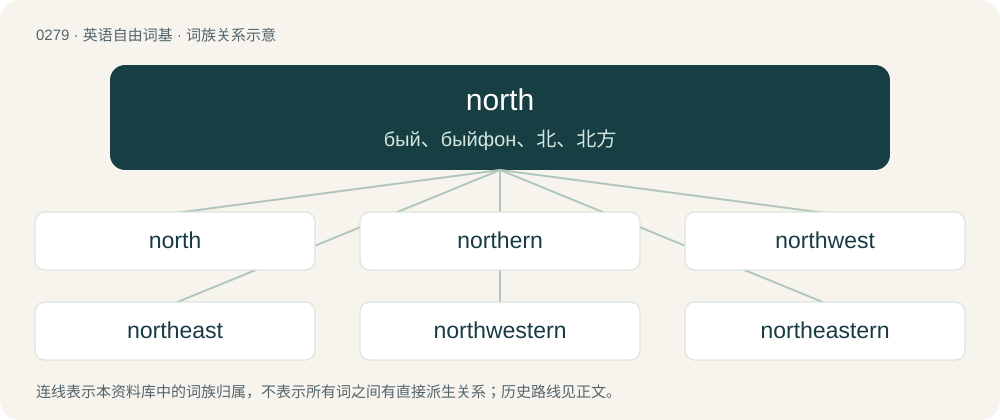

# 0313 · north — бый、быйфон、北、北方

[总目录](../00_总目录_按常用程度.md)

**类型**：英语自由词基　｜　**来源语言**：见词源记录

## 核心含义与来源

- 核心含义：бый、быйфон、北、北方
- 英文含义：The direction towards the pole to the left-hand side of someone facing east, specifically 0°, or (on another celestial object) the direction towards the pole lying on the northern side of the invariable plane.
- 词形：north

**来源记录 1**（名词；The direction towards the pole to the left-hand side of someone facing east, specifically 0°, or (on another celestial object) the direction towards the pole lying on the northern side of the invariable plane.）

From Middle English north, from Old English norþ, from Proto-West Germanic \*norþr, from Proto-Germanic \*nurþrą, ultimately from Proto-Indo-European \*nér (“below (the surface)”). The meaning developed either from "region where the sun is below (the earth)" or from "left side of someone who turns to the east when praying". Cognates Cognate with various Germanic counterparts such as Yola noardth, nordh (“north”), North Frisian noor, nord, nuurd, Nuurđ (“north”), Saterland Frisian Noude, Nudde (“north”), West Frisian noard (“north”), Dutch noord (“north”), German Nord (“north”), Danish, Norwegian Bokmål, and Norwegian Nynorsk nord (“north”), Faroese and Icelandic norður (“north”), Swedish nord, norr (“north”); also with Ancient Greek νέρτερος (nérteros), ἐνέρτερος (enérteros, “below”), Russian нора (nora, “hole”), Lithuanian nėrõvė (“mermaid, nymph”), Oscan 𐌍𐌄𐌓𐌕𐌓𐌀𐌊 (nertrak, “left”), Umbrian nertru (“left”), Sanskrit नरक (naraka, “hell”), Tocharian B ñor (“below”).

## 词族图

## 单词速览（常用到不常用）

| 单词 | 音标 | 释义 |
|---|---|---|
| [north](#w-1) | 英 /nɔːθ/；美 /noɹθ/ | бый、быйфон、北、北方 |
| [northern](#w-2) | 英 /ˈnɔː.ðən/；美 /ˈnɔɹ.ðɚn/ | n. 北方人；a. 北方的, 向北的, 自北方来的 |
| [northwest](#w-3) | 英 /nɔːθˈwɛst/；美 /nɔɹθˈwɛst/ | n. 西北, 西北方；a. 西北的, 在西北的, 来自西北的；adv. 向西北 |
| [northeast](#w-4) | British/Southern/Standard /noːˈθɪjst/ | n. 东北；a. 东北的, 向东北的, 来自东北的；adv. 向东北, 来自东北 |
| [northwestern](#w-5) | 英 /nɔːθˈwɛst.ə(ɹ)n/；/nɔːθˈwɛstn̩/ | a. 在西北部的, 西北方的, 来自西北的 |
| [northeastern](#w-6) | 英 /ˌnɔːˈθiː.stn̩/；美 /ˌnorˈθiː.stɚn/ | a. 东北方的, 在东北的, 来自东北的 |
| [northward](#w-7) | 英 /ˈnɔːθwəd/；美 /ˈnɔɹθwɚd/ | n. 北方, 北；a. 向北的；adv. 向北 |
| [northbound](#w-8) | 美 /ˈnɔɹθbaʊnd/ | a. 北行的 |
| [northside](#w-9) |  | \[地名\] \[基里巴斯\] 诺斯赛德 |
| [northwards](#w-10) | /ˈnɔːθwədz/ | adv. 向北方 |
| [northland](#w-11) | /ˈnɒːθlənd/ | n. 北国, 北部地方, 北部地带 |
| [northwesterly](#w-12) | /nɔːθˈwestəli/ | a. 位于西北方的, 向西北的, 从西北来的 |
| [northbridge](#w-13) |  | \[地名\] \[美国\] 诺斯布里奇 |
| [norther](#w-14) | /ˈnɔː(ɹ)θə(ɹ)/ | n. 酷寒北风；强烈北风 |

## 逐词详解

### 1. north

**词性**：名词　｜　**音标**：英 /nɔːθ/；美 /noɹθ/

**中文释义**：бый、быйфон、北、北方

**英文义项**：The direction towards the pole to the left-hand side of someone facing east, specifically 0°, or (on another celestial object) the direction towards the pole lying on the northern side of the invariable plane. / The up or positive direction.

**词源与演化**：

From Middle English north, from Old English norþ, from Proto-West Germanic \*norþr, from Proto-Germanic \*nurþrą, ultimately from Proto-Indo-European \*nér (“below (the surface)”). The meaning developed either from "region where the sun is below (the earth)" or from "left side of someone who turns to the east when praying". Cognates Cognate with various Germanic counterparts such as Yola noardth, nordh (“north”), North Frisian noor, nord, nuurd, Nuurđ (“north”), Saterland Frisian Noude, Nudde (“north”), West Frisian noard (“north”), Dutch noord (“north”), German Nord (“north”), Danish, Norwegian Bokmål, and Norwegian Nynorsk nord (“north”), Faroese and Icelandic norður (“north”), Swedish nord, norr (“north”); also with Ancient Greek νέρτερος (nérteros), ἐνέρτερος (enérteros, “below”), Russian нора (nora, “hole”), Lithuanian nėrõvė (“mermaid, nymph”), Oscan 𐌍𐌄𐌓𐌕𐌓𐌀𐌊 (nertrak, “left”), Umbrian nertru (“left”), Sanskrit नरक (naraka, “hell”), Tocharian B ñor (“below”).

**例句**：

> Stock prices are heading back towards the north.

该用例对应义项：The up or positive direction.

### 2. northern

**词性**：形容词　｜　**音标**：英 /ˈnɔː.ðən/；美 /ˈnɔɹ.ðɚn/

**中文释义**：n. 北方人；a. 北方的, 向北的, 自北方来的

**英文义项**：Of, facing, situated in, or related to the north; northerly. / Blowing from the north; northerly.

**构词拆分**：north + -ern

**词源与演化**：

From Middle English northerne, from Old English norþerne, from Proto-West Germanic \*norþrōnī, from Proto-Germanic \*nurþrōnijaz. Cognate with Old High German nordrōni and Old Norse norrœnn. Morphologically north + -ern.

**例句**：

> Les Dawson was a famous northern comedian.

该用例对应义项：Characteristic of the North of England (usually capitalised)

### 3. northwest

**词性**：形容词　｜　**音标**：英 /nɔːθˈwɛst/；美 /nɔɹθˈwɛst/

**中文释义**：n. 西北, 西北方；a. 西北的, 在西北的, 来自西北的；adv. 向西北

**英文义项**：Of, in or pertaining to the northwest; northwestern. / Situated toward or in the direction of the northwest; northwestward; northwesterly.

**构词拆分**：north + west

**词源与演化**：

From Middle English northwest, from Old English norþwest, equivalent to north + west.

**用法示例／搭配（非完整句）**：

> a northwest course

该用例对应义项：Situated toward or in the direction of the northwest; northwestward; northwesterly.

### 4. northeast

**词性**：形容词　｜　**音标**：British/Southern/Standard /noːˈθɪjst/

**中文释义**：n. 东北；a. 东北的, 向东北的, 来自东北的；adv. 向东北, 来自东北

**英文义项**：Of, in or pertaining to the northeast; northeastern. / Situated toward or in the direction of the northeast; northeastward; northeasterly.

**构词拆分**：north + east

**词源与演化**：

From Middle English northest, from Old English norþēast, equivalent to north + east.

**用法示例／搭配（非完整句）**：

> a northeast course

该用例对应义项：Situated toward or in the direction of the northeast; northeastward; northeasterly.

### 5. northwestern

**词性**：形容词　｜　**音标**：英 /nɔːθˈwɛst.ə(ɹ)n/；/nɔːθˈwɛstn̩/

**中文释义**：a. 在西北部的, 西北方的, 来自西北的

**英文义项**：Of or pertaining to the northwest; from or to in such a direction. / Blowing from that direction.

**构词拆分**：north + western

**词源与演化**：

Probably the reflex of Old English \*norþwesterne, equivalent to north + western, cognate with or formed similarly to Middle Low German nōrtwestern and Old High German nordwestrōni. Compare earlier northeastern, southeastern, and southwestern.

**例句**：

> Brittany is located in northwestern France.

该用例对应义项：Of or pertaining to the northwest; from or to in such a direction.

### 6. northeastern

**词性**：形容词　｜　**音标**：英 /ˌnɔːˈθiː.stn̩/；美 /ˌnorˈθiː.stɚn/

**中文释义**：a. 东北方的, 在东北的, 来自东北的

**英文义项**：Of, related to, located in, or from the northeast.

**构词拆分**：north + eastern

**词源与演化**：

From Middle English norþesterne, from Old English norþēasterne, equivalent to north + eastern.

**例句**：

> Kabylie, a region in northeastern Algeria, is very similar to southern Italy.

### 7. northward

**词性**：名词　｜　**音标**：英 /ˈnɔːθwəd/；美 /ˈnɔɹθwɚd/

**中文释义**：n. 北方, 北；a. 向北的；adv. 向北

**英文义项**：The direction or area lying to the north of a place.

**构词拆分**：north + -ward

**词源与演化**：

From north + -ward.

**例句**：

> There is a gradual cline of decreasing size to the northward.

### 8. northbound

**词性**：形容词　｜　**音标**：美 /ˈnɔɹθbaʊnd/

**中文释义**：a. 北行的

**英文义项**：Heading or moving in a northerly direction; or of infrastructure, intended for travelling northwards.

**构词拆分**：north + -bound

**词源与演化**：

From north + -bound.

**例句**：

> There are roadworks on the northbound carriageway.

该用例对应义项：Heading or moving in a northerly direction; or of infrastructure, intended for travelling northwards.

### 9. northside

**词性**：名词

**中文释义**：\[地名\] \[基里巴斯\] 诺斯赛德

**英文义项**：The northern side of a building, street, area etc.

**构词拆分**：north + side

**词源与演化**：

From north + side.

### 10. northwards

**词性**：副词　｜　**音标**：/ˈnɔːθwədz/

**中文释义**：adv. 向北方

**英文义项**：northward; in a northerly direction

**构词拆分**：north + -wards

**词源与演化**：

From north + -wards.

**例句**：

> If Algeria does nothing, the Sahara desert will continue to expand northwards.

### 11. northland

**词性**：名词　｜　**音标**：/ˈnɒːθlənd/

**中文释义**：n. 北国, 北部地方, 北部地带

**英文义项**：A land that lies to the north.

**构词拆分**：north + land

**词源与演化**：

From north + land.

### 12. northwesterly

**词性**：形容词　｜　**音标**：/nɔːθˈwestəli/

**中文释义**：a. 位于西北方的, 向西北的, 从西北来的

**英文义项**：Situated in, or pointing to, the northwest. / Coming from the northwest.

**构词拆分**：north + westerly

**词源与演化**：

From north + westerly. See also northwestern.

**例句**：

> A light, northwesterly wind blew across the city.

### 13. northbridge

**词性**：名词

**中文释义**：\[地名\] \[美国\] 诺斯布里奇

**英文义项**：A microchip connected directly to the CPU (unlike the southbridge) and thus responsible for tasks that require the highest performance.

**构词拆分**：north + bridge

**词源与演化**：

From north + bridge.

### 14. norther

**词性**：名词　｜　**音标**：/ˈnɔː(ɹ)θə(ɹ)/

**中文释义**：n. 酷寒北风；强烈北风

**英文义项**：A strong north wind, a wind blowing from the north.

**构词拆分**：north + -er

**词源与演化**：

From north + -er.
