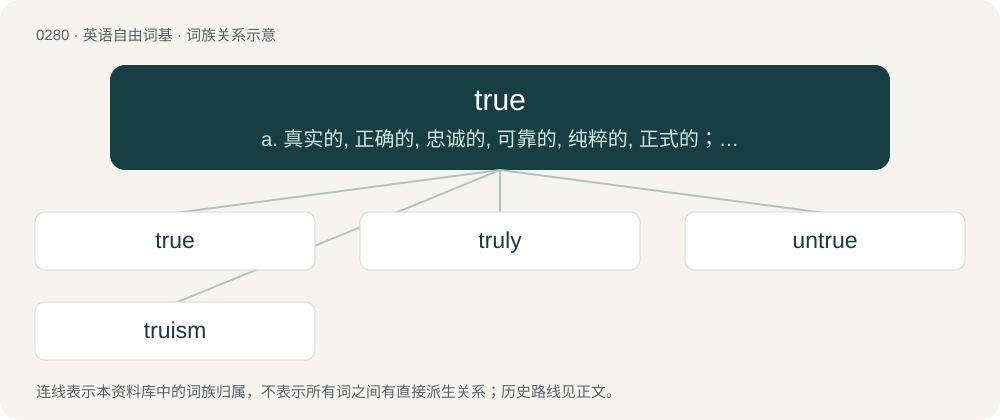

# 0316 · true — a. 真实的, 正确的, 忠诚的, 可靠的, 纯粹的, 正式的；n. 真实, 准确；adv. 真实地, 准确地

[总目录](../00_总目录_按常用程度.md)

**类型**：英语自由词基　｜　**来源语言**：见词源记录

## 核心含义与来源

- 核心含义：a. 真实的, 正确的, 忠诚的, 可靠的, 纯粹的, 正式的；n. 真实, 准确；adv. 真实地, 准确地
- 英文含义：Conforming to the actual state of reality or fact; factually correct.
- 词形：true

**来源记录 1**（形容词；Conforming to the actual state of reality or fact; factually correct.）

From Middle English treowe, trew, trewe, triwe, true, trwe, from Old English trēowe, trīewe (“faithful, true”), from Proto-Germanic \*triwwiz (“faithful, true”), from pre-Germanic \*drewh₂yos, from Proto-Indo-European \*drewH- (“firm, hard, true”). Cognates Cognate with Saterland Frisian trjou (“honest”), Alemannic German trüüw (“loyal”), Dutch trouw (“loyal, true”), German treu (“loyal, true”), Luxembourgish trei (“loyal”), Danish tryg (“safe, secure”), Faroese and Icelandic tryggur (“faithful, loyal; safe”), Norwegian Bokmål, Norwegian Nynorsk, and Swedish trygg (“safe, secure”), Gothic 𐍄𐍂𐌹𐌲𐌲𐍅𐍃 (triggws, “true; faithful, loyal”); also Irish dearbh (“sure”), Old Prussian druwis (“faith”), Ancient Greek δροόν (droón, “firm”)), extension of \*dóru (“tree”) (possibly also Proto-Slavic \*sъdorvъ (“healthy”) from the same root). More at tree. For the semantic development, compare Latin robustus (“tough”) from robur (“red oak”).

## 词族图

## 单词速览（常用到不常用）

| 单词 | 音标 | 释义 |
|---|---|---|
| [true](#w-1) | /tɹuː/ | a. 真实的, 正确的, 忠诚的, 可靠的, 纯粹的, 正式的；n. 真实, 准确；adv. 真实地, 准确地 |
| [truly](#w-2) | /ˈtɹuːli/ | adv. 真实地, 不假 |
| [untrue](#w-3) | /ʌnˈtɹuː/ | a. 不真实的, 不正确的, 不忠实的；\[法\] 虚伪的, 不真实的, 不正确的 |
| [truism](#w-4) | /tɹuːizəm/ | n. 自明之理, 众所周知, 老生常谈；\[法\] 老生常谈, 陈词滥调 |

## 逐词详解

### 1. true

**词性**：形容词　｜　**音标**：/tɹuː/

**中文释义**：a. 真实的, 正确的, 忠诚的, 可靠的, 纯粹的, 正式的；n. 真实, 准确；adv. 真实地, 准确地

**英文义项**：Conforming to the actual state of reality or fact; factually correct. / As an ellipsis of "(while) it is true (that)", used to start a sentence

**词源与演化**：

From Middle English treowe, trew, trewe, triwe, true, trwe, from Old English trēowe, trīewe (“faithful, true”), from Proto-Germanic \*triwwiz (“faithful, true”), from pre-Germanic \*drewh₂yos, from Proto-Indo-European \*drewH- (“firm, hard, true”). Cognates Cognate with Saterland Frisian trjou (“honest”), Alemannic German trüüw (“loyal”), Dutch trouw (“loyal, true”), German treu (“loyal, true”), Luxembourgish trei (“loyal”), Danish tryg (“safe, secure”), Faroese and Icelandic tryggur (“faithful, loyal; safe”), Norwegian Bokmål, Norwegian Nynorsk, and Swedish trygg (“safe, secure”), Gothic 𐍄𐍂𐌹𐌲𐌲𐍅𐍃 (triggws, “true; faithful, loyal”); also Irish dearbh (“sure”), Old Prussian druwis (“faith”), Ancient Greek δροόν (droón, “firm”)), extension of \*dóru (“tree”) (possibly also Proto-Slavic \*sъdorvъ (“healthy”) from the same root). More at tree. For the semantic development, compare Latin robustus (“tough”) from robur (“red oak”).

**例句**：

> The true bugs are those of the order Hemiptera; and, by some lights, most truly those of the suborder Heteroptera.

该用例对应义项：Used in the designation of group of species, or sometimes a single species, to indicate that it belongs to the clade its common name (which may be more broadly scoped in common speech) is restricted to in technical speech, or to distinguish it from a similar species, the latter of which may be called false.

### 2. truly

**词性**：副词　｜　**音标**：/ˈtɹuːli/

**中文释义**：adv. 真实地, 不假

**英文义项**：In accordance with the facts; truthfully, accurately. / Honestly, genuinely, in fact, really.

**构词拆分**：true + -ly

**词源与演化**：

From Middle English truely, treuly, treuli, trewely, treoweliche, treowliche, from Old English trēowlīċe (“faithfully; truly”), equivalent to true + -ly. Cognate with Dutch trouwelijk, Middle Low German truwlike, German treulich, Swedish trolig, Icelandic trygglega.

**例句**：

> Truly, that is all I know.

该用例对应义项：Honestly, genuinely, in fact, really.

### 3. untrue

**词性**：形容词　｜　**音标**：/ʌnˈtɹuː/

**中文释义**：a. 不真实的, 不正确的, 不忠实的；\[法\] 虚伪的, 不真实的, 不正确的

**英文义项**：False; not true. / Not faithful or loyal.

**构词拆分**：un- + true

**词源与演化**：

From Middle English untrewe, from Old English untrīewe, from Proto-West Germanic \*untriuwī, from Proto-Germanic \*untriwwiz. Equivalent to un- + true.

**例句**：

> She says that I stole her necklace, but that's completely untrue.

该用例对应义项：False; not true.

### 4. truism

**词性**：名词　｜　**音标**：/tɹuːizəm/

**中文释义**：n. 自明之理, 众所周知, 老生常谈；\[法\] 老生常谈, 陈词滥调

**英文义项**：A self-evident or obvious truth. / A banality or cliché.

**构词拆分**：true + -ism

**词源与演化**：

From true + -ism.

**例句**：

> To say that technology changes rapidly is to utter a truism.
