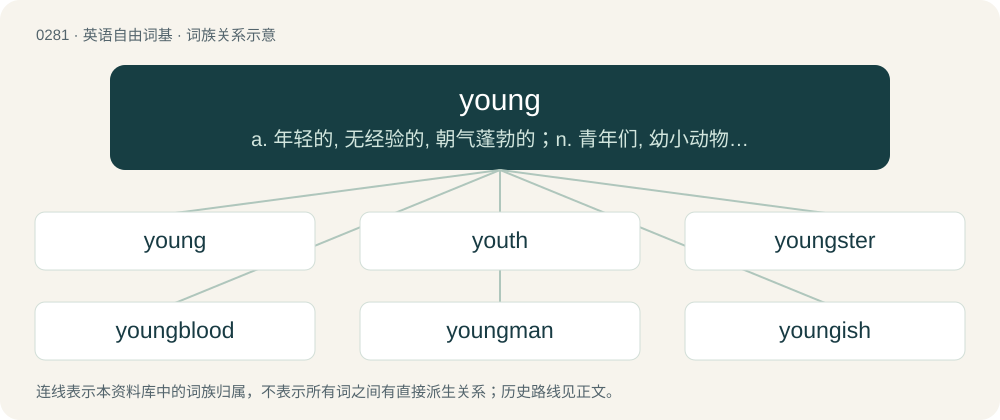

# 0317 · young — a. 年轻的, 无经验的, 朝气蓬勃的；n. 青年们, 幼小动物, 崽

[总目录](../00_总目录_按常用程度.md)

**类型**：英语自由词基　｜　**来源语言**：见词源记录

## 核心含义与来源

- 核心含义：a. 年轻的, 无经验的, 朝气蓬勃的；n. 青年们, 幼小动物, 崽
- 英文含义：In the early part of growth or life; born not long ago.
- 词形：young

**来源记录 1**（形容词；In the early part of growth or life; born not long ago.）

Inherited from Middle English yong, yonge, from Old English ġeong, from Proto-West Germanic \*jung, from Proto-Germanic \*jungaz, from Proto-Indo-European \*h₂yuHn̥ḱós, from \*h₂yuh₁en- (“young”). Cognates Cognate with Alemannic German jung, jungu, junhs, jungà, jòng (“young”), Bavarian junk (“young”), Central Franconian, Luxembourgish jonk (“young”), Cimbrian djung, jung, junk (“young”), Dutch jong (“young”), German, German Low German, Mòcheno and Vilamovian jung (“young”), Limburgish jong, jonk (“young”), Yiddish יונג (yung, “young”), Danish, Norwegian Bokmål, Norwegian Nynorsk and Swedish ung (“young”), Faroese, Icelandic ungur (“young”), Gothic 𐌾𐌿𐌲𐌲𐍃 (juggs, “young”).

## 词族图

## 单词速览（常用到不常用）

| 单词 | 音标 | 释义 |
|---|---|---|
| [young](#w-1) | /jʌŋ/ | a. 年轻的, 无经验的, 朝气蓬勃的；n. 青年们, 幼小动物, 崽 |
| [youth](#w-2) | 英 /juːθ/；美 /juθ/ | n. 年轻, 青年时代, 青年们, 青春；\[法\] 青年, 青年时期, 青春时期 |
| [youngster](#w-3) | 英 /ˈjʌŋstə/；美 /ˈjʌŋstɚ/ | n. 小孩, 年轻人, 少年；\[法\] 儿童, 少年, 青年 |
| [youngblood](#w-4) | /ˈjʌŋ,blʌd/ | n. 血性小子（电影名, 等于铁血男儿） |
| [youngman](#w-5) |  | \[人名\] \[英格兰人姓氏\] 扬曼 Yeoman的变体 |
| [youngish](#w-6) | /ˈjʌŋiʃ/ | a. 还年轻的, 还幼小的 |

## 逐词详解

### 1. young

**词性**：形容词　｜　**音标**：/jʌŋ/

**中文释义**：a. 年轻的, 无经验的, 朝气蓬勃的；n. 青年们, 幼小动物, 崽

**英文义项**：In the early part of growth or life; born not long ago. / At an early stage of existence or development; having recently come into existence.

**词源与演化**：

Inherited from Middle English yong, yonge, from Old English ġeong, from Proto-West Germanic \*jung, from Proto-Germanic \*jungaz, from Proto-Indo-European \*h₂yuHn̥ḱós, from \*h₂yuh₁en- (“young”). Cognates Cognate with Alemannic German jung, jungu, junhs, jungà, jòng (“young”), Bavarian junk (“young”), Central Franconian, Luxembourgish jonk (“young”), Cimbrian djung, jung, junk (“young”), Dutch jong (“young”), German, German Low German, Mòcheno and Vilamovian jung (“young”), Limburgish jong, jonk (“young”), Yiddish יונג (yung, “young”), Danish, Norwegian Bokmål, Norwegian Nynorsk and Swedish ung (“young”), Faroese, Icelandic ungur (“young”), Gothic 𐌾𐌿𐌲𐌲𐍃 (juggs, “young”).

**例句**：

> My grandmother is a very active woman and is quite young for her age.

该用例对应义项：Youthful; having the look or qualities of a young person.

### 2. youth

**词性**：名词　｜　**音标**：英 /juːθ/；美 /juθ/

**中文释义**：n. 年轻, 青年时代, 青年们, 青春；\[法\] 青年, 青年时期, 青春时期

**英文义项**：The quality or state of being young. / The part of life following childhood; the period of existence preceding maturity or age; the whole early part of life, from childhood, or, sometimes, from infancy, to adulthood.

**构词拆分**：young + -th (abstract nominal suffix)

**词源与演化**：

From Middle English youthe, youghte, ȝouþe, from Old English ġeoguþ (“the state of being young; youth”), from Proto-West Germanic \*juwunþa, from Proto-Germanic \*jugunþō, \*jugunþiz (“youth”), corresponding to young + -th (abstract nominal suffix). Cognate with Saterland Frisian Juugd, West Frisian jeugd, Dutch jeugd, German Low German Jöögd, German Jugend.

**例句**：

> There was a group of youths hanging around the parking lot, reading fashion magazines and listening to music.

该用例对应义项：A young person.

### 3. youngster

**词性**：名词　｜　**音标**：英 /ˈjʌŋstə/；美 /ˈjʌŋstɚ/

**中文释义**：n. 小孩, 年轻人, 少年；\[法\] 儿童, 少年, 青年

**英文义项**：A young person.

**构词拆分**：young + -ster

**词源与演化**：

From young + -ster. Attested from the early 17th century.

**例句**：

> `tiddler' is a British term for youngster.

该用例对应义项：a young person of either sex

### 4. youngblood

**词性**：名词　｜　**音标**：/ˈjʌŋ,blʌd/

**中文释义**：n. 血性小子（电影名, 等于铁血男儿）

**英文义项**：Someone who constitutes or brings fresh blood, especially a youngster who joins an older team etc. / A young black gangster.

**构词拆分**：young + blood

**词源与演化**：

From young + blood.

### 5. youngman

**词性**：名词

**中文释义**：\[人名\] \[英格兰人姓氏\] 扬曼 Yeoman的变体

**英文义项**：A younger lover or sexual partner.

**构词拆分**：young + man

**词源与演化**：

From young + man. Possible doublet of yeoman.

### 6. youngish

**词性**：形容词　｜　**音标**：/ˈjʌŋiʃ/

**中文释义**：a. 还年轻的, 还幼小的

**英文义项**：Somewhat young.

**构词拆分**：young + -ish

**词源与演化**：

From young + -ish.

**例句**：

> In spite of his youngish appearance, he had much experience.

该用例对应义项：Somewhat young.
