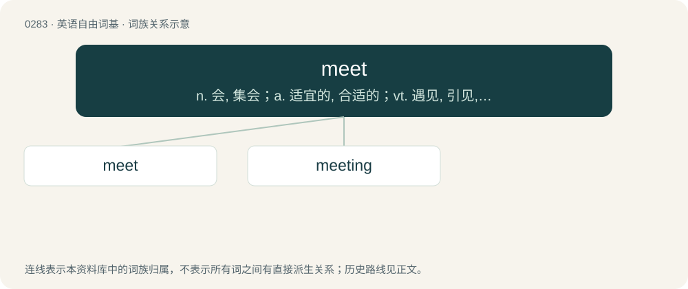

# 0319 · meet — n. 会, 集会；a. 适宜的, 合适的；vt. 遇见, 引见, 认识, 满足, 对付

[总目录](../00_总目录_按常用程度.md)

**类型**：英语自由词基　｜　**来源语言**：见词源记录

## 核心含义与来源

- 核心含义：n. 会, 集会；a. 适宜的, 合适的；vt. 遇见, 引见, 认识, 满足, 对付
- 英文含义：To come face to face with by accident; to encounter.
- 词形：meet

**来源记录 1**（动词；To come face to face with by accident; to encounter.）

From Middle English meten, from Old English mētan (“to meet, find, encounter”), from Proto-West Germanic \*mōtijan (“to meet”), from Proto-Germanic \*mōtijaną (“to meet”), from Proto-Indo-European \*meh₂d- (“to come, meet”). Cognates Cognate with Scots met, mete, meit (“to meet”), North Frisian meet, mätje, möt (“to meet”), West Frisian mette, moetsje (“to meet”), Dutch ontmoeten (“to meet”), Low German möten (“to meet”), Danish møde (“to meet”), Elfdalian my̨öt (“to meet”), Faroese møta (“to meet”), Icelandic mæta (“to meet”), Norwegian Bokmål møte (“to meet”), Norwegian Nynorsk møta, møte (“to meet”), Swedish möta (“to meet”). Related to moot.

## 词族图

## 单词速览（常用到不常用）

| 单词 | 音标 | 释义 |
|---|---|---|
| [meet](#w-1) | 英 /miːt/；美 /mit/ | n. 会, 集会；a. 适宜的, 合适的；vt. 遇见, 引见, 认识, 满足, 对付 |
| [meeting](#w-2) | 英 /ˈmiːtɪŋ/；美 /ˈmitɪŋ/ | n. 会议, 会面；\[法\] 会议, 会谈, 集会 |

## 逐词详解

### 1. meet

**词性**：动词　｜　**音标**：英 /miːt/；美 /mit/

**中文释义**：n. 会, 集会；a. 适宜的, 合适的；vt. 遇见, 引见, 认识, 满足, 对付

**英文义项**：To come face to face with by accident; to encounter. / To come face to face with someone by arrangement.

**词源与演化**：

From Middle English meten, from Old English mētan (“to meet, find, encounter”), from Proto-West Germanic \*mōtijan (“to meet”), from Proto-Germanic \*mōtijaną (“to meet”), from Proto-Indo-European \*meh₂d- (“to come, meet”). Cognates Cognate with Scots met, mete, meit (“to meet”), North Frisian meet, mätje, möt (“to meet”), West Frisian mette, moetsje (“to meet”), Dutch ontmoeten (“to meet”), Low German möten (“to meet”), Danish møde (“to meet”), Elfdalian my̨öt (“to meet”), Faroese møta (“to meet”), Icelandic mæta (“to meet”), Norwegian Bokmål møte (“to meet”), Norwegian Nynorsk møta, møte (“to meet”), Swedish möta (“to meet”). Related to moot.

**例句**：

> This proposal meets my requirements. The company agrees to meet the cost of any repairs.

该用例对应义项：To satisfy; to comply with.

### 2. meeting

**词性**：名词　｜　**音标**：英 /ˈmiːtɪŋ/；美 /ˈmitɪŋ/

**中文释义**：n. 会议, 会面；\[法\] 会议, 会谈, 集会

**英文义项**：The act of persons or things that meet. / A gathering of persons for a purpose; an assembly.

**构词拆分**：meet + -ing

**词源与演化**：

From Middle English meeting, meting, from Old English mēting, ġemēting (“meeting, assembly, association, society”), equivalent to meet + -ing. Cognate with West Frisian moeting (“meeting, encounter”), Dutch ontmoeting (“meeting, encounter”), Middle Low German mö̂tinge (“meeting”). Compare also German Low German Möte (“meeting, encounter”), Danish møde (“meeting, encounter”), Swedish möte (“meeting, encounter”), Icelandic mót (“meeting”). Related to moot.

**例句**：

> They came together in a chance meeting on the way home from work.

该用例对应义项：An encounter between people, even accidental.
