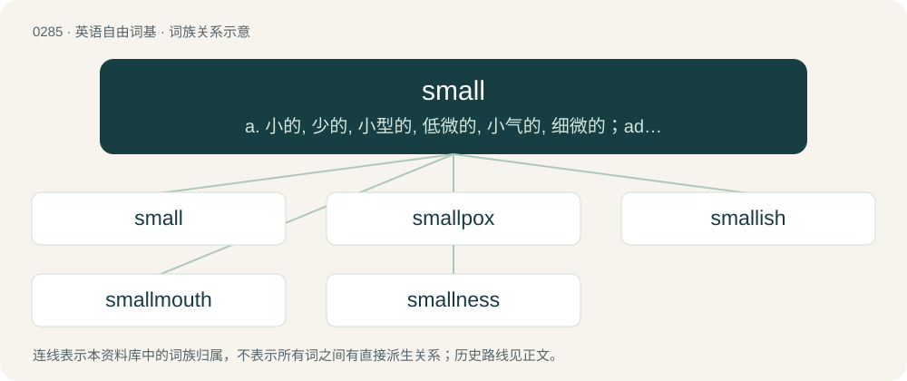

# 0321 · small — a. 小的, 少的, 小型的, 低微的, 小气的, 细微的；adv. 些微地；n. 狭小部分

[总目录](../00_总目录_按常用程度.md)

**类型**：英语自由词基　｜　**来源语言**：见词源记录

## 核心含义与来源

- 核心含义：a. 小的, 少的, 小型的, 低微的, 小气的, 细微的；adv. 些微地；n. 狭小部分
- 英文含义：Not large or big; insignificant; few in number.
- 词形：small

**来源记录 1**（形容词；Not large or big; insignificant; few in number.）

From Middle English smal, smale, small, smalle, smel, smæl, from Old English smæl (“narrow, slim; slender; fine; small; quiet”), from Proto-West Germanic \*smal, from Proto-Germanic \*smalaz (“small”), from Proto-Indo-European \*(s)mal- (“small; little”). Cognates Cognate with Scots smaw (“small; minor”), Yola smaale, small (“small”), North Frisian smaal, smeel, smääl (“narrow”), Saterland Frisian smäl (“narrow”), West Frisian smel (“narrow”), Alemannic German schmaal (“narrow”), Bavarian schmoi (“narrow; slender”), Dutch smal (“narrow; small”), German schmal (“narrow; slender”), Low German small (“narrow; slender, small”), Luxembourgish schmuel (“narrow”), Vilamovian śmoł, šmoł (“narrow”), Yiddish שמאָל (shmol, “narrow”), Danish, Norwegian Bokmål, Norwegian Nynorsk, and Swedish smal (“narrow; slim”), Gothic 𐍃𐌼𐌰𐌻𐌹𐍃𐍄𐍃 (smalists, “smallest”); also Latin malus (“bad, distressing, nasty; evil, mischievous, wicked; destructive, hurtful, noxious; abusive, hostile, unkind”), Belarusian малы́ (malý, “small”), Bulgarian and Macedonian мал (mal, “small; minor”), Czech and Slovak malý (“small”), Polish mały (“small; little; humble; short”), Russian ма́лый (mályj, “small; short”), Serbo-Croatian ма̑л, mȃl (“small”), Ukrainian мали́й (malýj, “small”).

## 词族图

## 单词速览（常用到不常用）

| 单词 | 音标 | 释义 |
|---|---|---|
| [small](#w-1) | 英 /smɔːl/；/smɔl/ | a. 小的, 少的, 小型的, 低微的, 小气的, 细微的；adv. 些微地；n. 狭小部分 |
| [smallpox](#w-2) | 英 /ˈsmɔːlpɒks/；美 /ˈsmɔlpɑks/ | n. 天花；\[医\] 天花, 痘疮 |
| [smallish](#w-3) | /ˈsmɒːliʃ/ | a. 有点小的, 短小的 |
| [smallmouth](#w-4) | /ˈsmɔː lmajθ/ | n. \[鱼\]小口黑鲈 |
| [smallness](#w-5) | /ˈsmɒːlnis/ | n. 小, 贫乏, 小气 |

## 逐词详解

### 1. small

**词性**：形容词　｜　**音标**：英 /smɔːl/；/smɔl/

**中文释义**：a. 小的, 少的, 小型的, 低微的, 小气的, 细微的；adv. 些微地；n. 狭小部分

**英文义项**：Not large or big; insignificant; few in number. / Humiliated or insignificant.

**词源与演化**：

From Middle English smal, smale, small, smalle, smel, smæl, from Old English smæl (“narrow, slim; slender; fine; small; quiet”), from Proto-West Germanic \*smal, from Proto-Germanic \*smalaz (“small”), from Proto-Indo-European \*(s)mal- (“small; little”). Cognates Cognate with Scots smaw (“small; minor”), Yola smaale, small (“small”), North Frisian smaal, smeel, smääl (“narrow”), Saterland Frisian smäl (“narrow”), West Frisian smel (“narrow”), Alemannic German schmaal (“narrow”), Bavarian schmoi (“narrow; slender”), Dutch smal (“narrow; small”), German schmal (“narrow; slender”), Low German small (“narrow; slender, small”), Luxembourgish schmuel (“narrow”), Vilamovian śmoł, šmoł (“narrow”), Yiddish שמאָל (shmol, “narrow”), Danish, Norwegian Bokmål, Norwegian Nynorsk, and Swedish smal (“narrow; slim”), Gothic 𐍃𐌼𐌰𐌻𐌹𐍃𐍄𐍃 (smalists, “smallest”); also Latin malus (“bad, distressing, nasty; evil, mischievous, wicked; destructive, hurtful, noxious; abusive, hostile, unkind”), Belarusian малы́ (malý, “small”), Bulgarian and Macedonian мал (mal, “small; minor”), Czech and Slovak malý (“small”), Polish mały (“small; little; humble; short”), Russian ма́лый (mályj, “small; short”), Serbo-Croatian ма̑л, mȃl (“small”), Ukrainian мали́й (malýj, “small”).

**例句**：

> Though over six feet tall, the man was very small and ashamed to undress.

该用例对应义项：Having a small penis, muscles, or other important body parts, regardless of overall body size.

### 2. smallpox

**词性**：名词　｜　**音标**：英 /ˈsmɔːlpɒks/；美 /ˈsmɔlpɑks/

**中文释义**：n. 天花；\[医\] 天花, 痘疮

**英文义项**：An acute, highly infectious often fatal disease caused by Variola virus of the family Poxviridae. It was completely eradicated in the 1970s, but still exists in laboratories. Those who survived were left with pockmarks.

**构词拆分**：small + pox

**词源与演化**：

From small + pox, in contrast to greatpox (“syphilis”).

**例句**：

> The Europeans brought new diseases such as smallpox, measles, dysentery, influenza, syphilis and leprosy.

该用例对应义项：An acute, highly infectious often fatal disease caused by Variola virus of the family Poxviridae. It was completely eradicated in the 1970s, but still exists in laboratories. Those who survived were left with pockmarks.

### 3. smallish

**词性**：形容词　｜　**音标**：/ˈsmɒːliʃ/

**中文释义**：a. 有点小的, 短小的

**英文义项**：Somewhat small.

**构词拆分**：small + -ish

**词源与演化**：

From Middle English smalish, equivalent to small + -ish.

### 4. smallmouth

**词性**：名词　｜　**音标**：/ˈsmɔː lmajθ/

**中文释义**：n. \[鱼\]小口黑鲈

**英文义项**：A species of freshwater bass, Micropterus dolomieu, native to central North America but widely introduced throughout Canada and the United States as a game fish.

**构词拆分**：small + mouth

**词源与演化**：

From small + mouth.

### 5. smallness

**词性**：名词　｜　**音标**：/ˈsmɒːlnis/

**中文释义**：n. 小, 贫乏, 小气

**英文义项**：The state or quality of being small. / The result or product of being small.

**构词拆分**：small + -ness

**词源与演化**：

From Middle English smalnesse; equivalent to small + -ness.

**例句**：

> His smallness didn't bother him, except when he needed something off the top shelf.

该用例对应义项：The state or quality of being small.
