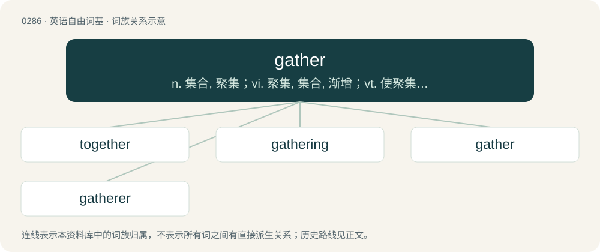

# 0322 · gather — n. 集合, 聚集；vi. 聚集, 集合, 渐增；vt. 使聚集, 搜集, 积聚

[总目录](../00_总目录_按常用程度.md)

**类型**：英语自由词基　｜　**来源语言**：见词源记录

## 核心含义与来源

- 核心含义：n. 集合, 聚集；vi. 聚集, 集合, 渐增；vt. 使聚集, 搜集, 积聚
- 英文含义：To collect normally separate things.
- 词形：gather

**来源记录 1**（动词；To collect normally separate things.）

From Middle English gaderen, from Old English gaderian (“to gather, assemble”), from Proto-West Germanic \*gadurōn (“to bring together, unite, gather”), from Proto-Indo-European \*gʰedʰ- (“to unite, assemble, keep”).

## 词族图

## 单词速览（常用到不常用）

| 单词 | 音标 | 释义 |
|---|---|---|
| [together](#w-1) | 英 /tʊˈɡɛð.ə/；美 /tʊˈɡɛðɚ/ | adv. 一起, 共同, 彼此 |
| [gathering](#w-2) | 英 /ˈɡæð.ə.ɹɪŋ/；美 /ˈɡæð.ɚ.ɪŋ/ | n. 聚集, 集中, 采集；\[化\] 富集 |
| [gather](#w-3) | 英 /ˈɡæðə/；美 /ˈɡæðɚ/ | n. 集合, 聚集；vi. 聚集, 集合, 渐增；vt. 使聚集, 搜集, 积聚 |
| [gatherer](#w-4) | /ˈ^æðərə/ | n. 采集者, 收集器 |

## 逐词详解

### 1. together

**词性**：形容词　｜　**音标**：英 /tʊˈɡɛð.ə/；美 /tʊˈɡɛðɚ/

**中文释义**：adv. 一起, 共同, 彼此

**英文义项**：Coherent; well-organized.

**构词拆分**：to-₂ + gather

**词源与演化**：

From Late Middle English together, from earlier togedere, togadere, from Old English tōgædere (“together”), from Proto-West Germanic \*tōgadura, \*tegadura, from Proto-Germanic \*tō (“to”) + \*gadar (“together”), from Proto-Indo-European \*gʰedʰ- (“to unite, keep”), equivalent to to-₂ + gather. Cognate with Scots thegither (“together”), Old Frisian togadera (whence West Frisian togearre (“together”)), Dutch tegader (“together”), Middle Low German tōgāder (“together”), Middle High German zegater (“together”). Compare also Old English ætgædere (“together”), Old English ġeador (“together”). More at gather.

**用法示例／搭配（非完整句）**：

> He’s really together.

该用例对应义项：Coherent; well-organized.

### 2. gathering

**词性**：名词　｜　**音标**：英 /ˈɡæð.ə.ɹɪŋ/；美 /ˈɡæð.ɚ.ɪŋ/

**中文释义**：n. 聚集, 集中, 采集；\[化\] 富集

**英文义项**：A meeting or get-together; a party or social function. / A group of people or things.

**构词拆分**：gather + -ing (verbal noun ending)

**词源与演化**：

From Middle English gadering, from Old English gaderung (“gathering, assembly”), equivalent to gather + -ing (verbal noun ending).

**例句**：

> This gathering machine forms the backbone of a bookbinding operation.

该用例对应义项：A section, a group of bifolios, or sheets of paper, stacked together and folded in half.

### 3. gather

**词性**：动词　｜　**音标**：英 /ˈɡæðə/；美 /ˈɡæðɚ/

**中文释义**：n. 集合, 聚集；vi. 聚集, 集合, 渐增；vt. 使聚集, 搜集, 积聚

**英文义项**：To collect normally separate things. / Especially, to harvest food.

**词源与演化**：

From Middle English gaderen, from Old English gaderian (“to gather, assemble”), from Proto-West Germanic \*gadurōn (“to bring together, unite, gather”), from Proto-Indo-European \*gʰedʰ- (“to unite, assemble, keep”).

**例句**：

> If you want to emphasise the shape, it is possible to gather the waistline.

该用例对应义项：To bring stitches closer together.

### 4. gatherer

**词性**：名词　｜　**音标**：/ˈ^æðərə/

**中文释义**：n. 采集者, 收集器

**英文义项**：A person who gathers things. / A person who primarily gathers in a hunter-gatherer social system.

**构词拆分**：gather + -er

**词源与演化**：

From Middle English gaderere, gaderare, equivalent to gather + -er.
