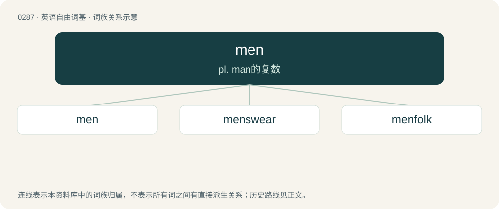

# 0323 · men — pl. man的复数

[总目录](../00_总目录_按常用程度.md)

**类型**：英语自由词基　｜　**来源语言**：见词源记录

## 核心含义与来源

- 核心含义：pl. man的复数
- 英文含义：(The) people, humanity, man(kind).
- 词形：men

**来源记录 1**（名词；(The) people, humanity, man(kind).）

From Middle English men, from Old English menn (“people”), from Proto-Germanic \*manniz, nominative plural of Proto-Germanic \*mann- (“person”). Cognate with German Männer (“men”), Danish mænd (“men”), Swedish män (“men”). More at man.

## 词族图

## 单词速览（常用到不常用）

| 单词 | 音标 | 释义 |
|---|---|---|
| [men](#w-1) | /mɛn/ | pl. man的复数 |
| [menswear](#w-2) | 美 /ˈmɛnz.wɛɚ/ | n. 男服 |
| [menfolk](#w-3) | /ˈmenfəuk/ | n. 男人, 男成员 |

## 逐词详解

### 1. men

**词性**：名词　｜　**音标**：/mɛn/

**中文释义**：pl. man的复数

**英文义项**：(The) people, humanity, man(kind). / Enlisted personnel (as opposed to commissioned officers).

**词源与演化**：

From Middle English men, from Old English menn (“people”), from Proto-Germanic \*manniz, nominative plural of Proto-Germanic \*mann- (“person”). Cognate with German Männer (“men”), Danish mænd (“men”), Swedish män (“men”). More at man.

**例句**：

> "Muster up the men in the barracks at 0600," the lieutenant said to his sergeant.

该用例对应义项：Enlisted personnel (as opposed to commissioned officers).

### 2. menswear

**词性**：名词　｜　**音标**：美 /ˈmɛnz.wɛɚ/

**中文释义**：n. 男服

**英文义项**：Men's clothing (and accessories), particularly in a retail context.

**构词拆分**：men + -s- + -wear

**词源与演化**：

From men + -s- + -wear.

**例句**：

> Shirts can be found in the menswear department.

### 3. menfolk

**词性**：名词　｜　**音标**：/ˈmenfəuk/

**中文释义**：n. 男人, 男成员

**英文义项**：Male people in general. / The male members of a group.

**构词拆分**：men + folk

**词源与演化**：

From men + folk.

**例句**：

> At our family reunion, the menfolk generally have a ball game, while the womenfolk gossip and trade snapshots.

该用例对应义项：The male members of a group.
