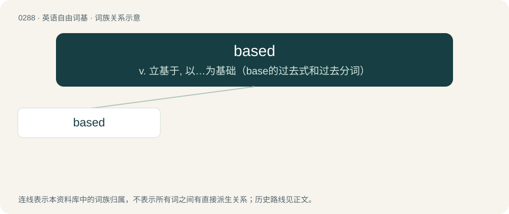

# 0324 · based — v. 立基于, 以…为基础（base的过去式和过去分词）

[总目录](../00_总目录_按常用程度.md)

**类型**：英语自由词基　｜　**来源语言**：见词源记录

## 核心含义与来源

- 核心含义：v. 立基于, 以…为基础（base的过去式和过去分词）
- 英文含义：Founded on; having a basis; often used in combining forms.
- 词形：based

**多个词源／构词路径**：同一拼写可能有不同来源；以下按词性和含义分别列出。

**来源记录 1**（形容词；Founded on; having a basis; often used in combining forms.）

From base + -ed.

**来源记录 2**（形容词；Not caring what others think about one's personality, style, or behavior; focused on maintaining individuality.）

A reference to freebase cocaine, via basehead. Coined by American rapper from California Lil B in 2010 to describe his lifestyle.

## 词族图

## 单词速览（常用到不常用）

| 单词 | 音标 | 释义 |
|---|---|---|
| [based](#w-1) | /beɪst/ | v. 立基于, 以…为基础（base的过去式和过去分词） |

## 逐词详解

### 1. based

**词性**：形容词　｜　**音标**：/beɪst/

**中文释义**：v. 立基于, 以…为基础（base的过去式和过去分词）

**英文义项**：Founded on; having a basis; often used in combining forms.

**构词拆分**：base + -ed

**词源与演化**：

From base + -ed.

**例句**：

> The company opted for a subscription-based business model.

该用例对应义项：Founded on; having a basis; often used in combining forms.
