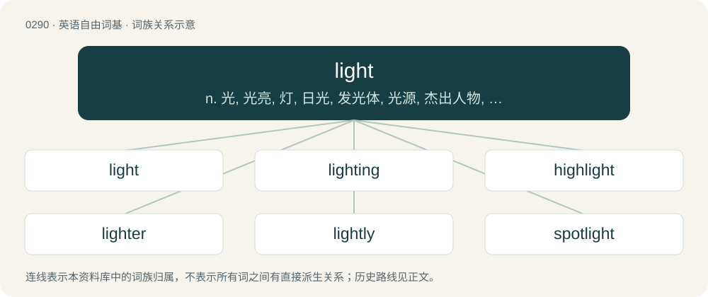

# 0326 · light — n. 光, 光亮, 灯, 日光, 发光体, 光源, 杰出人物, 火花, 眼光；a. 轻的, 少量的, 轻微的, 轻快的, 轻浮的, 明亮的, 淡色的, 容易的；vt. 点燃, 照亮

[总目录](../00_总目录_按常用程度.md)

**类型**：英语自由词基　｜　**来源语言**：见词源记录

## 核心含义与来源

- 核心含义：n. 光, 光亮, 灯, 日光, 发光体, 光源, 杰出人物, 火花, 眼光；a. 轻的, 少量的, 轻微的, 轻快的, 轻浮的, 明亮的, 淡色的, 容易的；vt. 点燃, 照亮
- 英文含义：Electromagnetic radiation in the wavelength range visible to the human eye (about 400–750 nanometers): visible light.
- 词形：light

**多个词源／构词路径**：同一拼写可能有不同来源；以下按词性和含义分别列出。

**来源记录 1**（名词；Electromagnetic radiation in the wavelength range visible to the human eye (about 400–750 nanometers): visible light.）

From Middle English light, liht, leoht, from Old English lēoht, from Proto-West Germanic \*leuht, from Proto-Germanic \*leuhtą, from Proto-Indo-European \*lewktom, from the root \*lewk- (“to shine”). Cognates \* Scots licht (“light”) \* Saterland Frisian Ljoacht, Lucht (“light”) \* West Frisian ljocht (“light”) \* Dutch licht (“light”) \* German Licht (“light”) \* German Low German Licht (“light”) \* Limburgish Leech, Leet, Léït (“light”) \* Luxembourgish Liicht (“light”) \* Vilamovian łicht (“light”) \* Yiddish ליכט (likht, “light”) \* Danish and Norwegian Bokmål lys (“light”) \* Elfdalian liuos (“light”) \* Faroese and Icelandic ljós (“light”) \* Norwegian Nynorsk ljos, ljus, lys (“light”) \* Swedish ljus (“light”) \* Latin lūx (“light”) \* Russian луч (luč, “beam of light”) \* Armenian լույս (luys, “light”) \* Ancient Greek λευκός (leukós, “white”) \* Persian رُخش (roxš).

**来源记录 2**（动词；To start (a fire).）

From Middle English lighten, lihten, from Old English līehtan (“to light, to shine”), from Proto-Germanic \*liuhtijaną, from \*leuhtą + \*-janą. Cognate with German leuchten (“to shine”).

**来源记录 3**（形容词；Having light; bright; clear; not dark or obscure.）

From Middle English light, liht, leoht, from Old English lēoht (“luminous, bright, light, clear, resplendent, renowned, beautiful”), from Proto-Germanic \*leuhtaz (“light”), from Proto-Indo-European \*lewk- (“light”). Cognate with Saterland Frisian ljoacht (“light”), Dutch licht, German licht.

**来源记录 4**（形容词；Having little or relatively little actual weight; not heavy; not cumbrous or unwieldy.）

From Middle English liȝt, lyghte, from Old English lēht, lēoht, līht, from Proto-West Germanic \*lį̄ht, from Proto-Germanic \*linhtaz or \*līhtaz (“light (in weight)”), from Proto-Indo-European \*h₁lengʷʰ- (“lightweight”). Cognates Cognate with Dutch licht (“light (not heavy)”), German leicht (“light (not heavy)”), Luxembourgish liicht (“lightweight”), Vilamovian łajcht (“easy”), Yiddish לײַכט (laykht, “light (of low weight)”), Danish let (“light (not heavy)”), Faroese lættur (“light (of weight); easy (to do)”), Icelandic léttur (“light (not weighing much); easy”), Norwegian Bokmål and Norwegian Nynorsk lett (“light (not heavy); easy”), Swedish lätt (“light; of low weight”), Gothic 𐌻𐌴𐌹𐌷𐍄𐍃 (leihts, “light (in weight)”); also Irish léim (“jump, leap; obstacle to be jumped; chasm, promontory”), Scottish Gaelic leum, lèim (“bound, frisk, leap; jump”), Welsh llai (“smaller; fewer, less”), Latin levis (“light (not heavy)”), Greek ελαφρός (elafrós, “lightweight; slight, thin, weak”), Albanian lehtë (“lightweight; easy”), Lithuanian lengvas (“light (not heavy); easy”), Belarusian лёгкі (ljóhki, “light (not heavy); easy”), Bulgarian and Macedonian лек (lek, “light (not heavy)”), Czech lehký (“light (of low weight); easy”), Polish lekki, lętki (“light (having little physical weight); easy (not demanding much effort; not difficult)”), Russian лёгкий (ljóxkij, “lightweight; easy”), Serbo-Croatian ла̏к, ла̏ган, lȁk, lȁgan (“easy; light (not heavy)”), Slovak ľahký (“light (of low weight); easy”), Slovene lahek (“light (of low weight); easy”), Ukrainian легки́й (lehkýj, “lightweight”), Armenian լանջ (lanǰ), լանջք (lanǰkʻ, “breast; mountain slope”), Persian لاغر (lâġar, “lithe; skinny; slender; thin”), Tocharian B lankᵤtse (“light (not heavy)”), Sanskrit लघु (laghu), रघु (raghu, “easy, light, not heavy or difficult”).

**来源记录 5**（动词；To find by chance.）

From Middle English lighten, from Old English līhtan (“to relieve”), from Proto-West Germanic \*lį̄htijan, from Proto-Germanic \*linhtijaną, from \*linhtaz (“light”).

## 词族图

## 单词速览（常用到不常用）

| 单词 | 音标 | 释义 |
|---|---|---|
| [light](#w-1) | /laɪt/ | n. 光, 光亮, 灯, 日光, 发光体, 光源, 杰出人物, 火花, 眼光；a. 轻的, 少量的, 轻微的, 轻快的, 轻浮的, 明亮的, 淡色的, 容易的；vt. 点燃, 照亮 |
| [lighting](#w-2) | 英 /ˈlaɪtɪŋ/；美 /ˈlaɪtɪŋ/ | n. 照明, 照明设备, 舞台灯光 |
| [highlight](#w-3) | 英 /ˈhaɪlaɪt/；美 /ˈhaɪˌlaɪt/ | n. 加亮区, 精彩场面；vt. 加亮, 使显著, 以强光照射, 突出；\[计\] 突出 |
| [lighter](#w-4) | 英 /ˈlaɪtə/；美 /ˈlaɪtɚ/ | n. 点火者, 点灯工人, 打火机, 驳船；vt. 以驳船搬运 |
| [lightly](#w-5) | /ˈlaɪtli/ | adv. 轻轻地, 少许, 不费力地 |
| [spotlight](#w-6) | 英 /ˈspɒtˌlaɪt/；美 /ˈspɑtˌlaɪt/ | n. 照明灯, 反光灯, 聚光灯 |
| [sunlight](#w-7) | /ˈsʌnˌlaɪt/ | n. 日光；\[医\] 日光, 太阳光 |
| [daylight](#w-8) | 英 /ˈdeɪlaɪt/；美 /ˈdeɪˌlaɪt/ | n. 白昼, 日光；vt. 使沐浴于日光；vi. 享有日光 |
| [twilight](#w-9) | /ˈtwaɪˌlaɪt/ | n. 暮光, 曙光, 黎明, 黄昏, 微光, 朦胧状态；a. 微明的 |
| [lightweight](#w-10) | 美 /ˈlaɪt.weɪt/ | n. 不到平均重量的人/物, 轻量级, 无足轻重的人, 性格不够强的人；a. 平均重量以下的, 重量轻的；\[计\] 轻便的, 轻量的 |
| [lighthouse](#w-11) | /ˈlaɪthaʊs/ | n. 灯塔 |
| [flashlight](#w-12) | 英 /ˈflæʃˌlaɪt/ | n. 手电筒, 闪光信号灯 |
| [lighten](#w-13) | /ˈlaɪ.tn̩/ | vt. 照亮, 点亮, 减轻, 使轻松, 闪出；vi. 发亮, 打闪, 变轻 |
| [enlighten](#w-14) | /ɪnˈlaɪtən/ | vt. 教育, 启发, 启蒙, 开导, 教导 |
| [starlight](#w-15) | /ˈstɑː(ɹ)laɪt/ | n. 星光 |
| [limelight](#w-16) | 英 /ˈlaɪm.laɪt/ | n. 石灰光, 石灰光灯, 以石灰光灯照射的舞台；vt. 使受到注目, 使显露头角 |
| [candlelight](#w-17) | /ˈkæn.dl̩ˌlaɪt/ | n. 烛光, 黄昏 |
| [alight](#w-18) | 英 /əˈlaɪt/ | vi. 落下, 偶然发现；a. 点着的 |
| [headlight](#w-19) | 美 /ˈhɛdˌlaɪt/ | n. 前灯, 桅灯；\[电\] 车前灯 |
| [lightness](#w-20) | /ˈlaɪtnəs/ | n. 光亮度, (颜色的)浅淡, 轻率, 轻佻, 轻浮, 轻盈, 轻松, 轻巧, 精巧, 优美；\[计\] 亮度 |
| [lightsaber](#w-21) | 英 /ˈlaɪtˌseɪ.bə(ɹ)/；美 /ˈlaɪtˌseɪ.bɚ/ | 光劍 /光剑 |
| [lighthearted](#w-22) | /ˈlaitˈhɑːtid/ | a. 快乐的, 心情愉快的；无忧无虑的 |
| [skylight](#w-23) | /ˈskaɪˌlaɪt/ | n. 天窗 |
| [searchlight](#w-24) | 英 /ˈsɜːtʃˌlaɪt/ | n. 探照灯 |
| [ultralight](#w-25) | 美 /ˌʌltɹəˈlaɪt/ | a. 超轻型的 |
| [lightroom](#w-26) |  | 【英文】A small room from which the magazine of a naval vessel is lighted, being separated from the magazine by heavy glass windows. |
| [backlight](#w-27) | /ˈbæk.laɪt/ | vt. 从背后照亮 |
| [torchlight](#w-28) | /ˈtɒːtʃlait/ | n. 火炬之光 |
| [lightspeed](#w-29) |  | \[电影\]光速侠 |
| [streetlight](#w-30) | 英 /ˈstɹiːt.laɪt/；美 /ˈstɹit.laɪt/ | n. 街灯, 路灯 |
| [stoplight](#w-31) | /ˈstɒplait/ | n. 交通信号灯 |
| [taillight](#w-32) | /ˈteillait/ | n. 尾灯 |
| [firelight](#w-33) | 英 /ˈfaɪə.laɪt/；美 /ˈfaɪɚ.laɪt/ | n. 火光 |
| [nightlight](#w-34) | 美 /ˈnaɪtˌlaɪt/ | 【英文】A small, dim light or lamp left on overnight. |
| [lightbox](#w-35) |  | n. 光箱特效；航行识别灯控制箱 |
| [lightman](#w-36) |  | \[人名\] \[英格兰人姓氏\] 莱特曼 Light的变体 |
| [floodlight](#w-37) | /ˈflʌdlait/ | n. 照明灯, 泛光；vt. 用泛光灯照亮 |

## 逐词详解

### 1. light

**词性**：名词　｜　**音标**：/laɪt/

**中文释义**：n. 光, 光亮, 灯, 日光, 发光体, 光源, 杰出人物, 火花, 眼光；a. 轻的, 少量的, 轻微的, 轻快的, 轻浮的, 明亮的, 淡色的, 容易的；vt. 点燃, 照亮

**英文义项**：Electromagnetic radiation in the wavelength range visible to the human eye (about 400–750 nanometers): visible light. / Electromagnetic radiation in the wavelength range visible to the human eye or in nearby ranges (infrared or ultraviolet radiation).

**词源与演化**：

From Middle English light, liht, leoht, from Old English lēoht, from Proto-West Germanic \*leuht, from Proto-Germanic \*leuhtą, from Proto-Indo-European \*lewktom, from the root \*lewk- (“to shine”). Cognates \* Scots licht (“light”) \* Saterland Frisian Ljoacht, Lucht (“light”) \* West Frisian ljocht (“light”) \* Dutch licht (“light”) \* German Licht (“light”) \* German Low German Licht (“light”) \* Limburgish Leech, Leet, Léït (“light”) \* Luxembourgish Liicht (“light”) \* Vilamovian łicht (“light”) \* Yiddish ליכט (likht, “light”) \* Danish and Norwegian Bokmål lys (“light”) \* Elfdalian liuos (“light”) \* Faroese and Icelandic ljós (“light”) \* Norwegian Nynorsk ljos, ljus, lys (“light”) \* Swedish ljus (“light”) \* Latin lūx (“light”) \* Russian луч (luč, “beam of light”) \* Armenian լույս (luys, “light”) \* Ancient Greek λευκός (leukós, “white”) \* Persian رُخش (roxš).

**例句**：

> As you can see, this spacious dining-room gets a lot of light in the mornings.

该用例对应义项：Electromagnetic radiation in the wavelength range visible to the human eye (about 400–750 nanometers): visible light.

### 2. lighting

**词性**：名词　｜　**音标**：英 /ˈlaɪtɪŋ/；美 /ˈlaɪtɪŋ/

**中文释义**：n. 照明, 照明设备, 舞台灯光

**英文义项**：The equipment used to provide illumination; the illumination so provided. / The act of activating such equipment, or of igniting a flame etc.

**构词拆分**：From light + -ing.

**词源与演化**：

From light + -ing.

**例句**：

> As long as the lighting was good.

该用例对应义项：having abundant light or illumination

### 3. highlight

**词性**：名词　｜　**音标**：英 /ˈhaɪlaɪt/；美 /ˈhaɪˌlaɪt/

**中文释义**：n. 加亮区, 精彩场面；vt. 加亮, 使显著, 以强光照射, 突出；\[计\] 突出

**英文义项**：An area or a spot in a drawing, painting, or photograph that is strongly illuminated. / An especially significant or interesting detail or event or period of time.

**构词拆分**：high + light

**词源与演化**：

From high + light.

**例句**：

> Meeting my future wife was the highlight of my trip to Spain.

该用例对应义项：An especially significant or interesting detail or event or period of time.

### 4. lighter

**词性**：名词　｜　**音标**：英 /ˈlaɪtə/；美 /ˈlaɪtɚ/

**中文释义**：n. 点火者, 点灯工人, 打火机, 驳船；vt. 以驳船搬运

**英文义项**：A person who lights things. / A device used to light things, especially a reusable handheld device for creating fire to light cigarettes.

**构词拆分**：light (“to ignite”) + -er

**词源与演化**：

From light (“to ignite”) + -er. Cognate with Middle Dutch lichtere, lichter (“one who spreads light, illuminator”), Dutch lichter, luchter (“candle-holder, chandelier”). Compare also Middle English lightnere, liȝtnere (“one who enlightens or illuminates”).

**例句**：

> Cigarette in mouth, he clutched his pockets in search of a lighter.

该用例对应义项：A device used to light things, especially a reusable handheld device for creating fire to light cigarettes.

### 5. lightly

**词性**：副词　｜　**音标**：/ˈlaɪtli/

**中文释义**：adv. 轻轻地, 少许, 不费力地

**英文义项**：In a light manner.

**构词拆分**：light + -ly

**词源与演化**：

From Middle English lyghtly, liȝtliche, lihtliche, from Old English lēohtlīċe, equivalent to light + -ly.

**例句**：

> As a teacher, I don't take rudeness in class lightly.

该用例对应义项：In a light manner.

### 6. spotlight

**词性**：名词　｜　**音标**：英 /ˈspɒtˌlaɪt/；美 /ˈspɑtˌlaɪt/

**中文释义**：n. 照明灯, 反光灯, 聚光灯

**英文义项**：A bright, directional light or lamp, especially one used to illuminate the focus or center of attention on a stage. / The circle of light shed by a spotlight.

**构词拆分**：spot + light

**词源与演化**：

From spot + light.

**例句**：

> Some people enjoy the spotlight.

该用例对应义项：The center of attention; the highlight or most important part.

### 7. sunlight

**词性**：名词　｜　**音标**：/ˈsʌnˌlaɪt/

**中文释义**：n. 日光；\[医\] 日光, 太阳光

**英文义项**：All the electromagnetic radiation given off by the Sun; especially, that in the visible spectrum and that bathes the Earth. / Brightness, hope; a positive outlook.

**构词拆分**：sun + light

**词源与演化**：

From Middle English sonnelight, sunneliht, from Old English sunnan lēoht (“sunlight”), equivalent to sun + light. Cognate with Dutch zonlicht (“sunlight”), German Low German Sünnenlücht (“sunlight”), German Sonnenlicht (“sunlight”).

**例句**：

> Sunlight on the skin gives you vitamin D.

该用例对应义项：All the electromagnetic radiation given off by the Sun; especially, that in the visible spectrum and that bathes the Earth.

### 8. daylight

**词性**：名词　｜　**音标**：英 /ˈdeɪlaɪt/；美 /ˈdeɪˌlaɪt/

**中文释义**：n. 白昼, 日光；vt. 使沐浴于日光；vi. 享有日光

**英文义项**：The natural light that is ambient in daytime, being mostly sunlight (both direct and indirect, on either sunny days or cloudy days). / A light source that simulates daylight.

**构词拆分**：day + light

**词源与演化**：

From Middle English daye-lighte, dey liȝht, dailiȝt, day-liht, dai-liht (also as days lyȝt, daies liht), equivalent to day + light. Cognate with Saterland Frisian Deegeslucht, Daisljoacht (“daylight”), West Frisian deiljocht (“daylight”), Dutch daglicht (“daylight”), German Tageslicht (“daylight”).

**例句**：

> In those days the entire factory was lit only by daylight and was closed at night.

该用例对应义项：The natural light that is ambient in daytime, being mostly sunlight (both direct and indirect, on either sunny days or cloudy days).

### 9. twilight

**词性**：名词　｜　**音标**：/ˈtwaɪˌlaɪt/

**中文释义**：n. 暮光, 曙光, 黎明, 黄昏, 微光, 朦胧状态；a. 微明的

**英文义项**：The soft light in the sky seen before the rising and (especially) after the setting of the sun, occasioned by the illumination of the earth’s atmosphere by the direct rays of the sun and their reflection on the earth. / The time when said light is visible; the period between daylight and darkness.

**构词拆分**：twi- (“double, half-”) + light

**词源与演化**：

From Middle English twilight, twyelyghte, equivalent to twi- (“double, half-”) + light, literally ‘second light, half-light’. Cognate to Scots twa licht, twylicht, twielicht (“twilight”), Low German twilecht, twelecht (“twilight”), Dutch tweelicht (“twilight, dusk”), German Zwielicht (“twilight, dusk”). Compare Old English twēone lēoht (“twilight”).

**例句**：

> I could just make out her face in the twilight.

该用例对应义项：The soft light in the sky seen before the rising and (especially) after the setting of the sun, occasioned by the illumination of the earth’s atmosphere by the direct rays of the sun and their reflection on the earth.

### 10. lightweight

**词性**：名词　｜　**音标**：美 /ˈlaɪt.weɪt/

**中文释义**：n. 不到平均重量的人/物, 轻量级, 无足轻重的人, 性格不够强的人；a. 平均重量以下的, 重量轻的；\[计\] 轻便的, 轻量的

**英文义项**：A particular weight class, or member of such, as prescribed by the rules, between that of the heavier welterweight and the lighter featherweight. See Wikipedia for the specifics of each sport. / A particular weight category as prescribed by the rules, separate from an open or heavyweight class.

**构词拆分**：light (“not heavy”, adjective) + weight (noun)

**词源与演化**：

From light (“not heavy”, adjective) + weight (noun).

**例句**：

> It's a small and lightweight audio player with extensive format support.

### 11. lighthouse

**词性**：名词　｜　**音标**：/ˈlaɪthaʊs/

**中文释义**：n. 灯塔

**英文义项**：A tower or other structure exhibiting a light or lights to warn or guide sailors.

**构词拆分**：light + house

**词源与演化**：

From light + house.

**例句**：

> In the history of lighthouses, English civil engineer John Smeaton made a significant contribution to the design of them.

该用例对应义项：A tower or other structure exhibiting a light or lights to warn or guide sailors.

### 12. flashlight

**词性**：名词　｜　**音标**：英 /ˈflæʃˌlaɪt/

**中文释义**：n. 手电筒, 闪光信号灯

**英文义项**：A battery-powered hand-held light source. / A flashgun (device used to create flashes of light for photography).

**构词拆分**：flash + light

**词源与演化**：

From flash + light.

**例句**：

> I shone my flashlight on the strange inscription.

该用例对应义项：A battery-powered hand-held light source.

### 13. lighten

**词性**：动词　｜　**音标**：/ˈlaɪ.tn̩/

**中文释义**：vt. 照亮, 点亮, 减轻, 使轻松, 闪出；vi. 发亮, 打闪, 变轻

**英文义项**：To make brighter or clearer; to illuminate. / To become brighter or clearer; to brighten.

**构词拆分**：light + -en

**词源与演化**：

From Middle English lightnen, equivalent to light + -en.

**例句**：

> Sorrow can be lightened by being openly brought out.

该用例对应义项：To alleviate; to reduce the burden of.

### 14. enlighten

**词性**：动词　｜　**音标**：/ɪnˈlaɪtən/

**中文释义**：vt. 教育, 启发, 启蒙, 开导, 教导

**英文义项**：To supply with light. / To make something clear to (someone); to give knowledge or understanding to.

**构词拆分**：light + -en

**词源与演化**：

Formerly also inlighten, from Middle English enlightenen, inlightnen, a hybrid formed from inlighten (“to enlighten, illuminate”), from Old English inlīhtan, onlīhtan, enlīhtan (“to enlighten, illuminate, give light to, give sight to”) and lightnen (“to enlighten, illuminate”) (equivalent to light + -en). Cognate with Dutch inlichten (“to enlighten, inform”), Old High German inliuhten (“to enlighten, illuminate”), Gothic 𐌹𐌽𐌻𐌹𐌿𐌷𐍄𐌾𐌰𐌽 (inliuhtjan, “to enlighten, illuminate”). More at inlight, -en.

**例句**：

> She tried to enlighten them about the rules of the program, but they remained belligerently and self-righteously ignorant.

该用例对应义项：To make something clear to (someone); to give knowledge or understanding to.

### 15. starlight

**词性**：名词　｜　**音标**：/ˈstɑː(ɹ)laɪt/

**中文释义**：n. 星光

**英文义项**：Light emitted from stars. / Light emitted by those other than the Sun.

**构词拆分**：star + light

**词源与演化**：

From star + light.

**例句**：

> I can give you the starlight and a cup of tea.

### 16. limelight

**词性**：名词　｜　**音标**：英 /ˈlaɪm.laɪt/

**中文释义**：n. 石灰光, 石灰光灯, 以石灰光灯照射的舞台；vt. 使受到注目, 使显露头角

**英文义项**：The intense white light produced when heating lime in an oxyhydrogen flame. / A type of stage lighting once used in theatres and music halls, producing a bright light by the use of incandescent quicklime.

**构词拆分**：lime + light

**词源与演化**：

From lime + light.

**用法示例／搭配（非完整句）**：

> steal the limelight

该用例对应义项：Attention, notice, a starring or central role, present fame; spotlight.

### 17. candlelight

**词性**：名词　｜　**音标**：/ˈkæn.dl̩ˌlaɪt/

**中文释义**：n. 烛光, 黄昏

**英文义项**：The light emitted by a candle.

**构词拆分**：candle + light

**词源与演化**：

From Middle English candel lyght, candyllyght, candyll-lyȝht, candel liȝt, candle lyȝt, candeliȝt, candel-liht, from Old English candel lēoht (“candlelight”), equivalent to candle + light.

**例句**：

> I saw my true love at the window, combing her hair by candlelight.

### 18. alight

**词性**：动词　｜　**音标**：英 /əˈlaɪt/

**中文释义**：vi. 落下, 偶然发现；a. 点着的

**英文义项**：Often followed by from or off: to get off an animal which one has been riding; to dismount; to descend or exit from a vehicle; hence, to complete one's journey; to stop. / Often followed by at, on, or upon: of something aloft: to descend and settle; to land, to lodge, to rest.

**构词拆分**：a- (prefix meaning ‘away, from, off, out’) + light (“to ease, lighten; to take off; to unload; to dismount; (archaic) to come down, land; to dismount”)

**词源与演化**：

From Middle English alighten (“to descend from a place: to dismount, get off; to descend to a place: to arrive or stop (at a place); to land; to drop; to attack; of lightning: to strike; to leap on to, mount; to descend in rank; to cause (someone) to lose rank; to come forth, spring from; to alleviate, relieve; (Christianity) of Jesus: to come down to earth from heaven, become incarnate; to descend (to hell); of the Holy Spirit, angels, miracles, etc.: to descend (from heaven); to descend (upon someone); to appear in a place”) \[and other forms\], from a merger of: \* Old English ālīhtan (“to alight, dismount”), from ā- (prefix meaning ‘away, from, off, out’) + līhtan, līehtan (“to descend, alight, light; to make easy or light, alleviate, lighten, relieve”), ultimately from Proto-Indo-European \*h₁lengʷʰ- (“not heavy, light”); and \* Old English ġelīhtan (“to descend; to come down, dismount; to make easy or light, alleviate, lighten, relieve”), from ġe- (intensifying prefix, attached to verbs to indicate completeness or perfection) + līhtan, līehtan (see above). The English word is analyzable as a- (prefix meaning ‘away, from, off, out’) + light (“to ease, lighten; to take off; to unload; to dismount; (archaic) to come down, land; to dismount”). Cognates \* Middle Low German erlichten (“to lighten”) \* Old High German gilīhten (“to make less heavy, lighten”) (Middle High German gelīhten); Old High German irlīhten (“to alleviate”) (Middle High German erlīhten, modern German erleichten)

**例句**：

> Passengers are alighting from the carriage.

该用例对应义项：Often followed by from or off: to get off an animal which one has been riding; to dismount; to descend or exit from a vehicle; hence, to complete one's journey; to stop.

### 19. headlight

**词性**：名词　｜　**音标**：美 /ˈhɛdˌlaɪt/

**中文释义**：n. 前灯, 桅灯；\[电\] 车前灯

**英文义项**：A bright light, with a lens and reflector, on the front of a motor vehicle (or originally a ship or train), designed to illuminate the road when driving at night; normally one of a pair. / A woman's breast.

**构词拆分**：head + light

**词源与演化**：

From head + light.

**例句**：

> Yanni's car has only one headlight working.

### 20. lightness

**词性**：名词　｜　**音标**：/ˈlaɪtnəs/

**中文释义**：n. 光亮度, (颜色的)浅淡, 轻率, 轻佻, 轻浮, 轻盈, 轻松, 轻巧, 精巧, 优美；\[计\] 亮度

**英文义项**：the condition of being illuminated / the relative whiteness or transparency of a colour

**构词拆分**：light (“to make bright, illuminate”, verb) + -ness (suffix forming nouns)

**词源与演化**：

From Middle English lightnes, lightnesse, from Old English līhtnes, lȳhtnys (“enlightening, illumination”), from Proto-West Germanic \*liuhtinassī; equivalent to light (“to make bright, illuminate”, verb) + -ness (suffix forming nouns). Cognate with Old High German liuhtnissi (“illumination, enlightening”).

**例句**：

> The lightness of balsa wood.

该用例对应义项：the property of being comparatively small in weight

### 21. lightsaber

**词性**：名词　｜　**音标**：英 /ˈlaɪtˌseɪ.bə(ɹ)/；美 /ˈlaɪtˌseɪ.bɚ/

**中文释义**：光劍 /光剑

**英文义项**：A sword having a blade made of a powerful beam of light or energy. / A real-world toy, prop, or device fashioned after the fictional lightsaber.

**构词拆分**：light + saber

**词源与演化**：

From light + saber; coined by American filmmaker and philanthropist George Lucas for the Star Wars film franchise. First mentioned in the film Star Wars (later retitled Star Wars: Episode IV—A New Hope) which was released on May 25, 1977.

**例句**：

> Mary bought Tom a new lightsaber for his birthday.

### 22. lighthearted

**词性**：形容词　｜　**音标**：/ˈlaitˈhɑːtid/

**中文释义**：a. 快乐的, 心情愉快的；无忧无虑的

**英文义项**：Joyful, glad, taking pleasure in being alive; not depressed or sad. / Enjoyably lacking of seriousness, not grave.

**构词拆分**：light + hearted

**词源与演化**：

From Middle English lyght hertyd, liȝt-hertid, from light (adjective) + herted, hertid (“having a disposition”, adjective) (equivalent to light + hearted), from the noun herte. See more at light, heart, -ed.

**例句**：

> His lighthearted banjo performance was appreciated because it relieved the tension in tight situations.

该用例对应义项：Enjoyably lacking of seriousness, not grave.

### 23. skylight

**词性**：名词　｜　**音标**：/ˈskaɪˌlaɪt/

**中文释义**：n. 天窗

**英文义项**：A window, dome, or opening in the roof or ceiling, to admit natural light. / Diffuse sky radiation—solar radiation reaching the earth's surface after having been scattered from the direct solar beam by molecules or suspensoids in the atmosphere.

**构词拆分**：sky + light

**词源与演化**：

From sky + light.

**例句**：

> I like the house with its skylight on the roof.

### 24. searchlight

**词性**：名词　｜　**音标**：英 /ˈsɜːtʃˌlaɪt/

**中文释义**：n. 探照灯

**英文义项**：A light source that projects a bright beam of light in any direction, generally for military use. / The light from the above source.

**构词拆分**：search + light

**词源与演化**：

From search + light. Compare West Frisian sykljocht (“searchlight”), Dutch zoeklicht (“searchlight”), Danish søgelys (“searchlight”), Swedish sökarljus (“searchlight”).

**例句**：

> Jonas saw a boat with a searchlight on it.

### 25. ultralight

**词性**：形容词　｜　**音标**：美 /ˌʌltɹəˈlaɪt/

**中文释义**：a. 超轻型的

**英文义项**：Extremely light; weighing very little.

**构词拆分**：From ultra- + light.

**词源与演化**：

From ultra- + light.

**例句**：

> Tom was severely injured in an ultralight flying accident.

### 26. lightroom

**词性**：名词

**英文义项**：A small room from which the magazine of a naval vessel is lighted, being separated from the magazine by heavy glass windows. / The room at the top of a lighthouse containing the lighting apparatus.

**构词拆分**：light (noun) + room (noun)

**词源与演化**：

From light (noun) + room (noun).

### 27. backlight

**词性**：名词　｜　**音标**：/ˈbæk.laɪt/

**中文释义**：vt. 从背后照亮

**英文义项**：Light shining from a source behind the object of interest or attention. / A spotlight that illuminates a photographic subject from behind.

**构词拆分**：back + light

**词源与演化**：

From back + light.

**例句**：

> The backlight from the sunset cast the pier and the crowd in silhouette.

该用例对应义项：Light shining from a source behind the object of interest or attention.

### 28. torchlight

**词性**：名词　｜　**音标**：/ˈtɒːtʃlait/

**中文释义**：n. 火炬之光

**英文义项**：The dim light produced by a burning torch. / The light produced by a flashlight.

**构词拆分**：torch + light

**词源与演化**：

From torch + light.

**例句**：

> The prince’s crown gleamed in the torchlight.

### 29. lightspeed

**词性**：名词

**中文释义**：\[电影\]光速侠

**英文义项**：The speed of light (in vacuum unless another medium is specified). / An extremely fast speed.

**构词拆分**：light + speed

**词源与演化**：

From light + speed.

### 30. streetlight

**词性**：名词　｜　**音标**：英 /ˈstɹiːt.laɪt/；美 /ˈstɹit.laɪt/

**中文释义**：n. 街灯, 路灯

**英文义项**：Any large outdoor light used to illuminate a public area, usually urban. / The light produced by these lights.

**构词拆分**：street + light

**词源与演化**：

From street + light.

**例句**：

> At night the streetlights of Paris are beautiful to see.

该用例对应义项：Any large outdoor light used to illuminate a public area, usually urban.

### 31. stoplight

**词性**：名词　｜　**音标**：/ˈstɒplait/

**中文释义**：n. 交通信号灯

**英文义项**：A traffic control signal, traditionally consisting of three lights, colored green, yellow/amber, and red, meaning proceed, prepare to stop, and stop, respectively. / A light on the rear of a vehicle that is activated when braking; a brake light.

**构词拆分**：stop + light

**词源与演化**：

From stop + light.

**例句**：

> When the stoplight turns green the cars will start.

### 32. taillight

**词性**：名词　｜　**音标**：/ˈteillait/

**中文释义**：n. 尾灯

**英文义项**：One of a pair of red lights mounted on the rear of a vehicle, so it can be seen from the rear at night.

**构词拆分**：tail + light

**词源与演化**：

From tail + light.

**例句**：

> Your car has a broken taillight.

### 33. firelight

**词性**：名词　｜　**音标**：英 /ˈfaɪə.laɪt/；美 /ˈfaɪɚ.laɪt/

**中文释义**：n. 火光

**英文义项**：The light of a fire, such as from a campfire or fireplace.

**构词拆分**：fire + light

**词源与演化**：

From Middle English fire liȝt, fyre lyghte, from Old English fȳrlēoht, equivalent to fire + light.

**例句**：

> Mary's face looked ashen in the firelight.

### 34. nightlight

**词性**：名词　｜　**音标**：美 /ˈnaɪtˌlaɪt/

**英文义项**：A small, dim light or lamp left on overnight. / Light that shines at night, such as moonlight or starlight.

**构词拆分**：night + light

**词源与演化**：

From night + light.

**例句**：

> He put a small nightlight in the bathroom to find his way around in the dark.

该用例对应义项：A small, dim light or lamp left on overnight.

### 35. lightbox

**词性**：名词

**中文释义**：n. 光箱特效；航行识别灯控制箱

**英文义项**：A box containing a source of light and a white, translucent cover, used to view photographic transparencies. / A box containing fluorescent tubes or LED technology, used to treat people with seasonal affective disorder (SAD) and circadian rhythm disorders.

**构词拆分**：light + box

**词源与演化**：

From light + box. In the Internet sense, originally the name of one specific technique.

### 36. lightman

**词性**：名词

**中文释义**：\[人名\] \[英格兰人姓氏\] 莱特曼 Light的变体

**英文义项**：A man who carries or takes care of a light.

**构词拆分**：light (noun) + -man

**词源与演化**：

From light (noun) + -man.

### 37. floodlight

**词性**：名词　｜　**音标**：/ˈflʌdlait/

**中文释义**：n. 照明灯, 泛光；vt. 用泛光灯照亮

**英文义项**：A projector of a bright beam of light for use in theatres and studios; a flood / Powerful artificial illumination with a broad beam, especially in a series of units on pylons used to illuminate a sports ground.

**构词拆分**：From flood + light.

**词源与演化**：

From flood + light.

**例句**：

> The floodlights bathed her in a pool of light.

该用例对应义项：A projector of a bright beam of light for use in theatres and studios; a flood
