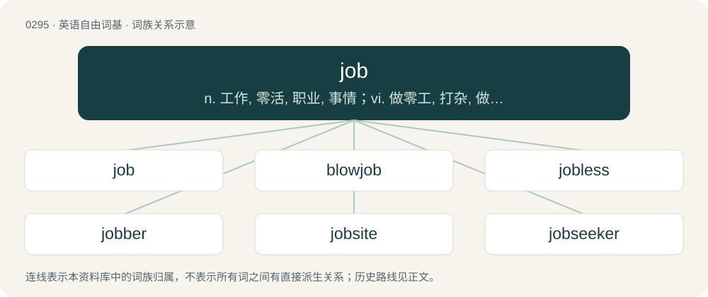

# 0331 · job — n. 工作, 零活, 职业, 事情；vi. 做零工, 打杂, 做股票经纪, 假公济私；vt. 代客买卖, 批发, 承包, 欺骗

[总目录](../00_总目录_按常用程度.md)

**类型**：英语自由词基　｜　**来源语言**：见词源记录

## 核心含义与来源

- 核心含义：n. 工作, 零活, 职业, 事情；vi. 做零工, 打杂, 做股票经纪, 假公济私；vt. 代客买卖, 批发, 承包, 欺骗
- 英文含义：A task.
- 词形：job

**多个词源／构词路径**：同一拼写可能有不同来源；以下按词性和含义分别列出。

**来源记录 1**（名词；A task.）

From the phrase jobbe of work (“piece of work”), of uncertain origin. Perhaps from a variant of Middle English gobbe (“mass, lump”); or perhaps related to Middle English jobben (“to jab, thrust, peck”), or Middle English choppe (“piece, bargain”). More at gob, jab, chop.

**来源记录 2**（动词；To pierce or poke (someone or something), typically with a sharp or pointed object; to stab.）

Imitative.

## 词族图

## 单词速览（常用到不常用）

| 单词 | 音标 | 释义 |
|---|---|---|
| [job](#w-1) | 英 /dʒɒb/；美 /dʒɑb/ | n. 工作, 零活, 职业, 事情；vi. 做零工, 打杂, 做股票经纪, 假公济私；vt. 代客买卖, 批发, 承包, 欺骗 |
| [blowjob](#w-2) | 英 /ˈbləʊ.d͡ʒɒb/；美 /ˈbloʊ.d͡ʒɑb/ | n. 口交 |
| [jobless](#w-3) | /ˈdʒɔblis/ | a. 失职的, 无职业的；\[经\] 失业的 |
| [jobber](#w-4) | 英 /ˈd͡ʒɒb.ə(ɹ)/；美 /ˈd͡ʒɑ.bɚ/ | n. 批发商, 股票经纪人；\[经\] 做包工的人, 临时工, 股票经纪人 |
| [jobsite](#w-5) | /ˈd͡ʒab.səɪt/ | .现场, 工作地点 |
| [jobseeker](#w-6) | /ˈd͡ʒɒbˌsiː.kɘ(ɹ)/ | n. 求职者 |

## 逐词详解

### 1. job

**词性**：名词　｜　**音标**：英 /dʒɒb/；美 /dʒɑb/

**中文释义**：n. 工作, 零活, 职业, 事情；vi. 做零工, 打杂, 做股票经纪, 假公济私；vt. 代客买卖, 批发, 承包, 欺骗

**英文义项**：A task. / An economic role for which a person is paid.

**词源与演化**：

From the phrase jobbe of work (“piece of work”), of uncertain origin. Perhaps from a variant of Middle English gobbe (“mass, lump”); or perhaps related to Middle English jobben (“to jab, thrust, peck”), or Middle English choppe (“piece, bargain”). More at gob, jab, chop.

**例句**：

> I didn't speak to many coworkers for the first year on the job.

该用例对应义项：A task.

### 2. blowjob

**词性**：名词　｜　**音标**：英 /ˈbləʊ.d͡ʒɒb/；美 /ˈbloʊ.d͡ʒɑb/

**中文释义**：n. 口交

**英文义项**：An act of fellatio, or sucking a penis or other phallic object (such as a dildo). / A display of excessive praise.

**构词拆分**：blow off (“to fellate”, originating among prostitutes from 1933) + job

**词源与演化**：

First used in the USA. From blow off (“to fellate”, originating among prostitutes from 1933) + job.

**例句**：

> The reviewer gave him a massive blowjob for his work.

该用例对应义项：A display of excessive praise.

### 3. jobless

**词性**：形容词　｜　**音标**：/ˈdʒɔblis/

**中文释义**：a. 失职的, 无职业的；\[经\] 失业的

**英文义项**：Lacking employment. / Having too much time on one's hands; having nothing better to do.

**构词拆分**：job + -less

**词源与演化**：

From job + -less.

**例句**：

> ― I’m showing him our texts with her, the liar. ― Bro, that is so jobless!

该用例对应义项：Having too much time on one's hands; having nothing better to do.

### 4. jobber

**词性**：名词　｜　**音标**：英 /ˈd͡ʒɒb.ə(ɹ)/；美 /ˈd͡ʒɑ.bɚ/

**中文释义**：n. 批发商, 股票经纪人；\[经\] 做包工的人, 临时工, 股票经纪人

**英文义项**：An actor temporarily employed for a specific role, often in a touring company. / An intermediary who buys and sells merchandise.

**构词拆分**：From job + -er.

**词源与演化**：

From job + -er.

### 5. jobsite

**词性**：名词　｜　**音标**：/ˈd͡ʒab.səɪt/

**中文释义**：.现场, 工作地点

**英文义项**：A physical location where work is done, especially construction work.

**构词拆分**：job + site

**词源与演化**：

From job + site.

### 6. jobseeker

**词性**：名词　｜　**音标**：/ˈd͡ʒɒbˌsiː.kɘ(ɹ)/

**中文释义**：n. 求职者

**英文义项**：A person seeking employment. / An unemployed person who must demonstrate active jobseeking efforts to qualify for government assistance.

**构词拆分**：job + seeker

**词源与演化**：

From job + seeker.

**例句**：

> He wants to apply for Jobseeker's Allowance.
