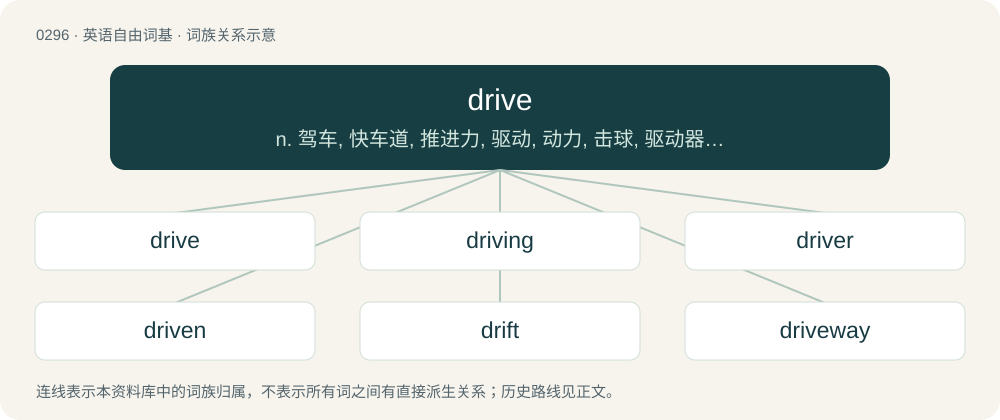

# 0333 · drive — n. 驾车, 快车道, 推进力, 驱动, 动力, 击球, 驱动器；vt. 开车, 驱使, 推动, 驾驶；vi. 开车, 猛击, 飞跑

[总目录](../00_总目录_按常用程度.md)

**类型**：英语自由词基　｜　**来源语言**：见词源记录

## 核心含义与来源

- 核心含义：n. 驾车, 快车道, 推进力, 驱动, 动力, 击球, 驱动器；vt. 开车, 驱使, 推动, 驾驶；vi. 开车, 猛击, 飞跑
- 英文含义：To operate (a wheeled motorized vehicle).
- 词形：drive

**来源记录 1**（动词；To operate (a wheeled motorized vehicle).）

From Middle English driven, from Old English drīfan (“to drive, force, move”), from Proto-West Germanic \*drīban, from Proto-Germanic \*drībaną (“to drive”), from Proto-Indo-European \*dʰreybʰ- (“to drive, push”). Cognates Cognate with Scots drive (“to drive”), Yola dhreeve, dhrive, dreeve, drieve, drive (“to drive”), North Frisian driiv, driiw, driwe (“to drive”), West Frisian driuwe (“to drive; to float”), Alemannic German triibe (“to drive”), Dutch drijven (“to drive, push”), German treiben (“to drive, push, propel”), Low German drieven (“to drive, drift, push”), Luxembourgish dreiwen (“to drive, propel”), Yiddish טרײַבן (traybn, “to drive”), Danish, Norwegian Bokmål drive (“to drive, propel”), Icelandic drífa (“to drive”), Norwegian Nynorsk driva, drive (“to drive, move; to propel; to run”), Swedish driva (“to drive, compel; to drift; to run”), Gothic 𐌳𐍂𐌴𐌹𐌱𐌰𐌽 (dreiban, “to drive”).

## 词族图

## 单词速览（常用到不常用）

| 单词 | 音标 | 释义 |
|---|---|---|
| [drive](#w-1) | 英 /dɹaɪv/ | n. 驾车, 快车道, 推进力, 驱动, 动力, 击球, 驱动器；vt. 开车, 驱使, 推动, 驾驶；vi. 开车, 猛击, 飞跑 |
| [driving](#w-2) | /ˈdɹaɪvɪŋ/ | n. 赶, 操纵, 驾驶；a. 推进的, 强劲的, 精力旺盛的 |
| [driver](#w-3) | 英 /ˈdɹaɪ.və/；美 /ˈdɹaɪvɚ/ | n. 驾驶员, 驱动器, 驱动程序；\[化\] 驱动器 |
| [driven](#w-4) | /ˈdɹɪvn̩/ | a. 有紧迫感的；drive的过去分词 |
| [drift](#w-5) | /dɹɪft/ | n. 漂流物, 漂流, 动向；v. (使)漂流 |
| [driveway](#w-6) | 美 /ˈdɹaɪvˌweɪ/ | n. 车道 |
| [overdrive](#w-7) | /ˌəʊvə(ɹ)ˈdɹaɪv/ | vt. 驱使过度, 使工作过度；n. 超速档 |
| [drivetrain](#w-8) | /ˈdraivtrein/ | n. 动力传动系统 |
| [hyperdrive](#w-9) | /ˈhaipədraiv/ | n. 超光速推进装置 |
| [driveshaft](#w-10) |  | （机器的）传动轴, 驱动轴 |
| [drivable](#w-11) | /ˈdɹaɪvəbl̩/ | a. 可驱动的, 可驾驶的 |
| [driveline](#w-12) | /ˈdraivlain/ | n. 动力传动系统 |

## 逐词详解

### 1. drive

**词性**：动词　｜　**音标**：英 /dɹaɪv/

**中文释义**：n. 驾车, 快车道, 推进力, 驱动, 动力, 击球, 驱动器；vt. 开车, 驱使, 推动, 驾驶；vi. 开车, 猛击, 飞跑

**英文义项**：To operate (a wheeled motorized vehicle). / To travel by operating a wheeled motorized vehicle.

**词源与演化**：

From Middle English driven, from Old English drīfan (“to drive, force, move”), from Proto-West Germanic \*drīban, from Proto-Germanic \*drībaną (“to drive”), from Proto-Indo-European \*dʰreybʰ- (“to drive, push”). Cognates Cognate with Scots drive (“to drive”), Yola dhreeve, dhrive, dreeve, drieve, drive (“to drive”), North Frisian driiv, driiw, driwe (“to drive”), West Frisian driuwe (“to drive; to float”), Alemannic German triibe (“to drive”), Dutch drijven (“to drive, push”), German treiben (“to drive, push, propel”), Low German drieven (“to drive, drift, push”), Luxembourgish dreiwen (“to drive, propel”), Yiddish טרײַבן (traybn, “to drive”), Danish, Norwegian Bokmål drive (“to drive, propel”), Icelandic drífa (“to drive”), Norwegian Nynorsk driva, drive (“to drive, move; to propel; to run”), Swedish driva (“to drive, compel; to drift; to run”), Gothic 𐌳𐍂𐌴𐌹𐌱𐌰𐌽 (dreiban, “to drive”).

**例句**：

> My husband's constant harping about the condition of the house threatens to drive me to distraction.

该用例对应义项：To provide an impetus for a change in one's situation or state of mind.

### 2. driving

**词性**：形容词　｜　**音标**：/ˈdɹaɪvɪŋ/

**中文释义**：n. 赶, 操纵, 驾驶；a. 推进的, 强劲的, 精力旺盛的

**英文义项**：That drives (a mechanism or process). / That drives forcefully; strong; forceful; violent (of wind, rain, etc)

**构词拆分**：drive + -ing

**词源与演化**：

From Middle English dryvyng, drivende, from Old English drīfende, from Proto-Germanic \*drībandz, present participle of Proto-Germanic \*drībaną (“to drive”), equivalent to drive + -ing. Cognate with Saterland Frisian drieuwend, West Frisian driuwend, Dutch drijvend, German Low German drievend, German treibend, Swedish drivande.

**例句**：

> Kouki's big mistake was having an accident while driving his father's car.

### 3. driver

**词性**：名词　｜　**音标**：英 /ˈdɹaɪ.və/；美 /ˈdɹaɪvɚ/

**中文释义**：n. 驾驶员, 驱动器, 驱动程序；\[化\] 驱动器

**英文义项**：One who drives something. / A person who drives a motorized vehicle such as a car, truck, bus, train, forklift, etc.

**构词拆分**：drive + -er

**词源与演化**：

From Middle English drivere, dryvere, dryvare, equivalent to drive + -er. Cognate with Saterland Frisian Drieuwer (“driver”), Dutch drijver (“driver”), German Low German Driever (“driver”), German Treiber (“driver”), Swedish drivare (“driver”).

**例句**：

> The driver will make an announcement when the trip is nearing its completion.

该用例对应义项：A person who drives a motorized vehicle such as a car, truck, bus, train, forklift, etc.

### 4. driven

**词性**：形容词　｜　**音标**：/ˈdɹɪvn̩/

**中文释义**：a. 有紧迫感的；drive的过去分词

**英文义项**：Obsessed; passionately motivated to achieve goals. / Formed into snowdrifts by wind. (of snow)

**构词拆分**：drive + -en

**词源与演化**：

From drive + -en.

**用法示例／搭配（非完整句）**：

> highly driven

该用例对应义项：Obsessed; passionately motivated to achieve goals.

### 5. drift

**词性**：名词　｜　**音标**：/dɹɪft/

**中文释义**：n. 漂流物, 漂流, 动向；v. (使)漂流

**英文义项**：Anything driven at random. / A mass of matter which has been driven or forced onward together in a body, or thrown together in a heap, etc., especially by wind or water.

**构词拆分**：drive + -t

**词源与演化**：

From Middle English drift, dryft (“act of driving, drove, shower of rain or snow, impulse”), from Old English \*drift (“drift”), from Proto-Germanic \*driftiz (“drift”), from Proto-Indo-European \*dʰreybʰ- (“to drive, push”). Equivalent to drive + -t; cognate with North Frisian drift (“drift”), Saterland Frisian Drift (“current, flow, stream, drift”), Dutch drift (“drift, passion, urge”), German Drift (“drift”) and Trift (“drove, pasture”), Danish drift (“impulse, instinct”), Swedish drift (“impulse, instinct”), Icelandic drift (“drift, snow-drift”).

**例句**：

> a drift of snow, of ice, of sand, of plants, etc.

该用例对应义项：A mass of matter which has been driven or forced onward together in a body, or thrown together in a heap, etc., especially by wind or water.

### 6. driveway

**词性**：名词　｜　**音标**：美 /ˈdɹaɪvˌweɪ/

**中文释义**：n. 车道

**英文义项**：A short private road that leads to a house or garage. / A road that enters or circulates through a defined area, such as an institution, compound, land area, etc., for the purpose of private access, maintenance, or security.

**构词拆分**：drive + way

**词源与演化**：

From drive + way.

**例句**：

> They parked in the driveway.

该用例对应义项：a road leading up to a private house

### 7. overdrive

**词性**：动词　｜　**音标**：/ˌəʊvə(ɹ)ˈdɹaɪv/

**中文释义**：vt. 驱使过度, 使工作过度；n. 超速档

**英文义项**：To drive too hard, or far, or beyond strength.

**构词拆分**：over- + drive

**词源与演化**：

From Middle English overdriven, from Old English oferdrīfan, equivalent to over- + drive. Cognate with Saterland Frisian uurdrieuwe (“to overdo, overstate”), Dutch overdrijven (“to exaggerate”), German Low German overdrieven, överdrieven (“to overdo, exaggerate”), German übertreiben (“to overdo, exaggerate”), Norwegian overdrive (“to exaggerate”).

**例句**：

> Tom's incendiary speech kicked the revolution into overdrive.

### 8. drivetrain

**词性**：名词　｜　**音标**：/ˈdraivtrein/

**中文释义**：n. 动力传动系统

**英文义项**：The mechanical parts of the powertrain, the gears and shafts, that connect the engine to the wheels in a vehicle.

**构词拆分**：drive + train

**词源与演化**：

From drive + train.

### 9. hyperdrive

**词性**：名词　｜　**音标**：/ˈhaipədraiv/

**中文释义**：n. 超光速推进装置

**英文义项**：A spaceship engine that allows faster-than-light travel by entering hyperspace. / A state of accelerated action.

**构词拆分**：hyper- + drive

**词源与演化**：

From hyper- + drive.

**例句**：

> The ship's hyperdrive had failed, leaving them stranded years from any repair base.

该用例对应义项：A spaceship engine that allows faster-than-light travel by entering hyperspace.

### 10. driveshaft

**词性**：名词

**中文释义**：（机器的）传动轴, 驱动轴

**英文义项**：A shaft used to transmit rotary motion.

**构词拆分**：drive + shaft

**词源与演化**：

From drive + shaft.

**例句**：

> The driveshaft of an automobile transfers power from the engine to the wheels.

该用例对应义项：A shaft used to transmit rotary motion.

### 11. drivable

**词性**：形容词　｜　**音标**：/ˈdɹaɪvəbl̩/

**中文释义**：a. 可驱动的, 可驾驶的

**英文义项**：Capable of being driven (as a vehicle). / Capable of being driven on safely or successfully (as a road or other surface).

**构词拆分**：drive + -able

**词源与演化**：

c. 1820 drive + -able

**例句**：

> Felix managed to get his truck fully repaired and drivable again.

### 12. driveline

**词性**：名词　｜　**音标**：/ˈdraivlain/

**中文释义**：n. 动力传动系统

**英文义项**：The drivetrain minus the engine and transmission / The powertrain in general

**构词拆分**：drive + line

**词源与演化**：

From drive + line.
