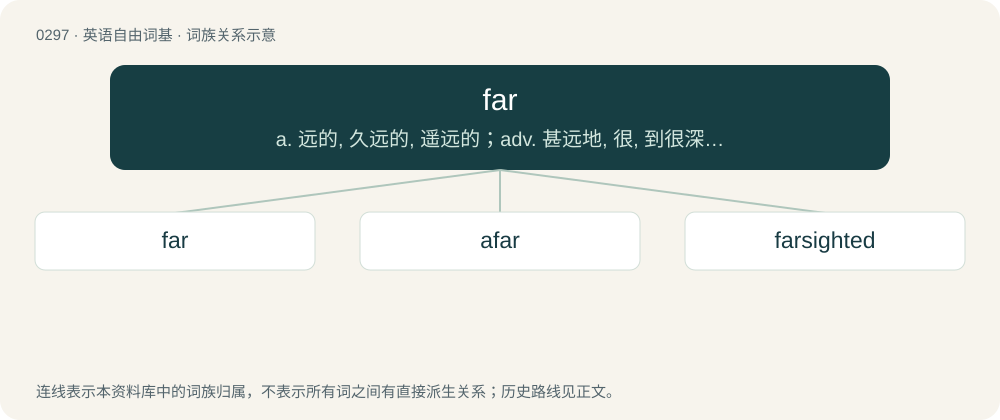

# 0334 · far — a. 远的, 久远的, 遥远的；adv. 甚远地, 很, 到很深的程度, 到很远的距离

[总目录](../00_总目录_按常用程度.md)

**类型**：英语自由词基　｜　**来源语言**：见词源记录

## 核心含义与来源

- 核心含义：a. 远的, 久远的, 遥远的；adv. 甚远地, 很, 到很深的程度, 到很远的距离
- 英文含义：Distant; remote in space.
- 词形：far

**多个词源／构词路径**：同一拼写可能有不同来源；以下按词性和含义分别列出。

**来源记录 1**（形容词；Distant; remote in space.）

Inherited from Middle English ferre, fer, Old English feor, feorr, from Proto-Germanic \*ferrai.

**来源记录 2**（名词；Emmer (a type of wheat), especially in the context of Roman use of it.）

From Latin far. Doublet of farro.

## 词族图

## 单词速览（常用到不常用）

| 单词 | 音标 | 释义 |
|---|---|---|
| [far](#w-1) | 英 /fɑː/；美 /fɑɹ/ | a. 远的, 久远的, 遥远的；adv. 甚远地, 很, 到很深的程度, 到很远的距离 |
| [afar](#w-2) | 英 /əˈfɑː/；美 /əˈfɑɹ/ | adv. 由远处, 遥远地 |
| [farsighted](#w-3) | /ˈfɑːɹˌsaɪt.əd/ | a. 能看到远处的, 有先见之明的, 远视的；\[医\] 远视的 |

## 逐词详解

### 1. far

**词性**：形容词　｜　**音标**：英 /fɑː/；美 /fɑɹ/

**中文释义**：a. 远的, 久远的, 遥远的；adv. 甚远地, 很, 到很深的程度, 到很远的距离

**英文义项**：Distant; remote in space. / Remote in time.

**词源与演化**：

Inherited from Middle English ferre, fer, Old English feor, feorr, from Proto-Germanic \*ferrai.

**例句**：

> He moved to the far end of the state. She remained at this end.

该用例对应义项：More remote of two.

### 2. afar

**词性**：副词　｜　**音标**：英 /əˈfɑː/；美 /əˈfɑɹ/

**中文释义**：adv. 由远处, 遥远地

**英文义项**：At, to, or from a great distance; far away; distantly.

**构词拆分**：a- (“for, on, or of”) + far

**词源与演化**：

From Middle English afer, equivalent to a- (“for, on, or of”) + far.

**例句**：

> He loved her from afar.

该用例对应义项：At, to, or from a great distance; far away; distantly.

### 3. farsighted

**词性**：形容词　｜　**音标**：/ˈfɑːɹˌsaɪt.əd/

**中文释义**：a. 能看到远处的, 有先见之明的, 远视的；\[医\] 远视的

**英文义项**：Unable to focus with one's eyes on near objects; presbyopic. / Considering the future with respect to one's own plans or deeds; showing anticipation.

**构词拆分**：far + sighted

**词源与演化**：

From far + sighted.

**例句**：

> Large goals that required farsighted policies.

该用例对应义项：planning prudently for the future
