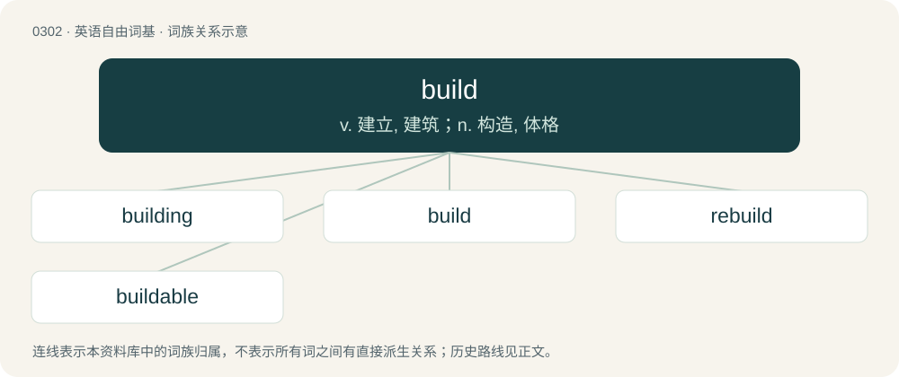

# 0340 · build — v. 建立, 建筑；n. 构造, 体格

[总目录](../00_总目录_按常用程度.md)

**类型**：英语自由词基　｜　**来源语言**：见词源记录

## 核心含义与来源

- 核心含义：v. 建立, 建筑；n. 构造, 体格
- 英文含义：To form (something) by combining materials or parts.
- 词形：build

**来源记录 1**（动词；To form (something) by combining materials or parts.）

From Middle English bilden, bulden, bylden, from Old English byldan and bytlan, bytlian (“to build”), from Proto-West Germanic \*buþlijan (“to build”), from Proto-Germanic \*buþlą, \*bōþlą (“house, dwelling, farm”), from Proto-Indo-European \*bʰuH- (“to become, grow, thrive, be, live, dwell”). Related to Old English botl (“building, house”). More at bottle. False cognate of German bilden.

## 词族图

## 单词速览（常用到不常用）

| 单词 | 音标 | 释义 |
|---|---|---|
| [building](#w-1) | /ˈbɪl.dɪŋ/ | n. 建筑物, 建筑；\[法\] 营造, 建筑, 建筑物 |
| [build](#w-2) | /bɪld/ | v. 建立, 建筑；n. 构造, 体格 |
| [rebuild](#w-3) | /ɹiːˈbɪld/ | vt. 改建, 重建, 改造；vi. 重建 |
| [buildable](#w-4) | /ˈbildəbl/ | a. 可建造的,可信赖的；a. 可以建造的 |

## 逐词详解

### 1. building

**词性**：名词　｜　**音标**：/ˈbɪl.dɪŋ/

**中文释义**：n. 建筑物, 建筑；\[法\] 营造, 建筑, 建筑物

**英文义项**：The act or process by which something is built; construction. / A closed structure with walls and a roof.

**构词拆分**：build + -ing

**词源与演化**：

From Middle English byldynge, buyldyng, byldyng, buldynge, buldyng, boldyng, equivalent to build + -ing. Compare also related Middle English bold (“edifice, castle, mansion”), from Old English bold (“building, dwelling, house”).

**例句**：

> The building of the bridge will be completed in a couple of weeks.

该用例对应义项：The act or process by which something is built; construction.

### 2. build

**词性**：动词　｜　**音标**：/bɪld/

**中文释义**：v. 建立, 建筑；n. 构造, 体格

**英文义项**：To form (something) by combining materials or parts. / To develop or give form to (something) according to a plan or process.

**词源与演化**：

From Middle English bilden, bulden, bylden, from Old English byldan and bytlan, bytlian (“to build”), from Proto-West Germanic \*buþlijan (“to build”), from Proto-Germanic \*buþlą, \*bōþlą (“house, dwelling, farm”), from Proto-Indo-European \*bʰuH- (“to become, grow, thrive, be, live, dwell”). Related to Old English botl (“building, house”). More at bottle. False cognate of German bilden.

**例句**：

> This code won’t build any more. Have you made any changes?

该用例对应义项：To be converted into software by compilation, usually with minimal human intervention.

### 3. rebuild

**词性**：动词　｜　**音标**：/ɹiːˈbɪld/

**中文释义**：vt. 改建, 重建, 改造；vi. 重建

**英文义项**：To build again or anew. / To attempt to improve one's performance during a period of struggling.

**构词拆分**：re- + build

**词源与演化**：

From re- + build.

**例句**：

> After missing the playoffs for the seventh straight season in a row, the Detroit Red Wings are trying to rebuild.

该用例对应义项：To attempt to improve one's performance during a period of struggling.

### 4. buildable

**词性**：形容词　｜　**音标**：/ˈbildəbl/

**中文释义**：a. 可建造的,可信赖的；a. 可以建造的

**英文义项**：That can be built. / Suitable for building on.

**构词拆分**：build + -able

**词源与演化**：

From build + -able.
