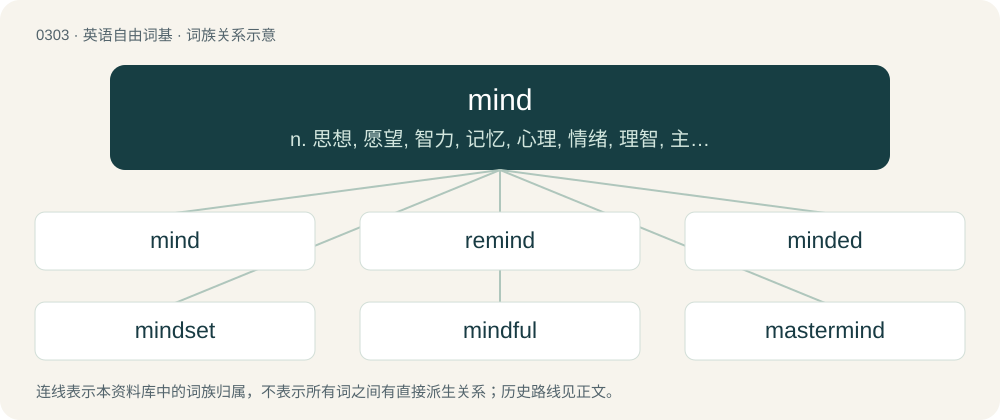

# 0341 · mind — n. 思想, 愿望, 智力, 记忆, 心理, 情绪, 理智, 主意, 心意；vi. 介意, 注意, 留心；vt. 注意, 留意, 专心于, 照看, 介意

[总目录](../00_总目录_按常用程度.md)

**类型**：英语自由词基　｜　**来源语言**：见词源记录

## 核心含义与来源

- 核心含义：n. 思想, 愿望, 智力, 记忆, 心理, 情绪, 理智, 主意, 心意；vi. 介意, 注意, 留心；vt. 注意, 留意, 专心于, 照看, 介意
- 英文含义：The capability for rational thought.
- 词形：mind

**来源记录 1**（名词；The capability for rational thought.）

From Middle English minde, munde, imynde, imunde, ȝemynde, ȝemunde, from Old English mynd, ġemynd (“mind, memory”), from Proto-West Germanic \*mundi, \*gamundi, from Proto-Germanic \*mundiz, \*gamundiz (“memory, remembrance”), from Proto-Indo-European \*méntis (“thought”) (compare also mantis, via Greek), from the root \*men- (“to think”). Cognate with Old High German gimunt ("mind, memory, remembrance"; Middle High German munst (“love, benevolence, joy”)), Old Norse mynd (“image, model”), Gothic 𐌲𐌰𐌼𐌿𐌽𐌳𐍃 (gamunds, “remembrance, memory, mind”). Related also to Danish minde (“memory”), Norwegian Bokmål, Norwegian Nynorsk, and Swedish minne (“memory”), Faroese and Icelandic minni (“memory, recall, recollection”), Latin mēns (“mind, reason”), Sanskrit मनस् (mánas), Ancient Greek μένος (ménos), Albanian mënd (“mind, reason”). Related to mantra. Compare also Old English myntan (“to mean, intend, purpose, determine, resolve”). More at mint.

## 词族图

## 单词速览（常用到不常用）

| 单词 | 音标 | 释义 |
|---|---|---|
| [mind](#w-1) | 英 /maɪnd/ | n. 思想, 愿望, 智力, 记忆, 心理, 情绪, 理智, 主意, 心意；vi. 介意, 注意, 留心；vt. 注意, 留意, 专心于, 照看, 介意 |
| [remind](#w-2) | /ɹəˈmaɪnd/ | vt. 提醒, 使想起 |
| [minded](#w-3) | /ˈmaɪndɪd/ | a. 有意的, 有心的, 具有意志的 |
| [mindset](#w-4) | 美 /ˈmaɪn(d)ˌsɛt/ | n. 心态；倾向；习惯；精神状态 |
| [mindful](#w-5) | /ˈmaɪnd.fl̩/ | a. 深切注意的, 留神的, 留心的 |
| [mastermind](#w-6) | 英 /ˈmɑː.stə.mʌɪnd/；美 /ˈmæs.tɚˌmaɪnd/ | n. 优秀策划者, 才子；vt. 指导, 主持, 策划 |
| [nevermind](#w-7) | /ˈnevəˈmaind/ | 注意, 留意, 理会 |
| [mindless](#w-8) | /maɪnd.ləs/ | a. 没头脑的, 不小心的, 不留神的 |
| [minding](#w-9) |  | vi. 介意（mind的现在分词形式） |
| [minder](#w-10) | /ˈmaində/ | n. 看守者, 照顾者 |
| [mindfuck](#w-11) | 英 /maɪnd.fʌk/ | n. &lt;俚&gt;高度兴奋状态 |
| [megamind](#w-12) |  | 【英文】A mind that is composed of other minds nested within it. |

## 逐词详解

### 1. mind

**词性**：名词　｜　**音标**：英 /maɪnd/

**中文释义**：n. 思想, 愿望, 智力, 记忆, 心理, 情绪, 理智, 主意, 心意；vi. 介意, 注意, 留心；vt. 注意, 留意, 专心于, 照看, 介意

**英文义项**：The capability for rational thought. / The ability to be aware of things.

**词源与演化**：

From Middle English minde, munde, imynde, imunde, ȝemynde, ȝemunde, from Old English mynd, ġemynd (“mind, memory”), from Proto-West Germanic \*mundi, \*gamundi, from Proto-Germanic \*mundiz, \*gamundiz (“memory, remembrance”), from Proto-Indo-European \*méntis (“thought”) (compare also mantis, via Greek), from the root \*men- (“to think”). Cognate with Old High German gimunt ("mind, memory, remembrance"; Middle High German munst (“love, benevolence, joy”)), Old Norse mynd (“image, model”), Gothic 𐌲𐌰𐌼𐌿𐌽𐌳𐍃 (gamunds, “remembrance, memory, mind”). Related also to Danish minde (“memory”), Norwegian Bokmål, Norwegian Nynorsk, and Swedish minne (“memory”), Faroese and Icelandic minni (“memory, recall, recollection”), Latin mēns (“mind, reason”), Sanskrit मनस् (mánas), Ancient Greek μένος (ménos), Albanian mënd (“mind, reason”). Related to mantra. Compare also Old English myntan (“to mean, intend, purpose, determine, resolve”). More at mint.

**例句**：

> Despite advancing age, his mind was still as sharp as ever.

该用例对应义项：The capability for rational thought.

### 2. remind

**词性**：动词　｜　**音标**：/ɹəˈmaɪnd/

**中文释义**：vt. 提醒, 使想起

**英文义项**：To cause one to experience a memory (of someone or something); to bring to the notice or consideration (of a person).

**构词拆分**：re- + mind (“to remember”)

**词源与演化**：

From mid 17th century, equivalent to re- + mind (“to remember”). Probably suggested by obsolete rememorate with the same sense. Displaced Old English myndgian.

**例句**：

> The group put up posters to remind people that noise is harmful.

### 3. minded

**词性**：形容词　｜　**音标**：/ˈmaɪndɪd/

**中文释义**：a. 有意的, 有心的, 具有意志的

**英文义项**：Having or exemplifying a mind of the stated type, nature or inclination. / Having a preference for doing something; having a likelihood, or disposition to carry out an act.

**构词拆分**：mind + -ed

**词源与演化**：

From mind + -ed. Compare Old English -mōd (“minded”), Old English ġehyġd (“minded; disposed”).

**例句**：

> a fair-minded decision by a traditionally minded Pope.

该用例对应义项：Having or exemplifying a mind of the stated type, nature or inclination.

### 4. mindset

**词性**：名词　｜　**音标**：美 /ˈmaɪn(d)ˌsɛt/

**中文释义**：n. 心态；倾向；习惯；精神状态

**英文义项**：A way of thinking; an attitude or opinion, especially a habitual one.

**构词拆分**：From mind + set.

**词源与演化**：

From mind + set.

**例句**：

> Earth Day is a way of propagating and celebrating the environmentalist mindset.

该用例对应义项：A way of thinking; an attitude or opinion, especially a habitual one.

### 5. mindful

**词性**：形容词　｜　**音标**：/ˈmaɪnd.fl̩/

**中文释义**：a. 深切注意的, 留神的, 留心的

**英文义项**：aware (of something); attentive, heedful. / Of or pertaining to mindfulness; sustaining meta-attention of the contents of one's own mind in the present moment.

**构词拆分**：mind + -ful

**词源与演化**：

From Middle English myndeful, myndefull, from Old English ġemyndful (“of good memory”), equivalent to mind + -ful.

**例句**：

> I think being mindful may help you to appreciate life more.

该用例对应义项：Of or pertaining to mindfulness; sustaining meta-attention of the contents of one's own mind in the present moment.

### 6. mastermind

**词性**：名词　｜　**音标**：英 /ˈmɑː.stə.mʌɪnd/；美 /ˈmæs.tɚˌmaɪnd/

**中文释义**：n. 优秀策划者, 才子；vt. 指导, 主持, 策划

**英文义项**：A person with an extraordinary intellect or skill that is markedly superior to their peers. / A person responsible for the highest level of planning and execution of a major operation.

**构词拆分**：master + mind

**词源与演化**：

From master + mind.

**例句**：

> Tom was the mastermind behind the theft of the crown jewels.

### 7. nevermind

**词性**：名词　｜　**音标**：/ˈnevəˈmaind/

**中文释义**：注意, 留意, 理会

**英文义项**：Attention, heed. / Concern, affair.

**构词拆分**：never + mind

**词源与演化**：

From never + mind (in never mind).

**例句**：

> Where is my wallet? Nevermind! I just found it under the couch.

### 8. mindless

**词性**：形容词　｜　**音标**：/maɪnd.ləs/

**中文释义**：a. 没头脑的, 不小心的, 不留神的

**英文义项**：Showing a lack of forethought or sense. / Having no sensible meaning or purpose.

**构词拆分**：mind + -less

**词源与演化**：

From Middle English myndles, myndelees, myndeles, mendlees, from Old English myndlēas, ġemyndlēas (“foolish, senseless”), equivalent to mind + -less.

**例句**：

> Atheism alleges that mindless scientific forces control the universe.

该用例对应义项：Lacking a mind.

### 9. minding

**词性**：名词

**中文释义**：vi. 介意（mind的现在分词形式）

**英文义项**：The act of taking heed of something.

**构词拆分**：mind + -ing

**词源与演化**：

From Middle English mynding, myndyng, equivalent to mind + -ing.

**例句**：

> I was just minding my own business when Tom started yelling at me.

### 10. minder

**词性**：名词　｜　**音标**：/ˈmaində/

**中文释义**：n. 看守者, 照顾者

**英文义项**：One who minds, tends, or watches something such as a child, a machine, or cattle; a keeper. / A personal bodyguard.

**构词拆分**：mind + -er

**词源与演化**：

From Middle English mynder, mendowre (“one who has a good memory; bears in mind; watches over; a keeper”); equivalent to mind + -er.

**例句**：

> I turned around and there, a few hundred feet away, was our government minder, Li Wong Su, huffing and puffing toward us.

该用例对应义项：someone (usually in totalitarian countries) who is assigned to watch over foreign visitors

### 11. mindfuck

**词性**：名词　｜　**音标**：英 /maɪnd.fʌk/

**中文释义**：n. &lt;俚&gt;高度兴奋状态

**英文义项**：Something that intentionally destabilizes, confuses, or manipulates the mind of another person.

**构词拆分**：mind + fuck

**词源与演化**：

Compound of mind + fuck.

### 12. megamind

**词性**：名词

**英文义项**：A mind that is composed of other minds nested within it.

**构词拆分**：mega- + mind

**词源与演化**：

From mega- + mind.

**例句**：

> Megamind is a bad guy, so he has to do some bad guy stuff.
