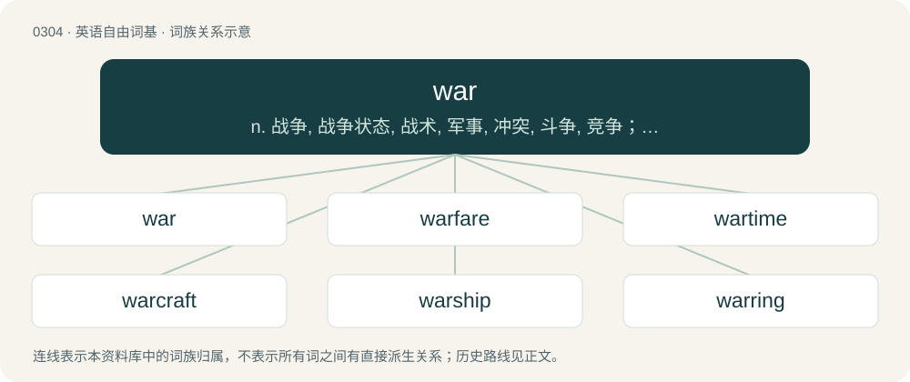

# 0342 · war — n. 战争, 战争状态, 战术, 军事, 冲突, 斗争, 竞争；vi. 进行战争, 作战, 打仗, 战斗；a. 战争的, 战时用的

[总目录](../00_总目录_按常用程度.md)

**类型**：英语自由词基　｜　**来源语言**：见词源记录

## 核心含义与来源

- 核心含义：n. 战争, 战争状态, 战术, 军事, 冲突, 斗争, 竞争；vi. 进行战争, 作战, 打仗, 战斗；a. 战争的, 战时用的
- 英文含义：Organized, large-scale, armed conflict between countries or between national, ethnic, or other sizeable groups, usually but not always involving active engagement of military forces.
- 词形：war

**来源记录 1**（名词；Organized, large-scale, armed conflict between countries or between national, ethnic, or other sizeable groups, usually but not always involving active engagement of military forces.）

Inherited from Middle English werre, from Late Old English werre /wyrre (“armed conflict”), from Anglo-Norman and Old Northern French guerre /werre (compare modern French guerre), from Medieval Latin werra, from Frankish \*werʀu (“confusion; quarrel”), from Proto-Indo-European \*wers- (“to mix up, confuse, beat, thresh”). Gradually displaced native Old English beadu, hild, ġewinn, orleġe, wīġ, and many others as the general term for "war" during the Middle English period. Related to Old High German werra (“confusion, strife, quarrel”) and German verwirren (“to confuse”), but not to Wehr (“defense”). Also related to Old Saxon werran (“to confuse, perplex”), Dutch war (“confusion, disarray”), West Frisian war (“struggle, resistance, defense, effort, exertion, activity”), and Romance terms borrowed from Germanic, such as Italian, Portuguese, and Spanish guerra (“war”). Not likely related to worse or wurst.

## 词族图

## 单词速览（常用到不常用）

| 单词 | 音标 | 释义 |
|---|---|---|
| [war](#w-1) | 英 /wɔː/；美 /wɔɹ/ | n. 战争, 战争状态, 战术, 军事, 冲突, 斗争, 竞争；vi. 进行战争, 作战, 打仗, 战斗；a. 战争的, 战时用的 |
| [warfare](#w-2) | 英 /ˈwɔːfɛə/；美 /ˈwɔɹfɛɹ/ | n. 战争, 战斗, 交战, 斗争, 竞争；\[法\] 战事, 作战, 交战 |
| [wartime](#w-3) | /ˈwɔː(ɹ)taɪm/ | n. 战时 |
| [warcraft](#w-4) | 英 /ˈwɔːkɹɑːft/；美 /ˈwɔɹkɹæft/ | n. 军用飞机, 军舰, 战略和战术, 兵法 |
| [warship](#w-5) | 英 /ˈwɔːˌʃɪp/；美 /ˈwɔɹˌʃɪp/ | n. 军舰, 战船 |
| [warring](#w-6) | /ˈwɔːriŋ/ | a. 交战的, 敌对的, 冲突的；\[法\] 战争, 敌对行为 |
| [warlord](#w-7) | 英 /ˈwɔːlɔːd/；美 /ˈwɔɹlɔɹd/ | n. 军阀, 军阀式领袖 |
| [warhead](#w-8) | /ˈwɒːhed/ | n. 弹头 |
| [warlike](#w-9) | 英 /ˈwɔːlaɪk/；美 /ˈwɔɹlaɪk/ | a. 准备战斗的, 好战的, 尚武的, 勇于作战的, 军事的；\[法\] 好战的, 军事的 |
| [interwar](#w-10) | British/Southern/Standard /ˈɪn.tə.wɔ(ː)/ | a. 两次战争之间的 |
| [wargaming](#w-11) |  | (wargame 的现在分词) 军事演习, 军事演习 |
| [warpath](#w-12) | /ˈwɔːpɑːθ/ | n. 征途, 敌对行动, 敌对情绪 |
| [warmonger](#w-13) | 英 /ˈwɔː.mʌŋ.ɡə/；美 /ˈwoɹˌmɑŋ.ɡɚ/ | n. 战争贩子；\[法\] 战争贩子 |
| [warhorse](#w-14) | /ˈwɔːhɔːs/ | n. 军马, &lt;口&gt;老兵, 老练的人 |
| [warplane](#w-15) | /ˈwɒːplein/ | n. 军用飞机 |
| [warfighter](#w-16) |  | 【英文】A servicemember of an armed force; (often specifically) one who sees combat. |
| [warfighting](#w-17) |  | 【英文】The fighting of a war. |

## 逐词详解

### 1. war

**词性**：名词　｜　**音标**：英 /wɔː/；美 /wɔɹ/

**中文释义**：n. 战争, 战争状态, 战术, 军事, 冲突, 斗争, 竞争；vi. 进行战争, 作战, 打仗, 战斗；a. 战争的, 战时用的

**英文义项**：Organized, large-scale, armed conflict between countries or between national, ethnic, or other sizeable groups, usually but not always involving active engagement of military forces. / A particular conflict of this kind.

**词源与演化**：

Inherited from Middle English werre, from Late Old English werre /wyrre (“armed conflict”), from Anglo-Norman and Old Northern French guerre /werre (compare modern French guerre), from Medieval Latin werra, from Frankish \*werʀu (“confusion; quarrel”), from Proto-Indo-European \*wers- (“to mix up, confuse, beat, thresh”). Gradually displaced native Old English beadu, hild, ġewinn, orleġe, wīġ, and many others as the general term for "war" during the Middle English period. Related to Old High German werra (“confusion, strife, quarrel”) and German verwirren (“to confuse”), but not to Wehr (“defense”). Also related to Old Saxon werran (“to confuse, perplex”), Dutch war (“confusion, disarray”), West Frisian war (“struggle, resistance, defense, effort, exertion, activity”), and Romance terms borrowed from Germanic, such as Italian, Portuguese, and Spanish guerra (“war”). Not likely related to worse or wurst.

**例句**：

> a war of succession... a war of attrition... the Cold War... World War III...

该用例对应义项：A particular conflict of this kind.

### 2. warfare

**词性**：名词　｜　**音标**：英 /ˈwɔːfɛə/；美 /ˈwɔɹfɛɹ/

**中文释义**：n. 战争, 战斗, 交战, 斗争, 竞争；\[法\] 战事, 作战, 交战

**英文义项**：The waging of war or armed conflict against an enemy. / Military operations of some particular kind e.g. guerrilla warfare.

**构词拆分**：war + fare

**词源与演化**：

From war + fare; perhaps a shortening of Middle English werre-faringe, werfarynge (“waging war, warfare”, literally “going to war”).

**例句**：

> They took to the field with all the panoply of modern warfare.

### 3. wartime

**词性**：名词　｜　**音标**：/ˈwɔː(ɹ)taɪm/

**中文释义**：n. 战时

**英文义项**：A period during which a war is in progress in a particular place.

**构词拆分**：war + time

**词源与演化**：

From war + time.

**例句**：

> After seven years of wartime captivity, Tom was a broken man.

### 4. warcraft

**词性**：名词　｜　**音标**：英 /ˈwɔːkɹɑːft/；美 /ˈwɔɹkɹæft/

**中文释义**：n. 军用飞机, 军舰, 战略和战术, 兵法

**英文义项**：The art or skill of conducting a war. / A warship.

**构词拆分**：war + -craft (skill)；war + -craft (vehicle)

**词源与演化**：

From Middle English werrecraft, equivalent to war + -craft (skill) or war + -craft (vehicle).

**例句**：

> This senate candidate also plays World of Warcraft.

### 5. warship

**词性**：名词　｜　**音标**：英 /ˈwɔːˌʃɪp/；美 /ˈwɔɹˌʃɪp/

**中文释义**：n. 军舰, 战船

**英文义项**：Any ship built or armed for naval combat. / A spacecraft built or armed for space warfare.

**构词拆分**：war + ship

**词源与演化**：

From war + ship.

**例句**：

> That warship armed with eight cannons is a "Queen Elizabeth" class.

### 6. warring

**词性**：形容词　｜　**音标**：/ˈwɔːriŋ/

**中文释义**：a. 交战的, 敌对的, 冲突的；\[法\] 战争, 敌对行为

**英文义项**：engaged in war; belligerent

**构词拆分**：By surface analysis, war + -ing

**词源与演化**：

From Middle English werrynge. By surface analysis, war + -ing.

**例句**：

> Belligerent (or warring) nations.

该用例对应义项：engaged in war

### 7. warlord

**词性**：名词　｜　**音标**：英 /ˈwɔːlɔːd/；美 /ˈwɔɹlɔɹd/

**中文释义**：n. 军阀, 军阀式领袖

**英文义项**：A military commander or bandit leader wielding civilian power in an area where the government is weak.

**构词拆分**：war + lord

**词源与演化**：

From war + lord.

**例句**：

> The high court decided to try the fugitive warlord in abstentia.

### 8. warhead

**词性**：名词　｜　**音标**：/ˈwɒːhed/

**中文释义**：n. 弹头

**英文义项**：The part of a missile, projectile, torpedo, rocket, or other munition which contains either the nuclear or thermonuclear system, high explosive system, chemical or biological agents, or inert materials intended to inflict damage. / The glans penis.

**构词拆分**：war + head

**词源与演化**：

From war + head, originally to distinguish a live war head of a torpedo from an inert exercise head. Piecewise doublet of war chief.

**例句**：

> The scientist participated in developing high-voltage switches, a key component crucial for setting off explosions needed to trigger nuclear warhead.

### 9. warlike

**词性**：形容词　｜　**音标**：英 /ˈwɔːlaɪk/；美 /ˈwɔɹlaɪk/

**中文释义**：a. 准备战斗的, 好战的, 尚武的, 勇于作战的, 军事的；\[法\] 好战的, 军事的

**英文义项**：Hostile and belligerent. / Martial, bellicose or militaristic.

**构词拆分**：war + -like

**词源与演化**：

From war + -like. Compare the older warly.

**例句**：

> A warlike people, or one that likes warlike rulers, is probably mentally unwell.

### 10. interwar

**词性**：形容词　｜　**音标**：British/Southern/Standard /ˈɪn.tə.wɔ(ː)/

**中文释义**：a. 两次战争之间的

**英文义项**：During or relating to the period of time between two wars, especially the two World Wars (1919–1939).

**构词拆分**：inter- + war

**词源与演化**：

From inter- + war.

**例句**：

> His family emigrated to America in the interwar years.

该用例对应义项：During or relating to the period of time between two wars, especially the two World Wars (1919–1939).

### 11. wargaming

**词性**：名词

**中文释义**：(wargame 的现在分词) 军事演习, 军事演习

**英文义项**：The playing of war games.

**构词拆分**：war + gaming

**词源与演化**：

From war + gaming.

### 12. warpath

**词性**：名词　｜　**音标**：/ˈwɔːpɑːθ/

**中文释义**：n. 征途, 敌对行动, 敌对情绪

**英文义项**：A course of action that leads to battle or hostility.

**构词拆分**：war + path

**词源与演化**：

From war + path.

**例句**：

> The band of Indians were ready to go on the warpath at the slightest provocation.

### 13. warmonger

**词性**：名词　｜　**音标**：英 /ˈwɔː.mʌŋ.ɡə/；美 /ˈwoɹˌmɑŋ.ɡɚ/

**中文释义**：n. 战争贩子；\[法\] 战争贩子

**英文义项**：Someone who advocates war to an enthusiastic or ardent degree. / A mercenary soldier.

**构词拆分**：war + monger

**词源与演化**：

From war + monger.

**例句**：

> I don't understand why Esther of all people would vote for such a warmonger.

### 14. warhorse

**词性**：名词　｜　**音标**：/ˈwɔːhɔːs/

**中文释义**：n. 军马, &lt;口&gt;老兵, 老练的人

**英文义项**：An experienced person who has been through many battles, situations or contests; someone who has given long service. / A regularly revived theatrical or musical work, as with Hamlet or a Beethoven symphony, or as excerpts thereto. May imply that the work in question has become hackneyed.

**构词拆分**：war + horse

**词源与演化**：

From war + horse.

**用法示例／搭配（非完整句）**：

> a Wagner warhorse

该用例对应义项：A regularly revived theatrical or musical work, as with Hamlet or a Beethoven symphony, or as excerpts thereto. May imply that the work in question has become hackneyed.

### 15. warplane

**词性**：名词　｜　**音标**：/ˈwɒːplein/

**中文释义**：n. 军用飞机

**英文义项**：An aircraft designed for combat.

**构词拆分**：war + plane

**词源与演化**：

From war + plane.

### 16. warfighter

**词性**：名词

**英文义项**：A servicemember of an armed force; (often specifically) one who sees combat.

**构词拆分**：war + fighter

**词源与演化**：

From war + fighter.

### 17. warfighting

**词性**：名词

**英文义项**：The fighting of a war.

**构词拆分**：war + fighting

**词源与演化**：

From war + fighting.
