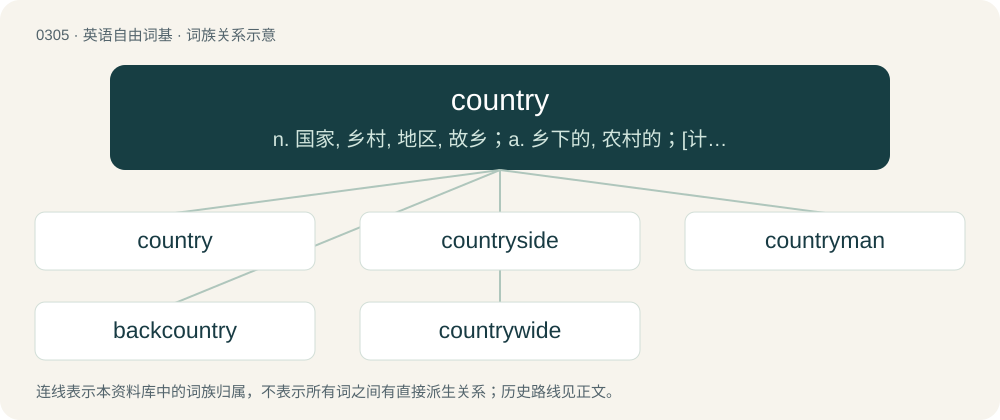

# 0343 · country — n. 国家, 乡村, 地区, 故乡；a. 乡下的, 农村的；\[计\] DOS外部命令:用于设定国家代码, 包括日期时间及货币格式

[总目录](../00_总目录_按常用程度.md)

**类型**：英语自由词基　｜　**来源语言**：见词源记录

## 核心含义与来源

- 核心含义：n. 国家, 乡村, 地区, 故乡；a. 乡下的, 农村的；\[计\] DOS外部命令:用于设定国家代码, 包括日期时间及货币格式
- 英文含义：The territory of a nation; a sovereign state or a region once independent and still distinct in institutions, language, etc.
- 词形：country

**来源记录 1**（名词；The territory of a nation; a sovereign state or a region once independent and still distinct in institutions, language, etc.）

Inherited from Middle English contre, borrowed from Old French contree, from Vulgar Latin \*(terra) contrāta (“facing land”), from Latin contrā (“against”) + -āta (noun-forming suffix). Cognate with Scots kintra. Unrelated to county. Displaced native English land in some of its senses. From around 1300 as "area surrounding a walled city or town; the open country." By early 16th century the sense was applied mostly to rural areas, as opposed to towns and cities. Compare typologically Russian страна́ (straná), сторона́ (storoná).

## 词族图

## 单词速览（常用到不常用）

| 单词 | 音标 | 释义 |
|---|---|---|
| [country](#w-1) | 英 /ˈkʌntɹi/ | n. 国家, 乡村, 地区, 故乡；a. 乡下的, 农村的；\[计\] DOS外部命令:用于设定国家代码, 包括日期时间及货币格式 |
| [countryside](#w-2) | 英 /ˈkʌn.tɹiˌsaɪd/ | n. 乡下地方, 乡下居民 |
| [countryman](#w-3) | /ˈkʌntɹimən/ | n. 同胞, 乡下人, 国民 |
| [backcountry](#w-4) | /ˈbækˌkʌntɹi/ | n. 偏僻地区；边远地区；穷乡僻壤；a. 偏僻地区的 |
| [countrywide](#w-5) | /ˌkʌn.tɹiˈwaɪd/ | a. 全国范围的 |

## 逐词详解

### 1. country

**词性**：名词　｜　**音标**：英 /ˈkʌntɹi/

**中文释义**：n. 国家, 乡村, 地区, 故乡；a. 乡下的, 农村的；\[计\] DOS外部命令:用于设定国家代码, 包括日期时间及货币格式

**英文义项**：The territory of a nation; a sovereign state or a region once independent and still distinct in institutions, language, etc. / A large area regarded as distinct from other areas, e.g. because it is inhabited by a specific group of people

**词源与演化**：

Inherited from Middle English contre, borrowed from Old French contree, from Vulgar Latin \*(terra) contrāta (“facing land”), from Latin contrā (“against”) + -āta (noun-forming suffix). Cognate with Scots kintra. Unrelated to county. Displaced native English land in some of its senses. From around 1300 as "area surrounding a walled city or town; the open country." By early 16th century the sense was applied mostly to rural areas, as opposed to towns and cities. Compare typologically Russian страна́ (straná), сторона́ (storoná).

**例句**：

> Hikers love the wild country that lies northwest of this river confluence.

该用例对应义项：An area of land of indefinite extent or of more or less definite extent in relation to human occupation, especially characterized by its particular physical features, or its suitability for a particular activity or connected with its population (by race, dialect, culture, etc.) or a person, especially a writer, or their works.

### 2. countryside

**词性**：名词　｜　**音标**：英 /ˈkʌn.tɹiˌsaɪd/

**中文释义**：n. 乡下地方, 乡下居民

**英文义项**：An area located outside of towns and cities; an area that is not urban or suburban; a rural area. / Such part of a larger area.

**构词拆分**：country + -side

**词源与演化**：

From country + -side.

**例句**：

> We live in the Swedish countryside.

该用例对应义项：Such part of a larger area.

### 3. countryman

**词性**：名词　｜　**音标**：/ˈkʌntɹimən/

**中文释义**：n. 同胞, 乡下人, 国民

**英文义项**：Somebody from a certain country. / Somebody from one's own country; a fellow countryman.

**构词拆分**：From country + -man.

**词源与演化**：

From country + -man.

**例句**：

> After the activities of the second day she stayed the night with a countryman.

### 4. backcountry

**词性**：名词　｜　**音标**：/ˈbækˌkʌntɹi/

**中文释义**：n. 偏僻地区；边远地区；穷乡僻壤；a. 偏僻地区的

**英文义项**：A remote region; countryside that is relatively inaccessible.

**构词拆分**：back + country

**词源与演化**：

From back + country.

**例句**：

> John is writing an assignment about the Brazilian backcountry.

### 5. countrywide

**词性**：形容词　｜　**音标**：/ˌkʌn.tɹiˈwaɪd/

**中文释义**：a. 全国范围的

**英文义项**：Throughout a country.

**构词拆分**：country + -wide

**词源与演化**：

From country + -wide.

**例句**：

> A countrywide fund-raising campaign.

该用例对应义项：occurring or extending throughout a country or nation
