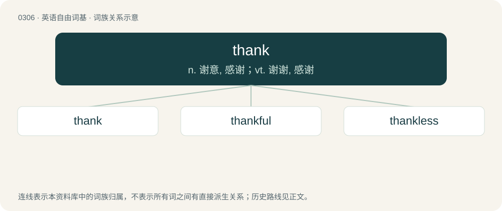

# 0345 · thank — n. 谢意, 感谢；vt. 谢谢, 感谢

[总目录](../00_总目录_按常用程度.md)

**类型**：英语自由词基　｜　**来源语言**：见词源记录

## 核心含义与来源

- 核心含义：n. 谢意, 感谢；vt. 谢谢, 感谢
- 英文含义：To express appreciation or gratitude toward (someone or something).
- 词形：thank

**来源记录 1**（动词；To express appreciation or gratitude toward (someone or something).）

From Middle English thanken (“to express gratitude, give thanks; to congratulate, rejoice with, or wish joy to; to extol, praise; to hold responsible for”), from Old English þancian, þoncian (“to thank”), from Proto-West Germanic \*þankōn, from Proto-Germanic \*þankōną (“to thank”), from \*þankaz (see etymology 1) + \*-ōną (suffix forming infinitives of verbs from nouns). Cognates Cognate with Scots thank (“to thank”), Saterland Frisian tonkje (“to thank”), Cimbrian dånkan (“to thank”), Dutch, German, and Luxembourgish danken (“to thank”), Vilamovian danka, daŋka, daonka (“to thank”), Yiddish דאַנקען (danken, “to thank”), Danish and Norwegian Bokmål takke (“to thank”), Faroese takka (“to thank”), Icelandic þakka (“to thank”), Swedish tacka (“to thank”).

## 词族图

## 单词速览（常用到不常用）

| 单词 | 音标 | 释义 |
|---|---|---|
| [thank](#w-1) | 英 /ˈθæŋk/；/ˈfaŋk/ | n. 谢意, 感谢；vt. 谢谢, 感谢 |
| [thankful](#w-2) | /ˈθæŋkfəl/ | a. 感谢的, 感激的, 欣慰的 |
| [thankless](#w-3) | /ˈθæŋklis/ | a. 不感谢的, 忘恩的, 不知感恩的 |

## 逐词详解

### 1. thank

**词性**：动词　｜　**音标**：英 /ˈθæŋk/；/ˈfaŋk/

**中文释义**：n. 谢意, 感谢；vt. 谢谢, 感谢

**英文义项**：To express appreciation or gratitude toward (someone or something). / In the future tense in the form one will thank someone to do something, chiefly expressing a command or criticism: to request that (someone) do something.

**词源与演化**：

From Middle English thanken (“to express gratitude, give thanks; to congratulate, rejoice with, or wish joy to; to extol, praise; to hold responsible for”), from Old English þancian, þoncian (“to thank”), from Proto-West Germanic \*þankōn, from Proto-Germanic \*þankōną (“to thank”), from \*þankaz (see etymology 1) + \*-ōną (suffix forming infinitives of verbs from nouns). Cognates Cognate with Scots thank (“to thank”), Saterland Frisian tonkje (“to thank”), Cimbrian dånkan (“to thank”), Dutch, German, and Luxembourgish danken (“to thank”), Vilamovian danka, daŋka, daonka (“to thank”), Yiddish דאַנקען (danken, “to thank”), Danish and Norwegian Bokmål takke (“to thank”), Faroese takka (“to thank”), Icelandic þakka (“to thank”), Swedish tacka (“to thank”).

**例句**：

> We can thank global warming for this freak weather.

该用例对应义项：Chiefly followed by for: to credit or hold (someone or something) responsible, especially for something negative; to blame.

### 2. thankful

**词性**：形容词　｜　**音标**：/ˈθæŋkfəl/

**中文释义**：a. 感谢的, 感激的, 欣慰的

**英文义项**：Showing appreciation or gratitude.

**构词拆分**：thank + -ful

**词源与演化**：

From Middle English thankful, from Old English þancful, þancfull (“thoughtful, pleasing, agreeable, pleasant, thankful, grateful”), equivalent to thank + -ful. Compare Old High German undankfol (“unthankful, ungrateful”).

**例句**：

> I'm thankful that you helped me out today. How can I ever repay you?

该用例对应义项：Showing appreciation or gratitude.

### 3. thankless

**词性**：形容词　｜　**音标**：/ˈθæŋklis/

**中文释义**：a. 不感谢的, 忘恩的, 不知感恩的

**英文义项**：Not appreciated or rewarded. / Ungrateful or unappreciative.

**构词拆分**：thank + -less

**词源与演化**：

From Middle English thankles, equivalent to thank + -less.

**例句**：

> Grading papers is a thankless task.

该用例对应义项：not likely to be rewarded
