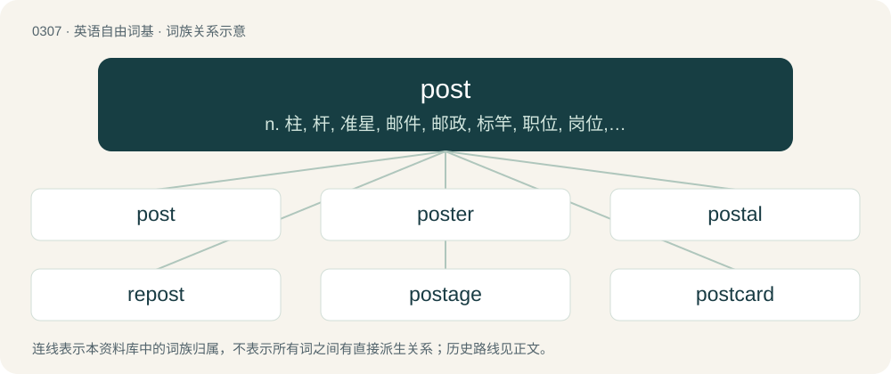

# 0346 · post — n. 柱, 杆, 准星, 邮件, 邮政, 标竿, 职位, 岗位, 哨所, 兵营；vt. 张帖, 邮递, 公布, 登入帐, 使熟悉, 布置；vi. 快速行进

[总目录](../00_总目录_按常用程度.md)

**类型**：英语自由词基　｜　**来源语言**：见词源记录

## 核心含义与来源

- 核心含义：n. 柱, 杆, 准星, 邮件, 邮政, 标竿, 职位, 岗位, 哨所, 兵营；vt. 张帖, 邮递, 公布, 登入帐, 使熟悉, 布置；vi. 快速行进
- 英文含义：A long dowel or plank protruding from the ground; a fencepost; a lightpost.
- 词形：post

**多个词源／构词路径**：同一拼写可能有不同来源；以下按词性和含义分别列出。

**来源记录 1**（名词；A long dowel or plank protruding from the ground; a fencepost; a lightpost.）

Inherited from Middle English post, from Old English post (“pillar, door-post”) and Old French post (“post, upright beam”), both from Latin postis (“door, post, doorpost”).

**来源记录 2**（名词；A station, or one of a series of stations, established for the refreshment and accommodation of travellers on some recognized route.）

Borrowed from Middle French poste, from Italian posta (“stopping-place for coaches”), feminine of posto (“placed, situated”).

**来源记录 3**（名词；An assigned station; a guard post.）

Probably from French poste.

**来源记录 4**（名词；Post-production.）

Clipping of post-production.

**来源记录 5**（名词；A post mortem (an investigation of a body's cause of death).）

Clipping of post mortem.

## 词族图

## 单词速览（常用到不常用）

| 单词 | 音标 | 释义 |
|---|---|---|
| [post](#w-1) | 英 /pəʊst/；美 /poʊst/ | n. 柱, 杆, 准星, 邮件, 邮政, 标竿, 职位, 岗位, 哨所, 兵营；vt. 张帖, 邮递, 公布, 登入帐, 使熟悉, 布置；vi. 快速行进 |
| [poster](#w-2) | 美 /ˈpoʊstɚ/ | n. 海报, 招贴, 驿马 |
| [postal](#w-3) | /ˈpəustl/ | a. 邮政的, 邮局的；\[经\] 邮政的 |
| [repost](#w-4) | /riːˈpəust/ | vt .&lt;主英&gt;重新投寄 |
| [postage](#w-5) | 英 /ˈpəʊstɪd͡ʒ/；美 /ˈpoʊstɪd͡ʒ/ | n. 邮资；\[经\] 邮费, 邮资 |
| [postcard](#w-6) | 美 /ˈpoʊstˌkɑɹd/ | n. 明信片 |
| [outpost](#w-7) | 美 /ˈaʊtˌpoʊst/ | n. 前哨, 前哨部队, 前哨基地 |
| [postmaster](#w-8) | 美 /ˈpoʊstˌmæstɚ/ | n. 邮政局长；\[计\] 邮件主管员 |
| [postman](#w-9) | 英 /ˈpəʊs(t)mən/ | n. 邮递员；\[法\] 邮递员, 理财法庭的高级律师 |
| [postcode](#w-10) | 英 /ˈpəʊs(t)kəʊd/；美 /ˈpoʊs(t)ˌkoʊd/ | n. 邮政编码 |
| [blogpost](#w-11) |  | 【英文】An entry posted to a blog. |
| [signpost](#w-12) | 美 /ˈsaɪnˌpoʊst/ | n. 招牌柱, 广告柱, 路标 |
| [lamppost](#w-13) | /ˈlæmpəust/ | n. 街灯柱 |
| [postmark](#w-14) | 美 /ˈpoʊstˌmɑɹk/ | n. 邮戳；vt. 盖邮戳于 |
| [goalpost](#w-15) | 英 /ˈɡəʊlpəʊst/；美 /ˈɡoʊlpoʊst/ | n. 球门柱 |
| [milepost](#w-16) | 美 /ˈmaɪlˌpoʊst/ | n. 里程标志, 里程碑 |

## 逐词详解

### 1. post

**词性**：名词　｜　**音标**：英 /pəʊst/；美 /poʊst/

**中文释义**：n. 柱, 杆, 准星, 邮件, 邮政, 标竿, 职位, 岗位, 哨所, 兵营；vt. 张帖, 邮递, 公布, 登入帐, 使熟悉, 布置；vi. 快速行进

**英文义项**：A long dowel or plank protruding from the ground; a fencepost; a lightpost. / A pole erected to mark a spot.

**词源与演化**：

Inherited from Middle English post, from Old English post (“pillar, door-post”) and Old French post (“post, upright beam”), both from Latin postis (“door, post, doorpost”).

**例句**：

> The posts mark the boundaries of the property.

该用例对应义项：A pole erected to mark a spot.

### 2. poster

**词性**：名词　｜　**音标**：美 /ˈpoʊstɚ/

**中文释义**：n. 海报, 招贴, 驿马

**英文义项**：A picture of a celebrity, an event etc., intended to be attached to a wall. / An advertisement to be posted on a pole, wall etc. to advertise something.

**构词拆分**：post + -er

**词源与演化**：

From post + -er.

**例句**：

> He has posters of his favorite band, sports teams and holiday resorts up.

该用例对应义项：A picture of a celebrity, an event etc., intended to be attached to a wall.

### 3. postal

**词性**：形容词　｜　**音标**：/ˈpəustl/

**中文释义**：a. 邮政的, 邮局的；\[经\] 邮政的

**英文义项**：Relating to the collection, sorting and delivery of mail. / Crazy, insane.

**构词拆分**：post + -al

**词源与演化**：

From post + -al, modelled on French postal.

**例句**：

> We sell stamps and stationery for all your postal needs.

该用例对应义项：Relating to the collection, sorting and delivery of mail.

### 4. repost

**词性**：动词　｜　**音标**：/riːˈpəust/

**中文释义**：vt .&lt;主英&gt;重新投寄

**英文义项**：To post again. / To post up again; to reset oneself at the post.

**构词拆分**：re- + post

**词源与演化**：

From re- + post.

**例句**：

> Maybe I should repost the FAQ for the benefit of newbies.

该用例对应义项：To post again.

### 5. postage

**词性**：名词　｜　**音标**：英 /ˈpəʊstɪd͡ʒ/；美 /ˈpoʊstɪd͡ʒ/

**中文释义**：n. 邮资；\[经\] 邮费, 邮资

**英文义项**：The system of transporting letters, and parcels. / The charge for posting an item.

**构词拆分**：post + -age

**词源与演化**：

From post + -age.

**例句**：

> I forgot to add a postage stamp before I mailed the letter.

### 6. postcard

**词性**：动词　｜　**音标**：美 /ˈpoʊstˌkɑɹd/

**中文释义**：n. 明信片

**英文义项**：To send a postcard to someone. / To send by means of a postcard.

**构词拆分**：From post + card.

**词源与演化**：

From post + card.

**用法示例／搭配（非完整句）**：

> to postcard one's friends

该用例对应义项：To send a postcard to someone.

### 7. outpost

**词性**：名词　｜　**音标**：美 /ˈaʊtˌpoʊst/

**中文释义**：n. 前哨, 前哨部队, 前哨基地

**英文义项**：A military post stationed at a distance from the main body of troops. / The body of troops manning such a post.

**构词拆分**：out- + post

**词源与演化**：

From out- + post.

**例句**：

> Sgt. Smith fleeced most of the rest of the outpost of their earnings in their weekly game of craps.

该用例对应义项：The body of troops manning such a post.

### 8. postmaster

**词性**：名词　｜　**音标**：美 /ˈpoʊstˌmæstɚ/

**中文释义**：n. 邮政局长；\[计\] 邮件主管员

**英文义项**：The head of a post office. / The administrator of an electronic mail system.

**构词拆分**：From post + master.

**词源与演化**：

From post + master.

**例句**：

> The postmaster, who was also the village grocer, had a clear recollection of the telegram.

### 9. postman

**词性**：名词　｜　**音标**：英 /ˈpəʊs(t)mən/

**中文释义**：n. 邮递员；\[法\] 邮递员, 理财法庭的高级律师

**英文义项**：Someone who delivers the post (mail) to, and/or collects the post from, residential or commercial addresses, or from public mailboxes.

**构词拆分**：post + -man

**词源与演化**：

From post + -man.

**例句**：

> I suspect that his wife is cheating on him with the postman.

### 10. postcode

**词性**：名词　｜　**音标**：英 /ˈpəʊs(t)kəʊd/；美 /ˈpoʊs(t)ˌkoʊd/

**中文释义**：n. 邮政编码

**英文义项**：A sequence of letters and numbers added to a postal address to aid the sorting and delivery of post or mail. / The region denoted by such a sequence.

**构词拆分**：post + code

**词源与演化**：

From post + code.

**例句**：

> Oh, I've mistakenly written the telephone number where I should've put the postcode.

### 11. blogpost

**词性**：名词

**英文义项**：An entry posted to a blog.

**构词拆分**：blog + post

**词源与演化**：

From blog + post.

### 12. signpost

**词性**：动词　｜　**音标**：美 /ˈsaɪnˌpoʊst/

**中文释义**：n. 招牌柱, 广告柱, 路标

**英文义项**：To install signposts on. / To direct (somebody) to services, resources, etc.

**构词拆分**：sign + post

**词源与演化**：

From sign + post.

**例句**：

> The route wasn't signposted, and we got lost on the way.

该用例对应义项：To install signposts on.

### 13. lamppost

**词性**：名词　｜　**音标**：/ˈlæmpəust/

**中文释义**：n. 街灯柱

**英文义项**：The pole that holds up a light so it can illuminate a wide area, such as holds up a streetlight. / A tall, thin person.

**构词拆分**：lamp + post

**词源与演化**：

From lamp + post.

**例句**：

> The part of the bike path after the last lamppost was scary.

### 14. postmark

**词性**：名词　｜　**音标**：美 /ˈpoʊstˌmɑɹk/

**中文释义**：n. 邮戳；vt. 盖邮戳于

**英文义项**：A marking made by a postal service on a delivery, usually indicating the place where and the date and time when the item was received or processed for the first time, mostly serving to cancel a postage stamp.

**构词拆分**：post + mark

**词源与演化**：

Compound of post + mark.

**例句**：

> The postmark indicates that this letter was mailed a week ago.

### 15. goalpost

**词性**：名词　｜　**音标**：英 /ˈɡəʊlpəʊst/；美 /ˈɡoʊlpoʊst/

**中文释义**：n. 球门柱

**英文义项**：One of the two vertical side poles of a goal. / The tall Y-shaped upright, now usually of fiberglass, at either end of the playing field, through which a football must go in order for a field goal to be scored. (They were originally H-shaped, with one wooden post on either side.)

**构词拆分**：goal + post

**词源与演化**：

From goal + post.

**例句**：

> The ball ricocheted off the goalpost and went in.

### 16. milepost

**词性**：名词　｜　**音标**：美 /ˈmaɪlˌpoʊst/

**中文释义**：n. 里程标志, 里程碑

**英文义项**：A post on a highway, often with one or more fingerposts, showing the distance in miles to nearby places. / A sign or post beside a railway marking the distance from the (actual or nominal) start of a line (usually the principal terminus or junction with a more major line).

**构词拆分**：From mile + post.

**词源与演化**：

From mile + post.
