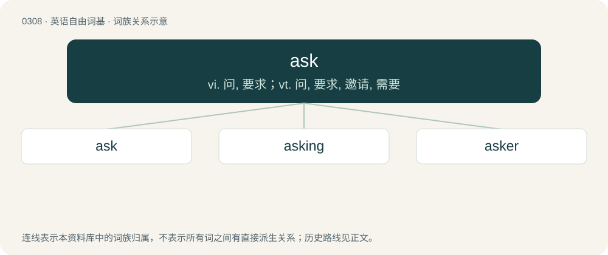

# 0347 · ask — vi. 问, 要求；vt. 问, 要求, 邀请, 需要

[总目录](../00_总目录_按常用程度.md)

**类型**：英语自由词基　｜　**来源语言**：见词源记录

## 核心含义与来源

- 核心含义：vi. 问, 要求；vt. 问, 要求, 邀请, 需要
- 英文含义：To request (information, or an answer to a question).
- 词形：ask

**多个词源／构词路径**：同一拼写可能有不同来源；以下按词性和含义分别列出。

**来源记录 1**（动词；To request (information, or an answer to a question).）

From Middle English asken, axen, from Old English āscian, from Proto-West Germanic \*aiskōn, from Proto-Indo-European \*h₂eys- (“to wish; request”). Cognate with Saterland Frisian aaskje (“to ask, demand, require”), West Frisian easkje (“to ask, demand, require”), Dutch eisen (“to demand, require”), German heischen (“to ask, request, implore”), Russian иска́ть (iskátʹ), Sanskrit इच्छति (iccháti) (whence Hindi ईछना (īchnā).

**来源记录 2**（名词；An eft; newt.）

From Middle English aske, arske, ascre, from Old English āþexe (“lizard, newt”), from Proto-West Germanic \*agiþahsijā (“lizard”), a compound of \*agiz (“snake, lizard”) + \*þahsuz (“badger”). Cognate of German Echse (“lizard”).

## 词族图

## 单词速览（常用到不常用）

| 单词 | 音标 | 释义 |
|---|---|---|
| [ask](#w-1) | 英 /ɑːsk/；美 /æsk/ | vi. 问, 要求；vt. 问, 要求, 邀请, 需要 |
| [asking](#w-2) | 英 /ˈɑːskɪŋ/；美 /ˈæskɪŋ/ | n. 请求 |
| [asker](#w-3) | 英 /ˈɑːsk.ə/；美 /ˈæsk.ɚ/ | n. 发问者, 请求者 |

## 逐词详解

### 1. ask

**词性**：动词　｜　**音标**：英 /ɑːsk/；美 /æsk/

**中文释义**：vi. 问, 要求；vt. 问, 要求, 邀请, 需要

**英文义项**：To request (information, or an answer to a question). / To request or enquire of (a person).

**词源与演化**：

From Middle English asken, axen, from Old English āscian, from Proto-West Germanic \*aiskōn, from Proto-Indo-European \*h₂eys- (“to wish; request”). Cognate with Saterland Frisian aaskje (“to ask, demand, require”), West Frisian easkje (“to ask, demand, require”), Dutch eisen (“to demand, require”), German heischen (“to ask, request, implore”), Russian иска́ть (iskátʹ), Sanskrit इच्छति (iccháti) (whence Hindi ईछना (īchnā).

**例句**：

> It’s asking a lot of this old car to make it all the way up to Scotland.

该用例对应义项：To require, demand, claim, or expect, whether by way of remuneration or return, or as a matter of necessity.

### 2. asking

**词性**：形容词　｜　**音标**：英 /ˈɑːskɪŋ/；美 /ˈæskɪŋ/

**中文释义**：n. 请求

**英文义项**：That asks; that expresses a question or request.

**构词拆分**：ask + -ing

**词源与演化**：

From Middle English askinge, askande, from Old English āsciende, from Proto-West Germanic \*aiskōndī, present participle of Proto-West Germanic \*aiskōn (“to ask”), equivalent to ask + -ing.

**例句**：

> He sent me a letter asking if the book had reached me.

### 3. asker

**词性**：名词　｜　**音标**：英 /ˈɑːsk.ə/；美 /ˈæsk.ɚ/

**中文释义**：n. 发问者, 请求者

**英文义项**：Someone who asks a question.

**构词拆分**：ask + -er

**词源与演化**：

From Middle English asker, axer, equivalent to ask + -er.
