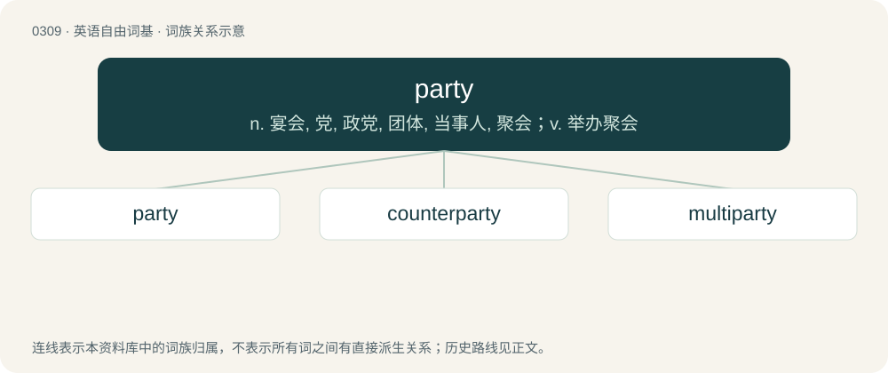

# 0348 · party — n. 宴会, 党, 政党, 团体, 当事人, 聚会；v. 举办聚会

[总目录](../00_总目录_按常用程度.md)

**类型**：英语自由词基　｜　**来源语言**：见词源记录

## 核心含义与来源

- 核心含义：n. 宴会, 党, 政党, 团体, 当事人, 聚会；v. 举办聚会
- 英文含义：A person or group of people constituting one side in a legal proceeding, such as in a legal action or a contract.
- 词形：party

**多个词源／构词路径**：同一拼写可能有不同来源；以下按词性和含义分别列出。

**来源记录 1**（名词；A person or group of people constituting one side in a legal proceeding, such as in a legal action or a contract.）

From Middle English party, partye, partie, from Anglo-Norman partie, from Old French partie (“side, part; portion, share; separation, division”, literally “that which is divided”), noun use of feminine of past participle of Old French partir (“to divide, separate”), from Latin partire (“to share, part, distribute, divide”), from pars (“a part, piece, a share”); see also part. First attested in c. 1300. Doublet of partita. The sense of communist party of a communist state derives Russian партия (partija), short for Коммунистическая партия (Kommunističeskaja partija). By surface analysis, part + -y (“noun suffix”).

**来源记录 2**（形容词；Favoring one party; partisan.）

From Middle English party, from Old French parti (“parted”), from Latin partītus (“parted”), past participle of partiō (“to divide”). More at part.

## 词族图

## 单词速览（常用到不常用）

| 单词 | 音标 | 释义 |
|---|---|---|
| [party](#w-1) | 英 /ˈpɑːti/；美 /ˈpɑɹti/ | n. 宴会, 党, 政党, 团体, 当事人, 聚会；v. 举办聚会 |
| [counterparty](#w-2) | /ˈkauntə,pɑːti/ | 合同的一方; 对手方 |
| [multiparty](#w-3) | /,mʌltiˈpɑːti/ | a. 多党的,包括多党的,包含多党党员的, 导致多党并存的选举(或政治)制度的 |

## 逐词详解

### 1. party

**词性**：名词　｜　**音标**：英 /ˈpɑːti/；美 /ˈpɑɹti/

**中文释义**：n. 宴会, 党, 政党, 团体, 当事人, 聚会；v. 举办聚会

**英文义项**：A person or group of people constituting one side in a legal proceeding, such as in a legal action or a contract. / A person; an individual.

**词源与演化**：

From Middle English party, partye, partie, from Anglo-Norman partie, from Old French partie (“side, part; portion, share; separation, division”, literally “that which is divided”), noun use of feminine of past participle of Old French partir (“to divide, separate”), from Latin partire (“to share, part, distribute, divide”), from pars (“a part, piece, a share”); see also part. First attested in c. 1300. Doublet of partita. The sense of communist party of a communist state derives Russian партия (partija), short for Коммунистическая партия (Kommunističeskaja partija). By surface analysis, part + -y (“noun suffix”).

**例句**：

> The contract requires that the party of the first part pay the fee.

该用例对应义项：A person or group of people constituting one side in a legal proceeding, such as in a legal action or a contract.

### 2. counterparty

**词性**：名词　｜　**音标**：/ˈkauntə,pɑːti/

**中文释义**：合同的一方; 对手方

**英文义项**：The other party to a financial transaction.

**构词拆分**：counter- + party

**词源与演化**：

From counter- + party.

**例句**：

> We can't leave the counterparty any loopholes.

### 3. multiparty

**词性**：形容词　｜　**音标**：/,mʌltiˈpɑːti/

**中文释义**：a. 多党的,包括多党的,包含多党党员的, 导致多党并存的选举(或政治)制度的

**英文义项**：Involving several different political parties. / Having multiple parties (involved persons).

**构词拆分**：multi- + party

**词源与演化**：

From multi- + party.

**用法示例／搭配（非完整句）**：

> a multiparty telephone call

该用例对应义项：Having multiple parties (involved persons).
