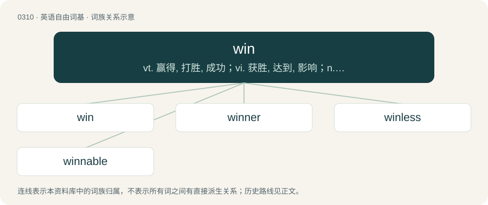

# 0349 · win — vt. 赢得, 打胜, 成功；vi. 获胜, 达到, 影响；n. 胜利, 赢, 收益

[总目录](../00_总目录_按常用程度.md)

**类型**：英语自由词基　｜　**来源语言**：见词源记录

## 核心含义与来源

- 核心含义：vt. 赢得, 打胜, 成功；vi. 获胜, 达到, 影响；n. 胜利, 赢, 收益
- 英文含义：To reach some destination or object, despite difficulty or toil (now usually intransitive, with preposition or locative adverb).
- 词形：win

**多个词源／构词路径**：同一拼写可能有不同来源；以下按词性和含义分别列出。

**来源记录 1**（动词；To reach some destination or object, despite difficulty or toil (now usually intransitive, with preposition or locative adverb).）

From Middle English winnen, from Old English winnan (“to labour, swink, toil,”) (compare Old English ġewinnan (“conquer, obtain, gain; endure, bear, suffer; be ill”)), from Proto-West Germanic \*winnan, from Proto-Germanic \*winnaną (“to swink, labour, win, gain, fight”), from Proto-Indo-European \*wenh₁- (“to strive, wish, desire, love”). Cognates Cognate with North Frisian wan, wane, wen, wine, wune (“to win”), Saterland Frisian and West Frisian winne (“to win”), Cimbrian gabènnan (“to win”), Dutch and Low German winnen (“to win”), German gewinnen (“to win”), Luxembourgish gewannen (“to win”), Danish vinde (“to win”), Faroese and Icelandic vinna (“to win”), Norwegian Bokmål vinne (“to win”), Norwegian Nynorsk vinna, vinne (“to win”), Swedish vinna (“to win”), Gothic 𐍅𐌹𐌽𐌽𐌰𐌽 (winnan, “to suffer”); also Latin venus (“beauty, charm, elegance, grace; beloved, love”), Albanian vuaj, vuj (“to suffer; to endure”), Sanskrit वनोति (vanoti, “to desire, like, love, wish; to gain, procure; to win; to prepare; to hurt, injure”).

**来源记录 2**（名词；An individual victory.）

From Middle English winn, winne, from Old English winn (“toil, labor, trouble, hardship; profit, gain; conflict, strife, war”), from Proto-Germanic \*winną (“labour, struggle, fight”), from Proto-Indo-European \*wenh₁- (“to strive, desire, wish, love”). Cognate with German Gewinn (“profit, gain”), Dutch gewin (“profit, gain”).

**来源记录 3**（名词；Pleasure; joy; delight.）

From Middle English wynne, winne, wunne, from Old English wynn (“joy, rapture, pleasure, delight, gladness”), from Proto-West Germanic \*wunnju, from Proto-Germanic \*wunjō (“joy, delight, pleasure, lust”), from Proto-Indo-European \*wenh₁- (“to strive, wish, desire, love”). Cognate with German Wonne (“bliss, joy, delight”), archaic Dutch wonne (“joy”), Danish ynde (“grace”), Icelandic yndi (“delight”).

**来源记录 4**（动词；To dry by exposure to the wind.）

From wind.

## 词族图

## 单词速览（常用到不常用）

| 单词 | 音标 | 释义 |
|---|---|---|
| [win](#w-1) | /ˈwɪn/ | vt. 赢得, 打胜, 成功；vi. 获胜, 达到, 影响；n. 胜利, 赢, 收益 |
| [winner](#w-2) | 英 /ˈwɪnə/；美 /ˈwɪnɚ/ | n. 胜利者, 优胜者；\[法\] 取胜者 |
| [winless](#w-3) | /ˈwinlis/ | a. (运动比赛)未获胜的,未赢的,每次交战皆输的 |
| [winnable](#w-4) | /ˈwɪnəbəl/ | a. 能赢得的 |

## 逐词详解

### 1. win

**词性**：动词　｜　**音标**：/ˈwɪn/

**中文释义**：vt. 赢得, 打胜, 成功；vi. 获胜, 达到, 影响；n. 胜利, 赢, 收益

**英文义项**：To reach some destination or object, despite difficulty or toil (now usually intransitive, with preposition or locative adverb). / To triumph or achieve victory in (a game, a war, etc.).

**词源与演化**：

From Middle English winnen, from Old English winnan (“to labour, swink, toil,”) (compare Old English ġewinnan (“conquer, obtain, gain; endure, bear, suffer; be ill”)), from Proto-West Germanic \*winnan, from Proto-Germanic \*winnaną (“to swink, labour, win, gain, fight”), from Proto-Indo-European \*wenh₁- (“to strive, wish, desire, love”). Cognates Cognate with North Frisian wan, wane, wen, wine, wune (“to win”), Saterland Frisian and West Frisian winne (“to win”), Cimbrian gabènnan (“to win”), Dutch and Low German winnen (“to win”), German gewinnen (“to win”), Luxembourgish gewannen (“to win”), Danish vinde (“to win”), Faroese and Icelandic vinna (“to win”), Norwegian Bokmål vinne (“to win”), Norwegian Nynorsk vinna, vinne (“to win”), Swedish vinna (“to win”), Gothic 𐍅𐌹𐌽𐌽𐌰𐌽 (winnan, “to suffer”); also Latin venus (“beauty, charm, elegance, grace; beloved, love”), Albanian vuaj, vuj (“to suffer; to endure”), Sanskrit वनोति (vanoti, “to desire, like, love, wish; to gain, procure; to win; to prepare; to hurt, injure”).

**例句**：

> If the local filters conflict with the global filters, the global filters always win.

该用例对应义项：To take priority.

### 2. winner

**词性**：名词　｜　**音标**：英 /ˈwɪnə/；美 /ˈwɪnɚ/

**中文释义**：n. 胜利者, 优胜者；\[法\] 取胜者

**英文义项**：One who has won or often wins. / A point or goal that wins a competition.

**构词拆分**：win + -er

**词源与演化**：

Inherited from Middle English wynner, wynnere, equivalent to win + -er. Compare Saterland Frisian Winner (“winner”), West Frisian winner (“winner”), Dutch winner and winnaar (“winner”), German Low German Winner, Gewinner (“winner”), German Gewinner (“winner”), Danish vinder (“winner”), Swedish vinnare (“winner”), Norwegian vinner (“winner”).

**例句**：

> The gold cup was given to the winner of the final match.

### 3. winless

**词性**：形容词　｜　**音标**：/ˈwinlis/

**中文释义**：a. (运动比赛)未获胜的,未赢的,每次交战皆输的

**英文义项**：Having never won; without a win; unsuccessful.

**构词拆分**：win + -less

**词源与演化**：

From win + -less.

**例句**：

> The team had a very disappointing winless season.

该用例对应义项：having no wins

### 4. winnable

**词性**：形容词　｜　**音标**：/ˈwɪnəbəl/

**中文释义**：a. 能赢得的

**英文义项**：Able to be won or achieved.

**构词拆分**：win + -able

**词源与演化**：

From win + -able.
