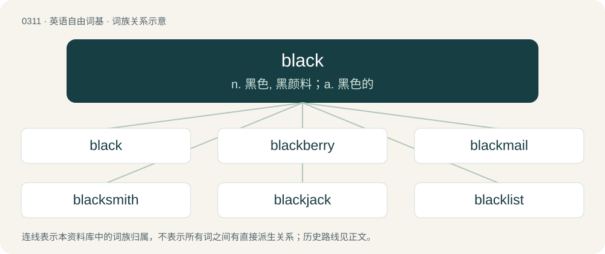

# 0351 · black — n. 黑色, 黑颜料；a. 黑色的

[总目录](../00_总目录_按常用程度.md)

**类型**：英语自由词基　｜　**来源语言**：见词源记录

## 核心含义与来源

- 核心含义：n. 黑色, 黑颜料；a. 黑色的
- 英文含义：Absorbing all light and reflecting none; dark and hueless.
- 词形：black

**来源记录 1**（形容词；Absorbing all light and reflecting none; dark and hueless.）

From Middle English blak, black, blake, from Old English blæc (“black, dark", also "ink”), from Proto-West Germanic \*blak, from Proto-Germanic \*blakaz (“burnt”), possibly from Proto-Indo-European \*bʰleg- (“to burn, shine”). See also Dutch blaken (“to burn”), Low German blak, black (“blackness, black paint, (black) ink”), Old High German blah (“black”); also compare Latin flagrāre (“to burn”), Ancient Greek φλόξ (phlóx, “flame”), Sanskrit भर्ग (bharga, “radiance”). Adjective sense 20 is a semantic loan from Cantonese 黑面 (hak1 min6, “to pull a long face, to scowl”).

## 词族图

## 单词速览（常用到不常用）

| 单词 | 音标 | 释义 |
|---|---|---|
| [black](#w-1) | 英 /blæk/ | n. 黑色, 黑颜料；a. 黑色的 |
| [blackberry](#w-2) | 英 /ˈblækbəɹi/；美 /ˈblækbɛɹi/ | n. 刺, 黑莓；\[医\] 黑果莓 |
| [blackmail](#w-3) | /ˈblækˌmeɪl/ | n. 勒索；vt. 勒索 |
| [blacksmith](#w-4) | /ˈblæk.smɪθ/ | n. 铁匠；\[机\] 铁匠 |
| [blackjack](#w-5) | /ˈblækd͡ʒæk/ | n. 闪锌矿；扑克牌的二十一点；包革金属棍棒 |
| [blacklist](#w-6) | /ˈblæklɪst/ | n. 黑名单 |
| [blackness](#w-7) | 美 /ˈblæknəs/ | n. 黑, 黑色, 邪恶；\[化\] 黑度 |
| [blackboard](#w-8) | 英 /ˈblækbɔːd/；美 /ˈblækbɔɹd/ | n. 黑板 |
| [blackwater](#w-9) | /ˈblæk,wɔːtə(r)/ | n. \[医\]黑尿病 |
| [blackwood](#w-10) | /ˈblækwud/ | n. 黑檀 |
| [blackbird](#w-11) | 英 /ˈblakbəːd/；美 /ˈblækˌbɚd/ | n. 黑鸟 |
| [blackface](#w-12) | /ˈblækˌfeɪs/ | n. 粗黑体字 |
| [blackish](#w-13) | 英 /ˈblækɪʃ/ | a. 带黑色的 |
| [blacker](#w-14) | 美 /ˈblækɚ/ | n. 擦皮鞋人；\[制鞋业\]黑色涂饰工 |
| [blackfish](#w-15) | 英 /ˈblakfɪʃ/ | n. 黑鲸 |
| [blacken](#w-16) | /ˈblækən/ | vt. 使变黑, 诽谤；vi. 变黑 |
| [blacktop](#w-17) | /ˈblæktɒp/ | n. 沥青, 柏油路 |
| [blackcurrant](#w-18) | 英 /ˈblækˌkʌɹənt/；美 /ˈblækˌkɜɹənt/ | n. 黑醋栗 |
| [blackwall](#w-19) |  | 【英文】A tyre/tire with black sidewalls. |
| [blackhead](#w-20) | /ˈblæk.hɛd/ | n. 粉刺；\[医\] 黑头粉刺, 盲肠肝炎 |
| [blackguard](#w-21) | 英 /ˈblæɡəd/；美 /ˈblæɡɚd/ | n. 无赖, 流氓；vt. 辱骂, 耍无赖；a. 无赖的, 滥骂的 |

## 逐词详解

### 1. black

**词性**：形容词　｜　**音标**：英 /blæk/

**中文释义**：n. 黑色, 黑颜料；a. 黑色的

**英文义项**：Absorbing all light and reflecting none; dark and hueless. / Without light.

**词源与演化**：

From Middle English blak, black, blake, from Old English blæc (“black, dark", also "ink”), from Proto-West Germanic \*blak, from Proto-Germanic \*blakaz (“burnt”), possibly from Proto-Indo-European \*bʰleg- (“to burn, shine”). See also Dutch blaken (“to burn”), Low German blak, black (“blackness, black paint, (black) ink”), Old High German blah (“black”); also compare Latin flagrāre (“to burn”), Ancient Greek φλόξ (phlóx, “flame”), Sanskrit भर्ग (bharga, “radiance”). Adjective sense 20 is a semantic loan from Cantonese 黑面 (hak1 min6, “to pull a long face, to scowl”).

**例句**：

> Compare two Unicode symbols: ☞ (“WHITE RIGHT POINTING INDEX”); ☛ (“BLACK RIGHT POINTING INDEX”).

该用例对应义项：Said of a symbol or character that is solid, filled with color.

### 2. blackberry

**词性**：名词　｜　**音标**：英 /ˈblækbəɹi/；美 /ˈblækbɛɹi/

**中文释义**：n. 刺, 黑莓；\[医\] 黑果莓

**英文义项**：A fruit-bearing shrub of the aggregate species Rubus fruticosus and some hybrids. / The soft fruit borne by this shrub, formed of a black (when ripe) cluster of drupelets.

**构词拆分**：black + berry

**词源与演化**：

From Middle English blakberie, blakeberie (“brambleberry”), from Old English blacu berġe, blæcberġe (attested in plural blaca berġan), equivalent to black + berry.

**例句**：

> The tayberry is a cultivated cross between a blackberry and a raspberry.

### 3. blackmail

**词性**：动词　｜　**音标**：/ˈblækˌmeɪl/

**中文释义**：n. 勒索；vt. 勒索

**英文义项**：To extort money or favors from (a person) by exciting fears of injury other than bodily harm, such as injury to reputation, distress of mind, false accusation, etc. / To speak ill of someone; to defame someone.

**词源与演化**：

From black + mail (“a piece of money”). Compare Middle English blak rente (“a type of blackmail levied by Irish chieftains”). The word is variously derived from the tribute paid by English and Scottish border dwellers to border reivers in return for immunity from raids and other harassment. This tribute was paid in goods or labour, in Latin reditus nigri (“black mail”); the opposite is blanche firmes or reditus albi (“white rent”), denoting payment by silver. McKay derives it from two Scottish Gaelic words blàthaich, pronounced (the th silent) bl-aich, "to protect" and màl (“tribute, payment”). He notes that the practice was common in the Scottish Highlands as well as the Borders. More likely, from black + Middle English mal, male, maile (“a payment, rent, tribute”), from Old English māl (“speech, contract, agreement, lawsuit, terms, bargaining”), from Old Norse mál (“agreement, speech, lawsuit”); related to Old English mæðel (“meeting, council”), mæl (“speech”), Gothic 𐌼𐌰𐌸𐌻 (maþl, “meeting place”), from Proto-Germanic \*maþlą (“gathering, agreement”), ultimately from Proto-Indo-European \*med- (“to give advice, measure”). From the practice of freebooting clan chieftains who ran protection rackets against Scottish farmers. Black from the evil of the practice. Expanded c. 1826 to any type of extortion money. Compare silver mail (“rent paid in money”) (1590s); buttock mail (“fine imposed for fornication”) (1530s, Scottish).

**例句**：

> He blackmailed a businesswoman by threatening to expose an alleged fraud.

该用例对应义项：To extort money or favors from (a person) by exciting fears of injury other than bodily harm, such as injury to reputation, distress of mind, false accusation, etc.

### 4. blacksmith

**词性**：名词　｜　**音标**：/ˈblæk.smɪθ/

**中文释义**：n. 铁匠；\[机\] 铁匠

**英文义项**：A person who forges iron. / A person who shoes horses.

**构词拆分**：black (color of forged iron) + smith (related to smite)

**词源与演化**：

From black (color of forged iron) + smith (related to smite).

**例句**：

> In the past, there used to be a blacksmith in our village.

### 5. blackjack

**词性**：名词　｜　**音标**：/ˈblækd͡ʒæk/

**中文释义**：n. 闪锌矿；扑克牌的二十一点；包革金属棍棒

**英文义项**：A common gambling card game in casinos, where the object is to get as close to 21 without going over. / A hand in the game of blackjack consisting of a face card and an ace.

**构词拆分**：black + jack

**词源与演化**：

From black + jack.

**例句**：

> They played a short round of blackjack before leaving the casino.

### 6. blacklist

**词性**：名词　｜　**音标**：/ˈblæklɪst/

**中文释义**：n. 黑名单

**英文义项**：A list or set of people or entities to be shunned or banned, disallowed or blocked.

**构词拆分**：black + list

**词源与演化**：

From black + list.

**例句**：

> The software included a lengthy blacklist of disreputable websites to block.

该用例对应义项：A list or set of people or entities to be shunned or banned, disallowed or blocked.

### 7. blackness

**词性**：名词　｜　**音标**：美 /ˈblæknəs/

**中文释义**：n. 黑, 黑色, 邪恶；\[化\] 黑度

**英文义项**：The state or quality of being black in colour. / Any space that such colour pervades.

**构词拆分**：black + -ness

**词源与演化**：

Inherited from Middle English blaknesse, equivalent to black + -ness. Sense 5 most likely both originated from the masque The Masque of Blackness by Ben Jonson and later changed to its current positive sense.

**例句**：

> The blackness of outer space comes from the lack of anything to reflect light rather than the absence of light.

该用例对应义项：The state or quality of being black in colour.

### 8. blackboard

**词性**：名词　｜　**音标**：英 /ˈblækbɔːd/；美 /ˈblækbɔɹd/

**中文释义**：n. 黑板

**英文义项**：A large flat surface, finished with black slate or a similar material, that can be written upon with chalk and subsequently erased; a chalkboard.

**构词拆分**：black + board

**词源与演化**：

From black + board, because such surfaces were once typically made of black slate.

**例句**：

> Hey, sir, the function on the blackboard is not exponential, but trigonometric.

### 9. blackwater

**词性**：名词　｜　**音标**：/ˈblæk,wɔːtə(r)/

**中文释义**：n. \[医\]黑尿病

**英文义项**：Water that contains dark organic matter such as loam or tannins. / Water that is acidic and low in nutrients.

**构词拆分**：black + water

**词源与演化**：

From black + water.

### 10. blackwood

**词性**：名词　｜　**音标**：/ˈblækwud/

**中文释义**：n. 黑檀

**英文义项**：African blackwood (Dalbergia melanoxylon), of Africa. / Australian blackwood (Acacia melanoxylon), of eastern Australia.

**构词拆分**：black + wood

**词源与演化**：

From black + wood.

### 11. blackbird

**词性**：名词　｜　**音标**：英 /ˈblakbəːd/；美 /ˈblækˌbɚd/

**中文释义**：n. 黑鸟

**英文义项**：A common true thrush, Turdus merula, found in woods and gardens over much of Eurasia, and introduced elsewhere. / A variety of New World birds of the family Icteridae (26 species of icterid bird).

**构词拆分**：black + bird

**词源与演化**：

From Middle English blakebird, blacbrid (“ouzel; Eurasian blackbird”), equivalent to black + bird.

**例句**：

> The blackbird found a little red worm in the green grass.

### 12. blackface

**词性**：名词　｜　**音标**：/ˈblækˌfeɪs/

**中文释义**：n. 粗黑体字

**英文义项**：The practice in which a nonblack person blackens their face using theatrical makeup in order to portray a caricature of a black person. / A sheep of the Scottish Blackface breed.

**构词拆分**：black + face

**词源与演化**：

From black + face.

### 13. blackish

**词性**：形容词　｜　**音标**：英 /ˈblækɪʃ/

**中文释义**：a. 带黑色的

**英文义项**：somewhat black

**构词拆分**：black + -ish

**词源与演化**：

From Middle English blackysshe, blakkyssh, equivalent to black + -ish.

**例句**：

> His knee turned a ghastly blackish purple from the swelling.

### 14. blacker

**词性**：名词　｜　**音标**：美 /ˈblækɚ/

**中文释义**：n. 擦皮鞋人；\[制鞋业\]黑色涂饰工

**英文义项**：One who blacks (in various senses). / Someone who creates black MIDI music.

**构词拆分**：black + -er

**词源与演化**：

From black + -er.

**例句**：

> Blacker than a moonless night, hotter and more bitter than hell itself... That is coffee.

### 15. blackfish

**词性**：名词　｜　**音标**：英 /ˈblakfɪʃ/

**中文释义**：n. 黑鲸

**英文义项**：An Atlantic salmon, Salmo salar, especially a female after spawning. / Any of various dark-colored fish of the Old World, especially the rudderfish (Centrolophus niger).

**构词拆分**：black + fish

**词源与演化**：

From black + fish.

### 16. blacken

**词性**：动词　｜　**音标**：/ˈblækən/

**中文释义**：vt. 使变黑, 诽谤；vi. 变黑

**英文义项**：To cause to be or become black. / To become black.

**构词拆分**：black + -en (verbal suffix)

**词源与演化**：

From Middle English blaknen, blakkenen, equivalent to black + -en (verbal suffix).

**例句**：

> The sky blackened as the storm clouds rolled in.

该用例对应义项：To become black.

### 17. blacktop

**词性**：动词　｜　**音标**：/ˈblæktɒp/

**中文释义**：n. 沥青, 柏油路

**英文义项**：To pave with blacktop.

**构词拆分**：black + top

**词源与演化**：

From black + top.

**例句**：

> The blacktop road glistened in the heat of the afternoon sun.

### 18. blackcurrant

**词性**：名词　｜　**音标**：英 /ˈblækˌkʌɹənt/；美 /ˈblækˌkɜɹənt/

**中文释义**：n. 黑醋栗

**英文义项**：A shrub, Ribes nigrum, that produces small, very dark purple, edible berries. / The berry borne by this shrub.

**构词拆分**：black + currant

**词源与演化**：

From black + currant.

**例句**：

> The blackcurrant jam paired perfectly with warm, buttered toast.

### 19. blackwall

**词性**：名词

**英文义项**：A tyre/tire with black sidewalls.

**构词拆分**：black + wall

**词源与演化**：

From black + wall.

### 20. blackhead

**词性**：名词　｜　**音标**：/ˈblæk.hɛd/

**中文释义**：n. 粉刺；\[医\] 黑头粉刺, 盲肠肝炎

**英文义项**：A type of comedo, a skin blemish, a type of acne vulgaris, where a pore becomes clogged with a dark, hard, cheesy keratin-filled substance forming a hard black "head" on the skin's surface. / A form of histomoniasis in poultry, characterized by cyanotic discoloration on the bird's head.

**构词拆分**：black + head

**词源与演化**：

From black + head.

### 21. blackguard

**词性**：名词　｜　**音标**：英 /ˈblæɡəd/；美 /ˈblæɡɚd/

**中文释义**：n. 无赖, 流氓；vt. 辱骂, 耍无赖；a. 无赖的, 滥骂的

**英文义项**：An unprincipled, contemptible person; an untrustworthy person.

**构词拆分**：black + guard

**词源与演化**：

From black + guard, thought to have referred originally to the scullions and lower menials of a court, or of a nobleman's household, who wore black liveries or blacked shoes and boots, or were often stained with soot.

**例句**：

> If I were not such a blackguard myself, I'd call you one, for your treatment of your wife.
