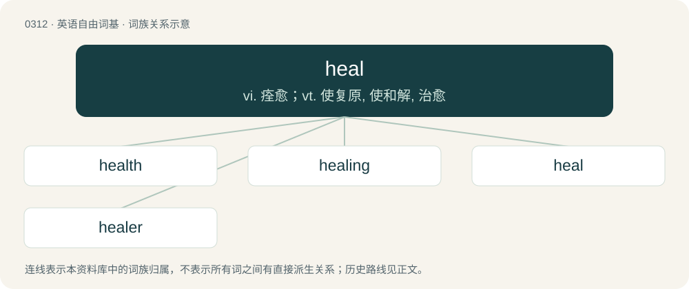

# 0353 · heal — vi. 痊愈；vt. 使复原, 使和解, 治愈

[总目录](../00_总目录_按常用程度.md)

**类型**：英语自由词基　｜　**来源语言**：见词源记录

## 核心含义与来源

- 核心含义：vi. 痊愈；vt. 使复原, 使和解, 治愈
- 英文含义：To make better from a disease, wound, etc.; to revive or cure.
- 词形：heal

**来源记录 1**（动词；To make better from a disease, wound, etc.; to revive or cure.）

From Middle English helen, from Old English hǣlan (“to heal, cure, save, greet, salute”), from Proto-West Germanic \*hailijan, from Proto-Germanic \*hailijaną (“to heal, make whole, save”), from Proto-Indo-European \*kéh₂ilos (“healthy, whole”). Derived from the adjective at hand in whole. Cognates Cognate with Scots hale, hail (“to heal”), Saterland Frisian heila, heilen (“to heal”), West Frisian hielje, Dutch helen (“to heal”), German heilen (“to heal”), Danish hele, Swedish hela (“to heal”), and further Russian цели́ть (celítʹ, “to heal”), Polish calić (“to save”), Czech celit (“to heal”), Serbo-Croatian céliti (“to heal”).

## 词族图

## 单词速览（常用到不常用）

| 单词 | 音标 | 释义 |
|---|---|---|
| [health](#w-1) | 英 /ˈhɛlθ/ | n. 健康, 卫生, 蓬勃, 健康状态；\[医\] 健康 |
| [healing](#w-2) | /ˈhiːlɪŋ/ | a. 治愈的, 恢复健康的；\[计\] 修复, 恢复 |
| [heal](#w-3) | /ˈhiːl/ | vi. 痊愈；vt. 使复原, 使和解, 治愈 |
| [healer](#w-4) | 英 /ˈhiːlə(ɹ)/；美 /ˈhilɚ/ | n. 医治者, 治疗物；\[医\] 治病者, 医生, 治病术土, 江湖医 |

## 逐词详解

### 1. health

**词性**：名词　｜　**音标**：英 /ˈhɛlθ/

**中文释义**：n. 健康, 卫生, 蓬勃, 健康状态；\[医\] 健康

**英文义项**：The state of being free from physical or psychological disease, illness, or malfunction; wellness. / A state of well-being or balance, often physical but sometimes also mental and social; the overall level of function of an organism from the cellular (micro) level to the social (macro) level.

**构词拆分**：heal + -th (abstract nominal suffix)

**词源与演化**：

Inherited from Middle English helthe, from Old English hǣlþ, from Proto-West Germanic \*hailiþu, from Proto-Germanic \*hailiþō, from \*hailaz + \*-iþō. Cognate with Old High German heilida. Analyzable as whole, hale, or heal + -th (abstract nominal suffix). More at heal. Doublet of wholth.

**例句**：

> The directors are concerned about the financial health of the project.

该用例对应义项：A state of well-being or balance, often physical but sometimes also mental and social; the overall level of function of an organism from the cellular (micro) level to the social (macro) level.

### 2. healing

**词性**：名词　｜　**音标**：/ˈhiːlɪŋ/

**中文释义**：a. 治愈的, 恢复健康的；\[计\] 修复, 恢复

**英文义项**：The process where the cells in the body regenerate and repair themselves. / An act of healing, as by a faith healer.

**构词拆分**：heal + -ing

**词源与演化**：

From Middle English heelinge, helynge, from Old English hǣling (“healing”), from Proto-Germanic \*hailingō (“healing”), from Proto-Germanic \*hailijaną (“to heal”), equivalent to heal + -ing. Cognate with West Frisian hieling (“healing”), Dutch heling (“healing”), German Heilung (“healing; cure”).

**例句**：

> Smallpox is a disease that leaves scars on the body after healing.

### 3. heal

**词性**：动词　｜　**音标**：/ˈhiːl/

**中文释义**：vi. 痊愈；vt. 使复原, 使和解, 治愈

**英文义项**：To make better from a disease, wound, etc.; to revive or cure. / To become better or healthy again.

**词源与演化**：

From Middle English helen, from Old English hǣlan (“to heal, cure, save, greet, salute”), from Proto-West Germanic \*hailijan, from Proto-Germanic \*hailijaną (“to heal, make whole, save”), from Proto-Indo-European \*kéh₂ilos (“healthy, whole”). Derived from the adjective at hand in whole. Cognates Cognate with Scots hale, hail (“to heal”), Saterland Frisian heila, heilen (“to heal”), West Frisian hielje, Dutch helen (“to heal”), German heilen (“to heal”), Danish hele, Swedish hela (“to heal”), and further Russian цели́ть (celítʹ, “to heal”), Polish calić (“to save”), Czech celit (“to heal”), Serbo-Croatian céliti (“to heal”).

**例句**：

> This bandage will help to heal your cut.

该用例对应义项：To make better from a disease, wound, etc.; to revive or cure.

### 4. healer

**词性**：名词　｜　**音标**：英 /ˈhiːlə(ɹ)/；美 /ˈhilɚ/

**中文释义**：n. 医治者, 治疗物；\[医\] 治病者, 医生, 治病术土, 江湖医

**英文义项**：One who heals, especially through faith. / Anything that heals; a medicine that heals some wound, injury, ailment, or disease.

**构词拆分**：heal + -er

**词源与演化**：

From Middle English helere, the agent noun of heal; analysed as heal + -er. Cognate with Dutch heler (“healer”), German Heiler (“healer”), Icelandic heilari (“healer”).

**例句**：

> The villagers sought help from a traditional healer.

该用例对应义项：One who heals, especially through faith.
