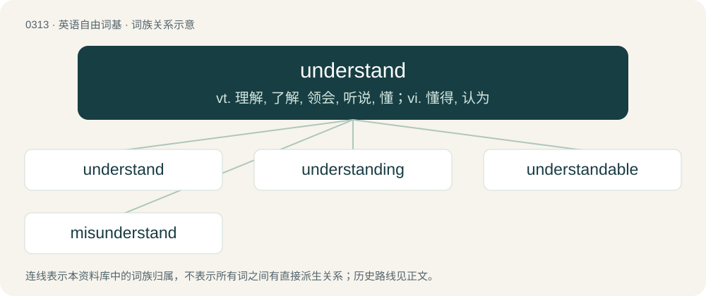

# 0354 · understand — vt. 理解, 了解, 领会, 听说, 懂；vi. 懂得, 认为

[总目录](../00_总目录_按常用程度.md)

**类型**：英语自由词基　｜　**来源语言**：见词源记录

## 核心含义与来源

- 核心含义：vt. 理解, 了解, 领会, 听说, 懂；vi. 懂得, 认为
- 英文含义：To know the meaning of; to parse or have parsed correctly; to comprehend.
- 词形：understand

**来源记录 1**（动词；To know the meaning of; to parse or have parsed correctly; to comprehend.）

From Middle English understanden, from Old English understandan (“to understand”), from Proto-West Germanic \*understandan (“to stand between, understand”), from Proto-Germanic \*understandaną (“to stand between, understand”), equivalent to Old English under- (“between, inter-”) + standan (“to stand”) (Modern English under- + stand). Cognate with Old Frisian understonda (“to understand, experience, learn”), Old High German understantan (“to understand”), Middle Danish understande (“to understand”). Compare also Saterland Frisian understunda, unnerstounde (“to dare, survey, measure”), Dutch onderstaan (“to undertake, presume”), German unterstehen (“to be subordinate”).

## 词族图

## 单词速览（常用到不常用）

| 单词 | 音标 | 释义 |
|---|---|---|
| [understand](#w-1) | 英 /ˌʌndəˈstænd/；美 /ˌʌndɚˈstænd/ | vt. 理解, 了解, 领会, 听说, 懂；vi. 懂得, 认为 |
| [understanding](#w-2) | 英 /ʌndəˈstandɪŋ/；美 /ˌʌndɚˈstændɪŋ/ | n. 理解, 谅解；\[法\] 协商, 协议, 谅解 |
| [understandable](#w-3) | /.ʌndəˈstændəbl/ | a. 可以理解的 |
| [misunderstand](#w-4) | 英 /mɪs.ʌn.də(ɹ)ˈstænd/ | vt. 误解, 误会 |

## 逐词详解

### 1. understand

**词性**：动词　｜　**音标**：英 /ˌʌndəˈstænd/；美 /ˌʌndɚˈstænd/

**中文释义**：vt. 理解, 了解, 领会, 听说, 懂；vi. 懂得, 认为

**英文义项**：To know the meaning of; to parse or have parsed correctly; to comprehend. / To know the meaning of.

**构词拆分**：under- + stand

**词源与演化**：

From Middle English understanden, from Old English understandan (“to understand”), from Proto-West Germanic \*understandan (“to stand between, understand”), from Proto-Germanic \*understandaną (“to stand between, understand”), equivalent to Old English under- (“between, inter-”) + standan (“to stand”) (Modern English under- + stand). Cognate with Old Frisian understonda (“to understand, experience, learn”), Old High German understantan (“to understand”), Middle Danish understande (“to understand”). Compare also Saterland Frisian understunda, unnerstounde (“to dare, survey, measure”), Dutch onderstaan (“to undertake, presume”), German unterstehen (“to be subordinate”).

**例句**：

> I understand that company policy says I can't get a refund, but can you make an exception?

该用例对应义项：To comprehend a fact or principle; to regard or come to regard a belief as such.

### 2. understanding

**词性**：名词　｜　**音标**：英 /ʌndəˈstandɪŋ/；美 /ˌʌndɚˈstændɪŋ/

**中文释义**：n. 理解, 谅解；\[法\] 协商, 协议, 谅解

**英文义项**：The act of one that understands or comprehends; the mental process of discernment of meaning. / Reason or intelligence; ability to grasp the full meaning of knowledge; ability to infer.

**构词拆分**：understand + -ing (gerund ending)

**词源与演化**：

From Middle English understandinge, understondinge, from Old English understanding (“intelligence, understanding”), from Proto-West Germanic \*undarstandingu, from Proto-Germanic \*understandingō, equivalent to understand + -ing (gerund ending). Cognate with Middle Dutch onderstaninge, Middle Low German understandinge, Middle High German understandunge.

**例句**：

> According to my understanding, the situation is quite perilous. I wonder if you see it this way, too.

该用例对应义项：Opinion, judgement, or outlook.

### 3. understandable

**词性**：形容词　｜　**音标**：/.ʌndəˈstændəbl/

**中文释义**：a. 可以理解的

**英文义项**：Capable of being understood; comprehensible. / Capable of being accepted or excused under the circumstances; permissible.

**构词拆分**：understand + -able

**词源与演化**：

From Middle English understondable, equivalent to understand + -able.

**例句**：

> I think that it's completely understandable if she turns down his offer.

### 4. misunderstand

**词性**：动词　｜　**音标**：英 /mɪs.ʌn.də(ɹ)ˈstænd/

**中文释义**：vt. 误解, 误会

**英文义项**：To understand incorrectly, while believing one has understood correctly.

**构词拆分**：mis- + understand

**词源与演化**：

From Middle English mys-understanden, equivalent to mis- + understand.

**例句**：

> To get the wrong end of the stick is to misunderstand something.
