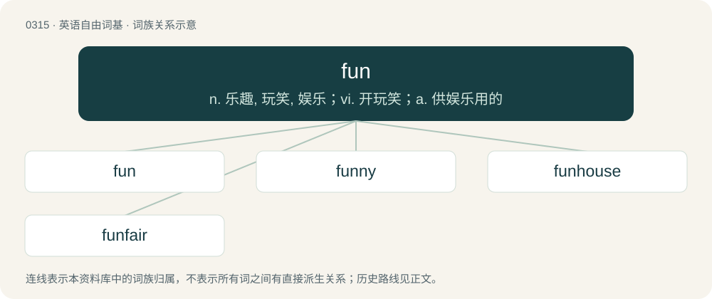

# 0356 · fun — n. 乐趣, 玩笑, 娱乐；vi. 开玩笑；a. 供娱乐用的

[总目录](../00_总目录_按常用程度.md)

**类型**：英语自由词基　｜　**来源语言**：见词源记录

## 核心含义与来源

- 核心含义：n. 乐趣, 玩笑, 娱乐；vi. 开玩笑；a. 供娱乐用的
- 英文含义：Amusement, enjoyment or pleasure.
- 词形：fun

**来源记录 1**（名词；Amusement, enjoyment or pleasure.）

From Middle English fonne, fon (“foolish, simple, silly”) or fonnen (“make a fool of”), from Middle English fonne (“a fool, dupe”), probably of North Germanic origin, related to Swedish fånig (“foolish”), Swedish fåne (“a fool”), from Old Norse fáni (“vain person, swaggerer”), but of unknown ultimate origin. Perhaps related to or influenced by fjäll (“rock, cliff, mountain”). Compare also English fumble, Norwegian Nynorsk fomme (“clumsy fool”). Compare also Norwegian fomme, fume (“a fool”). More at fon, fond. As a noun, fun is recorded from 1700, with a meaning “a cheat, trick, hoax”, from a verb fun meaning “to cheat, trick” (1680s). The meaning “diversion, amusement” dates to the 1720s. The older meaning is preserved in the phrase to make fun of (1737) and in usage of the adjective funny. The use of fun as adjective is newest and is due to reanalysis of the noun; this was incipient in the mid-19th century. Alternative etymology connected Middle English fonne with Old Frisian fonna, fone, fomne, variant forms of fāmne, fēmne (“young woman, virgin”), from Proto-West Germanic \*faimnijā, from Proto-Germanic \*faimnijǭ (“maiden”), from Proto-Indo-European \*peymen- (“girl”), \*poymen- (“breast milk”). If so, then cognate with Old English fǣmne (“maid, virgin, damsel, bride”), West Frisian famke (“girl”), Saterland Frisian fone, fon (“woman, maid, servant," also "weakling, simpleton”).

## 词族图

## 单词速览（常用到不常用）

| 单词 | 音标 | 释义 |
|---|---|---|
| [fun](#w-1) | 英 /fʌn/ | n. 乐趣, 玩笑, 娱乐；vi. 开玩笑；a. 供娱乐用的 |
| [funny](#w-2) | 英 /ˈfʌni/ | a. 好笑的, 有趣的, 滑稽的；n. 滑稽人物 |
| [funhouse](#w-3) | 美 /ˈfʌnˌhaʊs/ | 恐布欢乐屋 |
| [funfair](#w-4) |  | n. 游乐园, 游乐场 |

## 逐词详解

### 1. fun

**词性**：形容词　｜　**音标**：英 /fʌn/

**中文释义**：n. 乐趣, 玩笑, 娱乐；vi. 开玩笑；a. 供娱乐用的

**英文义项**：Enjoyable or amusing. / Whimsical or flamboyant.

**词源与演化**：

From Middle English fonne, fon (“foolish, simple, silly”) or fonnen (“make a fool of”), from Middle English fonne (“a fool, dupe”), probably of North Germanic origin, related to Swedish fånig (“foolish”), Swedish fåne (“a fool”), from Old Norse fáni (“vain person, swaggerer”), but of unknown ultimate origin. Perhaps related to or influenced by fjäll (“rock, cliff, mountain”). Compare also English fumble, Norwegian Nynorsk fomme (“clumsy fool”). Compare also Norwegian fomme, fume (“a fool”). More at fon, fond. As a noun, fun is recorded from 1700, with a meaning “a cheat, trick, hoax”, from a verb fun meaning “to cheat, trick” (1680s). The meaning “diversion, amusement” dates to the 1720s. The older meaning is preserved in the phrase to make fun of (1737) and in usage of the adjective funny. The use of fun as adjective is newest and is due to reanalysis of the noun; this was incipient in the mid-19th century. Alternative etymology connected Middle English fonne with Old Frisian fonna, fone, fomne, variant forms of fāmne, fēmne (“young woman, virgin”), from Proto-West Germanic \*faimnijā, from Proto-Germanic \*faimnijǭ (“maiden”), from Proto-Indo-European \*peymen- (“girl”), \*poymen- (“breast milk”). If so, then cognate with Old English fǣmne (“maid, virgin, damsel, bride”), West Frisian famke (“girl”), Saterland Frisian fone, fon (“woman, maid, servant," also "weakling, simpleton”).

**例句**：

> This year's fashion style is much more fun than recent seasons.

该用例对应义项：Whimsical or flamboyant.

### 2. funny

**词性**：形容词　｜　**音标**：英 /ˈfʌni/

**中文释义**：a. 好笑的, 有趣的, 滑稽的；n. 滑稽人物

**英文义项**：Amusing; humorous; comical. / Strange or unusual, often in an unpleasant way.

**构词拆分**：fun + -y

**词源与演化**：

From fun + -y.

**例句**：

> I know you'll enjoy chatting with her — she's really funny and smart.

该用例对应义项：Amusing; humorous; comical.

### 3. funhouse

**词性**：名词　｜　**音标**：美 /ˈfʌnˌhaʊs/

**中文释义**：恐布欢乐屋

**英文义项**：A structure, usually at a circus or amusement park, enclosing several interactive attractions such as distorting mirrors, ramps, slides, stairs, rotating barrel slides, etc., that usually do not involve performers.

**构词拆分**：fun + house

**词源与演化**：

From fun + house.

### 4. funfair

**词性**：名词

**中文释义**：n. 游乐园, 游乐场

**英文义项**：A travelling amusement park.

**构词拆分**：fun + fair

**词源与演化**：

From fun + fair.

**例句**：

> We went to the funfair yesterday and had a go on the big wheel.
