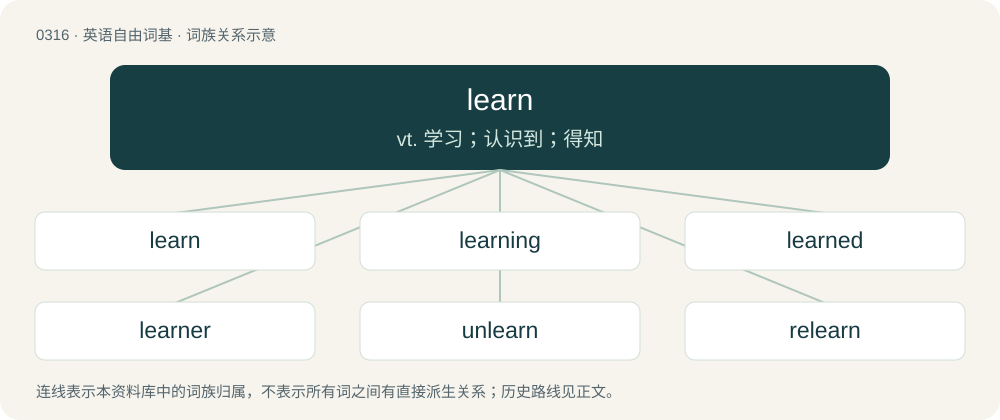

# 0358 · learn — vt. 学习；认识到；得知

[总目录](../00_总目录_按常用程度.md)

**类型**：英语自由词基　｜　**来源语言**：见词源记录

## 核心含义与来源

- 核心含义：vt. 学习；认识到；得知
- 英文含义：To acquire, or attempt to acquire knowledge or an ability to do something.
- 词形：learn

**来源记录 1**（动词；To acquire, or attempt to acquire knowledge or an ability to do something.）

From Middle English lernen (“to learn", also, "to teach"”), from Old English leornian (“to learn", rarely also, "to teach”), from Proto-West Germanic \*liʀnōn, from Proto-Germanic \*lizaną, from Proto-Indo-European \*(le-)lóys-e, stative from the root \*leys- (“track, furrow, trace, trail”). The spelling with ⟨ea⟩ is of Early Modern English origin and reflects a lengthening of /ɛ~e/ to /eː/ before /rn/ in Late Old English or Early Middle English, then later lowering to /ɛː/; the modern pronunciation reflects still later reshortening. Cognate with Old Frisian lernia, lerna (“to learn”), Middle Low German lernen (“to learn", also, "to teach”), Middle Dutch leernen (“to learn", also, "to teach”) (whence Dutch lernen (“to study scripture”)), German lernen (“to learn”). See also lore and lear.

## 词族图

## 单词速览（常用到不常用）

| 单词 | 音标 | 释义 |
|---|---|---|
| [learn](#w-1) | 英 /lɜːn/；美 /lɝn/ | vt. 学习；认识到；得知 |
| [learning](#w-2) | 英 /ˈlɜːnɪŋ/；美 /ˈlɝnɪŋ/ | n. 学问, 学识, 学习；\[计\] 学习 |
| [learned](#w-3) | 英 /ˈlɜːnɪd/；美 /ˈlɝnɪd/ | a. 有学问的, 学术上的；learn的过去式和过去分词 |
| [learner](#w-4) | 英 /ˈlɜɹnəɹ/ | n. 学习者, 初学者 |
| [unlearn](#w-5) | 英 /ʌnˈləːn/；美 /ʌnˈlɝn/ | vt. 使忘掉, 从脑中扫除掉, 抛掉以前的想法 |
| [relearn](#w-6) | 英 /ɹiːˈləːn/ | v. 再学习 |

## 逐词详解

### 1. learn

**词性**：动词　｜　**音标**：英 /lɜːn/；美 /lɝn/

**中文释义**：vt. 学习；认识到；得知

**英文义项**：To acquire, or attempt to acquire knowledge or an ability to do something. / To attend a course or other educational activity.

**词源与演化**：

From Middle English lernen (“to learn", also, "to teach"”), from Old English leornian (“to learn", rarely also, "to teach”), from Proto-West Germanic \*liʀnōn, from Proto-Germanic \*lizaną, from Proto-Indo-European \*(le-)lóys-e, stative from the root \*leys- (“track, furrow, trace, trail”). The spelling with ⟨ea⟩ is of Early Modern English origin and reflects a lengthening of /ɛ~e/ to /eː/ before /rn/ in Late Old English or Early Middle English, then later lowering to /ɛː/; the modern pronunciation reflects still later reshortening. Cognate with Old Frisian lernia, lerna (“to learn”), Middle Low German lernen (“to learn", also, "to teach”), Middle Dutch leernen (“to learn", also, "to teach”) (whence Dutch lernen (“to study scripture”)), German lernen (“to learn”). See also lore and lear.

**例句**：

> Give him a clip round the ear. That'll learn him!

该用例对应义项：To teach.

### 2. learning

**词性**：名词　｜　**音标**：英 /ˈlɜːnɪŋ/；美 /ˈlɝnɪŋ/

**中文释义**：n. 学问, 学识, 学习；\[计\] 学习

**英文义项**：An act in which something is learned. / Accumulated knowledge.

**构词拆分**：learn + -ing

**词源与演化**：

From Middle English lernyng, lernynge, from Old English leornung (“learning, study”), from Proto-West Germanic \*liʀnungu (“learning”), equivalent to learn + -ing. Cognate with Old Saxon lernunga, German Lernung.

**例句**：

> The department head was also a scholar of great learning.

该用例对应义项：Accumulated knowledge.

### 3. learned

**词性**：形容词　｜　**音标**：英 /ˈlɜːnɪd/；美 /ˈlɝnɪd/

**中文释义**：a. 有学问的, 学术上的；learn的过去式和过去分词

**英文义项**：Having much learning, knowledgeable, erudite; highly educated. / A courteous description used in various ways to refer to lawyers or judges.

**构词拆分**：learn + -ed

**词源与演化**：

From Middle English lerned, lernd, lernyd, equivalent to learn + -ed, which replaced the earlier lered (“taught”), from Old English (ġe)lǣred, past participle of lǣran (“to teach”). Learn formerly had the meaning “to teach”, which is now found only in nonstandard speech, as well as its standard meaning of “to learn”.

**例句**：

> All I need to know about life, I learned from a snowman.

### 4. learner

**词性**：名词　｜　**音标**：英 /ˈlɜɹnəɹ/

**中文释义**：n. 学习者, 初学者

**英文义项**：One who is learning; one receiving instruction.

**构词拆分**：learn + -er

**词源与演化**：

From learn + -er.

**例句**：

> Cambridge University Press has released a new series aimed at young learners with epilepsy.

该用例对应义项：One who is learning; one receiving instruction.

### 5. unlearn

**词性**：动词　｜　**音标**：英 /ʌnˈləːn/；美 /ʌnˈlɝn/

**中文释义**：vt. 使忘掉, 从脑中扫除掉, 抛掉以前的想法

**英文义项**：To discard the knowledge of. / To break a habit.

**构词拆分**：By surface analysis, un- + learn

**词源与演化**：

From Middle English unlernen. By surface analysis, un- + learn.

**例句**：

> Playing the keyboard is like riding a bike, you cannot unlearn it.

### 6. relearn

**词性**：动词　｜　**音标**：英 /ɹiːˈləːn/

**中文释义**：v. 再学习

**英文义项**：To learn (something) again.

**构词拆分**：re- + learn

**词源与演化**：

From re- + learn.

**例句**：

> I had to relearn how to swim properly.

该用例对应义项：To learn (something) again.
