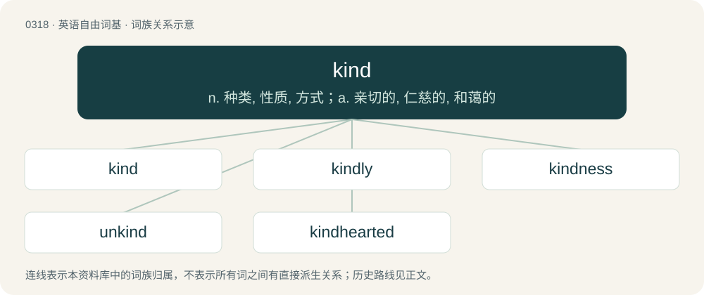

# 0360 · kind — n. 种类, 性质, 方式；a. 亲切的, 仁慈的, 和蔼的

[总目录](../00_总目录_按常用程度.md)

**类型**：英语自由词基　｜　**来源语言**：见词源记录

## 核心含义与来源

- 核心含义：n. 种类, 性质, 方式；a. 亲切的, 仁慈的, 和蔼的
- 英文含义：A type, race or category; a group of entities that have common characteristics such that they may be grouped together.
- 词形：kind

**多个词源／构词路径**：同一拼写可能有不同来源；以下按词性和含义分别列出。

**来源记录 1**（名词；A type, race or category; a group of entities that have common characteristics such that they may be grouped together.）

From Middle English kynde, kinde, from Old English cynd, ġecynd (“inherent nature, disposition, kind, gender, generation, race”), from Proto-West Germanic \*kundi, from Proto-Germanic \*kinþiz, related to Proto-Germanic \*kunją (“race, kin”) and Old English cennan (“to bear, give birth”). Cognate with Old High German gikunt (“nature, kind”), Icelandic kind (“race, species, kind”). Doublet of gens, genesis, and jati. See also kin.

**来源记录 2**（形容词；Having a benevolent, courteous, friendly, generous, gentle, liberal, sympathetic, or warm-hearted nature or disposition, marked by consideration for – and service to – others.）

From Middle English kynde, kinde, from Old English cynde, ġecynde (“innate, natural, native”), from Old English cynd, ġecynd (“nature, kind”).

## 词族图

## 单词速览（常用到不常用）

| 单词 | 音标 | 释义 |
|---|---|---|
| [kind](#w-1) | /kaɪnd/ | n. 种类, 性质, 方式；a. 亲切的, 仁慈的, 和蔼的 |
| [kindly](#w-2) | 英 /ˈkaɪn(d)li/ | a. 和蔼的, 温和的, 爽快的；adv. 温和地, 亲切地 |
| [kindness](#w-3) | /ˈkaɪnd.nəs/ | n. 仁慈, 亲切, 和蔼 |
| [unkind](#w-4) | 英 /ʌnˈkaɪnd/ | a. 不仁慈的, 不亲切的 |
| [kindhearted](#w-5) | /ˈkaindˈhɑːtid/ | a. 亲切的, 好心肠的, 仁慈的 |

## 逐词详解

### 1. kind

**词性**：名词　｜　**音标**：/kaɪnd/

**中文释义**：n. 种类, 性质, 方式；a. 亲切的, 仁慈的, 和蔼的

**英文义项**：A type, race or category; a group of entities that have common characteristics such that they may be grouped together. / A makeshift or otherwise atypical specimen.

**词源与演化**：

From Middle English kynde, kinde, from Old English cynd, ġecynd (“inherent nature, disposition, kind, gender, generation, race”), from Proto-West Germanic \*kundi, from Proto-Germanic \*kinþiz, related to Proto-Germanic \*kunją (“race, kin”) and Old English cennan (“to bear, give birth”). Cognate with Old High German gikunt (“nature, kind”), Icelandic kind (“race, species, kind”). Doublet of gens, genesis, and jati. See also kin.

**例句**：

> The kind of any primitive data type is \*, corresponding to a nullary constructor.

该用例对应义项：The type of a type constructor or a higher-order type operator.

### 2. kindly

**词性**：形容词　｜　**音标**：英 /ˈkaɪn(d)li/

**中文释义**：a. 和蔼的, 温和的, 爽快的；adv. 温和地, 亲切地

**英文义项**：Having a kind personality; kind, warmhearted, sympathetic. / Favourable, gentle, pleasant, tidy, auspicious, beneficent.

**构词拆分**：kind + -ly

**词源与演化**：

From Middle English kyndely, kyndeliche, from Old English cyndelīċ (“natural, kindly”); equivalent to kind + -ly.

**例句**：

> A kindly old man sits on the park bench every afternoon feeding pigeons.

该用例对应义项：Having a kind personality; kind, warmhearted, sympathetic.

### 3. kindness

**词性**：名词　｜　**音标**：/ˈkaɪnd.nəs/

**中文释义**：n. 仁慈, 亲切, 和蔼

**英文义项**：The state of being kind. / An instance of kind or charitable behaviour.

**构词拆分**：kind + -ness

**词源与演化**：

From Middle English kyndenesse, equivalent to kind + -ness.

**例句**：

> i'm going to turn a blind eye to this misdemeanour, out of the kindness of my heart.

该用例对应义项：An instance of kind or charitable behaviour.

### 4. unkind

**词性**：形容词　｜　**音标**：英 /ʌnˈkaɪnd/

**中文释义**：a. 不仁慈的, 不亲切的

**英文义项**：Lacking kindness, sympathy, benevolence, gratitude, or similar; cruel, harsh or unjust; ungrateful.

**构词拆分**：un- + kind

**词源与演化**：

Inherited from Middle English unkynde; equivalent to un- + kind.

**例句**：

> A thoughtless and unkind remark.

该用例对应义项：lacking kindness

### 5. kindhearted

**词性**：形容词　｜　**音标**：/ˈkaindˈhɑːtid/

**中文释义**：a. 亲切的, 好心肠的, 仁慈的

**英文义项**：Having an innately kind disposition or character.

**构词拆分**：kind + hearted

**词源与演化**：

From kind + hearted.

**例句**：

> A generous and kindhearted teacher.

该用例对应义项：having or proceeding from an innately kind disposition
