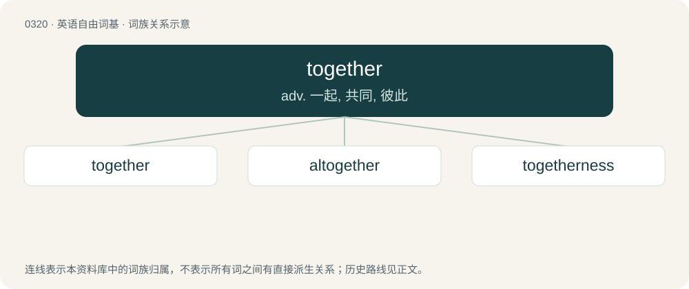

# 0363 · together — adv. 一起, 共同, 彼此

[总目录](../00_总目录_按常用程度.md)

**类型**：英语自由词基　｜　**来源语言**：见词源记录

## 核心含义与来源

- 核心含义：adv. 一起, 共同, 彼此
- 英文含义：At the same time, in the same place; in close association or proximity.
- 词形：together

**来源记录 1**（副词；At the same time, in the same place; in close association or proximity.）

From Late Middle English together, from earlier togedere, togadere, from Old English tōgædere (“together”), from Proto-West Germanic \*tōgadura, \*tegadura, from Proto-Germanic \*tō (“to”) + \*gadar (“together”), from Proto-Indo-European \*gʰedʰ- (“to unite, keep”), equivalent to to-₂ + gather. Cognate with Scots thegither (“together”), Old Frisian togadera (whence West Frisian togearre (“together”)), Dutch tegader (“together”), Middle Low German tōgāder (“together”), Middle High German zegater (“together”). Compare also Old English ætgædere (“together”), Old English ġeador (“together”). More at gather.

## 词族图

## 单词速览（常用到不常用）

| 单词 | 音标 | 释义 |
|---|---|---|
| [together](#w-1) | 英 /tʊˈɡɛð.ə/；美 /tʊˈɡɛðɚ/ | adv. 一起, 共同, 彼此 |
| [altogether](#w-2) | 英 /ɔːl.tʊˈɡɛð.ə(ɹ)/；美 /ɔl.tuˈɡɛð.ɚ/ | adv. 完全地, 总而言之 |
| [togetherness](#w-3) | /təˈ^eðənis/ | n. 和睦, 友好 |

## 逐词详解

### 1. together

**词性**：形容词　｜　**音标**：英 /tʊˈɡɛð.ə/；美 /tʊˈɡɛðɚ/

**中文释义**：adv. 一起, 共同, 彼此

**英文义项**：Coherent; well-organized.

**构词拆分**：to-₂ + gather

**词源与演化**：

From Late Middle English together, from earlier togedere, togadere, from Old English tōgædere (“together”), from Proto-West Germanic \*tōgadura, \*tegadura, from Proto-Germanic \*tō (“to”) + \*gadar (“together”), from Proto-Indo-European \*gʰedʰ- (“to unite, keep”), equivalent to to-₂ + gather. Cognate with Scots thegither (“together”), Old Frisian togadera (whence West Frisian togearre (“together”)), Dutch tegader (“together”), Middle Low German tōgāder (“together”), Middle High German zegater (“together”). Compare also Old English ætgædere (“together”), Old English ġeador (“together”). More at gather.

**用法示例／搭配（非完整句）**：

> He’s really together.

该用例对应义项：Coherent; well-organized.

### 2. altogether

**词性**：副词　｜　**音标**：英 /ɔːl.tʊˈɡɛð.ə(ɹ)/；美 /ɔl.tuˈɡɛð.ɚ/

**中文释义**：adv. 完全地, 总而言之

**英文义项**：Completely, wholly, or without exception. / On the whole; with everything considered.

**构词拆分**：al- (“all”) + together

**词源与演化**：

From Middle English altogeder, altogedere, equivalent to al- (“all”) + together. Cognate with Scots awthegither (“altogether”), Middle High German alzegater (“altogether”), Dutch altegaar. Compare also Old English ealġeador, eallġeador (“altogether”), West Frisian allegearre (“altogether”). More at together. The noun sense (nakedness): was popularized in George du Maurier's 1894 novel Trilby.

**例句**：

> Police did not seem altogether satisfied with my alibi.

该用例对应义项：Completely, wholly, or without exception.

### 3. togetherness

**词性**：名词　｜　**音标**：/təˈ^eðənis/

**中文释义**：n. 和睦, 友好

**英文义项**：The state or quality of being together. / The result or product of being together.

**构词拆分**：together + -ness

**词源与演化**：

From together + -ness.

**例句**：

> Quarantining together for two weeks might just feel like a little too much togetherness.
