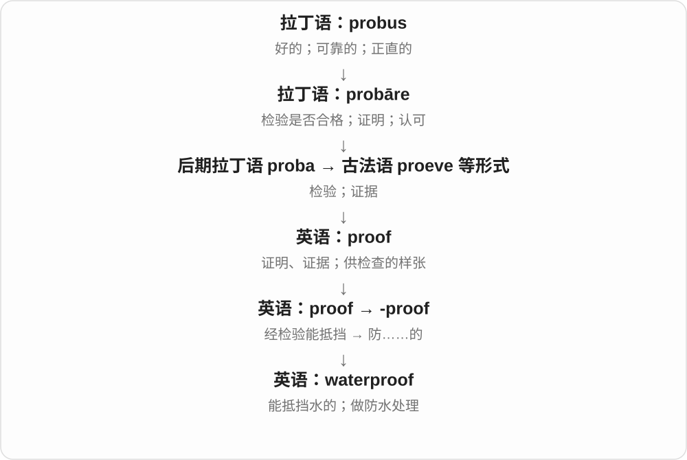
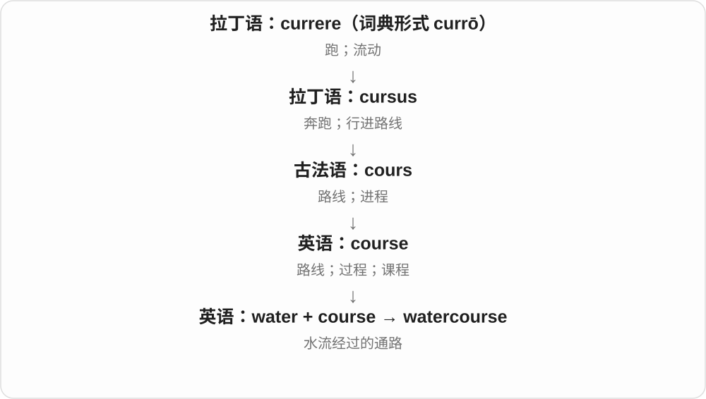

# 0363 · water — 水；供水；流泪、流口水及比喻

[逐词精讲目录](../00_逐词精讲目录.md) · [总目录](../00_总目录_按常用程度.md)

## 核心词根与来源

water 名词接古英语 wæter，动词也有古英语前身。复合词不能一律画成一条历史直线：各部分先存在，再组合；watershed 仿译德语而来，watercolour 两种英美拼写同义。

**WATER：先看水从哪来、在哪、做什么**

来源分海水雨水融水，位置分水下水边，流向形成地形；水印、严密论证、诱人口水再走向比喻。

- **基础性质和位置**：water · watery · waterless · underwater
- **来源、过程和用途**：freshwater · seawater · saltwater · rainwater · groundwater · stormwater · floodwater · meltwater · wastewater · bathwater · rosewater
- **水边位置与地形**：waterfront · waterside · waterline · waterfall · watershed · headwaters · waterway · watercourse · backwater · clearwater
- **设施、交通与生物**：breakwater · waterworks · watercraft · waterfowl · watercress · waterhole · watermelon
- **标记、绘画和比喻**：watermark · watercolour · watertight · waterproof · waterborne · mouthwatering
- **water → waters：水体、水域与浇水**：water · waters
- **water → watered、watering：水与供水、浇灌**：water · watered · watering
- **waterlogged 的进水、浸水画面**：water · waterlogged
- **otter：远处同族的水中动物名**：otter · otters
- **水的远古同源词：俄语 voda + -ka → vodka**：vodka
- **盖尔语水 + 生命 → whiskey、whisky**：whiskey · whisky

## 词形与演化规律

water → watery、waterless；水源与使用状态相邻，滨水位置、流域地形、设施交通、动植物、标记绘画及比喻分组。watered、watering 在基础词说明，不另堆常规词形。

本族名词、动词各有古英语旧形式，复数与第三人称形态重合。

古英语已有相关动词，现代 ing 说过程，也可作修饰用途的形式。

较早形容词 waterlogged 出现在船只进水、沉重难行的语境，waterlog 动词较晚，可能由它逆构；现代规则拆分与记录先后分清。

otter 接古英语 otr、otor，上溯重建的日耳曼、印欧语形式，有水中动物的命名背景，与 water 远同族；不是现代英语 water 改几个字母产生。

vodka 借俄语 vodka，voda 水配指小词尾 -ka。voda 与英语 water 是远处同源关系，英语不是把 water 改拼加 -ka；小水是名称来历，不是现代饮料成分定义。

酒名接盖尔语 uisge beatha 生命之水，uisge、uisce 与英语 water 远处同源；现代词形经长期变化、缩短。whiskey 与 whisky 是拼写传统，不能用有无 e 规定全球无例外分类。

## 单词速览（按词族由简到繁）

同一基础词的相关扩展放在一起，先读基础形式，再读扩展；各组之间优先读常用的。具体词源关系见各词讲解。

| 单词 | 音标 | 核心意思 |
|---|---|---|
| [water](#w-1) | 英 /ˈwɔːtə/；美 /ˈwɔːtər/、/ˈwɑːtər/ | 水；浇水；流泪、流口水等 |
| [waters](#w-50) | 英 /ˈwɔːtəz/；美 /ˈwɔːtərz/、/ˈwɑːtərz/ | 水域、大片水体〔复数用法〕；浇水〔第三人称单数〕 |
| [vodka](#w-56) | 英 /ˈvɒdkə/；美 /ˈvɑːdkə/ | 伏特加〔一种蒸馏酒〕 |
| [watering](#w-51) | 英 /ˈwɔːtərɪŋ/；美 /ˈwɔːtərɪŋ/，也读 /ˈwɑːtərɪŋ/ | 浇水、供水；正在流泪、流口水等〔按语境〕 |
| [waterfront](#w-3) | 英 /ˈwɔːtəfrʌnt/；美 /ˈwɔːtərfrʌnt/ | 滨水地带；滨水区 |
| [waterproof](#w-4) | 英 /ˈwɔːtəpruːf/；美 /ˈwɔːtərpruːf/ | 防水的；做防水处理 |
| [waterfall](#w-5) | 英 /ˈwɔːtəfɔːl/；美 /ˈwɔːtərfɔːl/ | 瀑布；瀑布式倾泻 |
| [watershed](#w-6) | 英 /ˈwɔːtəʃed/；美 /ˈwɔːtərʃed/ | 分水岭；流域〔尤美式〕；转折点 |
| [watermelon](#w-10) | 英 /ˈwɔːtəmelən/；美 /ˈwɔːtərmelən/ | 西瓜 |
| [watered](#w-52) | 英 /ˈwɔːtəd/；美 /ˈwɔːtərd/〔也见 /ˈwɑːtərd/〕 | 浇了水、加了水；water 的过去式、过去分词 |
| [watery](#w-13) | 英 /ˈwɔːtəri/；美 /ˈwɔːtəri/、/ˈwɑːtəri/ | 水汪汪的；稀薄的；淡而无味的 |
| [waterway](#w-14) | 英 /ˈwɔːtəweɪ/；美 /ˈwɔːtərweɪ/ | 水路；航道 |
| [watermark](#w-21) | 英 /ˈwɔːtəmɑːk/；美 /ˈwɔːtərmɑːrk/ | 水印；加水印 |
| [watercolour](#w-23) | 英 /ˈwɔːtəkʌlə/；美 /ˈwɔːtərkʌlər/ | 水彩颜料；水彩画〔美式常写 watercolor〕 |
| [waterfowl](#w-25) | 英 /ˈwɔːtəfaʊl/；美 /ˈwɔːtərfaʊl/ | 水禽；常在水上生活的鸟类 |
| [watertight](#w-27) | 英 /ˈwɔːtətaɪt/；美 /ˈwɔːtərtaɪt/ | 不漏水的；严密无漏洞的 |
| [waterworks](#w-28) | 英 /ˈwɔːtəwɜːks/；美 /ˈwɔːtərwɜːrks/ | 供水设施、系统；哭泣〔口语比喻〕 |
| [headwaters](#w-30) | 英 /ˈhedwɔːtəz/；美 /ˈhedwɔːtərz/ | 河流源头；上游源流 |
| [waterside](#w-32) | 英 /ˈwɔːtəsaɪd/；美 /ˈwɔːtərsaɪd/ | 水边；滨水的 |
| [waterline](#w-35) | 英 /ˈwɔːtəlaɪn/；美 /ˈwɔːtərlaɪn/ | 水线；船体与水面相交的线；水位痕 |
| [watercraft](#w-37) | 英 /ˈwɔːtəkrɑːft/；美 /ˈwɔːtərkræft/ | 水上交通工具；船艇；水上技能〔另义〕 |
| [watercress](#w-39) | 英 /ˈwɔːtəkres/；美 /ˈwɔːtərkres/ | 西洋菜；豆瓣菜 |
| [waterborne](#w-40) | 英 /ˈwɔːtəbɔːn/；美 /ˈwɔːtərbɔːrn/ | 由水传播、运载的；水上的 |
| [mouthwatering](#w-41) | 英 /ˈmaʊθwɔːtərɪŋ/；美 /ˈmaʊθwɔːtərɪŋ/ | 令人垂涎的；诱人的 |
| [watercourse](#w-44) | 英 /ˈwɔːtəkɔːs/；美 /ˈwɔːtərkɔːrs/ | 水道；河道 |
| [waterhole](#w-46) | 英 /ˈwɔːtəhəʊl/；美 /ˈwɔːtərhoʊl/ | 水潭；动物饮水处 |
| [waterless](#w-49) | 英 /ˈwɔːtələs/；美 /ˈwɔːtərləs/ | 无水的；缺水的；不用水的 |
| [underwater](#w-2) | 英 /ˌʌndəˈwɔːtə/；美 /ˌʌndərˈwɔːtər/ | 在水下的；在水下 |
| [freshwater](#w-7) | 英 /ˈfreʃwɔːtə/；美 /ˈfreʃwɔːtər/ | 淡水；淡水的 |
| [groundwater](#w-8) | 英 /ˈɡraʊndwɔːtə/；美 /ˈɡraʊndwɔːtər/ | 地下水 |
| [wastewater](#w-9) | 英 /ˈweɪstwɔːtə/；美 /ˈweɪstwɔːtər/ | 废水；污水 |
| [seawater](#w-15) | 英 /ˈsiːwɔːtə/；美 /ˈsiːwɔːtər/ | 海水 |
| [clearwater](#w-16) | 构词参考读法：英 /ˈklɪəwɔːtə/；美 /ˈklɪrwɔːtər/ | 清水型的〔河流〕 |
| [saltwater](#w-17) | 英 /ˈsɔːltwɔːtə/；美 /ˈsɔltˌwɔtər/ | 咸水的；海水的；咸水 |
| [rainwater](#w-19) | 英 /ˈreɪnwɔːtə/；美 /ˈreɪnwɔːtər/ | 雨水 |
| [backwater](#w-26) | 英 /ˈbækwɔːtə/；美 /ˈbækwɔːtər/ | 回水区；闭塞落后的地方〔比喻〕 |
| [stormwater](#w-29) | 英 /ˈstɔːmwɔːtə/；美 /ˈstɔːrmwɔːtər/ | 雨水径流；暴雨形成的地表来水 |
| [breakwater](#w-31) | 英 /ˈbreɪkwɔːtə/；美 /ˈbreɪkwɔːtər/ | 防波堤；消浪结构 |
| [rosewater](#w-42) | 英 /ˈrəʊzwɔːtə/；美 /ˈroʊzwɔːtər/ | 玫瑰水；带玫瑰香气的用水、制品 |
| [bathwater](#w-45) | 英 /ˈbɑːθwɔːtə/；美 /ˈbæθwɔːtər/ | 洗澡水 |
| [floodwater](#w-47) | 英 /ˈflʌdwɔːtə/；美 /ˈflʌdwɔːtər/ | 洪水；泛滥积水 |
| [meltwater](#w-48) | 英 /ˈmeltwɔːtə/；美 /ˈmeltwɔːtər/ | 融水；冰雪融化形成的水 |
| [whiskey](#w-57) | 英、美 /ˈwɪski/ | 威士忌〔一种谷物蒸馏酒；whisky 的拼写变体〕 |
| [whisky](#w-58) | 英、美 /ˈwɪski/ | 威士忌〔whiskey 的拼写变体〕 |
| [otter](#w-54) | 英 /ˈɒtə/；美 /ˈɑtɚ/ | 水獭 |
| [otters](#w-55) | 英 /ˈɒtəz/；美 /ˈɑtɚz/ | 水獭〔复数〕 |
| [waterlogged](#w-53) | 英 /ˈwɔːtəlɒɡd/；美 /ˈwɔːtərlɑːɡd/ | 浸透水的、积水严重的；进水后沉重难动的 |

## 逐词讲解

### 1. water — 水；浇水；流泪、流口水等

**音标**：英 /ˈwɔːtə/；美 /ˈwɔːtər/、/ˈwɑːtər/

**先抓住这个画面**

同样是水，看它在哪、从哪来、在做什么，词义就跟着展开。

**怎么拆**

名词接古英语 wæter，动词有古英语 wæterian 的前身；两者历史相关，不必说直到现代才临时把名词改作动词。

**怎么变成今天的意思**

**古英语 wæter → 中古英语 water**  
水

↓

**英语 water；动词也承接古英语 wæterian**  
水；浇水、供水；流泪、流口水等

drink water 喝水，water the plants 浇花，my eyes are watering 眼睛流泪。water 通常不可数；餐馆点 two waters 可省说两份、两瓶水。watered 是过去式，watering 是分词。

**常见搭配与例句**

a glass of water；water the plants；running water；make your mouth water。

> Please water the plants while I am away.

我不在时，请给植物浇水。

> The smell of fresh bread made my mouth water.

新鲜面包的香味让我直流口水。

**别混淆**

water 是物质名，a water 往往需要份量、种类等特别语境；water the garden 不等于给花园喝一瓶饮料。

### 2. waters — 水域、大片水体〔复数用法〕；浇水〔第三人称单数〕

**音标**：英 /ˈwɔːtəz/；美 /ˈwɔːtərz/、/ˈwɑːtərz/

**先抓住这个画面**

water 把水当作总体；waters 常把某片海、湖的水域作为场景来谈。把水给到植物等对象，动词也写 waters。

**怎么拆**

water + -s，词尾读 /z/。名词继承古英语 wæter，动词有 wæterian 的旧形；现代水域复数和给水动作按各自名动词用途解释。

**怎么变成今天的意思**

**古英语 wæter、wæterian → water 名动词**  
水；给水、浇水

↓

**water + -s → waters**  
水域、大片水体；单数主语浇水

coastal waters 沿海水域；calm waters 平静水面；waters the plants 给植物浇水。

**常见搭配与例句**

waters around the island；waters the garden each morning。

> The boat moved into calmer waters near the island.

船驶入岛旁较平静的水域。

> She waters the plants every morning.

她每天早晨给植物浇水。

**别混淆**

一般喝水说 water，通常不可数；waters 多用于地理、景色中的水域。She waters the plants 中则是动词，让植物得到水。

### 3. vodka — 伏特加〔一种蒸馏酒〕

**音标**：英 /ˈvɒdkə/；美 /ˈvɑːdkə/

**先抓住这个画面**

vodka 是酒名，中文通常音译伏特加。它的俄语名称原来像在说“小水”，这是词名的历史趣味，今天这个词实际指一种酒。

**怎么拆**

借俄语 vodka：voda 水 + 指小词尾 -ka。voda 与英语 water 远处同接水的印欧词族；现代英语不是把 water 加 -ka 来构造这个词。

**怎么变成今天的意思**

**俄语 voda 水 + -ka 指小 → vodka**  
水的名称参与酒类命名，是这条语言的命名方式

↓

**俄语 vodka → 英语 vodka**  
英语整体借入酒名，与 water 保留远古同源比较关系

a bottle of vodka 是一瓶伏特加；vodka production 是伏特加生产；the word vodka 是 vodka 这个词。

**常见搭配与例句**

a bottle of vodka；vodka production；the word vodka。

> The label identifies the drink as vodka.

标签把这种饮品标为伏特加。

> The exhibition explains the history of vodka production.

展览介绍了伏特加生产的历史。

**别混淆**

词源的小水帮助记名字，现代含义则是酒。water 与 vodka 的联系是早期词族分成不同语言后，再有俄语酒名被英语借入。

### 4. watering — 浇水、供水；正在流泪、流口水等〔按语境〕

**音标**：英 /ˈwɔːtərɪŋ/；美 /ˈwɔːtərɪŋ/，也读 /ˈwɑːtərɪŋ/

**先抓住这个画面**

把水送给植物，是 watering the plants；眼睛自己出水，也能说 eyes watering。都是围绕水出现、流动的不同场景。

**怎么拆**

water 的名词承古英语 wæter，相关供水动词古英语已有。现代 water 加 -ing，形成动作过程、活动名和用途修饰语。

**怎么变成今天的意思**

**古英语水名与相关动词 → water**  
水；供水、产生水状液体

↓

**water + -ing → watering**  
正在浇、供水、流泪；相应过程

watering the plants 给植物浇水；watering eyes 流泪的眼睛；a watering can 浇水壶。

**常见搭配与例句**

daily watering 每日浇水；mouth watering 嘴里流口水〔具体结构看句子〕。

> She was watering the plants on the balcony.

她正在给阳台植物浇水。

> His eyes were watering in the cold wind.

他的眼睛在冷风里流泪。

**别混淆**

watering 的主语、对象很关键：人 watering plants 是给水；eyes watering 是眼睛流泪。不把所有情况都译成浇水。

### 5. waterfront — 滨水地带；滨水区

**音标**：英 /ˈwɔːtəfrʌnt/；美 /ˈwɔːtərfrʌnt/

**先抓住这个画面**

城市或土地正对河、湖、海的那一带，沿着水展开。

**怎么拆**

water + front，front 取面向、临接的前沿，不是必然是战线。

**怎么变成今天的意思**

**water；front**  
并列组合部分

↓

**waterfront**  
临接水域的一带土地、城区

a waterfront restaurant 临水餐馆，walk along the waterfront 沿滨水区散步；可以是河滨、湖滨，不只海港。

**常见搭配与例句**

along the waterfront；a waterfront restaurant；waterfront development。

> We walked along the waterfront after dinner.

晚饭后我们沿滨水区散步。

> Old warehouses on the waterfront became galleries.

滨水区的旧仓库变成了画廊。

**别混淆**

waterfront 侧重临水土地、城区，underwater 在水下；景观酒店在 waterfront 不意味着房间在海底。

### 6. waterproof — 防水的；做防水处理

**音标**：英 /ˈwɔːtəpruːf/；美 /ˈwɔːtərpruːf/

**先抓住这个画面**

水来到表面，材料能挡住它，不让里面轻易湿掉。

**怎么拆**

water 水 + -proof“能经受、能抵挡”；-proof 从经检验而能抵御的意思发展出来，不是“证明水”。

**怎么变成今天的意思**

常见 waterproof jacket、waterproof bag；作动词可说 waterproof a surface。产品的实际防水能力取决于使用条件与说明。

**常见搭配与例句**

a waterproof jacket；waterproof material；waterproof the seams。

> She packed her phone in a waterproof pouch.

她把手机装进一个防水袋里。

> The workers waterproofed the roof before the rainy season.

工人在雨季前给屋顶做了防水处理。

**别混淆**

waterproof 通常比 water resistant 表达更强的防水能力，但单看一个词并不能知道具体耐水条件。

### 7. waterfall — 瀑布；瀑布式倾泻

**音标**：英 /ˈwɔːtəfɔːl/；美 /ˈwɔːtərfɔːl/

**先抓住这个画面**

水流遇到明显落差，从高处一片倾落下来。

**怎么拆**

water + fall，古英语有 wæterġefeall，中古英语 waterfal 等；fall 是下落，不是秋天。

**怎么变成今天的意思**

**water；fall〔下落〕**  
并列组合部分

↓

**waterfall**  
水从落差处下落形成的瀑布

a waterfall cascades down 瀑布倾泻而下。项目管理中的 waterfall model 借比喻说阶段依次推进，具体流程另看模型定义。

**常见搭配与例句**

a waterfall cascades；the foot of a waterfall；a waterfall model。

> We could hear the waterfall before we saw it.

还没见到瀑布，我们就听见了水声。

> Mist rose from the foot of the waterfall.

水雾从瀑布脚下升起。

**别混淆**

waterfall 瀑布，watershed 分水岭、流域等；后半部分决定地形图像，不能都看作水落下。

### 8. watershed — 分水岭；流域〔尤美式〕；转折点

**音标**：英 /ˈwɔːtəʃed/；美 /ˈwɔːtərʃed/

**先抓住这个画面**

山脊两边的水走向不同，像历史在某一刻分出前后；但美国水文资料也常用这个词指汇向同一出口的整片地。

**怎么拆**

water + shed，仿译德语 Wasserscheide；shed 在此关乎分开、分流，不是小棚子。不要把两种地理义混成一个物体。

**怎么变成今天的意思**

**德语 Wasserscheide → 英语仿译 water + shed**  
分开水流的界线、分水岭

↓

**英语 watershed**  
分水岭；也指汇水流域；引申为重要转折点

a watershed in history 历史转折点。地理中若画山脊边界，是分水岭；若说整个集水面积，是流域，USGS 材料常用后一义。先看是在谈线还是面。

**常见搭配与例句**

a watershed moment；a watershed in；watershed management。

> The agreement marked a watershed in their relationship.

这份协议标志着双方关系的重要转折。

> The project studies land use across the entire watershed.

项目研究整个流域的土地利用。

**别混淆**

watershed 分水岭与 drainage basin 流域在部分用法重叠；不能把 watershed management 全译成只管理一条山脊。

### 9. watermelon — 西瓜

**音标**：英 /ˈwɔːtəmelən/；美 /ˈwɔːtərmelən/

**先抓住这个画面**

名字直接强调汁水丰富：一种可以切成大块吃的多汁瓜果。

**怎么拆**

water 水 + melon 瓜，是英语复合词；melon 的较远历史含希腊 pepon 瓜、熟的这一成分。不是从拉丁语原封不动借入一整个 watermelon。

**怎么变成今天的意思**

**希腊 pepon 熟的；又用作瓜的名称**  
常联系被太阳晒熟、如同烹熟的意象

↓

**希腊 melon 苹果、果实 + pepon → melopepon**  
古代瓜果名称，不能当成现代物种分类

↓

**拉丁 melopepo → 缩短形式 melo → 古法语 melon → 英语 melon**  
较长的名称在流传中缩短

↓

**英语 water + melon → watermelon**  
以多汁的特点命名西瓜

a watermelon 是一个瓜，some watermelon 可以指切好的瓜肉。最典型的画面是绿皮红瓤，但颜色不是这个名称的绝对限制。

**常见搭配与例句**

a slice of watermelon；watermelon juice；watermelon seeds。

> We shared a watermelon after the picnic.

野餐后，我们分着吃了一个西瓜。

> She poured the fresh watermelon juice into a glass.

她把鲜榨西瓜汁倒进玻璃杯。

**别混淆**

melon 在日常菜单中常指甜瓜类，watermelon 明确指西瓜。water 说明多汁，不表示这种瓜一定长在水里。

### 10. watered — 浇了水、加了水；water 的过去式、过去分词

**音标**：英 /ˈwɔːtəd/；美 /ˈwɔːtərd/〔也见 /ˈwɑːtərd/〕

**先抓住这个画面**

water 作为动词可以给植物浇水，也可以往液体中加水。watered down 就是兑淡了，还能说内容、力度被削弱。

**怎么拆**

water 名词转动词，再接 -ed；这些动词用法有较早英语历史。加水带来的稀释，后来借来形容内容、要求减弱。

**怎么变成今天的意思**

**water 名词 → 浇水、加水等动词**  
供水、兑水；另有眼睛流泪用法

↓

**water + -ed 与 watered down**  
完成的动作；被稀释、被削弱

freshly watered plants 刚浇过水的植物；watered milk 加了水的牛奶；watered down the proposal 削弱了提案的内容或力度。

**常见搭配与例句**

well watered；a watered down version。

> She watered the plants before leaving.

离开前，她给植物浇了水。

> The final proposal had been watered down.

最终提案的力度已被削弱。

**别混淆**

watered 不只等于浇过花，要看 water 的动词义。eyes watered 则说眼里流泪，也不是往眼里浇水。

### 11. watery — 水汪汪的；稀薄的；淡而无味的

**音标**：英 /ˈwɔːtəri/；美 /ˈwɔːtəri/、/ˈwɑːtəri/

**先抓住这个画面**

水太多，眼睛湿汪汪，汤没了浓味，颜色也像被冲淡。

**怎么拆**

现代对应 water + -y；古英语已有 wæteriġ，中古英语有 watery、wattry，并非每个意思都是今天第一次加后缀。

**怎么变成今天的意思**

**古英语 wæter → 中古英语 water**  
水

↓

**英语 water；动词也承接古英语 wæterian**  
水；浇水、供水；流泪、流口水等

↓

**water + -y；承接旧形容词形式**  
含水多、像水或被水稀释的

watery eyes 眼睛含泪、湿润，watery soup 汤太稀，watery sunlight 是淡淡、无力的日光。按对象选形象，不都翻含水的。

**常见搭配与例句**

watery eyes；watery soup；a watery smile；watery sunlight。

> The soup was watery and lacked flavor.

汤太稀，没什么味道。

> She gave him a watery smile.

她含着泪朝他笑了笑。

**别混淆**

watery 常强调过稀、湿润或不浓，waterproof 防水；看到 water 不代表都描述水进去的方向。

### 12. waterway — 水路；航道

**音标**：英 /ˈwɔːtəweɪ/；美 /ˈwɔːtərweɪ/

**先抓住这个画面**

把河流、运河当作船和货物能够走的“路”。

**怎么拆**

接古英语 wæterweġ 与中古英语 waterwey；对应 water + way，不是近代才首次把水和路线联系起来。

**怎么变成今天的意思**

**古英语 weġ → 中古英语 way／wey**  
道路、路线，也可说做事的方式

↓

**古英语 wæterweġ → 英语 waterway**  
水上可通行的路线

常指供航运使用的河流、运河等路线，也可泛说水道；具体是否天然、是否通航，要看上下文。

**常见搭配与例句**

an inland waterway；a navigable waterway；a network of waterways。

> The canal is an important inland waterway.

这条运河是一条重要内河航道。

> Barges carry goods along the waterway.

驳船沿着水路运输货物。

**别混淆**

waterway 不是每一根自来水管；pipeline 说管线，waterway 多以路线、河道或航行为观察角度。

### 13. watermark — 水印；加水印

**音标**：英 /ˈwɔːtəmɑːk/；美 /ˈwɔːtərmɑːrk/

**先抓住这个画面**

纸张里藏着透光可见的图案；数字图片也借来称叠加或嵌入的识别标记。

**怎么拆**

water + mark；传统纸张水印与造纸时形成的厚薄、结构差异有关，不是成品纸上随便滴水。数字义是后来的比喻扩展。

**怎么变成今天的意思**

**water；mark**  
并列组合部分

↓

**watermark**  
纸张透光标记 → 数字识别标记

a visible watermark 可见水印，add a watermark 加水印；数字水印也有不可直接看见的类型，不是一律都盖半透明文字。

**常见搭配与例句**

add a watermark；a visible watermark；watermark an image。

> Hold the paper up to the light to see the watermark.

把纸对着光举起来，就能看见水印。

> The photographer added a watermark to the preview images.

摄影师给预览图加了水印。

**别混淆**

watermark 标识来源、权属等，bookmark 标记阅读位置或访问入口；两者不是同一种标记。

### 14. watercolour — 水彩颜料；水彩画〔美式常写 watercolor〕

**音标**：英 /ˈwɔːtəkʌlə/；美 /ˈwɔːtərkʌlər/

**先抓住这个画面**

水调开颜料，薄薄铺到纸面，透出轻盈、流动的色层。

**怎么拆**

water + colour；colour 与 color 是常见英美拼写差别，故 watercolor 与 watercolour 同词同义，不另造词源。

**怎么变成今天的意思**

**water；colour**  
并列组合部分

↓

**watercolour**  
以水调和的绘画颜料；这种画法及作品

paint in watercolour 用水彩画，a watercolour of a village 是一幅村庄水彩画。材料、技法义可不可数，单幅作品可数。

**常见搭配与例句**

paint in watercolour；a watercolour painting；a box of watercolours。

> She painted the harbor in watercolour.

她用水彩画了港口。

> A small watercolour of the village hung above the desk.

书桌上方挂着一幅村庄的小水彩画。

**别混淆**

watercolour 水彩与 oil painting 油画按材料、技法区分；watercolour 不只是图画颜色淡，浓色也可以用水彩画。

### 15. waterfowl — 水禽；常在水上生活的鸟类

**音标**：英 /ˈwɔːtəfaʊl/；美 /ˈwɔːtərfaʊl/

**先抓住这个画面**

想象鸭、雁、天鹅在水上浮游，按与水的生活联系归成一类。

**怎么拆**

water + fowl（禽鸟），中古英语已有 waterfoul 等形式；fowl 不是 foul“肮脏的”。

**怎么变成今天的意思**

**water；fowl**  
并列组合部分

↓

**waterfowl**  
与水域生活密切相关的禽鸟

migratory waterfowl 迁徙水禽，waterfowl habitat 水禽栖息地；日常是类群称呼，不据复合词替所有鸟类作精细分类。

**常见搭配与例句**

migratory waterfowl；waterfowl habitat；a flock of waterfowl。

> The lake is an important winter habitat for waterfowl.

湖泊是水禽重要的越冬栖息地。

> We watched a flock of waterfowl settle on the pond.

我们看见一群水禽落到池塘上。

**别混淆**

waterfowl 说水禽，poultry 常说家禽；野鸭可以是 waterfowl，不因此都是养殖家禽。

### 16. watertight — 不漏水的；严密无漏洞的

**音标**：英 /ˈwɔːtətaɪt/；美 /ˈwɔːtərtaɪt/

**先抓住这个画面**

接缝封得严，水进不去也漏不出；论证也能被夸成找不到漏洞。

**怎么拆**

water + tight（紧密的），tight 强调密封、严密，不是小得穿不上的衣服义。

**怎么变成今天的意思**

**water；tight**  
并列组合部分

↓

**watertight**  
不透漏水 → 严密、无可挑剔

a watertight container 密封不漏水容器，a watertight argument 严密论证。后者是评价，不等于写上这个词就真的没有逻辑问题。

**常见搭配与例句**

a watertight seal；a watertight container；a watertight argument。

> The lid forms a watertight seal.

盖子形成不漏水的密封。

> We need a watertight argument, not just a confident tone.

我们需要严密论证，不能只靠语气自信。

**别混淆**

watertight 常强调封闭、不进漏水，waterproof 防水更宽；具体产品性能仍看用途、条件，不能只凭词推定相同等级。

### 17. waterworks — 供水设施、系统；哭泣〔口语比喻〕

**音标**：英 /ˈwɔːtəwɜːks/；美 /ˈwɔːtərwɜːrks/

**先抓住这个画面**

水库、管道、水泵等让水不断送来；开哭也被戏称打开了这一套出水系统。

**怎么拆**

water + works（工厂、机器或整套设施），不是 water + work 简单等于在水里工作。

**怎么变成今天的意思**

**water；works〔设施、系统〕**  
并列组合部分

↓

**waterworks**  
供水设施；比喻眼泪流个不停

the town’s waterworks 镇上的供水设施。turn on the waterworks 口语说开始哭，常暗含说话人觉得对方哭得夸张或故意，别用于所有安慰场景。

**常见搭配与例句**

the local waterworks；a waterworks site；turn on the waterworks。

> The old waterworks now houses a museum.

旧供水设施如今改成了博物馆。

> The child turned on the waterworks when the game ended.

游戏一结束，那孩子就哭开了。

**别混淆**

waterworks 是设施系统，watercraft 是船艇；口语 waterworks 说哭，不是眼睛真的变成自来水厂。

### 18. headwaters — 河流源头；上游源流

**音标**：英 /ˈhedwɔːtəz/；美 /ˈhedwɔːtərz/

**先抓住这个画面**

沿河一直往上找，最前面的源区、小溪和支流汇出这条河。

**怎么拆**

head（起头、源头）+ waters（水域、水流，复数），不是人的头里装着水。

**怎么变成今天的意思**

**head〔源头〕；waters**  
并列组合部分

↓

**headwaters**  
河流源区和上游起源水流

the headwaters of a river 是某河源头，保护 headwaters 可以涉及整片源区，不一定只是一眼泉。

**常见搭配与例句**

the headwaters of；protect the headwaters；a headwaters region。

> The expedition reached the headwaters of the river.

考察队抵达了河流源头。

> Forests cover much of the headwaters region.

源区的大部分地带覆盖着森林。

**别混淆**

headwaters 在河流上游源头，mouth 河口在出口；headwaters 不是 watershed 的另一个拼法。

### 19. waterside — 水边；滨水的

**音标**：英 /ˈwɔːtəsaɪd/；美 /ˈwɔːtərsaɪd/

**先抓住这个画面**

沿水的边缘待着、走着，重点是紧靠水旁。

**怎么拆**

water + side，中古英语有 water-syde 等相应形式。side 取边、旁，不是支持哪一方的立场。

**怎么变成今天的意思**

**water；side**  
并列组合部分

↓

**waterside**  
水边；位于水旁的

a waterside path 水边小路，waterside cafes 临水咖啡馆；自然环境和城市环境都能用。

**常见搭配与例句**

a waterside path；a waterside cafe；at the waterside。

> A narrow waterside path led to the village.

一条水边窄路通往村庄。

> They sat at a waterside cafe.

他们坐在一家临水咖啡馆。

**别混淆**

waterside 泛说水边位置，waterfront 常让人想到临水地带、城区界面；两者可重叠，不划绝对边界。

### 20. waterline — 水线；船体与水面相交的线；水位痕

**音标**：英 /ˈwɔːtəlaɪn/；美 /ˈwɔːtərlaɪn/

**先抓住这个画面**

船一半在水里一半在外，沿船身一圈的交界就是水线。

**怎么拆**

water + line，line 选线、界线；也可指水曾到过的位置留下的痕迹。

**怎么变成今天的意思**

**water；line**  
并列组合部分

↓

**waterline**  
水面交界线或水位留下的线

below the waterline 水线以下，a mark at the waterline 水位线处的痕迹。船的载重、浮态改变，实际水线也能变。

**常见搭配与例句**

below the waterline；above the waterline；a waterline mark。

> The damage was just below the waterline.

损坏部位就在水线以下。

> A dark stain showed the old waterline on the wall.

墙上的深色污痕显示了以前水位到过的位置。

**别混淆**

waterline 是线，water level 是水位高度；两者有关，但在所有句子里并非同一个测量量。

### 21. watercraft — 水上交通工具；船艇；水上技能〔另义〕

**音标**：英 /ˈwɔːtəkrɑːft/；美 /ˈwɔːtərkræft/

**先抓住这个画面**

把能在水上航行的船艇统称起来；craft 在这里常是交通工具。

**怎么拆**

water + craft；craft 可表船艇等载具，也有技艺义，故水上技能是另一条用法，不把两条硬串成单一路径。

**怎么变成今天的意思**

**water；craft〔载具；另一义为技艺〕**  
并列组合部分

↓

**watercraft**  
水上船艇；另可指水上活动技艺

personal watercraft 常说小型个人水上载具，various types of watercraft 各类船艇。单复数常同形。

**常见搭配与例句**

personal watercraft；small watercraft；types of watercraft。

> The exhibition includes several types of traditional watercraft.

展览包含几类传统船艇。

> Small watercraft moved quietly across the lake.

小船艇静静驶过湖面。

**别混淆**

watercraft 泛称水上载具，waterworks 供水设施；都有 water 但不是同一类机器。

### 22. watercress — 西洋菜；豆瓣菜

**音标**：英 /ˈwɔːtəkres/；美 /ˈwɔːtərkres/

**先抓住这个画面**

一种爱在水边、浅水环境生长的可食用叶菜；cress 告诉你它是植物，不是水的口味。

**怎么拆**

water + cress，中古英语有 water cresse 等形式；cress 是一类辛香小叶菜的名称。

**怎么变成今天的意思**

**water；cress**  
并列组合部分

↓

**watercress**  
生长于水生环境的西洋菜类植物

watercress soup 西洋菜汤，watercress salad 西洋菜沙拉；也常见作沙拉配菜或装饰菜叶。

**常见搭配与例句**

watercress soup；a watercress salad；fresh watercress。

> The cafe serves watercress soup.

咖啡馆供应西洋菜汤。

> The sandwich came with a small watercress salad.

三明治配了一小份西洋菜沙拉。

**别混淆**

watercress 西洋菜与 cress 泛称的范围不同；不是 water + grass，所以不能译成所有水草。

### 23. waterborne — 由水传播、运载的；水上的

**音标**：英 /ˈwɔːtəbɔːn/；美 /ˈwɔːtərbɔːrn/

**先抓住这个画面**

水成了运输通道：可以载货，也可以把某些污染物、病原带到别处。

**怎么拆**

water + borne；borne 是 bear“承载”的过去分词，不是 born“出生”。

**怎么变成今天的意思**

**water；borne〔被承载的〕**  
并列组合部分

↓

**waterborne**  
由水承载、传播的

waterborne transport 水运，waterborne disease 经水传播的疾病。实际传播机制按具体对象理解，词本身只标水这一通道。

**常见搭配与例句**

waterborne transport；waterborne pollution；waterborne disease。

> The report compares road and waterborne transport.

报告比较了公路运输与水运。

> Scientists traced the waterborne pollution back to its source.

科学家追查了随水传播的污染的源头。

**别混淆**

waterborne 水传播、载运的，waterproof 防水；airborne 相应说经空气或在空中的，不由是否看得见来分。

### 24. mouthwatering — 令人垂涎的；诱人的

**音标**：英 /ˈmaʊθwɔːtərɪŋ/；美 /ˈmaʊθwɔːtərɪŋ/

**先抓住这个画面**

食物看着、闻着太香，嘴里都开始分泌口水；别的好机会也能诱人得像这样。

**怎么拆**

mouth + watering，watering 来自 water 动词“流口水”的用法；不是给嘴巴浇花。

**怎么变成今天的意思**

**mouth；watering〔water + -ing〕**  
并列组合部分

↓

**mouthwatering**  
让人流口水 → 很诱人的

a mouthwatering meal 令人垂涎的饭菜，a mouthwatering offer 极诱人的提议；后者常有夸张宣传语气。

**常见搭配与例句**

a mouthwatering meal；mouthwatering desserts；a mouthwatering offer。

> The bakery window was full of mouthwatering pastries.

面包店橱窗里摆满令人垂涎的酥点。

> The menu promised a mouthwatering selection of desserts.

菜单列出一系列诱人的甜点。

**别混淆**

mouthwatering 引人想要，watery soup 汤太稀常是嫌弃；都带 water，评价方向却不同。

### 25. watercourse — 水道；河道

**音标**：英 /ˈwɔːtəkɔːs/；美 /ˈwɔːtərkɔːrs/

**先抓住这个画面**

水不是随便铺一地，而是沿一条通路流过去；这条流动路线就是 watercourse。

**怎么拆**

water（水）+ course（行进路线），中古英语已有相应组合。

**怎么变成今天的意思**

可指河流、溪流等水道，强调排水和流动的路径，常见于地理和规划文字。

**常见搭配与例句**

a natural watercourse；block a watercourse；nearby watercourses。

> The fallen tree blocked the narrow watercourse.

倒下的树堵住了狭窄水道。

> The map shows every watercourse in the valley.

地图标出了山谷中的每条水道。

**别混淆**

waterway 常强调水上通行路线；watercourse 更侧重水流经过的沟渠或河道，未必可航行。

### 26. waterhole — 水潭；动物饮水处

**音标**：英 /ˈwɔːtəhəʊl/；美 /ˈwɔːtərhoʊl/

**先抓住这个画面**

干燥地方有个低洼水潭，动物常聚到这里喝水。

**怎么拆**

water + hole，hole 取凹处、坑洞。普通自然语境先抓积水地，不必把天文学等很专门的同形术语一起背。

**怎么变成今天的意思**

**water；hole**  
并列组合部分

↓

**waterhole**  
积水洼地、动物饮水潭

a waterhole attracts animals 水潭吸引动物，a dry waterhole 干涸水潭。a watering hole 也可比喻人们喝酒聚会的地方。

**常见搭配与例句**

gather at a waterhole；a permanent waterhole；a dry waterhole。

> Elephants gathered at the waterhole before sunset.

日落前，大象聚到水潭旁。

> The waterhole dried up during the long dry season.

漫长旱季中，水潭干涸了。

**别混淆**

waterhole 积水、饮水处，well 井通常涉及向地下取水的井体；不都是人工挖出的设施。

### 27. waterless — 无水的；缺水的；不用水的

**音标**：英 /ˈwɔːtələs/；美 /ˈwɔːtərləs/

**先抓住这个画面**

周围找不到水，或某种工艺刻意不靠水来完成。

**怎么拆**

water + -less，古英语已有 wæterlēas，经中古英语 waterles 等延续。

**怎么变成今天的意思**

**古英语 wæter → 中古英语 water**  
水

↓

**英语 water；动词也承接古英语 wæterian**  
水；浇水、供水；流泪、流口水等

↓

**water + -less → waterless**  
没有水；不需要水的

a waterless desert 是无水荒漠，waterless cleaning 是不用水的清洁方式。后者说使用方式，不必指成品化学组成绝对无任何水分。

**常见搭配与例句**

a waterless desert；waterless cleaning；a waterless landscape。

> The travelers crossed a waterless stretch of desert.

旅人穿过一段无水荒漠。

> The display introduces a waterless cleaning method.

展览介绍了一种不用水的清洁方法。

**别混淆**

waterless 没有水或不用水，waterproof 不让水穿过；防水包仍可能装着一瓶水。

### 28. underwater — 在水下的；在水下

**音标**：英 /ˌʌndəˈwɔːtə/；美 /ˌʌndərˈwɔːtər/

**先抓住这个画面**

镜头越过水面，进入水里面，而不只是站在水边。

**怎么拆**

under + water，组合表示水面以下；可作形容词或副词。

**怎么变成今天的意思**

**under；water**  
并列组合部分

↓

**underwater**  
位于或进入水面以下

underwater photography 是水下摄影，swim underwater 是在水下游。金融报道中另可比喻资产值低于相关债务等状态，初学先抓水下画面。

**常见搭配与例句**

underwater photography；an underwater camera；swim underwater。

> The camera can take pictures underwater.

这台相机可以在水下拍照。

> The film includes stunning underwater scenes.

影片包含惊艳的水下画面。

**别混淆**

underwater 在水下，waterfront 在滨水地带；海边拍照不等于 underwater photography。

### 29. freshwater — 淡水；淡水的

**音标**：英 /ˈfreʃwɔːtə/；美 /ˈfreʃwɔːtər/

**先抓住这个画面**

和海水那股咸味对照，这里抓的是含盐少，不是刚刚生产出来。

**怎么拆**

fresh + water，中古英语已有相应组合；fresh 在此是淡、不咸，不是所有语境都说新鲜。

**怎么变成今天的意思**

**fresh〔淡、不咸〕；water**  
并列组合部分

↓

**freshwater**  
淡水；生活于淡水中的

freshwater fish 淡水鱼，freshwater lakes 淡水湖。freshwater 按盐度类型命名，不自动保证适合饮用。

**常见搭配与例句**

freshwater fish；a freshwater lake；freshwater habitats。

> This species lives in freshwater lakes.

这种动物生活在淡水湖中。

> The island has limited freshwater resources.

这座岛的淡水资源有限。

**别混淆**

freshwater 淡水，fresh water 分写也可按语境说新取来的水；clean drinking water 才明确说干净饮用水。

### 30. groundwater — 地下水

**音标**：英 /ˈɡraʊndwɔːtə/；美 /ˈɡraʊndwɔːtər/

**先抓住这个画面**

水进入地下，填在砂土颗粒间、岩石孔隙裂缝里；别只想成一条空洞里的地下河。

**怎么拆**

ground（地面、地下介质）+ water，名称按水的位置、赋存环境组合。

**怎么变成今天的意思**

**ground；water**  
并列组合部分

↓

**groundwater**  
存在于地下饱和孔隙、裂隙等空间中的水

groundwater levels 地下水位，groundwater recharge 地下水补给。地下河只是部分特殊地质情形，不是地下水的通用形态。

**常见搭配与例句**

groundwater levels；groundwater recharge；groundwater resources。

> The town depends on groundwater for part of its water supply.

该镇部分供水依赖地下水。

> Scientists monitored groundwater levels throughout the year.

科学家全年监测地下水位。

**别混淆**

groundwater 按地下储存、流动环境，surface water 是地表水；它们可相互补给，不是永远互不相通。

### 31. wastewater — 废水；污水

**音标**：英 /ˈweɪstwɔːtə/；美 /ˈweɪstwɔːtər/

**先抓住这个画面**

水被生活、生产用过，带走了废物，需要收集、处理。

**怎么拆**

waste + water，waste 取废弃物、用后废料等义；不是 water“被浪费掉”这一事件的唯一叫法。

**怎么变成今天的意思**

**waste；water**  
并列组合部分

↓

**wastewater**  
使用、生产过程产生的废水

wastewater treatment 废水处理，industrial wastewater 工业废水；范围通常比厕所排泄物污水更广。

**常见搭配与例句**

wastewater treatment；industrial wastewater；a wastewater plant。

> The factory sends its wastewater to a treatment facility.

工厂把废水送到处理设施。

> The course explains the stages of wastewater treatment.

课程讲解废水处理的各个阶段。

**别混淆**

wastewater 废水可能来自多种用途；sewage 常侧重排水系统中的污水，尤其生活污水。具体术语范围依场景。

### 32. seawater — 海水

**音标**：英 /ˈsiːwɔːtə/；美 /ˈsiːwɔːtər/

**先抓住这个画面**

按来源看，是海里的水；通常含盐，但不是一切咸水都来自海。

**怎么拆**

sea + water，古英语有 sǣwæter，中古英语 seewater 等，组合义延续至今。

**怎么变成今天的意思**

**sea；water**  
并列组合部分

↓

**seawater**  
海中的水

a sample of seawater 海水样本，seawater temperature 海水温度。它是物质名，通常不可数。

**常见搭配与例句**

seawater temperature；a seawater sample；pump seawater。

> The researchers collected samples of seawater.

研究人员采集了海水样本。

> Seawater entered the engine compartment.

海水进入了发动机舱。

**别混淆**

seawater 按海洋来源，saltwater 按含盐性质；盐湖里的咸水也可叫 saltwater，不必是 seawater。

### 33. clearwater — 清水型的〔河流〕

**音标**：构词参考读法：英 /ˈklɪəwɔːtə/；美 /ˈklɪrwɔːtər/

**先抓住这个画面**

河水相对通透，没有大量泥沙或把水染深的物质；生态资料会把这种河流称为 clearwater river。

**怎么拆**

英语 clear + water 的复合形容词；clear 的历史追到拉丁语 clarus，water 是另一来源的英语词。

**怎么变成今天的意思**

**拉丁语 clarus**  
明亮、清楚、响亮；显著、出名

↓

**古法语 / 英法语 cler → 中古英语 clere → clear**  
清亮、明白 → 无遮挡、无疑惑

↓

**英语 clear + water → clearwater**  
水相对清澈 → 一类河流、水环境的描述

常见于热带河流生态分类，尤其与 whitewater、blackwater 对照。它描述水体性质，不是对饮用安全的保证；大写 Clearwater 又可能是地名。

**常见搭配与例句**

a clearwater river；clearwater habitats；a clearwater tributary。

> The survey compared fish communities in clearwater and blackwater rivers.

调查比较了清水型与黑水型河流中的鱼类群落。

> The expedition followed a clearwater tributary through the forest.

考察队沿一条清水型支流穿过森林。

**别混淆**

clear water 分开写是普通“清澈的水”；clearwater 连写通常作为水体类型的形容词。

### 34. saltwater — 咸水的；海水的；咸水

**音标**：英 /ˈsɔːltwɔːtə/；美 /ˈsɔltˌwɔtər/

**先抓住这个画面**

把水分成咸水和淡水两边：saltwater fish 是适应咸水环境的鱼。

**怎么拆**

salt + water 的英语复合词；两部分并列合成，不是 salt 演变出了 water。

**怎么变成今天的意思**

**印欧语盐词族 → 日耳曼语支**  
盐；与拉丁 sal 同源，但没有经过拉丁语借入

↓

**古英语 sealt → 英语 salt**  
盐；给食物加盐

↓

**salt 盐 + water 水 → saltwater**  
含盐水；生活在或适用于咸水的

a saltwater aquarium 是海水水族箱；saltwater fish 通常与 freshwater fish 对照。写水这种物质时，分写 salt water 也很常见，形容词合写尤其常用。

**常见搭配与例句**

saltwater fish；a saltwater aquarium；saltwater habitats。

> The shop sells equipment for saltwater aquariums.

这家店出售海水水族箱设备。

> Some fish can move between freshwater and saltwater habitats.

有些鱼可以在淡水和咸水生境之间迁移。

**别混淆**

saltwater 与 freshwater 按水的盐分区别；sea 是海这个地理实体。并非所有咸水都一定在海里。

### 35. rainwater — 雨水

**音标**：英 /ˈreɪnwɔːtə/；美 /ˈreɪnwɔːtər/

**先抓住这个画面**

从天上落下的雨，被接住、流过屋顶或落到地上，都能按来源叫雨水。

**怎么拆**

rain + water，古英语已有 reġnwæter，相应组合经中古英语延续。

**怎么变成今天的意思**

**rain；water**  
并列组合部分

↓

**rainwater**  
降雨形成的水

collect rainwater 收集雨水，a rainwater tank 雨水储罐。名字说来源，不替实际水质作保证。

**常见搭配与例句**

collect rainwater；a rainwater tank；rainwater collection。

> Rainwater ran down the roof into a barrel.

雨水沿屋顶流进桶里。

> The garden uses collected rainwater.

花园使用收集的雨水。

**别混淆**

rainwater 雨水，meltwater 冰雪融水；二者流入同一河流后也能按不同研究对象分开讨论。

### 36. backwater — 回水区；闭塞落后的地方〔比喻〕

**音标**：英 /ˈbækwɔːtə/；美 /ˈbækwɔːtər/

**先抓住这个画面**

主水流一路往前，旁边却有流动缓慢的水域，后来用来评价发展不活跃的地方。

**怎么拆**

back + water，以不在主要水流推进处的水域为具体材料，再比喻与主流活动疏离的地方。

**怎么变成今天的意思**

**英语 back；water**  
组合时并列的两个材料

↓

**back + water → backwater**  
缓慢、滞留等水域；比喻发展闭塞的地方

a political backwater 可能说政治影响很小的地方。比喻通常带贬义，是说话者评价；僻静不自动等于贫穷或文化无价值。

**常见搭配与例句**

a quiet backwater；a provincial backwater；a political backwater。

> The canoe drifted into a quiet backwater.

独木舟漂入一处平静的回水区。

> The writer resented the description of her town as a backwater.

作家不满别人把她的小镇说成闭塞落后的地方。

**别混淆**

backwater 与 backcountry 都可远离中心，但后者更偏地理荒远，前者比喻常批评不活跃或闭塞。

### 37. stormwater — 雨水径流；暴雨形成的地表来水

**音标**：英 /ˈstɔːmwɔːtə/；美 /ˈstɔːrmwɔːtər/

**先抓住这个画面**

雨落到地面后，没被吸收的部分沿路面、地势汇流，排水系统需要接住它。

**怎么拆**

storm + water；在城市排水、环境材料中常指降水形成的径流，部分用法也包括融雪径流。不是风暴中每一滴海水都叫 stormwater。

**怎么变成今天的意思**

**storm；water**  
并列组合部分

↓

**stormwater**  
降水后汇流、需排放处理的地表来水

stormwater runoff 雨水径流，stormwater drains 雨水排水设施。是否与生活污水分管，要看具体系统，不能只凭词名判断。

**常见搭配与例句**

stormwater runoff；stormwater drains；stormwater management。

> The park includes ponds that collect stormwater.

公园有收集雨水径流的池塘。

> Leaves blocked the stormwater drain.

落叶堵住了雨水排水口。

**别混淆**

stormwater 侧重降水径流的排水背景，wastewater 侧重使用后产生的废水；实际系统可能混合，但概念起点不同。

### 38. breakwater — 防波堤；消浪结构

**音标**：英 /ˈbreɪkwɔːtə/；美 /ˈbreɪkwɔːtər/

**先抓住这个画面**

海浪打过来，先撞上这道结构，港内就少受浪力冲击。

**怎么拆**

break + water，break 抓打散、削弱水浪力量，不是要把水分子打碎。与荷兰语 breekwater 等有对应构词。

**怎么变成今天的意思**

**break；water**  
并列组合部分

↓

**breakwater**  
削弱波浪力量、保护水域的结构

a harbor breakwater 港口防波堤，waves hit the breakwater 海浪拍打防波堤。按防浪用途命名，结构和位置有不同形式。

**常见搭配与例句**

a harbor breakwater；build a breakwater；waves hit the breakwater。

> Fishing boats sheltered behind the breakwater.

渔船在防波堤后避浪。

> Waves crashed against the breakwater.

海浪猛烈拍打防波堤。

**别混淆**

breakwater 主要削弱浪力，dam 水坝主要拦蓄或调控水流；都能用石、混凝土建，但用途不相同。

### 39. rosewater — 玫瑰水；带玫瑰香气的用水、制品

**音标**：英 /ˈrəʊzwɔːtə/；美 /ˈroʊzwɔːtər/

**先抓住这个画面**

把玫瑰的香味带进水里，少量就能让甜点或香氛带上花香。

**怎么拆**

rose（玫瑰）+ water；不同制法可涉及浸取、蒸馏等，不把词拆分当成唯一配方。

**怎么变成今天的意思**

**rose；water**  
并列组合部分

↓

**rosewater**  
带玫瑰香味、成分的水或液体

rosewater flavor 玫瑰水风味，a few drops of rosewater 几滴玫瑰水。食品和日化产品用途不同，名称不保证彼此可替代。

**常见搭配与例句**

a few drops of rosewater；rosewater flavor；a rosewater scent。

> The dessert had a delicate rosewater flavor.

甜点带着淡淡玫瑰水香味。

> The recipe calls for a few drops of rosewater.

食谱需要几滴玫瑰水。

**别混淆**

rosewater 是一种带花香的液体名称，rose-colored 玫瑰色的描述颜色；不保证所有 rosewater 都是粉红色。

### 40. bathwater — 洗澡水

**音标**：英 /ˈbɑːθwɔːtə/；美 /ˈbæθwɔːtər/

**先抓住这个画面**

浴缸或澡盆里用来洗澡的水；用途比来源重要。

**怎么拆**

bath + water，bath 为洗澡，不是 bat“蝙蝠”。

**怎么变成今天的意思**

**bath；water**  
并列组合部分

↓

**bathwater**  
用于泡澡、洗浴的水

run the bathwater 是放洗澡水。throw the baby out with the bathwater 比喻把该保留的好东西连同坏东西一起丢掉。

**常见搭配与例句**

warm bathwater；run the bathwater；throw the baby out with the bathwater。

> The bathwater was still warm.

洗澡水还温着。

> We should fix the weak parts of the plan without throwing the baby out with the bathwater.

应改掉方案的弱点，别连有价值的部分一起扔了。

**别混淆**

bathwater 是水，bathroom 是房间；固定比喻说别把有价值部分一并舍掉，不是按字面描述建议。

### 41. floodwater — 洪水；泛滥积水

**音标**：英 /ˈflʌdwɔːtə/；美 /ˈflʌdwɔːtər/

**先抓住这个画面**

水越出原本的河道、排水范围，把道路、田地淹了。

**怎么拆**

flood + water，按泛滥状态命名，常用复数 floodwaters 指大片洪水、各处来水。

**怎么变成今天的意思**

**flood；water**  
并列组合部分

↓

**floodwater**  
泛滥形成、流经被淹地区的水

rising floodwater 上涨洪水，receding floodwaters 退去的洪水。可以来自暴雨、河流漫溢等多种背景。

**常见搭配与例句**

rising floodwater；receding floodwaters；roads covered in floodwater。

> Floodwater covered the road overnight.

洪水一夜之间淹没了道路。

> The floodwaters began to recede in the morning.

早晨洪水开始退去。

**别混淆**

floodwater 按泛滥状态，rainwater 按雨的来源；一部分雨水可能成为洪水，两个分类角度不同。

### 42. meltwater — 融水；冰雪融化形成的水

**音标**：英 /ˈmeltwɔːtə/；美 /ˈmeltwɔːtər/

**先抓住这个画面**

原来是雪或冰，天气转暖后变成水，再沿地势流走。

**怎么拆**

melt（融化）+ water；名字交代形成方式，不专指某一个冰川。

**怎么变成今天的意思**

**melt；water**  
并列组合部分

↓

**meltwater**  
冰雪融化产生的水

glacial meltwater 冰川融水，meltwater streams 融水溪流。并非所有凉水都叫 meltwater。

**常见搭配与例句**

glacial meltwater；meltwater streams；a meltwater channel。

> Meltwater from the snow fed the stream.

积雪融水补给了小溪。

> The team followed a channel carved by meltwater.

团队沿着一条融水冲出的水道前进。

**别混淆**

meltwater 融水，rainwater 雨水；两者都可能参与河流补给，但来源过程不同。

### 43. whiskey — 威士忌〔一种谷物蒸馏酒；whisky 的拼写变体〕

**音标**：英、美 /ˈwɪski/

**先抓住这个画面**

whiskey 是酒名，中文音译威士忌。它更早的盖尔语名称意为生命之水；现代短词形是这个长名称经过借入、语音变化和缩短的结果。

**怎么拆**

借盖尔语 uisge beatha 生命之水的词族，uisge、早期 uisce 是水，beatha、早期 bethu 是生命。水这一部分与英语 water 远处同源，现代不把 whiskey 拆成英语 whisk 扫动。

**怎么变成今天的意思**

**盖尔语 uisge beatha 生命之水 → 早期英语多种借入形式**  
酒名由整体借入、缩短和发音变化发展

↓

**whiskey、whisky 的现代拼写传统**  
有无 e 通常与地区、品牌习惯相连，不据此划成全球无例外的类别

a bottle of whiskey 是一瓶威士忌；whiskey production 是威士忌生产；the history of whiskey 是威士忌的历史。

**常见搭配与例句**

a bottle of whiskey；whiskey production；the history of whiskey。

> An unopened bottle of whiskey stood on the shelf.

架子上放着一瓶未开封的威士忌。

> The exhibition includes a section on whiskey production.

展览有一个介绍威士忌生产的部分。

**别混淆**

whiskey 与 whisky 是同一类酒名的常见拼写；具体产品仍看名称、标签和背景。生命之水是历史命名，不是现代健康含义。

### 44. whisky — 威士忌〔whiskey 的拼写变体〕

**音标**：英、美 /ˈwɪski/

**先抓住这个画面**

看到 whisky，不必再猜另一种陌生饮料。它与 whiskey 属同一个酒名的不同拼写传统，中文都常译威士忌。

**怎么拆**

同接盖尔语 uisge beatha 生命之水的词族，长期缩短、借入为现代 whisky。末尾 -y 这里是整个借词拼写的一部分，不是英语的带有某物形容词后缀。

**怎么变成今天的意思**

**盖尔语生命之水名称 → 英语借词、缩短形式**  
水、生命两个历史组成部分都不是现代英语现场拼合

↓

**现代 whisky 与 whiskey**  
拼写习惯有地区、品牌差异，核心酒名相同

a whisky label 是威士忌标签；whisky production 是威士忌生产；a whisky distillery 是威士忌蒸馏酒厂。

**常见搭配与例句**

a whisky label；whisky production；a whisky distillery。

> The label uses the spelling whisky.

标签使用了 whisky 这个拼写。

> The old building once housed a whisky distillery.

这栋老建筑过去曾是一家威士忌酒厂。

**别混淆**

whisky 与 whiskey 通常无需分成两套读音、基本释义。它们与 water 的联系在更远的同源词族，不是现代英语 water 直接派生。

### 45. otter — 水獭

**音标**：英 /ˈɒtə/；美 /ˈɑtɚ/

**先抓住这个画面**

身体细长、擅长在水里游动找食物的水獭，是 otter。词源里也藏着“水中动物”的老画面。

**怎么拆**

古英语 otr、otor，经古日耳曼语材料，上溯重建的印欧语 *udros 水中动物；与 water 的水词族有远处关系，现代英语不再拆成 water 加动物后缀。

**怎么变成今天的意思**

**古英语 otr、otor ← 重建日耳曼语 \*otraz**  
重建的印欧语 \*udros 有水中动物的背景

↓

**水的古老材料 → otter 水獭 → otters**  
water 和 otter 是远处同族，各自经历语音演变

a river otter 是河獭；a sea otter 是海獭；an otter swimming 是一只正在游泳的水獭。

**常见搭配与例句**

a river otter；a sea otter；an otter swimming。

> An otter slipped into the river.

一只水獭滑进了河里。

> We watched a sea otter floating on its back.

我们看着一只海獭仰面浮在水上。

**别混淆**

otter 是水獭；beaver 是河狸，常见辨认画面是河狸宽扁的尾巴和筑坝行为。

### 46. otters — 水獭〔复数〕

**音标**：英 /ˈɒtəz/；美 /ˈɑtɚz/

**先抓住这个画面**

河边不止一只水獭，便用 otters。记住它仍是那个与水有古老联系的动物名。

**怎么拆**

otter + -s → otters，词尾按读音加 /z/。英国常见非卷舌读法 /təz/，美国常见卷舌 /tɚz/。

**怎么变成今天的意思**

**古英语 otr、otor ← 重建日耳曼语 \*otraz**  
重建的印欧语 \*udros 有水中动物的背景

↓

**水的古老材料 → otter 水獭 → otters**  
water 和 otter 是远处同族，各自经历语音演变

↓

**otter + -s → otters**  
多只水獭的规则复数

river otters 是河獭；sea otters 是海獭；a pair of otters 是两只水獭。

**常见搭配与例句**

river otters；sea otters；a pair of otters。

> Two otters played beside the bank.

两只水獭在河岸旁玩耍。

> The children looked for otters along the river.

孩子们沿着河寻找水獭。

**别混淆**

sea otters 和 river otters 都属于 otter 的名称范围，具体说哪类时保留前面的修饰词。

### 47. waterlogged — 浸透水的、积水严重的；进水后沉重难动的

**音标**：英 /ˈwɔːtəlɒɡd/；美 /ˈwɔːtərlɑːɡd/

**先抓住这个画面**

土、木头或物体吸进太多水，湿得沉沉、排不出去，叫 waterlogged。球场因积水不能比赛，是很常见的场景。

**怎么拆**

water + log 的原木画面，较早形容词 waterlogged 像说船进水后变成沉重、难动的木块。现代可按 waterlog 双写 g + 完整 -ed 理解，但 waterlog 动词的记录较晚，可能是逆构。

**怎么变成今天的意思**

**十八世纪先有 waterlogged 形容词**  
船进水，像原木般沉重、失去灵活性

↓

**较晚 waterlog 动词；现代 waterlogged 的扩展**  
土壤、场地、木头等被水浸透、积水

waterlogged soil 是积水浸透的土，a waterlogged pitch 是积水严重的球场；现代不要求东西真是一块原木。

**常见搭配与例句**

waterlogged ground 浸水地面；waterlogged timber 吸满水的木料。

> The match was postponed because the pitch was waterlogged.

球场积水严重，比赛延期了。

> The waterlogged wood was heavy to carry.

吸满水的木头搬起来很沉。

**别混淆**

waterlogged 常比 wet 更强调水过量、渗透或排不掉；不是只说表面刚沾了一点水。

## 这一组要分清什么

freshwater 不自动等于饮用水；groundwater 通常在孔隙裂隙里，不只地下河；watershed 可说边界线、流域面或历史转折。borne 承载与 born 出生不同。

## 串起来练习

Rainwater flowed toward the river while groundwater moved through the spaces in the rock.

雨水向河流汇去，地下水则在岩石孔隙里流动。
