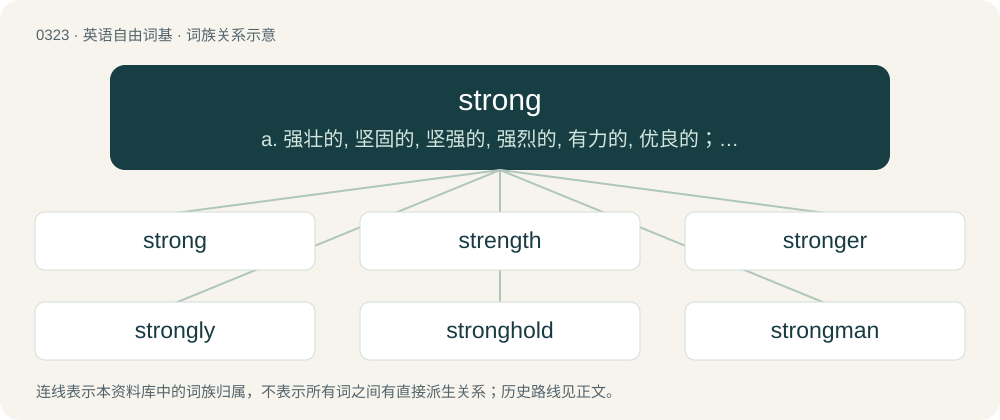

# 0367 · strong — a. 强壮的, 坚固的, 坚强的, 强烈的, 有力的, 优良的；adv. 强劲地, 有力地, 猛烈地

[总目录](../00_总目录_按常用程度.md)

**类型**：英语自由词基　｜　**来源语言**：见词源记录

## 核心含义与来源

- 核心含义：a. 强壮的, 坚固的, 坚强的, 强烈的, 有力的, 优良的；adv. 强劲地, 有力地, 猛烈地
- 英文含义：Capable of producing great physical force.
- 词形：strong

**来源记录 1**（形容词；Capable of producing great physical force.）

From Middle English strong, strang, from Old English strang (“strong”), from Proto-West Germanic \*strang (“severe, strict, rigorous, strong”), from Proto-Germanic \*strangaz (“tight, strict, straight, strong”), from Proto-Indo-European \*strengʰ- (“taut, stiff, tight”). Cognate with Scots strang (“strong”), West Frisian strang, string (“strict, harsh, severe, stern, stark, tough, strong, intense”), Dutch streng (“strict, severe, tight”), dialectal Dutch strang (“tight, strict, powerful, intense, mighty, strong”), German streng (“strict, severe, austere”), Danish and Norwegian streng (“strong, hard”), Norwegian strang (“strong, harsh, bitter”), Swedish sträng, strang (“severe, strict, harsh”), Faroese and Icelandic strangur (“strict”), Latin stringō (“tighten”). Related to strict and string.

## 词族图

## 单词速览（常用到不常用）

| 单词 | 音标 | 释义 |
|---|---|---|
| [strong](#w-1) | 英 /stɹɒŋ/；美 /stɹɔŋ/ | a. 强壮的, 坚固的, 坚强的, 强烈的, 有力的, 优良的；adv. 强劲地, 有力地, 猛烈地 |
| [strength](#w-2) | 美 /ˈstɹeɪŋθ/；/ˈstɹɛŋθ/ | n. 力量, 实力, 强度, 浓度, 人数, 抵抗力；\[化\] 强度 |
| [stronger](#w-3) | 英 /stɹɒŋɡə/；美 /stɹɔŋɡɚ/ | \[经\] 强劲的 |
| [strongly](#w-4) | 英 /ˈstɹɒŋli/；美 /ˈstɹɔŋli/ | adv. 强有力地, 坚强地, 激烈地 |
| [stronghold](#w-5) | 英 /ˈstɹɒŋhəʊld/；美 /ˈstɹɔŋˌhoʊld/ | n. 要塞, 堡垒, 大本营 |
| [strongman](#w-6) | /ˈstrɒŋmæn/ | n. 大力士 |
| [headstrong](#w-7) | /ˈhedstrɒŋ/ | a. 顽固的, 刚愎的, 任性的 |

## 逐词详解

### 1. strong

**词性**：形容词　｜　**音标**：英 /stɹɒŋ/；美 /stɹɔŋ/

**中文释义**：a. 强壮的, 坚固的, 坚强的, 强烈的, 有力的, 优良的；adv. 强劲地, 有力地, 猛烈地

**英文义项**：Capable of producing great physical force. / Capable of withstanding great physical force.

**词源与演化**：

From Middle English strong, strang, from Old English strang (“strong”), from Proto-West Germanic \*strang (“severe, strict, rigorous, strong”), from Proto-Germanic \*strangaz (“tight, strict, straight, strong”), from Proto-Indo-European \*strengʰ- (“taut, stiff, tight”). Cognate with Scots strang (“strong”), West Frisian strang, string (“strict, harsh, severe, stern, stark, tough, strong, intense”), Dutch streng (“strict, severe, tight”), dialectal Dutch strang (“tight, strict, powerful, intense, mighty, strong”), German streng (“strict, severe, austere”), Danish and Norwegian streng (“strong, hard”), Norwegian strang (“strong, harsh, bitter”), Swedish sträng, strang (“severe, strict, harsh”), Faroese and Icelandic strangur (“strict”), Latin stringō (“tighten”). Related to strict and string.

**例句**：

> The man was nearly drowned after a strong undercurrent swept him out to sea.

该用例对应义项：Capable of producing great physical force.

### 2. strength

**词性**：名词　｜　**音标**：美 /ˈstɹeɪŋθ/；/ˈstɹɛŋθ/

**中文释义**：n. 力量, 实力, 强度, 浓度, 人数, 抵抗力；\[化\] 强度

**英文义项**：The quality or degree of being strong. / The intensity of a force or power; potency.

**构词拆分**：strong + -th (abstract nominal suffix)

**词源与演化**：

From Middle English strengthe, from Old English strengþu (“strength”), from Proto-West Germanic \*strangiþu (“strongness; strength”), equivalent to strong + -th (abstract nominal suffix). Cognate with Dutch strengte (“strength”), German Low German Strengde, Strengte (“harshness; rigidity; strictness; severity”).

**例句**：

> It requires great strength to lift heavy objects.

该用例对应义项：The quality or degree of being strong.

### 3. stronger

**词性**：形容词　｜　**音标**：英 /stɹɒŋɡə/；美 /stɹɔŋɡɚ/

**中文释义**：\[经\] 强劲的

**英文义项**：Said of one proposition with respect to another one: that the former entails the latter, but the latter does not entail the former. / Better.

**构词拆分**：strong + -er

**词源与演化**：

From Middle English strongere, strengere (“stronger”), from Old English strongra, strengra (“stronger”), from Proto-Germanic \*strangizô (“\*stronger”), comparative of Proto-Germanic \*strangaz (“strong”), equivalent to strong + -er. More at strong.

**例句**：

> Compared to the previous semester, my grades now are a lot stronger.

该用例对应义项：Better.

### 4. strongly

**词性**：副词　｜　**音标**：英 /ˈstɹɒŋli/；美 /ˈstɹɔŋli/

**中文释义**：adv. 强有力地, 坚强地, 激烈地

**英文义项**：In a strong or powerful manner. / Very much.

**构词拆分**：strong + -ly

**词源与演化**：

From Middle English strongliche, strangliche, from Old English stranglīċe (“strongly”), equivalent to strong + -ly.

**例句**：

> In the third race, Renowned Blaze finished strongly to win, paying sixteen dollars.

该用例对应义项：In a strong or powerful manner.

### 5. stronghold

**词性**：名词　｜　**音标**：英 /ˈstɹɒŋhəʊld/；美 /ˈstɹɔŋˌhoʊld/

**中文释义**：n. 要塞, 堡垒, 大本营

**英文义项**：A place built to withstand attack; a fortress. / A place of domination by, or refuge or survival of, a particular group or idea.

**构词拆分**：By surface analysis, strong + hold

**词源与演化**：

From Middle English stranghalde, strong-hold, strong-holde, from strong (“having physical strength, sturdy, strong; built to withstand assaults, fortified”) (from Old English strang, strong (“strong”), ultimately from Proto-Indo-European \*strengʰ- (“stiff, tight”)) + hōld (“grasp, grip; control, possession, rule”) (from Old English). By surface analysis, strong + hold.

**用法示例／搭配（非完整句）**：

> the last stronghold of the Cornish language

该用例对应义项：A place of domination by, or refuge or survival of, a particular group or idea.

### 6. strongman

**词性**：名词　｜　**音标**：/ˈstrɒŋmæn/

**中文释义**：n. 大力士

**英文义项**：A man who performs feats of strength, as in competitions or as an attraction in a circus. / A forceful or brutal person, usually a ruler or tyrant.

**构词拆分**：strong + -man

**词源与演化**：

From strong + -man.

**例句**：

> He is determined to bring down the Iraqi strongman.

该用例对应义项：a powerful political figure who rules by the exercise of force or violence

### 7. headstrong

**词性**：形容词　｜　**音标**：/ˈhedstrɒŋ/

**中文释义**：a. 顽固的, 刚愎的, 任性的

**英文义项**：Determined to do as one pleases, and not as others want.

**构词拆分**：head + strong

**词源与演化**：

From Middle English heedstrong, equivalent to head + strong.

**例句**：

> He was in that headstrong teenage phase when he felt like he knew everything.

该用例对应义项：Determined to do as one pleases, and not as others want.
