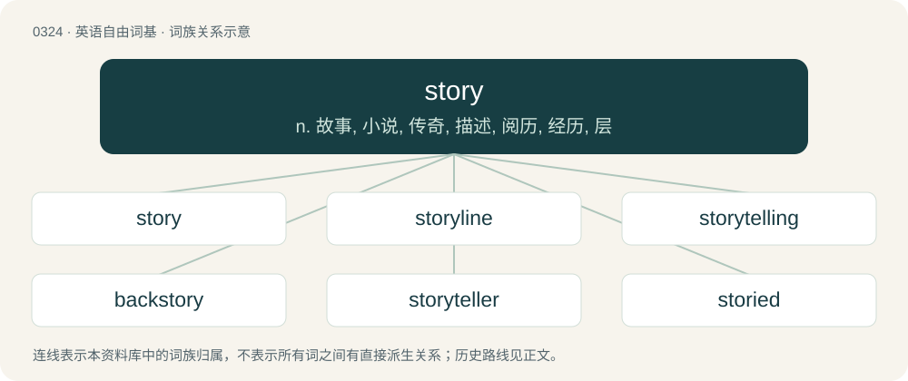

# 0368 · story — n. 故事, 小说, 传奇, 描述, 阅历, 经历, 层

[总目录](../00_总目录_按常用程度.md)

**类型**：英语自由词基　｜　**来源语言**：见词源记录

## 核心含义与来源

- 核心含义：n. 故事, 小说, 传奇, 描述, 阅历, 经历, 层
- 英文含义：An account of real or fictional events.
- 词形：story

**多个词源／构词路径**：同一拼写可能有不同来源；以下按词性和含义分别列出。

**来源记录 1**（名词；An account of real or fictional events.）

From Middle English storie, storye, from Anglo-Norman estorie by aphesis, from Latin historia, from Ancient Greek ῐ̔στορῐ́ᾱ (hĭstorĭ́ā, “learning through research”). Doublet of history and storey.

**来源记录 2**（感叹词；Used as a greeting, short for what's the story?）

Alternative form of what's the story (“how are you?”)

## 词族图

## 单词速览（常用到不常用）

| 单词 | 音标 | 释义 |
|---|---|---|
| [story](#w-1) | 英 /ˈstɔː.ɹi/；美 /ˈstɔ.ɹi/ | n. 故事, 小说, 传奇, 描述, 阅历, 经历, 层 |
| [storyline](#w-2) |  | n. 故事情节 |
| [storytelling](#w-3) | /ˈstɒːriteliŋ/ | n. 说故事, 说谎话 |
| [backstory](#w-4) | 英 /ˈbækˌstɔːɹi/；美 /ˈbækˌstɔɹi/ | （电影、小说等的）幕后故事, 故事背景 |
| [storyteller](#w-5) | /ˈstɒːritelə/ | n. 说故事的人, 故事作者 |
| [storied](#w-6) | /ˈstɔːɹid/ | a. 传说上有名的, 以历史画装饰的, 分层的 |
| [storybook](#w-7) | /ˈstɒːribuk/ | n. 故事书, 小说 |
| [storyboard](#w-8) | /ˈstɔːribɔːd/ | n. （电影、电视节目或商业广告等的）情节串连图板 |
| [storytime](#w-9) |  | 【英文】The time at which a story is told. |
| [understory](#w-10) | 英 /ˈʌndəstɔːɹi/；美 /ˈʌndɚˌstoɹi/ | 林下叶层 |

## 逐词详解

### 1. story

**词性**：名词　｜　**音标**：英 /ˈstɔː.ɹi/；美 /ˈstɔ.ɹi/

**中文释义**：n. 故事, 小说, 传奇, 描述, 阅历, 经历, 层

**英文义项**：An account of real or fictional events. / A lie, fiction.

**词源与演化**：

From Middle English storie, storye, from Anglo-Norman estorie by aphesis, from Latin historia, from Ancient Greek ῐ̔στορῐ́ᾱ (hĭstorĭ́ā, “learning through research”). Doublet of history and storey.

**例句**：

> I tried it again; same story, no error message, nothing happened.

该用例对应义项：A sequence of events, or a situation, such as might be related in an account.

### 2. storyline

**词性**：名词

**中文释义**：n. 故事情节

**英文义项**：The plot of a story; one of several within a story, usually interwoven. / A narrative description of a given modeling scenario, highlighting its main characteristics and underlying technical and socioeconomic drivers.

**构词拆分**：story + line

**词源与演化**：

From story + line. The climate science usage is defined in the IPCC WG III AR5 report (2014).

**例句**：

> That film had a wonderful storyline, but the poor acting let it down.

该用例对应义项：The plot of a story; one of several within a story, usually interwoven.

### 3. storytelling

**词性**：名词　｜　**音标**：/ˈstɒːriteliŋ/

**中文释义**：n. 说故事, 说谎话

**英文义项**：The act and skills of presenting stories and tales.

**构词拆分**：story + telling

**词源与演化**：

From story + telling.

**例句**：

> His Italian heritage influences his passion for art, music, and storytelling.

### 4. backstory

**词性**：名词　｜　**音标**：英 /ˈbækˌstɔːɹi/；美 /ˈbækˌstɔɹi/

**中文释义**：（电影、小说等的）幕后故事, 故事背景

**英文义项**：The previous experiences and life of a person, specifically (narratology, especially in film, television) a character in a dramatic work. / A fictitious account of a person's history designed to conceal their actual history and motives.

**构词拆分**：back- (prefix meaning ‘in, into, or towards the past’) + story

**词源与演化**：

From back- (prefix meaning ‘in, into, or towards the past’) + story.

**例句**：

> What’s the backstory of our new colleague?

该用例对应义项：The previous experiences and life of a person, specifically (narratology, especially in film, television) a character in a dramatic work.

### 5. storyteller

**词性**：名词　｜　**音标**：/ˈstɒːritelə/

**中文释义**：n. 说故事的人, 故事作者

**英文义项**：A person who relates stories through one medium or another to an audience. / A liar; a fibber.

**构词拆分**：story + teller

**词源与演化**：

From story + teller.

**例句**：

> Tom is a wonderful storyteller, but his spelling is atrocious.

### 6. storied

**词性**：形容词　｜　**音标**：/ˈstɔːɹid/

**中文释义**：a. 传说上有名的, 以历史画装饰的, 分层的

**英文义项**：Much discussed or written about. / Historical.

**构词拆分**：From story + -ed.

**词源与演化**：

From story + -ed.

**例句**：

> They marveled at the storied ruins of the temple.

### 7. storybook

**词性**：名词　｜　**音标**：/ˈstɒːribuk/

**中文释义**：n. 故事书, 小说

**英文义项**：A book containing stories, especially children's stories.

**构词拆分**：story + book

**词源与演化**：

From story + book.

**例句**：

> The curtains are adorned with patterns from his favorite storybook.

### 8. storyboard

**词性**：名词　｜　**音标**：/ˈstɔːribɔːd/

**中文释义**：n. （电影、电视节目或商业广告等的）情节串连图板

**英文义项**：A series of drawings that lay out the sequence of scenes in a film or series, especially an animated one. / Any sequence of drawings or diagrams which illustrate a sequence of events, e.g. in an accident or as a flowsheet for computer programming.

**构词拆分**：story + board

**词源与演化**：

From story + board.

### 9. storytime

**词性**：名词

**英文义项**：The time at which a story is told.

**构词拆分**：story + time

**词源与演化**：

From story + time.

**例句**：

> Sami is a fan of storytime videos.

### 10. understory

**词性**：名词　｜　**音标**：英 /ˈʌndəstɔːɹi/；美 /ˈʌndɚˌstoɹi/

**中文释义**：林下叶层

**英文义项**：A story of a building below the stories generally used for residence or work. / The (layer of) plants that grow in the shade of the canopy of a forest above the forest floor.

**构词拆分**：under- (prefix meaning ‘beneath, under’) + story (“a floor or level”)

**词源与演化**：

From under- (prefix meaning ‘beneath, under’) + story (“a floor or level”).
