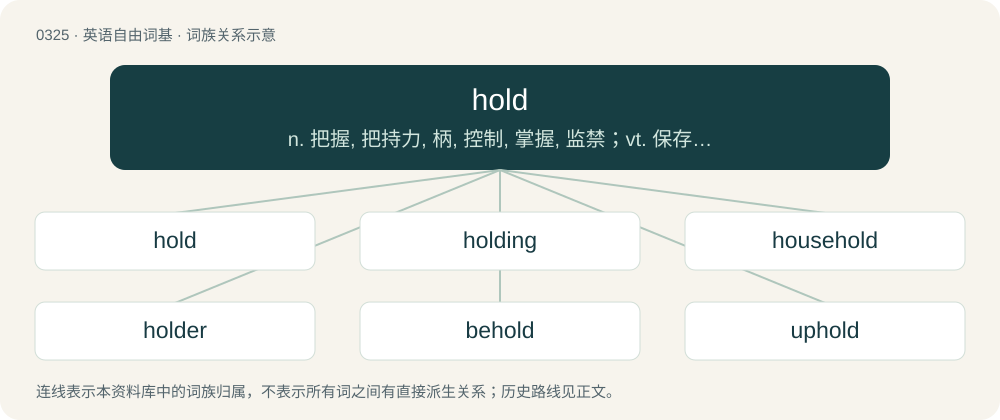

# 0372 · hold — n. 把握, 把持力, 柄, 控制, 掌握, 监禁；vt. 保存, 握住, 拿住, 占据, 持有, 拥有；vi. 支持, 持续, 有效

[总目录](../00_总目录_按常用程度.md)

**类型**：英语自由词基　｜　**来源语言**：见词源记录

## 核心含义与来源

- 核心含义：n. 把握, 把持力, 柄, 控制, 掌握, 监禁；vt. 保存, 握住, 拿住, 占据, 持有, 拥有；vi. 支持, 持续, 有效
- 英文含义：To grasp or grip.
- 词形：hold

**多个词源／构词路径**：同一拼写可能有不同来源；以下按词性和含义分别列出。

**来源记录 1**（动词；To grasp or grip.）

Derived from Middle English holden, derived from Old English healdan, derived from Proto-West Germanic \*haldan, derived from Proto-Germanic \*haldaną (“to tend, herd”), maybe derived from Proto-Indo-European \*kel- (“to drive”). Doublet of halt. Cognates \*West Frisian hâlde \*Low German holden, holen \*Dutch houden \*German halten \*Danish \*Norwegian Bokmål holde \*Norwegian Nynorsk halda. Compare Latin celer (“quick”), Tocharian B käl- (“to goad, drive”), Ancient Greek κέλλω (kéllō, “to drive”), Sanskrit कलयति (kalayati, “to impel”).

**来源记录 2**（名词；The cargo area of a ship or aircraft (often holds or cargo hold).）

Alteration (due to hold) of hole. Cognate with Dutch hol (“hole, cave, den, cavity, cargo hold”), Dutch holte (“cavity, hollow, den”).

## 词族图

## 单词速览（常用到不常用）

| 单词 | 音标 | 释义 |
|---|---|---|
| [hold](#w-1) | 英 /həʊld/；美 /hoʊld/ | n. 把握, 把持力, 柄, 控制, 掌握, 监禁；vt. 保存, 握住, 拿住, 占据, 持有, 拥有；vi. 支持, 持续, 有效 |
| [holding](#w-2) | /ˈhəʊldɪŋ/ | n. 把持, 支持, 保持；\[法\] 租借地, 占有物, 拥有的财产 |
| [household](#w-3) | 英 /ˈhaʊshəʊld/；美 /ˈhaʊshoʊld/ | n. 一家人, 家庭, 家族, 王室；a. 家庭的, 家常的, 王室的 |
| [holder](#w-4) | 英 /ˈhəʊldə/；美 /ˈhoʊɫdɚ/ | n. 持有人, 所有人, 支持物；\[化\] 夹持器; 夹具; 贮罐 |
| [behold](#w-5) | 英 /bɪˈhəʊld/；美 /bɪˈhoʊld/ | vt. 看到, 注视；vi. 看 |
| [uphold](#w-6) | /ˌʌpˈhəʊld/ | vt. 支撑, 赞成, 鼓励, 举起, 坚持；\[法\] 确认, 赞成, 支持 |
| [stronghold](#w-7) | 英 /ˈstɹɒŋhəʊld/；美 /ˈstɹɔŋˌhoʊld/ | n. 要塞, 堡垒, 大本营 |
| [withhold](#w-8) | 英 /wɪθˈhəʊld/；美 /wɪθˈhoʊld/ | vt. 使停止, 扣留, 保留, 拒给；vi. 克制, 忍住 |
| [foothold](#w-9) | /ˈfʊthoʊld/ | n. 立足处, 据点, 根据地 |
| [ahold](#w-10) | /əˈhoʊld/ | n. 抓, 握；adv. 迎风航驶 |
| [stranglehold](#w-11) | /ˈstræŋglhəuld/ | n. 勒颈, 压制自由, 抑制, 束缚 |
| [leasehold](#w-12) | /ˈliːshəuld/ | a. 租赁的；n. 租赁权, 租赁 |
| [chokehold](#w-13) | 英 /ˈt͡ʃəʊkhəʊld/；美 /ˈt͡ʃoʊkˌ(h)oʊld/ | n. 掐脖子; 压制 |

## 逐词详解

### 1. hold

**词性**：动词　｜　**音标**：英 /həʊld/；美 /hoʊld/

**中文释义**：n. 把握, 把持力, 柄, 控制, 掌握, 监禁；vt. 保存, 握住, 拿住, 占据, 持有, 拥有；vi. 支持, 持续, 有效

**英文义项**：To grasp or grip. / To contain or store.

**词源与演化**：

Derived from Middle English holden, derived from Old English healdan, derived from Proto-West Germanic \*haldan, derived from Proto-Germanic \*haldaną (“to tend, herd”), maybe derived from Proto-Indo-European \*kel- (“to drive”). Doublet of halt. Cognates \*West Frisian hâlde \*Low German holden, holen \*Dutch houden \*German halten \*Danish \*Norwegian Bokmål holde \*Norwegian Nynorsk halda. Compare Latin celer (“quick”), Tocharian B käl- (“to goad, drive”), Ancient Greek κέλλω (kéllō, “to drive”), Sanskrit कलयति (kalayati, “to impel”).

**例句**：

> The general ordered the colonel to hold his position at all costs.

该用例对应义项：To have and keep possession of something.

### 2. holding

**词性**：名词　｜　**音标**：/ˈhəʊldɪŋ/

**中文释义**：n. 把持, 支持, 保持；\[法\] 租借地, 占有物, 拥有的财产

**英文义项**：Something that one owns, especially stocks and bonds. / A determination of law made by a court.

**构词拆分**：hold + -ing

**词源与演化**：

From hold + -ing. The sense "holding company" is from Russian холдинг (xolding), a pseudo-anglicism derived from an ellipsis of holding company.

**例句**：

> Indicate the applicable numeral, by holding up the corresponding number of fingers.

### 3. household

**词性**：形容词　｜　**音标**：英 /ˈhaʊshəʊld/；美 /ˈhaʊshoʊld/

**中文释义**：n. 一家人, 家庭, 家族, 王室；a. 家庭的, 家常的, 王室的

**英文义项**：Belonging to the same house and family. / Found in or having its origin in a home.

**构词拆分**：By surface analysis, house + hold

**词源与演化**：

From Middle English houshold. By surface analysis, house + hold. Cognate with Scots houshald, housald, housell, howsell (“household”), Dutch huishouden (“household”) (earlier huishoud), German Low German Huushollen (“household”) (Middle Low German hūsholt), German Haushalt (“household”), Swedish hushåll (“household, family”), Norwegian husholdning (“household”).

**用法示例／搭配（非完整句）**：

> a household word; a household name

该用例对应义项：Widely known to the public; familiar.

### 4. holder

**词性**：名词　｜　**音标**：英 /ˈhəʊldə/；美 /ˈhoʊɫdɚ/

**中文释义**：n. 持有人, 所有人, 支持物；\[化\] 夹持器; 夹具; 贮罐

**英文义项**：A thing that holds. / A person who temporarily or permanently possesses something.

**构词拆分**：hold + -er

**词源与演化**：

From hold + -er.

**例句**：

> In 2012, there were 28 living holders of the Victoria Cross or the George Cross.

该用例对应义项：A person who temporarily or permanently possesses something.

### 5. behold

**词性**：动词　｜　**音标**：英 /bɪˈhəʊld/；美 /bɪˈhoʊld/

**中文释义**：vt. 看到, 注视；vi. 看

**英文义项**：To look at or see (someone or something), especially appreciatively; to descry, to look upon. / To contemplate (someone or something).

**构词拆分**：be- + hold

**词源与演化**：

From Middle English biholden, from Old English behealdan (“to hold, possess, preserve, belong, keep, observe, look at, take care, beware, be cautious, restrain, act, behave”), from Proto-West Germanic \*bihaldan (“to hold with, keep”), equivalent to be- + hold. Cognate with Saterland Frisian behoolde (“to keep”), Dutch behouden (“to keep, restrain, preserve”), German behalten (“to keep, restrain, remember”), Danish and Norwegian beholde (“to keep”) and Swedish behålla (“to keep”).

**用法示例／搭配（非完整句）**：

> Lo and behold.

该用例对应义项：To look.

### 6. uphold

**词性**：动词　｜　**音标**：/ˌʌpˈhəʊld/

**中文释义**：vt. 支撑, 赞成, 鼓励, 举起, 坚持；\[法\] 确认, 赞成, 支持

**英文义项**：To hold up; to lift on high; to elevate. / To keep erect; to support; to sustain; to keep from falling.

**构词拆分**：up- + hold

**词源与演化**：

From Middle English upholden, equivalent to up- + hold. Compare Dutch ophouden (“to stop, cease, hold up”), German aufhalten (“to stop, halt, detain”). Compare also Middle Low German upholt, Old Norse upphald (“uphold, support”).

**例句**：

> During the war, these guys sacrificed their life to uphold our freedom.

### 7. stronghold

**词性**：名词　｜　**音标**：英 /ˈstɹɒŋhəʊld/；美 /ˈstɹɔŋˌhoʊld/

**中文释义**：n. 要塞, 堡垒, 大本营

**英文义项**：A place built to withstand attack; a fortress. / A place of domination by, or refuge or survival of, a particular group or idea.

**构词拆分**：By surface analysis, strong + hold

**词源与演化**：

From Middle English stranghalde, strong-hold, strong-holde, from strong (“having physical strength, sturdy, strong; built to withstand assaults, fortified”) (from Old English strang, strong (“strong”), ultimately from Proto-Indo-European \*strengʰ- (“stiff, tight”)) + hōld (“grasp, grip; control, possession, rule”) (from Old English). By surface analysis, strong + hold.

**用法示例／搭配（非完整句）**：

> the last stronghold of the Cornish language

该用例对应义项：A place of domination by, or refuge or survival of, a particular group or idea.

### 8. withhold

**词性**：动词　｜　**音标**：英 /wɪθˈhəʊld/；美 /wɪθˈhoʊld/

**中文释义**：vt. 使停止, 扣留, 保留, 拒给；vi. 克制, 忍住

**英文义项**：To keep (a physical object that one has obtained) to oneself rather than giving it back to its owner. / To keep (information, assent, etc.) to oneself rather than revealing it.

**构词拆分**：with- + hold

**词源与演化**：

From Middle English withholden. Equivalent to with- + hold.

**例句**：

> I’ll withhold from asking about it.

该用例对应义项：To stay back, to refrain.

### 9. foothold

**词性**：名词　｜　**音标**：/ˈfʊthoʊld/

**中文释义**：n. 立足处, 据点, 根据地

**英文义项**：A solid grip with the feet. / A secure position from which it is difficult to be dislodged.

**构词拆分**：foot + hold

**词源与演化**：

From foot + hold.

**例句**：

> Britain is apparently working to get a foothold in Algeria.

### 10. ahold

**词性**：名词　｜　**音标**：/əˈhoʊld/

**中文释义**：n. 抓, 握；adv. 迎风航驶

**英文义项**：A hold, grip, grasp.

**构词拆分**：a + hold

**词源与演化**：

From a + hold.

**例句**：

> Pepper spray is great, unless the assailant gets ahold of it.

### 11. stranglehold

**词性**：名词　｜　**音标**：/ˈstræŋglhəuld/

**中文释义**：n. 勒颈, 压制自由, 抑制, 束缚

**英文义项**：A grip or control so strong as to stifle or cut off.

**构词拆分**：strangle + hold

**词源与演化**：

From strangle + hold.

**例句**：

> For years the company had a stranglehold on the rest of the industry.

该用例对应义项：A grip or control so strong as to stifle or cut off.

### 12. leasehold

**词性**：形容词　｜　**音标**：/ˈliːshəuld/

**中文释义**：a. 租赁的；n. 租赁权, 租赁

**英文义项**：Of an estate in land, held for a term of years absolute by a lessee or tenant.

**构词拆分**：lease + hold

**词源与演化**：

From lease + hold.

### 13. chokehold

**词性**：名词　｜　**音标**：英 /ˈt͡ʃəʊkhəʊld/；美 /ˈt͡ʃoʊkˌ(h)oʊld/

**中文释义**：n. 掐脖子; 压制

**英文义项**：A grappling hold around a person's neck, especially one in which the neck is grasped tightly from behind with an arm, cutting off the flow of blood to the brain and restricting breathing. / A powerful and restrictive control or influence over something.

**构词拆分**：choke (verb) + hold (noun)

**词源与演化**：

The noun is derived from choke (verb) + hold (noun). The verb is derived from the noun.

**例句**：

> One country has a chokehold on another country's economy.

该用例对应义项：A powerful and restrictive control or influence over something.
