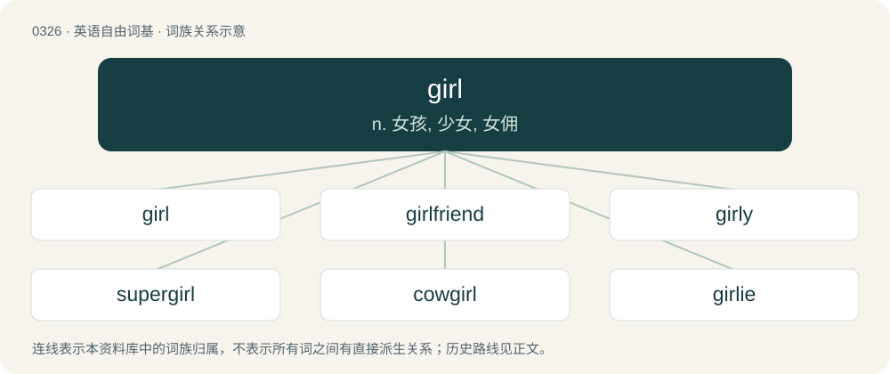

# 0373 · girl — n. 女孩, 少女, 女佣

[总目录](../00_总目录_按常用程度.md)

**类型**：英语自由词基　｜　**来源语言**：见词源记录

## 核心含义与来源

- 核心含义：n. 女孩, 少女, 女佣
- 英文含义：A female child.
- 词形：girl

**来源记录 1**（名词；A female child.）

From Middle English gerle, girle, gyrle (“young person (boy or girl)”), perhaps from Old English \*gyrele, from Proto-West Germanic \*gurilā, from a zero-grade diminutive of \*gaurā (“young child”) + \*-ilā. Ultimately of unknown origin. Doublet of gal/gyal and gyaru. Cognates Cognate with Yola gurl (“child, girl”), German Gör, Göre (“brat, cheeky young child”), Low German Gör (“child”).

## 词族图

## 单词速览（常用到不常用）

| 单词 | 音标 | 释义 |
|---|---|---|
| [girl](#w-1) | 英 /ˈɡɜːl/；美 /ˈɡɜɹl/ | n. 女孩, 少女, 女佣 |
| [girlfriend](#w-2) | 英 /ˈɡɜːlfɹɛnd/；美 /ˈɡɝlfɹɛnd/ | n. 女朋友 |
| [girly](#w-3) | 英 /ˈɡɜːli/；美 /ˈɡɝli/ | a. 像少女的 |
| [supergirl](#w-4) |  | \[电影\]女超人 |
| [cowgirl](#w-5) | 美 /ˈkaʊˌɡɝl/ | n. 女牛仔 |
| [girlie](#w-6) | /ˈgəːli/ | n. 少女 |
| [batgirl](#w-7) | /ˈbætˌgɜːl/ | 棒球女球童 |
| [girlish](#w-8) | 英 /ˈɡɜː.lɪʃ/；美 /ˈɡɝ.lɪʃ/ | a. 少女的, 少女似的, 适于女子的 |
| [fangirl](#w-9) | 美 /ˈfænˌɡɝl/ | 脑残粉; 指的是那些极度痴迷于某事物或某明星的粉丝，甚至狂热到失去理智的地步 |
| [showgirl](#w-10) | /ˈʃəj^\\\\ːl/ | n. 广告女郎；歌舞女郎 |
| [girlhood](#w-11) | /ˈgəːlhud/ | n. 少女时代, 少女们 |
| [homegirl](#w-12) | 美 /ˈhoʊmˌɡɝl/ | n. 闺蜜 |

## 逐词详解

### 1. girl

**词性**：名词　｜　**音标**：英 /ˈɡɜːl/；美 /ˈɡɜɹl/

**中文释义**：n. 女孩, 少女, 女佣

**英文义项**：A female child. / A woman, especially a young and often attractive woman.

**词源与演化**：

From Middle English gerle, girle, gyrle (“young person (boy or girl)”), perhaps from Old English \*gyrele, from Proto-West Germanic \*gurilā, from a zero-grade diminutive of \*gaurā (“young child”) + \*-ilā. Ultimately of unknown origin. Doublet of gal/gyal and gyaru. Cognates Cognate with Yola gurl (“child, girl”), German Gör, Göre (“brat, cheeky young child”), Low German Gör (“child”).

**例句**：

> He has a crush on a girl at work. We were kidding with him yesterday about his work crush.

该用例对应义项：A woman, especially a young and often attractive woman.

### 2. girlfriend

**词性**：名词　｜　**音标**：英 /ˈɡɜːlfɹɛnd/；美 /ˈɡɝlfɹɛnd/

**中文释义**：n. 女朋友

**英文义项**：A female partner in an unmarried romantic relationship. / A female friend of a woman or girl.

**构词拆分**：girl + friend

**词源与演化**：

From girl + friend.

**例句**：

> Marc went to the park with his girlfriend and watched the sunset with her.

该用例对应义项：A female partner in an unmarried romantic relationship.

### 3. girly

**词性**：形容词　｜　**音标**：英 /ˈɡɜːli/；美 /ˈɡɝli/

**中文释义**：a. 像少女的

**英文义项**：Characteristic of a stereotypical girl, very effeminate, gentle; unmasculine. / Of, or pertaining to, a young, attractive woman; especially one who is scantily clad.

**构词拆分**：girl + -y

**词源与演化**：

From girl + -y (adjectival sufix).

**用法示例／搭配（非完整句）**：

> a girly calendar

该用例对应义项：Of, or pertaining to, a young, attractive woman; especially one who is scantily clad.

### 4. supergirl

**词性**：名词

**中文释义**：\[电影\]女超人

**英文义项**：A girl who is particularly successful, talented, or otherwise remarkable.

**构词拆分**：super- + girl

**词源与演化**：

From super- + girl. The DC Comics heroine Supergirl first appeared in May 1959.

### 5. cowgirl

**词性**：名词　｜　**音标**：美 /ˈkaʊˌɡɝl/

**中文释义**：n. 女牛仔

**英文义项**：A woman who tends free-range cattle, especially in the American West. / A woman who identifies with cowboy culture, including clothing such as the cowboy hat.

**构词拆分**：cow + girl

**词源与演化**：

From cow + girl.

**例句**：

> This year, my sister is dressing up as a cowgirl.

### 6. girlie

**词性**：名词　｜　**音标**：/ˈgəːli/

**中文释义**：n. 少女

**英文义项**：A magazine targeting an adult male audience and containing nude or seminude photographs of women. / A young girl.

**构词拆分**：girl + -ie

**词源与演化**：

From girl + -ie.

**例句**：

> When Grandma came to visit, the boy hid the girlies in his dresser so she wouldn't see them.

该用例对应义项：A magazine targeting an adult male audience and containing nude or seminude photographs of women.

### 7. batgirl

**词性**：名词　｜　**音标**：/ˈbætˌgɜːl/

**中文释义**：棒球女球童

**英文义项**：The female equivalent of a batboy.

**构词拆分**：bat + girl

**词源与演化**：

From bat + girl.

### 8. girlish

**词性**：形容词　｜　**音标**：英 /ˈɡɜː.lɪʃ/；美 /ˈɡɝ.lɪʃ/

**中文释义**：a. 少女的, 少女似的, 适于女子的

**英文义项**：Like (that of) a girl; feminine.

**构词拆分**：girl + -ish

**词源与演化**：

From girl + -ish.

**例句**：

> Her girlish complexion belied the fact that she was over forty.

### 9. fangirl

**词性**：名词　｜　**音标**：美 /ˈfænˌɡɝl/

**中文释义**：脑残粉; 指的是那些极度痴迷于某事物或某明星的粉丝，甚至狂热到失去理智的地步

**英文义项**：A female fan who is obsessive about a particular subject (especially, someone or something in popular entertainment media).

**构词拆分**：fan + girl

**词源与演化**：

From fan + girl.

### 10. showgirl

**词性**：名词　｜　**音标**：/ˈʃəj^\\\\ːl/

**中文释义**：n. 广告女郎；歌舞女郎

**英文义项**：A female performer in any of various (usually live) entertainment roles, usually including dancing and singing, often exotically or provocatively costumed.

**构词拆分**：show + girl

**词源与演化**：

From show + girl.

**例句**：

> She was a Las Vegas showgirl when she was younger.

该用例对应义项：A female performer in any of various (usually live) entertainment roles, usually including dancing and singing, often exotically or provocatively costumed.

### 11. girlhood

**词性**：名词　｜　**音标**：/ˈgəːlhud/

**中文释义**：n. 少女时代, 少女们

**英文义项**：The state or condition of being a girl. / The childhood of a girl.

**构词拆分**：girl + -hood

**词源与演化**：

From girl + -hood.

**例句**：

> We don't know much of Skura's girlhood in Algeria.

### 12. homegirl

**词性**：名词　｜　**音标**：美 /ˈhoʊmˌɡɝl/

**中文释义**：n. 闺蜜

**英文义项**：A female friend. / A female co-member of a gang.

**构词拆分**：home + girl

**词源与演化**：

From home + girl; compare homeboy.
